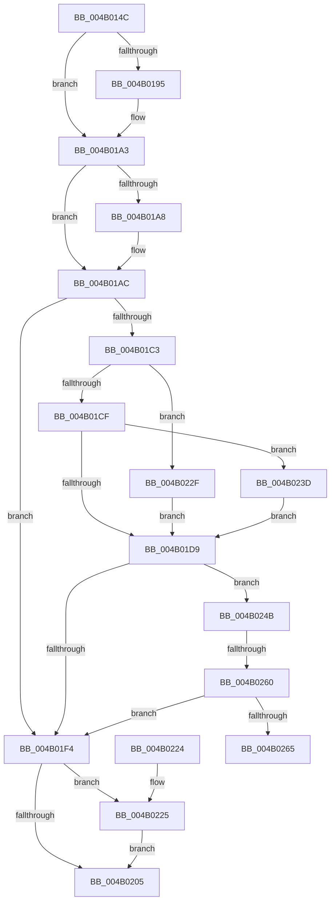

# KsepShimDbChanged

- RVA: `0x004B014C`–`0x004B026F` (길이 `291` bytes)
- VA: `0x00000001404B014C`
- 실행 섹션: `.text`
- PDB 이름 있음: `예`; PDB Function 태그: `예`
- unwind 정보 RVA: `0x000B88D4`
- 디코드: `73`개 명령, `291/291` bytes 표시
- 미해석 바이트: `0` (있으면 어셈블리에 `.byte`로 보존)

> 이 문서는 커널 이미지의 기계어와 PDB 기호를 분석해 생성했습니다. 4번과 5번은 함수 원형과 자료형을 바이너리 사용 방식에서 추정한 C 해석이며 원본 소스 복구 결과는 아닙니다.

## 1. Dependencies

- 직접 호출 지점: **7**; 고유 호출 대상: **6**
- 직접 호출자로 확인된 함수: **2**
- RIP 상대 이미지 참조: **7**

### Outgoing calls
- `0x004B0185` → [KeAbPreAcquire](../21/KeAbPreAcquire_function_00210230.md) (function, `0x00210230`)
- `0x004B019E` → [ExfAcquirePushLockExclusiveEx](../20/ExfAcquirePushLockExclusiveEx_function_0020FC90.md) (function, `0x0020FC90`)
- `0x004B01BA` → [KsepShimDatabaseTime](../../page/A7/KsepShimDatabaseTime_function_00A79684.md) (function, `0x00A79684`)
- `0x004B01EB` → [KsepShimDatabaseTime](../../page/A7/KsepShimDatabaseTime_function_00A79684.md) (function, `0x00A79684`)
- `0x004B0208` → [KeAbPostRelease](../2E/KeAbPostRelease_function_002E1600.md) (function, `0x002E1600`)
- `0x004B020D` → [KeLeaveCriticalRegion](../25/KeLeaveCriticalRegion_function_0025D8B0.md) (function, `0x0025D8B0`)
- `0x004B0228` → [ExfTryToWakePushLock](../26/ExfTryToWakePushLock_function_00265DD0.md) (function, `0x00265DD0`)

### Direct callers
- [KseQueryDeviceDataList](../../page/95/KseQueryDeviceDataList_function_00959390.md) at `0x0095941F`
- [KseQueryDeviceData](../../page/95/KseQueryDeviceData_function_0095AFB0.md) at `0x0095B06E`

### Static image references
- `0x004B0164` → RVA `0x00F10670` (`.data`; read)
- `0x004B01B3` → RVA `0x00012390` (`.rdata`; read)
- `0x004B01C3` → RVA `0x00F10628` (`.data`; read)
- `0x004B01E4` → RVA `0x0001BFC0` (`.rdata`; read)
- `0x004B01F4` → RVA `0x00F10670` (`.data`; read/write)
- `0x004B0234` → RVA `0x00F10628` (`.data`; write)
- `0x004B024B` → RVA `0x00F10660` (`.data`; read)

## 2. Other-region calls and transfers

- 다른 실행 섹션으로 향하는 call: **2**
  - `0x004B01BA` → [KsepShimDatabaseTime](../../page/A7/KsepShimDatabaseTime_function_00A79684.md) (`.text` → `PAGE`)
  - `0x004B01EB` → [KsepShimDatabaseTime](../../page/A7/KsepShimDatabaseTime_function_00A79684.md) (`.text` → `PAGE`)
- call이 아닌 외부 분기/꼬리 이동: **2**
  - `0x004B025A` → [sub_006FB1C6](../6F/Unknown_function_006FB1C6.md) (`tail-transfer`)
  - `0x004B026A` → [sub_006FB1C6](../6F/Unknown_function_006FB1C6.md) (`tail-transfer`)

## 3. Assembly (complete function range)

```asm
004B014C  48 89 5C 24 10                  mov qword ptr [rsp + 0x10], rbx
004B0151  48 89 74 24 18                  mov qword ptr [rsp + 0x18], rsi
004B0156  57                              push rdi
004B0157  48 83 EC 20                     sub rsp, 0x20
004B015B  65 48 8B 04 25 88 01 00 00      mov rax, qword ptr gs:[0x188]
004B0164  48 8D 35 05 05 A6 00            lea rsi, [rip + 0xa60505]
004B016B  48 83 64 24 30 00               and qword ptr [rsp + 0x30], 0
004B0171  48 83 CB FF                     or rbx, 0xffffffffffffffff
004B0175  45 33 C0                        xor r8d, r8d
004B0178  33 D2                           xor edx, edx
004B017A  48 8B CE                        mov rcx, rsi
004B017D  66 01 98 E4 01 00 00            add word ptr [rax + 0x1e4], bx
004B0184  90                              nop
004B0185  E8 A6 00 D6 FF                  call 0x140210230
004B018A  F0 48 0F BA 2E 00               lock bts qword ptr [rsi], 0
004B0190  48 8B F8                        mov rdi, rax
004B0193  73 0E                           jae 0x1404b01a3
004B0195  4C 8B C6                        mov r8, rsi
004B0198  48 8B D0                        mov rdx, rax
004B019B  48 8B CE                        mov rcx, rsi
004B019E  E8 ED FA D5 FF                  call 0x14020fc90
004B01A3  48 85 FF                        test rdi, rdi
004B01A6  74 04                           je 0x1404b01ac
004B01A8  C6 47 0A 01                     mov byte ptr [rdi + 0xa], 1
004B01AC  48 8D 54 24 30                  lea rdx, [rsp + 0x30]
004B01B1  33 FF                           xor edi, edi
004B01B3  48 8D 0D D6 21 B6 FF            lea rcx, [rip - 0x49de2a]
004B01BA  E8 C5 94 5C 00                  call 0x140a79684
004B01BF  85 C0                           test eax, eax
004B01C1  78 31                           js 0x1404b01f4
004B01C3  48 8B 05 5E 04 A6 00            mov rax, qword ptr [rip + 0xa6045e]
004B01CA  48 85 C0                        test rax, rax
004B01CD  74 60                           je 0x1404b022f
004B01CF  48 8B 4C 24 30                  mov rcx, qword ptr [rsp + 0x30]
004B01D4  48 3B C8                        cmp rcx, rax
004B01D7  75 64                           jne 0x1404b023d
004B01D9  48 83 64 24 30 00               and qword ptr [rsp + 0x30], 0
004B01DF  48 8D 54 24 30                  lea rdx, [rsp + 0x30]
004B01E4  48 8D 0D D5 BD B6 FF            lea rcx, [rip - 0x49422b]
004B01EB  E8 94 94 5C 00                  call 0x140a79684
004B01F0  85 C0                           test eax, eax
004B01F2  79 57                           jns 0x1404b024b
004B01F4  F0 48 0F C1 1D 73 04 A6 00      lock xadd qword ptr [rip + 0xa60473], rbx
004B01FD  80 E3 06                        and bl, 6
004B0200  80 FB 02                        cmp bl, 2
004B0203  74 20                           je 0x1404b0225
004B0205  48 8B CE                        mov rcx, rsi
004B0208  E8 F3 13 E3 FF                  call 0x1402e1600
004B020D  E8 9E D6 DA FF                  call 0x14025d8b0
004B0212  48 8B 5C 24 38                  mov rbx, qword ptr [rsp + 0x38]
004B0217  8B C7                           mov eax, edi
004B0219  48 8B 74 24 40                  mov rsi, qword ptr [rsp + 0x40]
004B021E  48 83 C4 20                     add rsp, 0x20
004B0222  5F                              pop rdi
004B0223  C3                              ret
004B0224  CC                              int3
004B0225  48 8B CE                        mov rcx, rsi
004B0228  E8 A3 5B DB FF                  call 0x140265dd0
004B022D  EB D6                           jmp 0x1404b0205
004B022F  48 8B 44 24 30                  mov rax, qword ptr [rsp + 0x30]
004B0234  48 89 05 ED 03 A6 00            mov qword ptr [rip + 0xa603ed], rax
004B023B  EB 9C                           jmp 0x1404b01d9
004B023D  48 89 0D E4 03 A6 00            mov qword ptr [rip + 0xa603e4], rcx
004B0244  BF 01 00 00 00                  mov edi, 1
004B0249  EB 8E                           jmp 0x1404b01d9
004B024B  48 8B 0D 0E 04 A6 00            mov rcx, qword ptr [rip + 0xa6040e]
004B0252  48 8B 44 24 30                  mov rax, qword ptr [rsp + 0x30]
004B0257  48 85 C9                        test rcx, rcx
004B025A  0F 84 66 AF 24 00               je 0x1406fb1c6
004B0260  48 3B C1                        cmp rax, rcx
004B0263  74 8F                           je 0x1404b01f4
004B0265  BF 01 00 00 00                  mov edi, 1
004B026A  E9 57 AF 24 00                  jmp 0x1406fb1c6
```

## 4. C-style interpretation (structured pseudocode)

```c
__int64 __fastcall KsepShimDbChanged(__int64 a1, int a2, int a3)
{
    __int64 result;
    __int64 v_rbx;
    __int64 v_rdi;
    __int64 v_rsp;
    unsigned __int64 v_stack_p10;
    unsigned __int64 v_stack_p18;
    unsigned __int64 v_stack_p30;
    unsigned __int64 v_stack_p8;

    v_stack_p10 = v_rbx;
    v_stack_p18 = v_rsi;
    v_rsp = (v_rsp) - (32);
    v_rbx = (v_rbx) | (-1);
    a3 = 0;
    a2 = 0;
    result = KeAbPreAcquire(v_rip + 10880261, a2, a3, a4);
    if (!(condition_is_above_or_equal)) {
        a3 = v_rip + 10880261;
        a2 = result;
        a1 = v_rip + 10880261;
        result = ExfAcquirePushLockExclusiveEx(a1, a2, a3, a4);
    }
    if (result != 0) {
        *(unsigned __int8 *)(result + 10) = 1;
    }
    v_rdi = 0;
    result = KsepShimDatabaseTime(v_rip - 4841002, v_stack_p8, a3, a4);
    if (sign_flag) goto loc_004B01F4;
    if (*(unsigned __int64 *)(v_rip + 10880094) == 0) goto loc_004B022F;
    if (v_stack_p8 != (*(unsigned __int64 *)(v_rip + 10880094))) goto loc_004B023D;
loc_004B01D9:
    result = KsepShimDatabaseTime(v_rip - 4801067, v_stack_p8, a3, a4);
    if (!sign_flag) goto loc_004B024B;
loc_004B01F4:
    v_rbx = (unsigned __int8)((v_rbx) & (6));
    if (((unsigned __int8)(v_rbx)) == 2) goto loc_004B0225;
loc_004B0205:
    result = KeAbPostRelease(v_rip + 10880261, v_stack_p8, a3, a4);
    result = KeLeaveCriticalRegion(v_rip + 10880261, v_stack_p8, a3, a4);
    v_rsp = (v_rsp) + (32);
    return 0;
loc_004B0225:
    result = ExfTryToWakePushLock(v_stack_p18, v_stack_p8, a3, a4);
    goto loc_004B0205;
loc_004B022F:
    *(unsigned __int64 *)(v_rip + 10879981) = v_stack_p30;
    goto loc_004B01D9;
loc_004B023D:
    *(unsigned __int64 *)(v_rip + 10879972) = v_stack_p18;
    goto loc_004B01D9;
loc_004B024B:
    if (v_stack_p30 == (*(unsigned __int64 *)(v_rip + 10880014))) goto loc_004B01F4;
}
```

## 5. (Beta) C Style

```c
int64_t KsepShimDbChanged(int64_t Arg1, int32_t Arg2, int32_t Arg3)
{
    int64_t result;
    int64_t local_rbx;
    int64_t local_rdi;
    int64_t local_rsp;
    uint64_t v_stack_p10;
    uint64_t v_stack_p18;
    uint64_t v_stack_p30;
    uint64_t v_stack_p8;

    v_stack_p10 = local_rbx;
    v_stack_p18 = local_rsi;
    local_rsp = (local_rsp) - (32);
    local_rbx = (local_rbx) | (-1);
    Arg3 = 0;
    Arg2 = 0;
    result = KeAbPreAcquire(v_rip + 10880261, Arg2, Arg3, a4);
    if (!(condition_is_above_or_equal)) {
        Arg3 = v_rip + 10880261;
        Arg2 = result;
        Arg1 = v_rip + 10880261;
        result = ExfAcquirePushLockExclusiveEx(Arg1, Arg2, Arg3, a4);
    }
    if (result != 0) {
        *(uint8_t *)(result + 0xA) = 1;
    }
    local_rdi = 0;
    result = KsepShimDatabaseTime(v_rip - 4841002, v_stack_p8, Arg3, a4);
    if (sign_flag) goto loc_004B01F4;
    if (*(uint64_t *)(v_rip + 0xA6045E) == 0) goto loc_004B022F;
    if (v_stack_p8 != (*(uint64_t *)(v_rip + 0xA6045E))) goto loc_004B023D;
loc_004B01D9:
    result = KsepShimDatabaseTime(v_rip - 4801067, v_stack_p8, Arg3, a4);
    if (!sign_flag) goto loc_004B024B;
loc_004B01F4:
    local_rbx = (uint8_t)((local_rbx) & (6));
    if (((uint8_t)(local_rbx)) == 2) goto loc_004B0225;
loc_004B0205:
    result = KeAbPostRelease(v_rip + 10880261, v_stack_p8, Arg3, a4);
    result = KeLeaveCriticalRegion(v_rip + 10880261, v_stack_p8, Arg3, a4);
    local_rsp = (local_rsp) + (32);
    return 0;
loc_004B0225:
    result = ExfTryToWakePushLock(v_stack_p18, v_stack_p8, Arg3, a4);
    goto loc_004B0205;
loc_004B022F:
    *(uint64_t *)(v_rip + 0xA603ED) = v_stack_p30;
    goto loc_004B01D9;
loc_004B023D:
    *(uint64_t *)(v_rip + 0xA603E4) = v_stack_p18;
    goto loc_004B01D9;
loc_004B024B:
    if (v_stack_p30 == (*(uint64_t *)(v_rip + 0xA6040E))) goto loc_004B01F4;
}
```

## 6. Execution-region graph

[열기: 2D/3D 그래프와 함수 탐색 컨트롤 패널](../../../control-panel.html?section=text&rva=0x004B014C&view=graph)

- 2D 그래프는 위에서 아래로 흐르고, 3D 그래프는 빈 공간을 드래그해 회전합니다. Shift+드래그는 이동, 휠은 확대·축소, 함수 노드 선택은 대상 보고서 이동입니다.

### Static fallback


