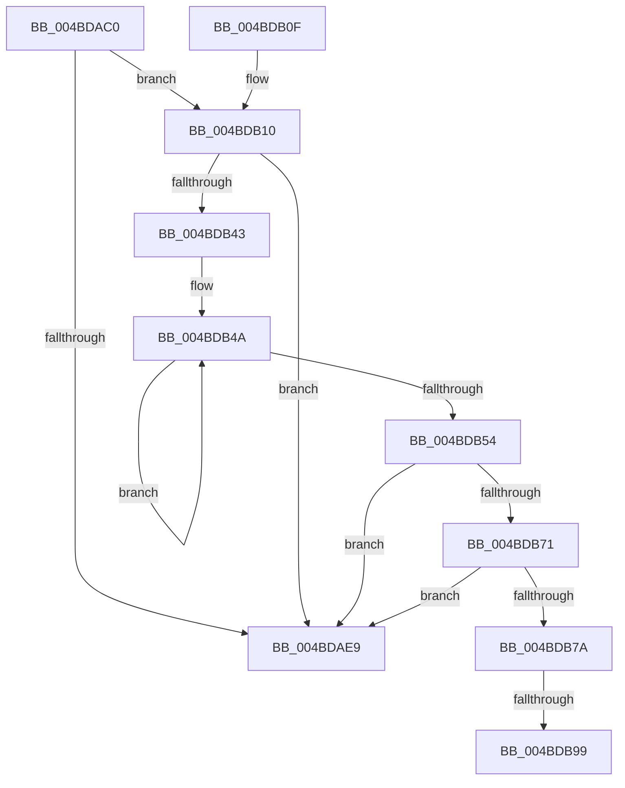

# LdrpGetParentLangId

- RVA: `0x004BDAC0`–`0x004BDBAE` (길이 `238` bytes)
- VA: `0x00000001404BDAC0`
- 실행 섹션: `.text`
- PDB 이름 있음: `예`; PDB Function 태그: `예`
- unwind 정보 RVA: `0x000BC15C`
- 디코드: `53`개 명령, `238/238` bytes 표시
- 미해석 바이트: `0` (있으면 어셈블리에 `.byte`로 보존)

> 이 문서는 커널 이미지의 기계어와 PDB 기호를 분석해 생성했습니다. 4번과 5번은 함수 원형과 자료형을 바이너리 사용 방식에서 추정한 C 해석이며 원본 소스 복구 결과는 아닙니다.

## 1. Dependencies

- 직접 호출 지점: **5**; 고유 호출 대상: **5**
- 직접 호출자로 확인된 함수: **2**
- RIP 상대 이미지 참조: **3**

### Outgoing calls
- `0x004BDAF9` → [_security_check_cookie](../6A/_security_check_cookie_function_006AC640.md) (function, `0x006AC640`)
- `0x004BDB39` → [bsearch](../50/bsearch_function_00500430.md) (function, `0x00500430`)
- `0x004BDB64` → [StringCchCopyNW](../4D/StringCchCopyNW_function_004D0F68.md) (function, `0x004D0F68`)
- `0x004BDB87` → [DownLevelGetParentLanguageName](../66/DownLevelGetParentLanguageName_function_00661E94.md) (function, `0x00661E94`)
- `0x004BDBA1` → [DownLevelLanguageNameToLangID](../4C/DownLevelLanguageNameToLangID_function_004C3748.md) (function, `0x004C3748`)

### Direct callers
- [LdrpSearchResourceSection_U](../../page/99/LdrpSearchResourceSection_U_function_0099B2DC.md) at `0x0099B9AF`
- [LdrResFallbackLangList](../../page/A2/LdrResFallbackLangList_function_00A21F1C.md) at `0x00A220DA`

### Static image references
- `0x004BDACD` → RVA `0x00E0A740` (`.data`; read)
- `0x004BDB15` → RVA `0x004BA310` (`CompareLangIDs`; read)
- `0x004BDB2C` → RVA `0x00003A90` (`.rdata`; read)

## 2. Other-region calls and transfers

- 다른 실행 섹션으로 향하는 call: **0**
- call이 아닌 외부 분기/꼬리 이동: **2**
  - `0x004BDB93` → [sub_006FCA30](../6F/Unknown_function_006FCA30.md) (`tail-transfer`)
  - `0x004BDBA9` → [sub_006FCA30](../6F/Unknown_function_006FCA30.md) (`tail-transfer`)

## 3. Assembly (complete function range)

```asm
004BDAC0  48 89 5C 24 18                  mov qword ptr [rsp + 0x18], rbx
004BDAC5  57                              push rdi
004BDAC6  48 81 EC B0 01 00 00            sub rsp, 0x1b0
004BDACD  48 8B 05 6C CC 94 00            mov rax, qword ptr [rip + 0x94cc6c]
004BDAD4  48 33 C4                        xor rax, rsp
004BDAD7  48 89 84 24 A0 01 00 00         mov qword ptr [rsp + 0x1a0], rax
004BDADF  33 DB                           xor ebx, ebx
004BDAE1  48 8B FA                        mov rdi, rdx
004BDAE4  48 85 D2                        test rdx, rdx
004BDAE7  75 27                           jne 0x1404bdb10
004BDAE9  B8 0D 00 00 C0                  mov eax, 0xc000000d
004BDAEE  48 8B 8C 24 A0 01 00 00         mov rcx, qword ptr [rsp + 0x1a0]
004BDAF6  48 33 CC                        xor rcx, rsp
004BDAF9  E8 42 EB 1E 00                  call 0x1406ac640
004BDAFE  48 8B 9C 24 D0 01 00 00         mov rbx, qword ptr [rsp + 0x1d0]
004BDB06  48 81 C4 B0 01 00 00            add rsp, 0x1b0
004BDB0D  5F                              pop rdi
004BDB0E  C3                              ret
004BDB0F  CC                              int3
004BDB10  66 89 4C 24 30                  mov word ptr [rsp + 0x30], cx
004BDB15  48 8D 05 F4 C7 FF FF            lea rax, [rip - 0x380c]
004BDB1C  48 8D 4C 24 30                  lea rcx, [rsp + 0x30]
004BDB21  48 89 44 24 20                  mov qword ptr [rsp + 0x20], rax
004BDB26  41 B9 10 00 00 00               mov r9d, 0x10
004BDB2C  48 8D 15 5D 5F B4 FF            lea rdx, [rip - 0x4ba0a3]
004BDB33  41 B8 B4 01 00 00               mov r8d, 0x1b4
004BDB39  E8 F2 28 04 00                  call 0x140500430
004BDB3E  48 85 C0                        test rax, rax
004BDB41  74 A6                           je 0x1404bdae9
004BDB43  4C 8B 00                        mov r8, qword ptr [rax]
004BDB46  49 83 CB FF                     or r11, 0xffffffffffffffff
004BDB4A  49 FF C3                        inc r11
004BDB4D  66 43 39 1C 58                  cmp word ptr [r8 + r11*2], bx
004BDB52  75 F6                           jne 0x1404bdb4a
004BDB54  49 FF C3                        inc r11
004BDB57  48 8D 4C 24 40                  lea rcx, [rsp + 0x40]
004BDB5C  4D 8B CB                        mov r9, r11
004BDB5F  BA 55 00 00 00                  mov edx, 0x55
004BDB64  E8 FF 33 01 00                  call 0x1404d0f68
004BDB69  85 C0                           test eax, eax
004BDB6B  0F 88 78 FF FF FF               js 0x1404bdae9
004BDB71  45 85 DB                        test r11d, r11d
004BDB74  0F 84 6F FF FF FF               je 0x1404bdae9
004BDB7A  48 8D 94 24 F0 00 00 00         lea rdx, [rsp + 0xf0]
004BDB82  48 8D 4C 24 40                  lea rcx, [rsp + 0x40]
004BDB87  E8 08 43 1A 00                  call 0x140661e94
004BDB8C  BA 02 00 00 00                  mov edx, 2
004BDB91  3B C2                           cmp eax, edx
004BDB93  0F 8C 97 EE 23 00               jl 0x1406fca30
004BDB99  48 8D 8C 24 F0 00 00 00         lea rcx, [rsp + 0xf0]
004BDBA1  E8 A2 5B 00 00                  call 0x1404c3748
004BDBA6  0F B7 D8                        movzx ebx, ax
004BDBA9  E9 82 EE 23 00                  jmp 0x1406fca30
```

## 4. C-style interpretation (structured pseudocode)

```c
__int64 __fastcall LdrpGetParentLangId(__int64 a1, __int64 a2)
{
    __int64 result;
    __int64 v_r11;
    __int64 v_rbx;
    __int64 v_rsp;
    unsigned __int64 v_stack_m18;
    unsigned __int64 v_stack_p18;
    unsigned __int64 v_stack_p20;
    unsigned __int16 v_stack_p30;
    unsigned __int64 v_stack_p40;
    unsigned __int64 v_stack_pF0;

    v_stack_p18 = v_rbx;
    v_rsp = (v_rsp) - (432);
    result = (*(unsigned __int64 *)(v_rip + 9751660)) ^ (v_rsp);
    v_stack_m18 = result;
    v_rbx = 0;
    if (a2 != 0) goto loc_004BDB10;
loc_004BDAE9:
    a1 = (v_stack_m18) ^ (v_rsp);
    result = _security_check_cookie(a1, a2, a3, a4);
    v_rsp = (v_rsp) + (432);
    return result;
loc_004BDB10:
    v_stack_p30 = (unsigned __int16)(a1);
    v_stack_p20 = v_rip - 14348;
    result = bsearch(v_stack_p30, v_rip - 4956323, 436, 16);
    if (result == 0) goto loc_004BDAE9;
    v_r11 = (v_r11) | (-1);
loc_004BDB4A:
    v_r11 = (v_r11) + 1;
    if ((*(unsigned __int16 *)(*(unsigned __int64 *)(result) + v_r11 * 2)) != ((unsigned __int16)(v_stack_p18))) goto loc_004BDB4A;
    v_r11 = (v_r11) + 1;
    result = StringCchCopyNW(v_stack_p40, 85, *(unsigned __int64 *)(result), v_r11);
    if (sign_flag) goto loc_004BDAE9;
    if ((unsigned int)(v_r11) == 0) goto loc_004BDAE9;
    result = DownLevelGetParentLanguageName(v_stack_p40, v_stack_pF0, *(unsigned __int64 *)(result), v_r11);
    result = DownLevelLanguageNameToLangID(v_stack_pF0, 2, *(unsigned __int64 *)(result), v_r11);
}
```

## 5. (Beta) C Style

```c
int64_t LdrpGetParentLangId(int64_t Arg1, int64_t Arg2)
{
    int64_t result;
    int64_t local_r11;
    int64_t local_rbx;
    int64_t local_rsp;
    uint64_t v_stack_m18;
    uint64_t v_stack_p18;
    uint64_t v_stack_p20;
    uint16_t v_stack_p30;
    uint64_t v_stack_p40;
    uint64_t v_stack_pF0;

    v_stack_p18 = local_rbx;
    local_rsp = (local_rsp) - (432);
    result = (*(uint64_t *)(v_rip + 0x94CC6C)) ^ (local_rsp);
    v_stack_m18 = result;
    local_rbx = 0;
    if (Arg2 != 0) goto loc_004BDB10;
loc_004BDAE9:
    Arg1 = (v_stack_m18) ^ (local_rsp);
    result = _security_check_cookie(Arg1, Arg2, a3, a4);
    local_rsp = (local_rsp) + (432);
    return result;
loc_004BDB10:
    v_stack_p30 = (uint16_t)(Arg1);
    v_stack_p20 = v_rip - 14348;
    result = bsearch(v_stack_p30, v_rip - 4956323, 436, 16);
    if (result == 0) goto loc_004BDAE9;
    local_r11 = (local_r11) | (-1);
loc_004BDB4A:
    local_r11 = (local_r11) + 1;
    if ((*(uint16_t *)(*(uint64_t *)(result) + local_r11 * 2)) != ((uint16_t)(v_stack_p18))) goto loc_004BDB4A;
    local_r11 = (local_r11) + 1;
    result = StringCchCopyNW(v_stack_p40, 85, *(uint64_t *)(result), local_r11);
    if (sign_flag) goto loc_004BDAE9;
    if ((uint32_t)(local_r11) == 0) goto loc_004BDAE9;
    result = DownLevelGetParentLanguageName(v_stack_p40, v_stack_pF0, *(uint64_t *)(result), local_r11);
    result = DownLevelLanguageNameToLangID(v_stack_pF0, 2, *(uint64_t *)(result), local_r11);
}
```

## 6. Execution-region graph

[열기: 2D/3D 그래프와 함수 탐색 컨트롤 패널](../../../control-panel.html?section=text&rva=0x004BDAC0&view=graph)

- 2D 그래프는 위에서 아래로 흐르고, 3D 그래프는 빈 공간을 드래그해 회전합니다. Shift+드래그는 이동, 휠은 확대·축소, 함수 노드 선택은 대상 보고서 이동입니다.

### Static fallback


