# McTemplateK0pqzzzzzzz_EtwWriteTransfer

- RVA: `0x004BEFF4`–`0x004BF218` (길이 `548` bytes)
- VA: `0x00000001404BEFF4`
- 실행 섹션: `.text`
- PDB 이름 있음: `예`; PDB Function 태그: `아니요`
- unwind 정보 RVA: `0x000BC4E8`
- 디코드: `150`개 명령, `548/548` bytes 표시
- 미해석 바이트: `0` (있으면 어셈블리에 `.byte`로 보존)

> 이 문서는 커널 이미지의 기계어와 PDB 기호를 분석해 생성했습니다. 4번과 5번은 함수 원형과 자료형을 바이너리 사용 방식에서 추정한 C 해석이며 원본 소스 복구 결과는 아닙니다.

## 1. Dependencies

- 직접 호출 지점: **2**; 고유 호출 대상: **2**
- 직접 호출자로 확인된 함수: **1**
- RIP 상대 이미지 참조: **4**

### Outgoing calls
- `0x004BF1EA` → [McGenEventWrite_EtwWriteTransfer](../42/McGenEventWrite_EtwWriteTransfer_function_00424FC8.md) (function, `0x00424FC8`)
- `0x004BF1F6` → [_security_check_cookie](../6A/_security_check_cookie_function_006AC640.md) (function, `0x006AC640`)

### Direct callers
- [sub_00B1C93A](../../page/B1/Unknown_function_00B1C93A.md) at `0x00B1CCBD`

### Static image references
- `0x004BF016` → RVA `0x00E0A740` (`.data`; read)
- `0x004BF09C` → RVA `0x006CB080` (` ?? ::FNODOBFM::`string'`; read)
- `0x004BF1DC` → RVA `0x0001E138` (`.rdata`; read)
- `0x004BF1E3` → RVA `0x00E06DA0` (`.data`; read)

## 2. Other-region calls and transfers

- 다른 실행 섹션으로 향하는 call: **0**
- 별도 외부 분기/꼬리 이동을 확인하지 못했습니다.

## 3. Assembly (complete function range)

```asm
004BEFF4  48 8B C4                        mov rax, rsp
004BEFF7  48 89 58 08                     mov qword ptr [rax + 8], rbx
004BEFFB  48 89 70 10                     mov qword ptr [rax + 0x10], rsi
004BEFFF  4C 89 48 20                     mov qword ptr [rax + 0x20], r9
004BF003  55                              push rbp
004BF004  57                              push rdi
004BF005  41 54                           push r12
004BF007  41 56                           push r14
004BF009  41 57                           push r15
004BF00B  48 8D 68 D1                     lea rbp, [rax - 0x2f]
004BF00F  48 81 EC E0 00 00 00            sub rsp, 0xe0
004BF016  48 8B 05 23 B7 94 00            mov rax, qword ptr [rip + 0x94b723]
004BF01D  48 33 C4                        xor rax, rsp
004BF020  48 89 45 F7                     mov qword ptr [rbp - 9], rax
004BF024  48 8B 55 5F                     mov rdx, qword ptr [rbp + 0x5f]
004BF028  48 8D 45 4F                     lea rax, [rbp + 0x4f]
004BF02C  48 8B BD 8F 00 00 00            mov rdi, qword ptr [rbp + 0x8f]
004BF033  45 33 F6                        xor r14d, r14d
004BF036  4C 8B 95 87 00 00 00            mov r10, qword ptr [rbp + 0x87]
004BF03D  48 83 C9 FF                     or rcx, 0xffffffffffffffff
004BF041  48 8B 5D 7F                     mov rbx, qword ptr [rbp + 0x7f]
004BF045  49 8B F0                        mov rsi, r8
004BF048  4C 8B 5D 77                     mov r11, qword ptr [rbp + 0x77]
004BF04C  4C 8B 4D 6F                     mov r9, qword ptr [rbp + 0x6f]
004BF050  45 8D 7E 0A                     lea r15d, [r14 + 0xa]
004BF054  4C 8B 45 67                     mov r8, qword ptr [rbp + 0x67]
004BF058  48 89 44 24 40                  mov qword ptr [rsp + 0x40], rax
004BF05D  48 8D 45 57                     lea rax, [rbp + 0x57]
004BF061  48 89 44 24 50                  mov qword ptr [rsp + 0x50], rax
004BF066  48 C7 44 24 48 08 00 00 00      mov qword ptr [rsp + 0x48], 8
004BF06F  48 C7 44 24 58 04 00 00 00      mov qword ptr [rsp + 0x58], 4
004BF078  48 85 D2                        test rdx, rdx
004BF07B  74 16                           je 0x1404bf093
004BF07D  48 8B C1                        mov rax, rcx
004BF080  48 FF C0                        inc rax
004BF083  66 44 39 34 42                  cmp word ptr [rdx + rax*2], r14w
004BF088  75 F6                           jne 0x1404bf080
004BF08A  8D 04 45 02 00 00 00            lea eax, [rax*2 + 2]
004BF091  EB 03                           jmp 0x1404bf096
004BF093  41 8B C7                        mov eax, r15d
004BF096  48 85 D2                        test rdx, rdx
004BF099  89 45 8F                        mov dword ptr [rbp - 0x71], eax
004BF09C  4C 8D 25 DD BF 20 00            lea r12, [rip + 0x20bfdd]
004BF0A3  44 89 75 93                     mov dword ptr [rbp - 0x6d], r14d
004BF0A7  49 0F 44 D4                     cmove rdx, r12
004BF0AB  48 89 55 87                     mov qword ptr [rbp - 0x79], rdx
004BF0AF  4D 85 C0                        test r8, r8
004BF0B2  74 16                           je 0x1404bf0ca
004BF0B4  48 8B C1                        mov rax, rcx
004BF0B7  48 FF C0                        inc rax
004BF0BA  66 45 39 34 40                  cmp word ptr [r8 + rax*2], r14w
004BF0BF  75 F6                           jne 0x1404bf0b7
004BF0C1  8D 04 45 02 00 00 00            lea eax, [rax*2 + 2]
004BF0C8  EB 03                           jmp 0x1404bf0cd
004BF0CA  41 8B C7                        mov eax, r15d
004BF0CD  4D 85 C0                        test r8, r8
004BF0D0  89 45 9F                        mov dword ptr [rbp - 0x61], eax
004BF0D3  44 89 75 A3                     mov dword ptr [rbp - 0x5d], r14d
004BF0D7  4D 0F 44 C4                     cmove r8, r12
004BF0DB  4C 89 45 97                     mov qword ptr [rbp - 0x69], r8
004BF0DF  4D 85 C9                        test r9, r9
004BF0E2  74 16                           je 0x1404bf0fa
004BF0E4  48 8B C1                        mov rax, rcx
004BF0E7  48 FF C0                        inc rax
004BF0EA  66 45 39 34 41                  cmp word ptr [r9 + rax*2], r14w
004BF0EF  75 F6                           jne 0x1404bf0e7
004BF0F1  8D 04 45 02 00 00 00            lea eax, [rax*2 + 2]
004BF0F8  EB 03                           jmp 0x1404bf0fd
004BF0FA  41 8B C7                        mov eax, r15d
004BF0FD  4D 85 C9                        test r9, r9
004BF100  89 45 AF                        mov dword ptr [rbp - 0x51], eax
004BF103  44 89 75 B3                     mov dword ptr [rbp - 0x4d], r14d
004BF107  4D 0F 44 CC                     cmove r9, r12
004BF10B  4C 89 4D A7                     mov qword ptr [rbp - 0x59], r9
004BF10F  4D 85 DB                        test r11, r11
004BF112  74 16                           je 0x1404bf12a
004BF114  48 8B C1                        mov rax, rcx
004BF117  48 FF C0                        inc rax
004BF11A  66 45 39 34 43                  cmp word ptr [r11 + rax*2], r14w
004BF11F  75 F6                           jne 0x1404bf117
004BF121  8D 04 45 02 00 00 00            lea eax, [rax*2 + 2]
004BF128  EB 03                           jmp 0x1404bf12d
004BF12A  41 8B C7                        mov eax, r15d
004BF12D  4D 85 DB                        test r11, r11
004BF130  89 45 BF                        mov dword ptr [rbp - 0x41], eax
004BF133  44 89 75 C3                     mov dword ptr [rbp - 0x3d], r14d
004BF137  4D 0F 44 DC                     cmove r11, r12
004BF13B  4C 89 5D B7                     mov qword ptr [rbp - 0x49], r11
004BF13F  48 85 DB                        test rbx, rbx
004BF142  74 16                           je 0x1404bf15a
004BF144  48 8B C1                        mov rax, rcx
004BF147  48 FF C0                        inc rax
004BF14A  66 44 39 34 43                  cmp word ptr [rbx + rax*2], r14w
004BF14F  75 F6                           jne 0x1404bf147
004BF151  8D 04 45 02 00 00 00            lea eax, [rax*2 + 2]
004BF158  EB 03                           jmp 0x1404bf15d
004BF15A  41 8B C7                        mov eax, r15d
004BF15D  48 85 DB                        test rbx, rbx
004BF160  89 45 CF                        mov dword ptr [rbp - 0x31], eax
004BF163  44 89 75 D3                     mov dword ptr [rbp - 0x2d], r14d
004BF167  49 0F 44 DC                     cmove rbx, r12
004BF16B  48 89 5D C7                     mov qword ptr [rbp - 0x39], rbx
004BF16F  4D 85 D2                        test r10, r10
004BF172  74 16                           je 0x1404bf18a
004BF174  48 8B C1                        mov rax, rcx
004BF177  48 FF C0                        inc rax
004BF17A  66 45 39 34 42                  cmp word ptr [r10 + rax*2], r14w
004BF17F  75 F6                           jne 0x1404bf177
004BF181  8D 04 45 02 00 00 00            lea eax, [rax*2 + 2]
004BF188  EB 03                           jmp 0x1404bf18d
004BF18A  41 8B C7                        mov eax, r15d
004BF18D  4D 85 D2                        test r10, r10
004BF190  89 45 DF                        mov dword ptr [rbp - 0x21], eax
004BF193  44 89 75 E3                     mov dword ptr [rbp - 0x1d], r14d
004BF197  4D 0F 44 D4                     cmove r10, r12
004BF19B  4C 89 55 D7                     mov qword ptr [rbp - 0x29], r10
004BF19F  48 85 FF                        test rdi, rdi
004BF1A2  74 13                           je 0x1404bf1b7
004BF1A4  48 FF C1                        inc rcx
004BF1A7  66 44 39 34 4F                  cmp word ptr [rdi + rcx*2], r14w
004BF1AC  75 F6                           jne 0x1404bf1a4
004BF1AE  8D 0C 4D 02 00 00 00            lea ecx, [rcx*2 + 2]
004BF1B5  EB 03                           jmp 0x1404bf1ba
004BF1B7  41 8B CF                        mov ecx, r15d
004BF1BA  48 85 FF                        test rdi, rdi
004BF1BD  89 4D EF                        mov dword ptr [rbp - 0x11], ecx
004BF1C0  48 8D 44 24 30                  lea rax, [rsp + 0x30]
004BF1C5  44 89 75 F3                     mov dword ptr [rbp - 0xd], r14d
004BF1C9  49 0F 44 FC                     cmove rdi, r12
004BF1CD  48 89 44 24 20                  mov qword ptr [rsp + 0x20], rax
004BF1D2  45 8B CF                        mov r9d, r15d
004BF1D5  48 89 7D E7                     mov qword ptr [rbp - 0x19], rdi
004BF1D9  4C 8B C6                        mov r8, rsi
004BF1DC  48 8D 15 55 EF B5 FF            lea rdx, [rip - 0x4a10ab]
004BF1E3  48 8D 0D B6 7B 94 00            lea rcx, [rip + 0x947bb6]
004BF1EA  E8 D9 5D F6 FF                  call 0x140424fc8
004BF1EF  48 8B 4D F7                     mov rcx, qword ptr [rbp - 9]
004BF1F3  48 33 CC                        xor rcx, rsp
004BF1F6  E8 45 D4 1E 00                  call 0x1406ac640
004BF1FB  4C 8D 9C 24 E0 00 00 00         lea r11, [rsp + 0xe0]
004BF203  49 8B 5B 30                     mov rbx, qword ptr [r11 + 0x30]
004BF207  49 8B 73 38                     mov rsi, qword ptr [r11 + 0x38]
004BF20B  49 8B E3                        mov rsp, r11
004BF20E  41 5F                           pop r15
004BF210  41 5E                           pop r14
004BF212  41 5C                           pop r12
004BF214  5F                              pop rdi
004BF215  5D                              pop rbp
004BF216  C3                              ret
004BF217  CC                              int3
```

## 4. C-style interpretation (structured pseudocode)

```c
__int64 __fastcall McTemplateK0pqzzzzzzz_EtwWriteTransfer(__int64 a1, __int64 a2, __int64 a3, __int64 a4)
{
    __int64 result;
    __int64 v_r10;
    __int64 v_r11;
    __int64 v_r14;
    __int64 v_rbx;
    __int64 v_rdi;
    __int64 v_rsp;
    unsigned __int64 v_stack_m28;
    unsigned __int64 v_stack_mB0;
    unsigned __int64 v_stack_mB8;
    unsigned __int64 v_stack_mC0;
    unsigned __int64 v_stack_mC8;
    unsigned __int64 v_stack_mD8;
    unsigned __int64 v_stack_mE8;

    *(unsigned __int64 *)(v_rsp + 8) = v_rbx;
    *(unsigned __int64 *)(v_rsp + 16) = v_rsi;
    *(unsigned __int64 *)(v_rsp + 32) = a4;
    v_rsp = (v_rsp) - (224);
    result = (*(unsigned __int64 *)(v_rip + 9746211)) ^ (v_rsp);
    *(unsigned __int64 *)(v_rsp - 47 - 9) = result;
    v_r14 = 0;
    a1 = (a1) | (-1);
    v_stack_mC8 = v_rsp - 47 + 79;
    v_stack_mB8 = v_rsp - 47 + 87;
    v_stack_mC0 = 8;
    v_stack_mB0 = 4;
    if (*(unsigned __int64 *)(v_rsp - 47 + 95) == 0) goto loc_004BF093;
loc_004BF080:
    result = (a1) + 1;
    if ((*(unsigned __int16 *)(*(unsigned __int64 *)(v_rsp - 47 + 95) + result * 2)) != 0) goto loc_004BF080;
    goto loc_004BF096;
loc_004BF093:
loc_004BF096:
    *(unsigned int *)(v_rsp - 47 - 113) = (unsigned int)((unsigned int)((unsigned int)(v_r14 + 10)));
    *(unsigned int *)(v_rsp - 47 - 109) = 0;
    a2 = *(unsigned __int64 *)(v_rsp - 47 + 95);
    if (*(unsigned __int64 *)(v_rsp - 47 + 95) == 0) { a2 = v_rip + 2146269; }
    *(unsigned __int64 *)(v_rsp - 47 - 121) = a2;
    if (*(unsigned __int64 *)(v_rsp - 47 + 103) == 0) goto loc_004BF0CA;
loc_004BF0B7:
    result = (a1) + 1;
    if ((*(unsigned __int16 *)(*(unsigned __int64 *)(v_rsp - 47 + 103) + result * 2)) != 0) goto loc_004BF0B7;
    goto loc_004BF0CD;
loc_004BF0CA:
loc_004BF0CD:
    *(unsigned int *)(v_rsp - 47 - 97) = (unsigned int)((unsigned int)((unsigned int)(v_r14 + 10)));
    *(unsigned int *)(v_rsp - 47 - 93) = 0;
    a3 = *(unsigned __int64 *)(v_rsp - 47 + 103);
    if (*(unsigned __int64 *)(v_rsp - 47 + 103) == 0) { a3 = v_rip + 2146269; }
    *(unsigned __int64 *)(v_rsp - 47 - 105) = a3;
    if (*(unsigned __int64 *)(v_rsp - 47 + 111) == 0) goto loc_004BF0FA;
loc_004BF0E7:
    result = (a1) + 1;
    if ((*(unsigned __int16 *)(*(unsigned __int64 *)(v_rsp - 47 + 111) + result * 2)) != 0) goto loc_004BF0E7;
    goto loc_004BF0FD;
loc_004BF0FA:
loc_004BF0FD:
    *(unsigned int *)(v_rsp - 47 - 81) = (unsigned int)((unsigned int)((unsigned int)(v_r14 + 10)));
    *(unsigned int *)(v_rsp - 47 - 77) = 0;
    a4 = *(unsigned __int64 *)(v_rsp - 47 + 111);
    if (*(unsigned __int64 *)(v_rsp - 47 + 111) == 0) { a4 = v_rip + 2146269; }
    *(unsigned __int64 *)(v_rsp - 47 - 89) = a4;
    if (*(unsigned __int64 *)(v_rsp - 47 + 119) == 0) goto loc_004BF12A;
loc_004BF117:
    result = (a1) + 1;
    if ((*(unsigned __int16 *)(*(unsigned __int64 *)(v_rsp - 47 + 119) + result * 2)) != 0) goto loc_004BF117;
    goto loc_004BF12D;
loc_004BF12A:
loc_004BF12D:
    *(unsigned int *)(v_rsp - 47 - 65) = (unsigned int)((unsigned int)((unsigned int)(v_r14 + 10)));
    *(unsigned int *)(v_rsp - 47 - 61) = 0;
    v_r11 = *(unsigned __int64 *)(v_rsp - 47 + 119);
    if (*(unsigned __int64 *)(v_rsp - 47 + 119) == 0) { v_r11 = v_rip + 2146269; }
    *(unsigned __int64 *)(v_rsp - 47 - 73) = v_r11;
    if (*(unsigned __int64 *)(v_rsp - 47 + 127) == 0) goto loc_004BF15A;
loc_004BF147:
    result = (a1) + 1;
    if ((*(unsigned __int16 *)(*(unsigned __int64 *)(v_rsp - 47 + 127) + result * 2)) != 0) goto loc_004BF147;
    goto loc_004BF15D;
loc_004BF15A:
loc_004BF15D:
    *(unsigned int *)(v_rsp - 47 - 49) = (unsigned int)((unsigned int)((unsigned int)(v_r14 + 10)));
    *(unsigned int *)(v_rsp - 47 - 45) = 0;
    v_rbx = *(unsigned __int64 *)(v_rsp - 47 + 127);
    if (*(unsigned __int64 *)(v_rsp - 47 + 127) == 0) { v_rbx = v_rip + 2146269; }
    *(unsigned __int64 *)(v_rsp - 47 - 57) = v_rbx;
    if (*(unsigned __int64 *)(v_rsp - 47 + 135) == 0) goto loc_004BF18A;
loc_004BF177:
    result = (a1) + 1;
    if ((*(unsigned __int16 *)(*(unsigned __int64 *)(v_rsp - 47 + 135) + result * 2)) != 0) goto loc_004BF177;
    goto loc_004BF18D;
loc_004BF18A:
loc_004BF18D:
    *(unsigned int *)(v_rsp - 47 - 33) = (unsigned int)((unsigned int)((unsigned int)(v_r14 + 10)));
    *(unsigned int *)(v_rsp - 47 - 29) = 0;
    v_r10 = *(unsigned __int64 *)(v_rsp - 47 + 135);
    if (*(unsigned __int64 *)(v_rsp - 47 + 135) == 0) { v_r10 = v_rip + 2146269; }
    *(unsigned __int64 *)(v_rsp - 47 - 41) = v_r10;
    if (*(unsigned __int64 *)(v_rsp - 47 + 143) == 0) goto loc_004BF1B7;
loc_004BF1A4:
    a1 = (a1) + 1;
    if ((*(unsigned __int16 *)(*(unsigned __int64 *)(v_rsp - 47 + 143) + a1 * 2)) != 0) goto loc_004BF1A4;
    goto loc_004BF1BA;
loc_004BF1B7:
loc_004BF1BA:
    *(unsigned int *)(v_rsp - 47 - 17) = (unsigned int)((unsigned int)((unsigned int)(v_r14 + 10)));
    *(unsigned int *)(v_rsp - 47 - 13) = 0;
    v_rdi = *(unsigned __int64 *)(v_rsp - 47 + 143);
    if (*(unsigned __int64 *)(v_rsp - 47 + 143) == 0) { v_rdi = v_rip + 2146269; }
    v_stack_mE8 = v_stack_mD8;
    *(unsigned __int64 *)(v_rsp - 47 - 25) = v_rdi;
    result = McGenEventWrite_EtwWriteTransfer(v_rip + 9730998, v_rip - 4853931, a3, (unsigned int)((unsigned int)(v_r14 + 10)));
    a1 = (*(unsigned __int64 *)(v_rsp - 47 - 9)) ^ (v_rsp);
    result = _security_check_cookie(a1, v_rip - 4853931, a3, (unsigned int)((unsigned int)(v_r14 + 10)));
    return result;
}
```

## 5. (Beta) C Style

```c
int64_t McTemplateK0pqzzzzzzz_EtwWriteTransfer(int64_t Arg1, int64_t Arg2, int64_t Arg3, int64_t Arg4)
{
    int64_t result;
    int64_t local_r10;
    int64_t local_r11;
    int64_t local_r14;
    int64_t local_rbx;
    int64_t local_rdi;
    int64_t local_rsp;
    uint64_t v_stack_m28;
    uint64_t v_stack_mB0;
    uint64_t v_stack_mB8;
    uint64_t v_stack_mC0;
    uint64_t v_stack_mC8;
    uint64_t v_stack_mD8;
    uint64_t v_stack_mE8;

    *(uint64_t *)(local_rsp + 0x8) = local_rbx;
    *(uint64_t *)(local_rsp + 0x10) = local_rsi;
    *(uint64_t *)(local_rsp + 0x20) = Arg4;
    local_rsp = (local_rsp) - (224);
    result = (*(uint64_t *)(v_rip + 0x94B723)) ^ (local_rsp);
    *(uint64_t *)(local_rsp - 0x2F - 0x9) = result;
    local_r14 = 0;
    Arg1 = (Arg1) | (-1);
    v_stack_mC8 = local_rsp - 47 + 79;
    v_stack_mB8 = local_rsp - 47 + 87;
    v_stack_mC0 = 8;
    v_stack_mB0 = 4;
    if (*(uint64_t *)(local_rsp - 0x2F + 0x5F) == 0) goto loc_004BF093;
loc_004BF080:
    result = (Arg1) + 1;
    if ((*(uint16_t *)(*(uint64_t *)(local_rsp - 0x2F + 0x5F) + result * 2)) != 0) goto loc_004BF080;
    goto loc_004BF096;
loc_004BF093:
loc_004BF096:
    *(uint32_t *)(local_rsp - 0x2F - 0x71) = (uint32_t)((uint32_t)((uint32_t)(local_r14 + 10)));
    *(uint32_t *)(local_rsp - 0x2F - 0x6D) = 0;
    Arg2 = *(uint64_t *)(local_rsp - 0x2F + 0x5F);
    if (*(uint64_t *)(local_rsp - 0x2F + 0x5F) == 0) { Arg2 = v_rip + 2146269; }
    *(uint64_t *)(local_rsp - 0x2F - 0x79) = Arg2;
    if (*(uint64_t *)(local_rsp - 0x2F + 0x67) == 0) goto loc_004BF0CA;
loc_004BF0B7:
    result = (Arg1) + 1;
    if ((*(uint16_t *)(*(uint64_t *)(local_rsp - 0x2F + 0x67) + result * 2)) != 0) goto loc_004BF0B7;
    goto loc_004BF0CD;
loc_004BF0CA:
loc_004BF0CD:
    *(uint32_t *)(local_rsp - 0x2F - 0x61) = (uint32_t)((uint32_t)((uint32_t)(local_r14 + 10)));
    *(uint32_t *)(local_rsp - 0x2F - 0x5D) = 0;
    Arg3 = *(uint64_t *)(local_rsp - 0x2F + 0x67);
    if (*(uint64_t *)(local_rsp - 0x2F + 0x67) == 0) { Arg3 = v_rip + 2146269; }
    *(uint64_t *)(local_rsp - 0x2F - 0x69) = Arg3;
    if (*(uint64_t *)(local_rsp - 0x2F + 0x6F) == 0) goto loc_004BF0FA;
loc_004BF0E7:
    result = (Arg1) + 1;
    if ((*(uint16_t *)(*(uint64_t *)(local_rsp - 0x2F + 0x6F) + result * 2)) != 0) goto loc_004BF0E7;
    goto loc_004BF0FD;
loc_004BF0FA:
loc_004BF0FD:
    *(uint32_t *)(local_rsp - 0x2F - 0x51) = (uint32_t)((uint32_t)((uint32_t)(local_r14 + 10)));
    *(uint32_t *)(local_rsp - 0x2F - 0x4D) = 0;
    Arg4 = *(uint64_t *)(local_rsp - 0x2F + 0x6F);
    if (*(uint64_t *)(local_rsp - 0x2F + 0x6F) == 0) { Arg4 = v_rip + 2146269; }
    *(uint64_t *)(local_rsp - 0x2F - 0x59) = Arg4;
    if (*(uint64_t *)(local_rsp - 0x2F + 0x77) == 0) goto loc_004BF12A;
loc_004BF117:
    result = (Arg1) + 1;
    if ((*(uint16_t *)(*(uint64_t *)(local_rsp - 0x2F + 0x77) + result * 2)) != 0) goto loc_004BF117;
    goto loc_004BF12D;
loc_004BF12A:
loc_004BF12D:
    *(uint32_t *)(local_rsp - 0x2F - 0x41) = (uint32_t)((uint32_t)((uint32_t)(local_r14 + 10)));
    *(uint32_t *)(local_rsp - 0x2F - 0x3D) = 0;
    local_r11 = *(uint64_t *)(local_rsp - 0x2F + 0x77);
    if (*(uint64_t *)(local_rsp - 0x2F + 0x77) == 0) { local_r11 = v_rip + 2146269; }
    *(uint64_t *)(local_rsp - 0x2F - 0x49) = local_r11;
    if (*(uint64_t *)(local_rsp - 0x2F + 0x7F) == 0) goto loc_004BF15A;
loc_004BF147:
    result = (Arg1) + 1;
    if ((*(uint16_t *)(*(uint64_t *)(local_rsp - 0x2F + 0x7F) + result * 2)) != 0) goto loc_004BF147;
    goto loc_004BF15D;
loc_004BF15A:
loc_004BF15D:
    *(uint32_t *)(local_rsp - 0x2F - 0x31) = (uint32_t)((uint32_t)((uint32_t)(local_r14 + 10)));
    *(uint32_t *)(local_rsp - 0x2F - 0x2D) = 0;
    local_rbx = *(uint64_t *)(local_rsp - 0x2F + 0x7F);
    if (*(uint64_t *)(local_rsp - 0x2F + 0x7F) == 0) { local_rbx = v_rip + 2146269; }
    *(uint64_t *)(local_rsp - 0x2F - 0x39) = local_rbx;
    if (*(uint64_t *)(local_rsp - 0x2F + 0x87) == 0) goto loc_004BF18A;
loc_004BF177:
    result = (Arg1) + 1;
    if ((*(uint16_t *)(*(uint64_t *)(local_rsp - 0x2F + 0x87) + result * 2)) != 0) goto loc_004BF177;
    goto loc_004BF18D;
loc_004BF18A:
loc_004BF18D:
    *(uint32_t *)(local_rsp - 0x2F - 0x21) = (uint32_t)((uint32_t)((uint32_t)(local_r14 + 10)));
    *(uint32_t *)(local_rsp - 0x2F - 0x1D) = 0;
    local_r10 = *(uint64_t *)(local_rsp - 0x2F + 0x87);
    if (*(uint64_t *)(local_rsp - 0x2F + 0x87) == 0) { local_r10 = v_rip + 2146269; }
    *(uint64_t *)(local_rsp - 0x2F - 0x29) = local_r10;
    if (*(uint64_t *)(local_rsp - 0x2F + 0x8F) == 0) goto loc_004BF1B7;
loc_004BF1A4:
    Arg1 = (Arg1) + 1;
    if ((*(uint16_t *)(*(uint64_t *)(local_rsp - 0x2F + 0x8F) + Arg1 * 2)) != 0) goto loc_004BF1A4;
    goto loc_004BF1BA;
loc_004BF1B7:
loc_004BF1BA:
    *(uint32_t *)(local_rsp - 0x2F - 0x11) = (uint32_t)((uint32_t)((uint32_t)(local_r14 + 10)));
    *(uint32_t *)(local_rsp - 0x2F - 0xD) = 0;
    local_rdi = *(uint64_t *)(local_rsp - 0x2F + 0x8F);
    if (*(uint64_t *)(local_rsp - 0x2F + 0x8F) == 0) { local_rdi = v_rip + 2146269; }
    v_stack_mE8 = v_stack_mD8;
    *(uint64_t *)(local_rsp - 0x2F - 0x19) = local_rdi;
    result = McGenEventWrite_EtwWriteTransfer(v_rip + 9730998, v_rip - 4853931, Arg3, (uint32_t)((uint32_t)(local_r14 + 10)));
    Arg1 = (*(uint64_t *)(local_rsp - 0x2F - 0x9)) ^ (local_rsp);
    result = _security_check_cookie(Arg1, v_rip - 4853931, Arg3, (uint32_t)((uint32_t)(local_r14 + 10)));
    return result;
}
```

## 6. Execution-region graph

[열기: 2D/3D 그래프와 함수 탐색 컨트롤 패널](../../../control-panel.html?section=text&rva=0x004BEFF4&view=graph)

- 2D 그래프는 위에서 아래로 흐르고, 3D 그래프는 빈 공간을 드래그해 회전합니다. Shift+드래그는 이동, 휠은 확대·축소, 함수 노드 선택은 대상 보고서 이동입니다.

### Static fallback

```mermaid
flowchart TD
  bb_004BEFF4[BB_004BEFF4]
  bb_004BF07D[BB_004BF07D]
  bb_004BF080[BB_004BF080]
  bb_004BF08A[BB_004BF08A]
  bb_004BF093[BB_004BF093]
  bb_004BF096[BB_004BF096]
  bb_004BF0B4[BB_004BF0B4]
  bb_004BF0B7[BB_004BF0B7]
  bb_004BF0C1[BB_004BF0C1]
  bb_004BF0CA[BB_004BF0CA]
  bb_004BF0CD[BB_004BF0CD]
  bb_004BF0E4[BB_004BF0E4]
  bb_004BF0E7[BB_004BF0E7]
  bb_004BF0F1[BB_004BF0F1]
  bb_004BF0FA[BB_004BF0FA]
  bb_004BF0FD[BB_004BF0FD]
  bb_004BF114[BB_004BF114]
  bb_004BF117[BB_004BF117]
  bb_004BF121[BB_004BF121]
  bb_004BF12A[BB_004BF12A]
  bb_004BF12D[BB_004BF12D]
  bb_004BF144[BB_004BF144]
  bb_004BF147[BB_004BF147]
  bb_004BF151[BB_004BF151]
  bb_004BF15A[BB_004BF15A]
  bb_004BF15D[BB_004BF15D]
  bb_004BF174[BB_004BF174]
  bb_004BF177[BB_004BF177]
  bb_004BF181[BB_004BF181]
  bb_004BF18A[BB_004BF18A]
  bb_004BF18D[BB_004BF18D]
  bb_004BF1A4[BB_004BF1A4]
  bb_004BF1AE[BB_004BF1AE]
  bb_004BF1B7[BB_004BF1B7]
  bb_004BF1BA[BB_004BF1BA]
  bb_004BF217[BB_004BF217]
  bb_004BEFF4 -->|branch| bb_004BF093
  bb_004BEFF4 -->|fallthrough| bb_004BF07D
  bb_004BF07D -->|flow| bb_004BF080
  bb_004BF080 -->|branch| bb_004BF080
  bb_004BF080 -->|fallthrough| bb_004BF08A
  bb_004BF08A -->|branch| bb_004BF096
  bb_004BF093 -->|flow| bb_004BF096
  bb_004BF096 -->|branch| bb_004BF0CA
  bb_004BF096 -->|fallthrough| bb_004BF0B4
  bb_004BF0B4 -->|flow| bb_004BF0B7
  bb_004BF0B7 -->|branch| bb_004BF0B7
  bb_004BF0B7 -->|fallthrough| bb_004BF0C1
  bb_004BF0C1 -->|branch| bb_004BF0CD
  bb_004BF0CA -->|flow| bb_004BF0CD
  bb_004BF0CD -->|branch| bb_004BF0FA
  bb_004BF0CD -->|fallthrough| bb_004BF0E4
  bb_004BF0E4 -->|flow| bb_004BF0E7
  bb_004BF0E7 -->|branch| bb_004BF0E7
  bb_004BF0E7 -->|fallthrough| bb_004BF0F1
  bb_004BF0F1 -->|branch| bb_004BF0FD
  bb_004BF0FA -->|flow| bb_004BF0FD
  bb_004BF0FD -->|branch| bb_004BF12A
  bb_004BF0FD -->|fallthrough| bb_004BF114
  bb_004BF114 -->|flow| bb_004BF117
  bb_004BF117 -->|branch| bb_004BF117
  bb_004BF117 -->|fallthrough| bb_004BF121
  bb_004BF121 -->|branch| bb_004BF12D
  bb_004BF12A -->|flow| bb_004BF12D
  bb_004BF12D -->|branch| bb_004BF15A
  bb_004BF12D -->|fallthrough| bb_004BF144
  bb_004BF144 -->|flow| bb_004BF147
  bb_004BF147 -->|branch| bb_004BF147
  bb_004BF147 -->|fallthrough| bb_004BF151
  bb_004BF151 -->|branch| bb_004BF15D
  bb_004BF15A -->|flow| bb_004BF15D
  bb_004BF15D -->|branch| bb_004BF18A
  bb_004BF15D -->|fallthrough| bb_004BF174
  bb_004BF174 -->|flow| bb_004BF177
  bb_004BF177 -->|branch| bb_004BF177
  bb_004BF177 -->|fallthrough| bb_004BF181
  bb_004BF181 -->|branch| bb_004BF18D
  bb_004BF18A -->|flow| bb_004BF18D
  bb_004BF18D -->|branch| bb_004BF1B7
  bb_004BF18D -->|fallthrough| bb_004BF1A4
  bb_004BF1A4 -->|branch| bb_004BF1A4
  bb_004BF1A4 -->|fallthrough| bb_004BF1AE
  bb_004BF1AE -->|branch| bb_004BF1BA
  bb_004BF1B7 -->|flow| bb_004BF1BA
```


