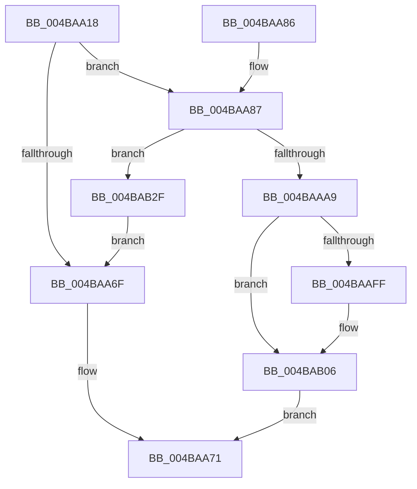

# MiAddPrivateFixupEntryForSystemImage

- RVA: `0x004BAA18`–`0x004BAB3B` (길이 `291` bytes)
- VA: `0x00000001404BAA18`
- 실행 섹션: `.text`
- PDB 이름 있음: `예`; PDB Function 태그: `아니요`
- unwind 정보 RVA: `0x000BB5D8`
- 디코드: `76`개 명령, `291/291` bytes 표시
- 미해석 바이트: `0` (있으면 어셈블리에 `.byte`로 보존)

> 이 문서는 커널 이미지의 기계어와 PDB 기호를 분석해 생성했습니다. 4번과 5번은 함수 원형과 자료형을 바이너리 사용 방식에서 추정한 C 해석이며 원본 소스 복구 결과는 아닙니다.

## 1. Dependencies

- 직접 호출 지점: **6**; 고유 호출 대상: **5**
- 직접 호출자로 확인된 함수: **1**
- RIP 상대 이미지 참조: **4**

### Outgoing calls
- `0x004BAA62` → [MiAllocatePool](../35/MiAllocatePool_function_0035B540.md) (function, `0x0035B540`)
- `0x004BAA95` → [MiAllocatePool](../35/MiAllocatePool_function_0035B540.md) (function, `0x0035B540`)
- `0x004BAAB2` → [MiInitializePrivateFixupBitmap](../../page/9E/MiInitializePrivateFixupBitmap_function_009E55C8.md) (function, `0x009E55C8`)
- `0x004BAAE7` → [ExAcquireSpinLockExclusive](../24/ExAcquireSpinLockExclusive_function_00248690.md) (function, `0x00248690`)
- `0x004BAB20` → [MiReleaseSpinLockExclusive](../24/MiReleaseSpinLockExclusive_function_002482C0.md) (function, `0x002482C0`)
- `0x004BAB31` → [ExFreePoolWithTag](../../poolcode/B8/ExFreePoolWithTag_function_00B82870.md) (function, `0x00B82870`)

### Direct callers
- [MiGetSystemAddressForImage](../../page/A7/MiGetSystemAddressForImage_function_00A74EEC.md) at `0x00A7506D`

### Static image references
- `0x004BAAE0` → RVA `0x00E2D91C` (`.data`; read)
- `0x004BAAEC` → RVA `0x00E2D908` (`.data`; read)
- `0x004BAAF3` → RVA `0x00E2D900` (`.data`; read)
- `0x004BAB19` → RVA `0x00E2D908` (`.data`; write)

## 2. Other-region calls and transfers

- 다른 실행 섹션으로 향하는 call: **2**
  - `0x004BAAB2` → [MiInitializePrivateFixupBitmap](../../page/9E/MiInitializePrivateFixupBitmap_function_009E55C8.md) (`.text` → `PAGE`)
  - `0x004BAB31` → [ExFreePoolWithTag](../../poolcode/B8/ExFreePoolWithTag_function_00B82870.md) (`.text` → `POOLCODE`)
- 별도 외부 분기/꼬리 이동을 확인하지 못했습니다.

## 3. Assembly (complete function range)

```asm
004BAA18  48 89 5C 24 08                  mov qword ptr [rsp + 8], rbx
004BAA1D  48 89 6C 24 10                  mov qword ptr [rsp + 0x10], rbp
004BAA22  48 89 74 24 18                  mov qword ptr [rsp + 0x18], rsi
004BAA27  57                              push rdi
004BAA28  48 83 EC 20                     sub rsp, 0x20
004BAA2C  48 8B 01                        mov rax, qword ptr [rcx]
004BAA2F  48 8B EA                        mov rbp, rdx
004BAA32  48 8B F1                        mov rsi, rcx
004BAA35  BB 40 00 00 00                  mov ebx, 0x40
004BAA3A  8B CB                           mov ecx, ebx
004BAA3C  44 8B 40 08                     mov r8d, dword ptr [rax + 8]
004BAA40  41 8B C0                        mov eax, r8d
004BAA43  24 3F                           and al, 0x3f
004BAA45  F6 D8                           neg al
004BAA47  48 1B D2                        sbb rdx, rdx
004BAA4A  49 C1 E8 06                     shr r8, 6
004BAA4E  48 F7 DA                        neg rdx
004BAA51  48 83 C2 02                     add rdx, 2
004BAA55  49 03 D0                        add rdx, r8
004BAA58  41 B8 4D 6D 53 69               mov r8d, 0x69536d4d
004BAA5E  48 C1 E2 03                     shl rdx, 3
004BAA62  E8 D9 0A EA FF                  call 0x14035b540
004BAA67  48 8B F8                        mov rdi, rax
004BAA6A  48 85 C0                        test rax, rax
004BAA6D  75 18                           jne 0x1404baa87
004BAA6F  33 C0                           xor eax, eax
004BAA71  48 8B 5C 24 30                  mov rbx, qword ptr [rsp + 0x30]
004BAA76  48 8B 6C 24 38                  mov rbp, qword ptr [rsp + 0x38]
004BAA7B  48 8B 74 24 40                  mov rsi, qword ptr [rsp + 0x40]
004BAA80  48 83 C4 20                     add rsp, 0x20
004BAA84  5F                              pop rdi
004BAA85  C3                              ret
004BAA86  CC                              int3
004BAA87  BA 38 00 00 00                  mov edx, 0x38
004BAA8C  41 B8 4D 69 46 69               mov r8d, 0x6946694d
004BAA92  48 8B CB                        mov rcx, rbx
004BAA95  E8 A6 0A EA FF                  call 0x14035b540
004BAA9A  48 8B D8                        mov rbx, rax
004BAA9D  48 8B CF                        mov rcx, rdi
004BAAA0  48 85 C0                        test rax, rax
004BAAA3  0F 84 86 00 00 00               je 0x1404bab2f
004BAAA9  41 B8 01 00 00 00               mov r8d, 1
004BAAAF  48 8B D6                        mov rdx, rsi
004BAAB2  E8 11 AB 52 00                  call 0x1409e55c8
004BAAB7  48 89 7B 28                     mov qword ptr [rbx + 0x28], rdi
004BAABB  48 89 73 30                     mov qword ptr [rbx + 0x30], rsi
004BAABF  48 89 6B 10                     mov qword ptr [rbx + 0x10], rbp
004BAAC3  48 8B 06                        mov rax, qword ptr [rsi]
004BAAC6  8B 40 08                        mov eax, dword ptr [rax + 8]
004BAAC9  C1 E0 0C                        shl eax, 0xc
004BAACC  FF C8                           dec eax
004BAACE  48 03 C5                        add rax, rbp
004BAAD1  48 89 43 18                     mov qword ptr [rbx + 0x18], rax
004BAAD5  48 8B 06                        mov rax, qword ptr [rsi]
004BAAD8  48 8B 48 20                     mov rcx, qword ptr [rax + 0x20]
004BAADC  48 89 4B 20                     mov qword ptr [rbx + 0x20], rcx
004BAAE0  48 8D 0D 35 2E 97 00            lea rcx, [rip + 0x972e35]
004BAAE7  E8 A4 DB D8 FF                  call 0x140248690
004BAAEC  48 8B 0D 15 2E 97 00            mov rcx, qword ptr [rip + 0x972e15]
004BAAF3  48 8D 15 06 2E 97 00            lea rdx, [rip + 0x972e06]
004BAAFA  48 39 11                        cmp qword ptr [rcx], rdx
004BAAFD  74 07                           je 0x1404bab06
004BAAFF  B9 03 00 00 00                  mov ecx, 3
004BAB04  CD 29                           int 0x29
004BAB06  48 89 13                        mov qword ptr [rbx], rdx
004BAB09  8A D0                           mov dl, al
004BAB0B  48 89 4B 08                     mov qword ptr [rbx + 8], rcx
004BAB0F  48 89 19                        mov qword ptr [rcx], rbx
004BAB12  48 8D 0D 03 2E 97 00            lea rcx, [rip + 0x972e03]
004BAB19  48 89 1D E8 2D 97 00            mov qword ptr [rip + 0x972de8], rbx
004BAB20  E8 9B D7 D8 FF                  call 0x1402482c0
004BAB25  B8 01 00 00 00                  mov eax, 1
004BAB2A  E9 42 FF FF FF                  jmp 0x1404baa71
004BAB2F  33 D2                           xor edx, edx
004BAB31  E8 3A 7D 6C 00                  call 0x140b82870
004BAB36  E9 34 FF FF FF                  jmp 0x1404baa6f
```

## 4. C-style interpretation (structured pseudocode)

```c
__int64 __fastcall MiAddPrivateFixupEntryForSystemImage(__int64 a1, __int64 a2)
{
    __int64 result;
    __int64 v_rsp;
    unsigned __int64 v_stack_p10;
    unsigned __int64 v_stack_p18;
    unsigned __int64 v_stack_p8;

    v_stack_p8 = v_rbx;
    v_stack_p10 = v_rbp;
    v_stack_p18 = v_rsi;
    v_rsp = (v_rsp) - (32);
    result = (unsigned __int8)(((unsigned int)((unsigned int)((unsigned int)(*(unsigned int *)(*(unsigned __int64 *)(a1) + 8))))) & (63));
    result = (unsigned __int8)(-(result));
    a3 = ((unsigned int)(*(unsigned int *)(*(unsigned __int64 *)(a1) + 8))) >> (6);
    a2 = -(a2);
    a2 = (a2) + (2);
    a2 = (a2) + (a3);
    a2 = (a2) << (3);
    result = MiAllocatePool(64, a2, (unsigned int)(0x69536D4DULL), a4);
    if (result != 0) goto loc_004BAA87;
loc_004BAA6F:
    result = 0;
loc_004BAA71:
    v_rsp = (v_rsp) + (32);
    return result;
loc_004BAA87:
    result = MiAllocatePool(v_stack_p8, 56, (unsigned int)(0x6946694DULL), a4);
    if (result == 0) goto loc_004BAB2F;
    result = MiInitializePrivateFixupBitmap(result, v_stack_p18, 1, a4);
    *(unsigned __int64 *)(result + 40) = result;
    *(unsigned __int64 *)(result + 48) = v_stack_p18;
    *(unsigned __int64 *)(result + 16) = v_stack_p10;
    result = (unsigned int)(((unsigned int)(*(unsigned int *)(*(unsigned __int64 *)(v_stack_p18) + 8))) << (12));
    result = (unsigned int)((result) - 1);
    result = (result) + (v_stack_p10);
    *(unsigned __int64 *)(result + 24) = result;
    *(unsigned __int64 *)(result + 32) = *(unsigned __int64 *)(*(unsigned __int64 *)(v_stack_p18) + 32);
    result = ExAcquireSpinLockExclusive(v_rip + 9907765, v_stack_p18, 1, a4);
    if ((*(unsigned __int64 *)(*(unsigned __int64 *)(v_rip + 9907733))) != (v_rip + 9907718)) {
        a1 = 3;
    }
    *(unsigned __int64 *)(result) = v_rip + 9907718;
    *(unsigned __int64 *)(result + 8) = a1;
    *(unsigned __int64 *)(a1) = result;
    *(unsigned __int64 *)(v_rip + 9907688) = result;
    result = MiReleaseSpinLockExclusive(v_rip + 9907715, (unsigned __int8)(result), 1, a4);
    goto loc_004BAA71;
loc_004BAB2F:
    a2 = 0;
    result = ExFreePoolWithTag(v_rip + 9907715, a2, 1, a4);
    goto loc_004BAA6F;
}
```

## 5. (Beta) C Style

```c
int64_t MiAddPrivateFixupEntryForSystemImage(void *Arg1, int64_t Arg2)
{
    uint8_t *arg1 = (uint8_t *)Arg1;

    int64_t result;
    int64_t local_rsp;
    uint64_t v_stack_p10;
    uint64_t v_stack_p18;
    uint64_t v_stack_p8;

    v_stack_p8 = local_rbx;
    v_stack_p10 = local_rbp;
    v_stack_p18 = local_rsi;
    local_rsp = (local_rsp) - (32);
    result = (uint8_t)(((uint32_t)((uint32_t)((uint32_t)(*(uint32_t *)(*(uint64_t *)(arg1) + 0x8))))) & (63));
    result = (uint8_t)(-(result));
    a3 = ((uint32_t)(*(uint32_t *)(*(uint64_t *)(arg1) + 0x8))) >> (6);
    Arg2 = -(Arg2);
    Arg2 = (Arg2) + (2);
    Arg2 = (Arg2) + (a3);
    Arg2 = (Arg2) << (3);
    result = MiAllocatePool(64, Arg2, (uint32_t)(0x69536D4DULL), a4);
    if (result != 0) goto loc_004BAA87;
loc_004BAA6F:
    result = 0;
loc_004BAA71:
    local_rsp = (local_rsp) + (32);
    return result;
loc_004BAA87:
    result = MiAllocatePool(v_stack_p8, 56, (uint32_t)(0x6946694DULL), a4);
    if (result == 0) goto loc_004BAB2F;
    result = MiInitializePrivateFixupBitmap(result, v_stack_p18, 1, a4);
    *(uint64_t *)(result + 0x28) = result;
    *(uint64_t *)(result + 0x30) = v_stack_p18;
    *(uint64_t *)(result + 0x10) = v_stack_p10;
    result = (uint32_t)(((uint32_t)(*(uint32_t *)(*(uint64_t *)(v_stack_p18) + 0x8))) << (12));
    result = (uint32_t)((result) - 1);
    result = (result) + (v_stack_p10);
    *(uint64_t *)(result + 0x18) = result;
    *(uint64_t *)(result + 0x20) = *(uint64_t *)(*(uint64_t *)(v_stack_p18) + 0x20);
    result = ExAcquireSpinLockExclusive(v_rip + 9907765, v_stack_p18, 1, a4);
    if ((*(uint64_t *)(*(uint64_t *)(v_rip + 0x972E15))) != (v_rip + 9907718)) {
        Arg1 = 3;
    }
    *(uint64_t *)(result) = v_rip + 9907718;
    *(void **)(result + 0x8) = Arg1;
    *(uint64_t *)(arg1) = result;
    *(uint64_t *)(v_rip + 0x972DE8) = result;
    result = MiReleaseSpinLockExclusive(v_rip + 9907715, (uint8_t)(result), 1, a4);
    goto loc_004BAA71;
loc_004BAB2F:
    Arg2 = 0;
    result = ExFreePoolWithTag(v_rip + 9907715, Arg2, 1, a4);
    goto loc_004BAA6F;
}
```

### 관측된 메모리 오프셋

구조체 형식이 확인되지 않은 접근은 인자 기준의 오프셋으로만 기록했습니다.

| 기준 인자 | 오프셋 표현 | 폭 (bit) | 접근 |
|---|---:|---:|---|
| `Arg1` | `+ 0x0` | `64` | `R` |

## 6. Execution-region graph

[열기: 2D/3D 그래프와 함수 탐색 컨트롤 패널](../../../control-panel.html?section=text&rva=0x004BAA18&view=graph)

- 2D 그래프는 위에서 아래로 흐르고, 3D 그래프는 빈 공간을 드래그해 회전합니다. Shift+드래그는 이동, 휠은 확대·축소, 함수 노드 선택은 대상 보고서 이동입니다.

### Static fallback


