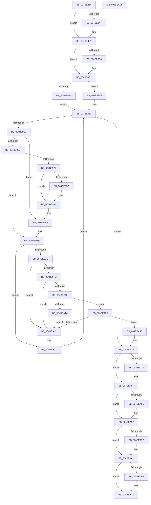

# MiAdjustSecureDriverStateForIatCapture

- RVA: `0x004BE864`–`0x004BEAE0` (길이 `636` bytes)
- VA: `0x00000001404BE864`
- 실행 섹션: `.text`
- PDB 이름 있음: `예`; PDB Function 태그: `아니요`
- unwind 정보 RVA: `0x0007BBB4`
- 디코드: `167`개 명령, `636/636` bytes 표시
- 미해석 바이트: `0` (있으면 어셈블리에 `.byte`로 보존)

> 이 문서는 커널 이미지의 기계어와 PDB 기호를 분석해 생성했습니다. 4번과 5번은 함수 원형과 자료형을 바이너리 사용 방식에서 추정한 C 해석이며 원본 소스 복구 결과는 아닙니다.

## 1. Dependencies

- 직접 호출 지점: **17**; 고유 호출 대상: **15**
- 직접 호출자로 확인된 함수: **2**
- RIP 상대 이미지 참조: **6**

### Outgoing calls
- `0x004BE8AC` → [KiRaiseIrqlProcessIrqlFlags](../4F/KiRaiseIrqlProcessIrqlFlags_function_004F56FC.md) (function, `0x004F56FC`)
- `0x004BE8DC` → [VslExemptSecurePteRange](../4F/VslExemptSecurePteRange_function_004F8AFC.md) (function, `0x004F8AFC`)
- `0x004BE930` → [MiLockWorkingSetSharedAtDpc](../23/MiLockWorkingSetSharedAtDpc_function_00239574.md) (function, `0x00239574`)
- `0x004BE93A` → [MiGetProcessorFlushList](../24/MiGetProcessorFlushList_function_00242C90.md) (function, `0x00242C90`)
- `0x004BE957` → [MiInitializeTbFlushList](../29/MiInitializeTbFlushList_function_00294F00.md) (function, `0x00294F00`)
- `0x004BE97F` → [MiFlushTbList](../31/MiFlushTbList_function_00311FC0.md) (function, `0x00311FC0`)
- `0x004BE98A` → [MiUnlockPageTable](../21/MiUnlockPageTable_function_00216EC0.md) (function, `0x00216EC0`)
- `0x004BE9B9` → [MiLockNestedPageTable](../23/MiLockNestedPageTable_function_0023E890.md) (function, `0x0023E890`)
- `0x004BE9C1` → [MI_READ_PTE_LOCK_FREE](../28/MI_READ_PTE_LOCK_FREE_function_002828A0.md) (function, `0x002828A0`)
- `0x004BEA09` → [MiGetPagePrivilege](../28/MiGetPagePrivilege_function_00285420.md) (function, `0x00285420`)
- `0x004BEA24` → [MiInsertTbFlushEntry](../29/MiInsertTbFlushEntry_function_00293670.md) (function, `0x00293670`)
- `0x004BEA39` → [KeSetPagePrivilege](../40/KeSetPagePrivilege_function_00407970.md) (function, `0x00407970`)
- `0x004BEA74` → [KeBugCheckEx](../4F/KeBugCheckEx_function_004FD660.md) (function, `0x004FD660`)
- `0x004BEA82` → [MiFlushTbList](../31/MiFlushTbList_function_00311FC0.md) (function, `0x00311FC0`)
- `0x004BEA92` → [MiUnlockPageTable](../21/MiUnlockPageTable_function_00216EC0.md) (function, `0x00216EC0`)
- `0x004BEA9C` → [MiReleaseProcessorFlushList](../31/MiReleaseProcessorFlushList_function_00313C70.md) (function, `0x00313C70`)
- `0x004BEAA7` → [MiUnlockWorkingSetShared](../27/MiUnlockWorkingSetShared_function_0027D690.md) (function, `0x0027D690`)

### Direct callers
- [MiApplyImportOptimizationToRuntimeDriver](../../page/A9/MiApplyImportOptimizationToRuntimeDriver_function_00A9F93C.md) at `0x00A9FAB3`
- [sub_00B49200](../../page/B4/Unknown_function_00B49200.md) at `0x00B4920E`

### Static image references
- `0x004BE89E` → RVA `0x00FC6D20` (`ALMOSTRO`; read)
- `0x004BE8BD` → RVA `0x00E2D9B0` (`.data`; write)
- `0x004BE8CB` → RVA `0x00E2D9A8` (`.data`; write)
- `0x004BE905` → RVA `0x00E37E40` (`.data`; read)
- `0x004BEAB1` → RVA `0x00E2D9A8` (`.data`; read/write)
- `0x004BEAB9` → RVA `0x00E2D9B0` (`.data`; read/write)

## 2. Other-region calls and transfers

- 다른 실행 섹션으로 향하는 call: **0**
- 별도 외부 분기/꼬리 이동을 확인하지 못했습니다.

## 3. Assembly (complete function range)

```asm
004BE864  48 8B C4                        mov rax, rsp
004BE867  48 89 58 10                     mov qword ptr [rax + 0x10], rbx
004BE86B  48 89 68 18                     mov qword ptr [rax + 0x18], rbp
004BE86F  48 89 70 20                     mov qword ptr [rax + 0x20], rsi
004BE873  57                              push rdi
004BE874  41 54                           push r12
004BE876  41 55                           push r13
004BE878  41 56                           push r14
004BE87A  41 57                           push r15
004BE87C  48 83 EC 40                     sub rsp, 0x40
004BE880  4C 8B 79 30                     mov r15, qword ptr [rcx + 0x30]
004BE884  0F 57 C0                        xorps xmm0, xmm0
004BE887  0F 11 40 C8                     movups xmmword ptr [rax - 0x38], xmm0
004BE88B  44 8B E2                        mov r12d, edx
004BE88E  48 8B D9                        mov rbx, rcx
004BE891  45 0F 20 C5                     mov r13, cr8
004BE895  B8 02 00 00 00                  mov eax, 2
004BE89A  44 0F 22 C0                     mov cr8, rax
004BE89E  83 3D 7B 84 B0 00 00            cmp dword ptr [rip + 0xb0847b], 0
004BE8A5  74 0A                           je 0x1404be8b1
004BE8A7  8A D0                           mov dl, al
004BE8A9  41 8A CD                        mov cl, r13b
004BE8AC  E8 4B 6E 03 00                  call 0x1404f56fc
004BE8B1  45 85 E4                        test r12d, r12d
004BE8B4  74 1C                           je 0x1404be8d2
004BE8B6  8B 43 40                        mov eax, dword ptr [rbx + 0x40]
004BE8B9  48 03 43 30                     add rax, qword ptr [rbx + 0x30]
004BE8BD  48 89 05 EC F0 96 00            mov qword ptr [rip + 0x96f0ec], rax
004BE8C4  45 85 E4                        test r12d, r12d
004BE8C7  48 8B 43 30                     mov rax, qword ptr [rbx + 0x30]
004BE8CB  48 89 05 D6 F0 96 00            mov qword ptr [rip + 0x96f0d6], rax
004BE8D2  8B 53 40                        mov edx, dword ptr [rbx + 0x40]
004BE8D5  41 0F 95 C0                     setne r8b
004BE8D9  49 8B CF                        mov rcx, r15
004BE8DC  E8 1B A2 03 00                  call 0x1404f8afc
004BE8E1  48 B8 F8 FF FF FF 7F 00 00 00   movabs rax, 0x7ffffffff8
004BE8EB  49 8B F7                        mov rsi, r15
004BE8EE  48 C1 EE 09                     shr rsi, 9
004BE8F2  48 23 F0                        and rsi, rax
004BE8F5  48 B8 00 00 00 00 80 F6 FF FF   movabs rax, 0xfffff68000000000
004BE8FF  48 8B C0                        mov rax, rax
004BE902  8B 4B 40                        mov ecx, dword ptr [rbx + 0x40]
004BE905  4C 8D 35 34 95 97 00            lea r14, [rip + 0x979534]
004BE90C  48 03 F0                        add rsi, rax
004BE90F  B8 00 00 00 00                  mov eax, 0
004BE914  F7 C1 FF 0F 00 00               test ecx, 0xfff
004BE91A  0F 95 C0                        setne al
004BE91D  C1 E9 0C                        shr ecx, 0xc
004BE920  03 C1                           add eax, ecx
004BE922  33 FF                           xor edi, edi
004BE924  49 8B CE                        mov rcx, r14
004BE927  48 8D 2C C6                     lea rbp, [rsi + rax*8]
004BE92B  48 89 6C 24 70                  mov qword ptr [rsp + 0x70], rbp
004BE930  E8 3F AC D7 FF                  call 0x140239574
004BE935  45 85 E4                        test r12d, r12d
004BE938  74 24                           je 0x1404be95e
004BE93A  E8 51 43 D8 FF                  call 0x140242c90
004BE93F  45 33 C9                        xor r9d, r9d
004BE942  C7 44 24 20 01 00 00 00         mov dword ptr [rsp + 0x20], 1
004BE94A  49 8B D6                        mov rdx, r14
004BE94D  48 8B C8                        mov rcx, rax
004BE950  48 8B D8                        mov rbx, rax
004BE953  44 8B 40 0C                     mov r8d, dword ptr [rax + 0xc]
004BE957  E8 A4 65 DD FF                  call 0x140294f00
004BE95C  EB 02                           jmp 0x1404be960
004BE95E  33 DB                           xor ebx, ebx
004BE960  48 3B F5                        cmp rsi, rbp
004BE963  0F 83 11 01 00 00               jae 0x1404bea7a
004BE969  48 85 FF                        test rdi, rdi
004BE96C  74 21                           je 0x1404be98f
004BE96E  48 F7 C6 FF 0F 00 00            test rsi, 0xfff
004BE975  75 47                           jne 0x1404be9be
004BE977  48 85 DB                        test rbx, rbx
004BE97A  74 08                           je 0x1404be984
004BE97C  48 8B CB                        mov rcx, rbx
004BE97F  E8 3C 36 E5 FF                  call 0x140311fc0
004BE984  48 8B D7                        mov rdx, rdi
004BE987  49 8B CE                        mov rcx, r14
004BE98A  E8 31 85 D5 FF                  call 0x140216ec0
004BE98F  48 B8 F8 FF FF FF 7F 00 00 00   movabs rax, 0x7ffffffff8
004BE999  48 8B FE                        mov rdi, rsi
004BE99C  48 C1 EF 09                     shr rdi, 9
004BE9A0  48 23 F8                        and rdi, rax
004BE9A3  48 B8 00 00 00 00 80 F6 FF FF   movabs rax, 0xfffff68000000000
004BE9AD  48 8B C0                        mov rax, rax
004BE9B0  48 03 F8                        add rdi, rax
004BE9B3  49 8B CE                        mov rcx, r14
004BE9B6  48 8B D7                        mov rdx, rdi
004BE9B9  E8 D2 FE D7 FF                  call 0x14023e890
004BE9BE  48 8B CE                        mov rcx, rsi
004BE9C1  E8 DA 3E DC FF                  call 0x1402828a0
004BE9C6  4C 8B F0                        mov r14, rax
004BE9C9  A8 01                           test al, 1
004BE9CB  74 7A                           je 0x1404bea47
004BE9CD  49 C1 EE 0C                     shr r14, 0xc
004BE9D1  48 B8 FF FF FF FF FF 00 00 00   movabs rax, 0xffffffffff
004BE9DB  4C 23 F0                        and r14, rax
004BE9DE  4B 8D 2C 76                     lea rbp, [r14 + r14*2]
004BE9E2  48 C1 E5 04                     shl rbp, 4
004BE9E6  48 B8 00 00 00 00 00 DE FF FF   movabs rax, 0xffffde0000000000
004BE9F0  48 03 E8                        add rbp, rax
004BE9F3  48 8B 45 28                     mov rax, qword ptr [rbp + 0x28]
004BE9F7  48 85 C0                        test rax, rax
004BE9FA  79 46                           jns 0x1404bea42
004BE9FC  4C 8D 44 24 30                  lea r8, [rsp + 0x30]
004BEA01  BA 02 00 00 00                  mov edx, 2
004BEA06  48 8B CD                        mov rcx, rbp
004BEA09  E8 12 6A DC FF                  call 0x140285420
004BEA0E  A8 01                           test al, 1
004BEA10  74 30                           je 0x1404bea42
004BEA12  49 8B D7                        mov rdx, r15
004BEA15  45 85 E4                        test r12d, r12d
004BEA18  74 11                           je 0x1404bea2b
004BEA1A  45 33 C9                        xor r9d, r9d
004BEA1D  48 8B CB                        mov rcx, rbx
004BEA20  45 8D 41 01                     lea r8d, [r9 + 1]
004BEA24  E8 47 4C DD FF                  call 0x140293670
004BEA29  EB 17                           jmp 0x1404bea42
004BEA2B  41 B9 00 02 00 00               mov r9d, 0x200
004BEA31  4C 8D 44 24 30                  lea r8, [rsp + 0x30]
004BEA36  49 8B CE                        mov rcx, r14
004BEA39  E8 32 8F F4 FF                  call 0x140407970
004BEA3E  85 C0                           test eax, eax
004BEA40  78 1C                           js 0x1404bea5e
004BEA42  48 8B 6C 24 70                  mov rbp, qword ptr [rsp + 0x70]
004BEA47  48 83 C6 08                     add rsi, 8
004BEA4B  4C 8D 35 EE 93 97 00            lea r14, [rip + 0x9793ee]
004BEA52  49 81 C7 00 10 00 00            add r15, 0x1000
004BEA59  E9 02 FF FF FF                  jmp 0x1404be960
004BEA5E  48 83 64 24 20 00               and qword ptr [rsp + 0x20], 0
004BEA64  4C 8B C5                        mov r8, rbp
004BEA67  4C 63 C8                        movsxd r9, eax
004BEA6A  BA 10 15 05 00                  mov edx, 0x51510
004BEA6F  B9 1A 00 00 00                  mov ecx, 0x1a
004BEA74  E8 E7 EB 03 00                  call 0x1404fd660
004BEA79  CC                              int3
004BEA7A  48 85 DB                        test rbx, rbx
004BEA7D  74 08                           je 0x1404bea87
004BEA7F  48 8B CB                        mov rcx, rbx
004BEA82  E8 39 35 E5 FF                  call 0x140311fc0
004BEA87  48 85 FF                        test rdi, rdi
004BEA8A  74 0B                           je 0x1404bea97
004BEA8C  48 8B D7                        mov rdx, rdi
004BEA8F  49 8B CE                        mov rcx, r14
004BEA92  E8 29 84 D5 FF                  call 0x140216ec0
004BEA97  48 85 DB                        test rbx, rbx
004BEA9A  74 05                           je 0x1404beaa1
004BEA9C  E8 CF 51 E5 FF                  call 0x140313c70
004BEAA1  41 8A D5                        mov dl, r13b
004BEAA4  49 8B CE                        mov rcx, r14
004BEAA7  E8 E4 EB DB FF                  call 0x14027d690
004BEAAC  45 85 E4                        test r12d, r12d
004BEAAF  75 10                           jne 0x1404beac1
004BEAB1  48 83 25 EF EE 96 00 00         and qword ptr [rip + 0x96eeef], 0
004BEAB9  48 83 25 EF EE 96 00 00         and qword ptr [rip + 0x96eeef], 0
004BEAC1  4C 8D 5C 24 40                  lea r11, [rsp + 0x40]
004BEAC6  49 8B 5B 38                     mov rbx, qword ptr [r11 + 0x38]
004BEACA  49 8B 6B 40                     mov rbp, qword ptr [r11 + 0x40]
004BEACE  49 8B 73 48                     mov rsi, qword ptr [r11 + 0x48]
004BEAD2  49 8B E3                        mov rsp, r11
004BEAD5  41 5F                           pop r15
004BEAD7  41 5E                           pop r14
004BEAD9  41 5D                           pop r13
004BEADB  41 5C                           pop r12
004BEADD  5F                              pop rdi
004BEADE  C3                              ret
004BEADF  CC                              int3
```

## 4. C-style interpretation (structured pseudocode)

```c
__int64 __fastcall MiAdjustSecureDriverStateForIatCapture(__int64 a1, int a2, __int64 a3, int a4)
{
    __int64 result;
    __int64 v_r14;
    __int64 v_r15;
    __int64 v_rbp;
    __int64 v_rbx;
    __int64 v_rdi;
    __int64 v_rsi;
    __int64 v_rsp;
    unsigned __int64 v_stack_m28;
    unsigned __int64 v_stack_m38;
    unsigned int v_stack_m48;
    unsigned __int64 v_stack_p8;

    *(unsigned __int64 *)(v_rsp + 16) = v_rbx;
    *(unsigned __int64 *)(v_rsp + 24) = v_rbp;
    *(unsigned __int64 *)(v_rsp + 32) = v_rsi;
    v_rsp = (v_rsp) - (64);
    *(unsigned __int64 *)(v_rsp - 56) = v_xmm0;
    result = 2;
    if ((*(unsigned int *)(v_rip + 11568251)) != 0) {
        a2 = 2;
        a1 = (unsigned __int8)(v_cr8);
        result = KiRaiseIrqlProcessIrqlFlags(a1, a2, a3, a4);
    }
    if ((unsigned int)((unsigned int)(a2)) != 0) {
        result = *(unsigned int *)(a1 + 64);
        result = (result) + (*(unsigned __int64 *)(a1 + 48));
        *(unsigned __int64 *)(v_rip + 9892076) = result;
        result = *(unsigned __int64 *)(a1 + 48);
        *(unsigned __int64 *)(v_rip + 9892054) = result;
    }
    a3 = ((unsigned int)((unsigned int)(a2)) != 0) ? 1 : 0;
    result = VslExemptSecurePteRange(*(unsigned __int64 *)(a1 + 48), (unsigned int)(*(unsigned int *)(a1 + 64)), a3, a4);
    v_rsi = (*(unsigned __int64 *)(a1 + 48)) >> (9);
    v_rsi = (v_rsi) & (result);
    v_rsi = (v_rsi) + (result);
    result = ((((unsigned int)((unsigned int)(*(unsigned int *)(a1 + 64)))) & (0xFFFULL)) != 0) ? 1 : 0;
    a1 = (unsigned int)(((unsigned int)(*(unsigned int *)(a1 + 64))) >> (12));
    result = (unsigned int)((result) + ((unsigned int)(a1)));
    v_rdi = 0;
    v_stack_p8 = v_rsi + result * 8;
    result = MiLockWorkingSetSharedAtDpc(v_rip + 9934132, (unsigned int)(*(unsigned int *)(a1 + 64)), a3, a4);
    if ((unsigned int)((unsigned int)(a2)) == 0) goto loc_004BE95E;
    result = MiGetProcessorFlushList(v_rip + 9934132, (unsigned int)(*(unsigned int *)(a1 + 64)), a3, a4);
    a4 = 0;
    v_stack_m48 = 1;
    result = MiInitializeTbFlushList(result, v_rip + 9934132, (unsigned int)(*(unsigned int *)(result + 12)), a4);
    goto loc_004BE960;
loc_004BE95E:
    v_rbx = 0;
loc_004BE960:
    if (v_rsi >= (v_rsi + result * 8)) goto loc_004BEA7A;
    if (0 == 0) goto loc_004BE98F;
    if (((v_rsi) & (0xFFFULL)) != 0) goto loc_004BE9BE;
    if (0 != 0) {
        a1 = 0;
        result = MiFlushTbList(a1, v_rip + 9934132, (unsigned int)(*(unsigned int *)(result + 12)), a4);
    }
    result = MiUnlockPageTable(v_rip + 9934132, 0, (unsigned int)(*(unsigned int *)(result + 12)), a4);
loc_004BE98F:
    v_rdi = (v_rsi) >> (9);
    v_rdi = (v_rdi) & (result);
    v_rdi = (v_rdi) + (result);
    result = MiLockNestedPageTable(v_rip + 9934132, v_rdi, (unsigned int)(*(unsigned int *)(result + 12)), a4);
loc_004BE9BE:
    result = MI_READ_PTE_LOCK_FREE(v_rsi, v_rdi, (unsigned int)(*(unsigned int *)(result + 12)), a4);
    if ((((unsigned __int8)(result)) & (1)) == 0) goto loc_004BEA47;
    v_r14 = (result) >> (12);
    v_r14 = (v_r14) & (result);
    v_rbp = (v_r14 + v_r14 * 2) << (4);
    v_rbp = (v_rbp) + (result);
    if (!sign_flag) goto loc_004BEA42;
    result = MiGetPagePrivilege(v_rbp, 2, v_stack_m38, a4);
    if ((((unsigned __int8)(result)) & (1)) == 0) goto loc_004BEA42;
    if ((unsigned int)((unsigned int)(a2)) == 0) goto loc_004BEA2B;
    a4 = 0;
    result = MiInsertTbFlushEntry(0, *(unsigned __int64 *)(a1 + 48), a4 + 1, a4);
    goto loc_004BEA42;
loc_004BEA2B:
    result = KeSetPagePrivilege(v_r14, *(unsigned __int64 *)(a1 + 48), v_stack_m38, 512);
    if (sign_flag) goto loc_004BEA5E;
loc_004BEA42:
loc_004BEA47:
    v_rsi = (v_rsi) + (8);
    v_r15 = (*(unsigned __int64 *)(a1 + 48)) + (0x1000ULL);
    goto loc_004BE960;
loc_004BEA5E:
    result = KeBugCheckEx(26, (unsigned int)(0x51510ULL), v_stack_p8, (int)((unsigned int)(result)));
loc_004BEA7A:
    if (0 != 0) {
        a1 = 0;
        result = MiFlushTbList(a1, (unsigned int)(0x51510ULL), v_stack_p8, (int)((unsigned int)(result)));
    }
    if (v_rdi != 0) {
        a2 = v_rdi;
        a1 = v_rip + 9933806;
        result = MiUnlockPageTable(a1, a2, v_stack_p8, (int)((unsigned int)(result)));
    }
    if (0 != 0) {
        result = MiReleaseProcessorFlushList(a1, a2, v_stack_p8, (int)((unsigned int)(result)));
    }
    result = MiUnlockWorkingSetShared(v_rip + 9933806, (unsigned __int8)(v_cr8), v_stack_p8, (int)((unsigned int)(result)));
    if ((unsigned int)((unsigned int)(a2)) == 0) {
    }
    return result;
}
```

## 5. (Beta) C Style

```c
int64_t MiAdjustSecureDriverStateForIatCapture(void *Arg1, int32_t Arg2, int64_t Arg3, int32_t Arg4)
{
    uint8_t *arg1 = (uint8_t *)Arg1;

    int64_t result;
    int64_t local_r14;
    int64_t local_r15;
    int64_t local_rbp;
    int64_t local_rbx;
    int64_t local_rdi;
    int64_t local_rsi;
    int64_t local_rsp;
    uint64_t v_stack_m28;
    uint64_t v_stack_m38;
    uint32_t v_stack_m48;
    uint64_t v_stack_p8;

    *(uint64_t *)(local_rsp + 0x10) = local_rbx;
    *(uint64_t *)(local_rsp + 0x18) = local_rbp;
    *(uint64_t *)(local_rsp + 0x20) = local_rsi;
    local_rsp = (local_rsp) - (64);
    *(uint64_t *)(local_rsp - 0x38) = v_xmm0;
    result = 2;
    if ((*(uint32_t *)(v_rip + 0xB0847B)) != 0) {
        Arg2 = 2;
        Arg1 = (uint8_t)(v_cr8);
        result = KiRaiseIrqlProcessIrqlFlags(Arg1, Arg2, Arg3, Arg4);
    }
    if ((uint32_t)((uint32_t)(Arg2)) != 0) {
        result = *(uint32_t *)(arg1 + 0x40);
        result = (result) + (*(uint64_t *)(arg1 + 0x30));
        *(uint64_t *)(v_rip + 0x96F0EC) = result;
        result = *(uint64_t *)(arg1 + 0x30);
        *(uint64_t *)(v_rip + 0x96F0D6) = result;
    }
    Arg3 = ((uint32_t)((uint32_t)(Arg2)) != 0) ? 1 : 0;
    result = VslExemptSecurePteRange(*(uint64_t *)(arg1 + 0x30), (uint32_t)(*(uint32_t *)(arg1 + 0x40)), Arg3, Arg4);
    local_rsi = (*(uint64_t *)(arg1 + 0x30)) >> (9);
    local_rsi = (local_rsi) & (result);
    local_rsi = (local_rsi) + (result);
    result = ((((uint32_t)((uint32_t)(*(uint32_t *)(arg1 + 0x40)))) & (0xFFFULL)) != 0) ? 1 : 0;
    Arg1 = (uint32_t)(((uint32_t)(*(uint32_t *)(arg1 + 0x40))) >> (12));
    result = (uint32_t)((result) + ((uint32_t)(Arg1)));
    local_rdi = 0;
    v_stack_p8 = local_rsi + result * 8;
    result = MiLockWorkingSetSharedAtDpc(v_rip + 9934132, (uint32_t)(*(uint32_t *)(arg1 + 0x40)), Arg3, Arg4);
    if ((uint32_t)((uint32_t)(Arg2)) == 0) goto loc_004BE95E;
    result = MiGetProcessorFlushList(v_rip + 9934132, (uint32_t)(*(uint32_t *)(arg1 + 0x40)), Arg3, Arg4);
    Arg4 = 0;
    v_stack_m48 = 1;
    result = MiInitializeTbFlushList(result, v_rip + 9934132, (uint32_t)(*(uint32_t *)(result + 0xC)), Arg4);
    goto loc_004BE960;
loc_004BE95E:
    local_rbx = 0;
loc_004BE960:
    if (local_rsi >= (local_rsi + result * 8)) goto loc_004BEA7A;
    if (0 == 0) goto loc_004BE98F;
    if (((local_rsi) & (0xFFFULL)) != 0) goto loc_004BE9BE;
    if (0 != 0) {
        Arg1 = 0;
        result = MiFlushTbList(Arg1, v_rip + 9934132, (uint32_t)(*(uint32_t *)(result + 0xC)), Arg4);
    }
    result = MiUnlockPageTable(v_rip + 9934132, 0, (uint32_t)(*(uint32_t *)(result + 0xC)), Arg4);
loc_004BE98F:
    local_rdi = (local_rsi) >> (9);
    local_rdi = (local_rdi) & (result);
    local_rdi = (local_rdi) + (result);
    result = MiLockNestedPageTable(v_rip + 9934132, local_rdi, (uint32_t)(*(uint32_t *)(result + 0xC)), Arg4);
loc_004BE9BE:
    result = MI_READ_PTE_LOCK_FREE(local_rsi, local_rdi, (uint32_t)(*(uint32_t *)(result + 0xC)), Arg4);
    if ((((uint8_t)(result)) & (1)) == 0) goto loc_004BEA47;
    local_r14 = (result) >> (12);
    local_r14 = (local_r14) & (result);
    local_rbp = (local_r14 + local_r14 * 2) << (4);
    local_rbp = (local_rbp) + (result);
    if (!sign_flag) goto loc_004BEA42;
    result = MiGetPagePrivilege(local_rbp, 2, v_stack_m38, Arg4);
    if ((((uint8_t)(result)) & (1)) == 0) goto loc_004BEA42;
    if ((uint32_t)((uint32_t)(Arg2)) == 0) goto loc_004BEA2B;
    Arg4 = 0;
    result = MiInsertTbFlushEntry(0, *(uint64_t *)(arg1 + 0x30), Arg4 + 1, Arg4);
    goto loc_004BEA42;
loc_004BEA2B:
    result = KeSetPagePrivilege(local_r14, *(uint64_t *)(arg1 + 0x30), v_stack_m38, 512);
    if (sign_flag) goto loc_004BEA5E;
loc_004BEA42:
loc_004BEA47:
    local_rsi = (local_rsi) + (8);
    local_r15 = (*(uint64_t *)(arg1 + 0x30)) + (0x1000ULL);
    goto loc_004BE960;
loc_004BEA5E:
    result = KeBugCheckEx(26, (uint32_t)(0x51510ULL), v_stack_p8, (int32_t)((uint32_t)(result)));
loc_004BEA7A:
    if (0 != 0) {
        Arg1 = 0;
        result = MiFlushTbList(Arg1, (uint32_t)(0x51510ULL), v_stack_p8, (int32_t)((uint32_t)(result)));
    }
    if (local_rdi != 0) {
        Arg2 = local_rdi;
        Arg1 = v_rip + 9933806;
        result = MiUnlockPageTable(Arg1, Arg2, v_stack_p8, (int32_t)((uint32_t)(result)));
    }
    if (0 != 0) {
        result = MiReleaseProcessorFlushList(Arg1, Arg2, v_stack_p8, (int32_t)((uint32_t)(result)));
    }
    result = MiUnlockWorkingSetShared(v_rip + 9933806, (uint8_t)(v_cr8), v_stack_p8, (int32_t)((uint32_t)(result)));
    if ((uint32_t)((uint32_t)(Arg2)) == 0) {
    }
    return result;
}
```

### 관측된 메모리 오프셋

구조체 형식이 확인되지 않은 접근은 인자 기준의 오프셋으로만 기록했습니다.

| 기준 인자 | 오프셋 표현 | 폭 (bit) | 접근 |
|---|---:|---:|---|
| `Arg1` | `+ 0x30` | `64` | `R` |
| `Arg1` | `+ 0x40` | `32` | `R` |

## 6. Execution-region graph

[열기: 2D/3D 그래프와 함수 탐색 컨트롤 패널](../../../control-panel.html?section=text&rva=0x004BE864&view=graph)

- 2D 그래프는 위에서 아래로 흐르고, 3D 그래프는 빈 공간을 드래그해 회전합니다. Shift+드래그는 이동, 휠은 확대·축소, 함수 노드 선택은 대상 보고서 이동입니다.

### Static fallback


