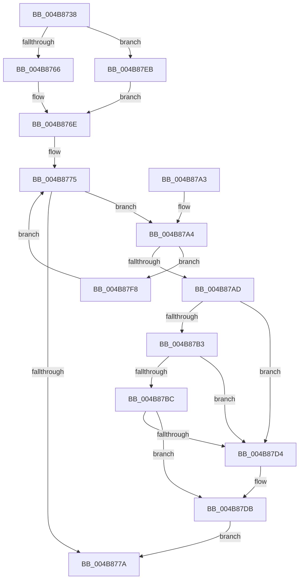

# MiAllocateHardwareDescriptor

- RVA: `0x004B8738`–`0x004B8800` (길이 `200` bytes)
- VA: `0x00000001404B8738`
- 실행 섹션: `.text`
- PDB 이름 있음: `예`; PDB Function 태그: `아니요`
- unwind 정보 RVA: `0x0009CC80`
- 디코드: `55`개 명령, `200/200` bytes 표시
- 미해석 바이트: `0` (있으면 어셈블리에 `.byte`로 보존)

> 이 문서는 커널 이미지의 기계어와 PDB 기호를 분석해 생성했습니다. 4번과 5번은 함수 원형과 자료형을 바이너리 사용 방식에서 추정한 C 해석이며 원본 소스 복구 결과는 아닙니다.

## 1. Dependencies

- 직접 호출 지점: **3**; 고유 호출 대상: **3**
- 직접 호출자로 확인된 함수: **2**
- RIP 상대 이미지 참조: **0**

### Outgoing calls
- `0x004B8766` → [ExAcquireSpinLockExclusive](../24/ExAcquireSpinLockExclusive_function_00248690.md) (function, `0x00248690`)
- `0x004B878B` → [MiReleaseSpinLockExclusive](../24/MiReleaseSpinLockExclusive_function_002482C0.md) (function, `0x002482C0`)
- `0x004B87EE` → [ExAcquireSpinLockExclusiveAtDpcLevel](../24/ExAcquireSpinLockExclusiveAtDpcLevel_function_00248E80.md) (function, `0x00248E80`)

### Direct callers
- [MiTryZeroMemory](../31/MiTryZeroMemory_function_0031E720.md) at `0x0031E874`
- [MiComputeCacheAttributeSpeeds](../69/MiComputeCacheAttributeSpeeds_function_006999E8.md) at `0x00699BDD`

### Static image references
- 디코드된 RIP-relative 메모리 참조가 없습니다.

## 2. Other-region calls and transfers

- 다른 실행 섹션으로 향하는 call: **0**
- 별도 외부 분기/꼬리 이동을 확인하지 못했습니다.

## 3. Assembly (complete function range)

```asm
004B8738  48 89 5C 24 08                  mov qword ptr [rsp + 8], rbx
004B873D  48 89 74 24 10                  mov qword ptr [rsp + 0x10], rsi
004B8742  57                              push rdi
004B8743  48 83 EC 20                     sub rsp, 0x20
004B8747  48 8B D9                        mov rbx, rcx
004B874A  33 FF                           xor edi, edi
004B874C  44 0F 20 C0                     mov rax, cr8
004B8750  48 8B 89 D0 00 00 00            mov rcx, qword ptr [rcx + 0xd0]
004B8757  48 81 C1 B0 3B 00 00            add rcx, 0x3bb0
004B875E  3C 02                           cmp al, 2
004B8760  0F 84 85 00 00 00               je 0x1404b87eb
004B8766  E8 25 FF D8 FF                  call 0x140248690
004B876B  40 8A F0                        mov sil, al
004B876E  48 8D 4B 78                     lea rcx, [rbx + 0x78]
004B8772  48 8B 01                        mov rax, qword ptr [rcx]
004B8775  48 3B C1                        cmp rax, rcx
004B8778  75 2A                           jne 0x1404b87a4
004B877A  48 8B 8B D0 00 00 00            mov rcx, qword ptr [rbx + 0xd0]
004B8781  40 8A D6                        mov dl, sil
004B8784  48 81 C1 B0 3B 00 00            add rcx, 0x3bb0
004B878B  E8 30 FB D8 FF                  call 0x1402482c0
004B8790  48 8B 5C 24 30                  mov rbx, qword ptr [rsp + 0x30]
004B8795  48 8B C7                        mov rax, rdi
004B8798  48 8B 74 24 38                  mov rsi, qword ptr [rsp + 0x38]
004B879D  48 83 C4 20                     add rsp, 0x20
004B87A1  5F                              pop rdi
004B87A2  C3                              ret
004B87A3  CC                              int3
004B87A4  48 8B 10                        mov rdx, qword ptr [rax]
004B87A7  40 38 78 10                     cmp byte ptr [rax + 0x10], dil
004B87AB  75 4B                           jne 0x1404b87f8
004B87AD  48 39 42 08                     cmp qword ptr [rdx + 8], rax
004B87B1  75 21                           jne 0x1404b87d4
004B87B3  4C 8B 40 08                     mov r8, qword ptr [rax + 8]
004B87B7  49 39 00                        cmp qword ptr [r8], rax
004B87BA  75 18                           jne 0x1404b87d4
004B87BC  49 89 10                        mov qword ptr [r8], rdx
004B87BF  48 8D 78 20                     lea rdi, [rax + 0x20]
004B87C3  4C 89 42 08                     mov qword ptr [rdx + 8], r8
004B87C7  C6 40 10 01                     mov byte ptr [rax + 0x10], 1
004B87CB  48 8B 51 08                     mov rdx, qword ptr [rcx + 8]
004B87CF  48 39 0A                        cmp qword ptr [rdx], rcx
004B87D2  74 07                           je 0x1404b87db
004B87D4  B9 03 00 00 00                  mov ecx, 3
004B87D9  CD 29                           int 0x29
004B87DB  48 89 08                        mov qword ptr [rax], rcx
004B87DE  48 89 50 08                     mov qword ptr [rax + 8], rdx
004B87E2  48 89 02                        mov qword ptr [rdx], rax
004B87E5  48 89 41 08                     mov qword ptr [rcx + 8], rax
004B87E9  EB 8F                           jmp 0x1404b877a
004B87EB  40 B6 11                        mov sil, 0x11
004B87EE  E8 8D 06 D9 FF                  call 0x140248e80
004B87F3  E9 76 FF FF FF                  jmp 0x1404b876e
004B87F8  48 8B C2                        mov rax, rdx
004B87FB  E9 75 FF FF FF                  jmp 0x1404b8775
```

## 4. C-style interpretation (structured pseudocode)

```c
__int64 __fastcall MiAllocateHardwareDescriptor(__int64 a1)
{
    __int64 result;
    __int64 v_rdi;
    __int64 v_rsp;
    unsigned __int64 v_stack_p10;
    unsigned __int64 v_stack_p8;

    v_stack_p8 = v_rbx;
    v_stack_p10 = v_rsi;
    v_rsp = (v_rsp) - (32);
    v_rdi = 0;
    a1 = (*(unsigned __int64 *)(a1 + 208)) + (0x3BB0ULL);
    if (((unsigned __int8)(v_cr8)) == 2) goto loc_004B87EB;
    result = ExAcquireSpinLockExclusive(a1, a2, a3, a4);
loc_004B876E:
loc_004B8775:
    if ((*(unsigned __int64 *)(a1 + 120)) != (a1 + 120)) goto loc_004B87A4;
loc_004B877A:
    a1 = (*(unsigned __int64 *)(a1 + 208)) + (0x3BB0ULL);
    result = MiReleaseSpinLockExclusive(a1, (unsigned __int8)((unsigned __int8)(result)), a3, a4);
    v_rsp = (v_rsp) + (32);
    return 0;
loc_004B87A4:
    if ((*(unsigned __int8 *)(0 + 16)) != 0) goto loc_004B87F8;
    if ((*(unsigned __int64 *)(*(unsigned __int64 *)(0) + 8)) != 0) goto loc_004B87D4;
    if ((*(unsigned __int64 *)(*(unsigned __int64 *)(0 + 8))) != 0) goto loc_004B87D4;
    *(unsigned __int64 *)(*(unsigned __int64 *)(0 + 8)) = *(unsigned __int64 *)(0);
    *(unsigned __int64 *)(*(unsigned __int64 *)(0) + 8) = *(unsigned __int64 *)(0 + 8);
    *(unsigned __int8 *)(0 + 16) = 1;
    if ((*(unsigned __int64 *)(*(unsigned __int64 *)(a1 + 8))) != a1) {
        a1 = 3;
    }
    *(unsigned __int64 *)(0) = a1;
    *(unsigned __int64 *)(0 + 8) = *(unsigned __int64 *)(a1 + 8);
    *(unsigned __int64 *)(*(unsigned __int64 *)(a1 + 8)) = 0;
    *(unsigned __int64 *)(a1 + 8) = 0;
    goto loc_004B877A;
loc_004B87EB:
    result = ExAcquireSpinLockExclusiveAtDpcLevel(a1, *(unsigned __int64 *)(a1 + 8), *(unsigned __int64 *)(0 + 8), a4);
    goto loc_004B876E;
loc_004B87F8:
    goto loc_004B8775;
}
```

## 5. (Beta) C Style

```c
int64_t MiAllocateHardwareDescriptor(void *Arg1)
{
    uint8_t *arg1 = (uint8_t *)Arg1;

    int64_t result;
    int64_t local_rdi;
    int64_t local_rsp;
    uint64_t v_stack_p10;
    uint64_t v_stack_p8;

    v_stack_p8 = local_rbx;
    v_stack_p10 = local_rsi;
    local_rsp = (local_rsp) - (32);
    local_rdi = 0;
    Arg1 = (*(uint64_t *)(arg1 + 0xD0)) + (0x3BB0ULL);
    if (((uint8_t)(v_cr8)) == 2) goto loc_004B87EB;
    result = ExAcquireSpinLockExclusive(Arg1, a2, a3, a4);
loc_004B876E:
loc_004B8775:
    if ((*(uint64_t *)(arg1 + 0x78)) != (Arg1 + 120)) goto loc_004B87A4;
loc_004B877A:
    Arg1 = (*(uint64_t *)(arg1 + 0xD0)) + (0x3BB0ULL);
    result = MiReleaseSpinLockExclusive(Arg1, (uint8_t)((uint8_t)(result)), a3, a4);
    local_rsp = (local_rsp) + (32);
    return 0;
loc_004B87A4:
    if ((*(uint8_t *)(0 + 0x10)) != 0) goto loc_004B87F8;
    if ((*(uint64_t *)(*(uint64_t *)(0) + 0x8)) != 0) goto loc_004B87D4;
    if ((*(uint64_t *)(*(uint64_t *)(0 + 0x8))) != 0) goto loc_004B87D4;
    *(uint64_t *)(*(uint64_t *)(0 + 0x8)) = *(uint64_t *)(0);
    *(uint64_t *)(*(uint64_t *)(0) + 0x8) = *(uint64_t *)(0 + 0x8);
    *(uint8_t *)(0 + 0x10) = 1;
    if ((*(uint64_t *)(*(uint64_t *)(arg1 + 0x8))) != Arg1) {
        Arg1 = 3;
    }
    *(void **)(0) = Arg1;
    *(uint64_t *)(0 + 0x8) = *(uint64_t *)(arg1 + 0x8);
    *(uint64_t *)(*(uint64_t *)(arg1 + 0x8)) = 0;
    *(uint64_t *)(arg1 + 0x8) = 0;
    goto loc_004B877A;
loc_004B87EB:
    result = ExAcquireSpinLockExclusiveAtDpcLevel(Arg1, *(uint64_t *)(arg1 + 0x8), *(uint64_t *)(0 + 0x8), a4);
    goto loc_004B876E;
loc_004B87F8:
    goto loc_004B8775;
}
```

### 관측된 메모리 오프셋

구조체 형식이 확인되지 않은 접근은 인자 기준의 오프셋으로만 기록했습니다.

| 기준 인자 | 오프셋 표현 | 폭 (bit) | 접근 |
|---|---:|---:|---|
| `Arg1` | `+ 0x0` | `64` | `R` |
| `Arg1` | `+ 0x8` | `64` | `R` |
| `Arg1` | `+ 0x78` | `64` | `R` |
| `Arg1` | `+ 0xD0` | `64` | `R` |

## 6. Execution-region graph

[열기: 2D/3D 그래프와 함수 탐색 컨트롤 패널](../../../control-panel.html?section=text&rva=0x004B8738&view=graph)

- 2D 그래프는 위에서 아래로 흐르고, 3D 그래프는 빈 공간을 드래그해 회전합니다. Shift+드래그는 이동, 휠은 확대·축소, 함수 노드 선택은 대상 보고서 이동입니다.

### Static fallback


