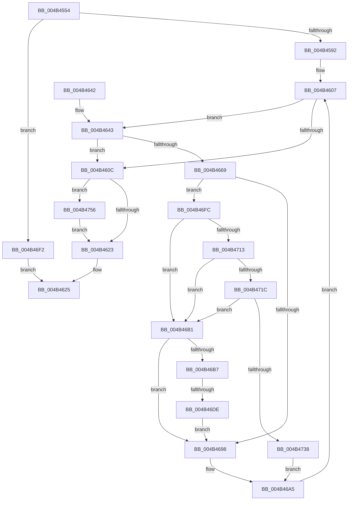

# MiCloneCaptureVadCommit

- RVA: `0x004B4554`–`0x004B4763` (길이 `527` bytes)
- VA: `0x00000001404B4554`
- 실행 섹션: `.text`
- PDB 이름 있음: `예`; PDB Function 태그: `예`
- unwind 정보 RVA: `0x000B9E74`
- 디코드: `132`개 명령, `527/527` bytes 표시
- 미해석 바이트: `0` (있으면 어셈블리에 `.byte`로 보존)

> 이 문서는 커널 이미지의 기계어와 PDB 기호를 분석해 생성했습니다. 4번과 5번은 함수 원형과 자료형을 바이너리 사용 방식에서 추정한 C 해석이며 원본 소스 복구 결과는 아닙니다.

## 1. Dependencies

- 직접 호출 지점: **8**; 고유 호출 대상: **5**
- 직접 호출자로 확인된 함수: **1**
- RIP 상대 이미지 참조: **0**

### Outgoing calls
- `0x004B4581` → [MiAllocatePool](../35/MiAllocatePool_function_0035B540.md) (function, `0x0035B540`)
- `0x004B45FF` → [MiLockWorkingSetExclusive](../32/MiLockWorkingSetExclusive_function_003238A0.md) (function, `0x003238A0`)
- `0x004B4612` → [MiUnlockWorkingSetExclusive](../27/MiUnlockWorkingSetExclusive_function_0027EC70.md) (function, `0x0027EC70`)
- `0x004B465C` → [MiGetNextPageTable](../2C/MiGetNextPageTable_function_002C2EE0.md) (function, `0x002C2EE0`)
- `0x004B46BD` → [MiUnlockWorkingSetExclusive](../27/MiUnlockWorkingSetExclusive_function_0027EC70.md) (function, `0x0027EC70`)
- `0x004B46D0` → [MiAllocatePool](../35/MiAllocatePool_function_0035B540.md) (function, `0x0035B540`)
- `0x004B46EB` → [MiLockWorkingSetExclusive](../32/MiLockWorkingSetExclusive_function_003238A0.md) (function, `0x003238A0`)
- `0x004B4759` → [MiCloneDiscardVadCommit](../../page/AB/MiCloneDiscardVadCommit_function_00AB0CD8.md) (function, `0x00AB0CD8`)

### Direct callers
- [MiAllocateChildVads](../../page/97/MiAllocateChildVads_function_0097E380.md) at `0x0097E58D`

### Static image references
- 디코드된 RIP-relative 메모리 참조가 없습니다.

## 2. Other-region calls and transfers

- 다른 실행 섹션으로 향하는 call: **1**
  - `0x004B4759` → [MiCloneDiscardVadCommit](../../page/AB/MiCloneDiscardVadCommit_function_00AB0CD8.md) (`.text` → `PAGE`)
- call이 아닌 외부 분기/꼬리 이동: **1**
  - `0x004B46D8` → [sub_006FB866](../6F/Unknown_function_006FB866.md) (`tail-transfer`)

## 3. Assembly (complete function range)

```asm
004B4554  48 89 5C 24 08                  mov qword ptr [rsp + 8], rbx
004B4559  48 89 6C 24 18                  mov qword ptr [rsp + 0x18], rbp
004B455E  48 89 74 24 20                  mov qword ptr [rsp + 0x20], rsi
004B4563  57                              push rdi
004B4564  41 54                           push r12
004B4566  41 55                           push r13
004B4568  41 56                           push r14
004B456A  41 57                           push r15
004B456C  48 83 EC 30                     sub rsp, 0x30
004B4570  BA 90 00 00 00                  mov edx, 0x90
004B4575  4C 8B F1                        mov r14, rcx
004B4578  41 B8 4D 69 56 63               mov r8d, 0x6356694d
004B457E  8D 4A B0                        lea ecx, [rdx - 0x50]
004B4581  E8 BA 6F EA FF                  call 0x14035b540
004B4586  48 8B D8                        mov rbx, rax
004B4589  48 85 C0                        test rax, rax
004B458C  0F 84 60 01 00 00               je 0x1404b46f2
004B4592  48 83 60 08 00                  and qword ptr [rax + 8], 0
004B4597  48 BA FF FF FF FF 0F 00 00 00   movabs rdx, 0xfffffffff
004B45A1  48 83 20 00                     and qword ptr [rax], 0
004B45A5  33 FF                           xor edi, edi
004B45A7  65 48 8B 04 25 88 01 00 00      mov rax, qword ptr gs:[0x188]
004B45B0  41 0F B6 4E 20                  movzx ecx, byte ptr [r14 + 0x20]
004B45B5  48 C1 E1 20                     shl rcx, 0x20
004B45B9  49 B8 00 00 00 00 80 F6 FF FF   movabs r8, 0xfffff68000000000
004B45C3  4C 8B B8 B8 00 00 00            mov r15, qword ptr [rax + 0xb8]
004B45CA  41 8B 46 18                     mov eax, dword ptr [r14 + 0x18]
004B45CE  49 81 C7 00 04 00 00            add r15, 0x400
004B45D5  48 0B C8                        or rcx, rax
004B45D8  48 23 CA                        and rcx, rdx
004B45DB  49 8B C0                        mov rax, r8
004B45DE  48 8D 34 C8                     lea rsi, [rax + rcx*8]
004B45E2  41 0F B6 4E 21                  movzx ecx, byte ptr [r14 + 0x21]
004B45E7  41 8B 46 1C                     mov eax, dword ptr [r14 + 0x1c]
004B45EB  48 C1 E1 20                     shl rcx, 0x20
004B45EF  48 0B C8                        or rcx, rax
004B45F2  48 23 CA                        and rcx, rdx
004B45F5  49 8B C0                        mov rax, r8
004B45F8  4C 8D 2C C8                     lea r13, [rax + rcx*8]
004B45FC  49 8B CF                        mov rcx, r15
004B45FF  E8 9C F2 E6 FF                  call 0x1403238a0
004B4604  44 8A E0                        mov r12b, al
004B4607  49 3B F5                        cmp rsi, r13
004B460A  76 37                           jbe 0x1404b4643
004B460C  41 8A D4                        mov dl, r12b
004B460F  49 8B CF                        mov rcx, r15
004B4612  E8 59 A6 DC FF                  call 0x14027ec70
004B4617  49 89 5E 08                     mov qword ptr [r14 + 8], rbx
004B461B  85 FF                           test edi, edi
004B461D  0F 88 33 01 00 00               js 0x1404b4756
004B4623  8B C7                           mov eax, edi
004B4625  48 8B 5C 24 60                  mov rbx, qword ptr [rsp + 0x60]
004B462A  48 8B 6C 24 70                  mov rbp, qword ptr [rsp + 0x70]
004B462F  48 8B 74 24 78                  mov rsi, qword ptr [rsp + 0x78]
004B4634  48 83 C4 30                     add rsp, 0x30
004B4638  41 5F                           pop r15
004B463A  41 5E                           pop r14
004B463C  41 5D                           pop r13
004B463E  41 5C                           pop r12
004B4640  5F                              pop rdi
004B4641  C3                              ret
004B4642  CC                              int3
004B4643  48 8D 44 24 68                  lea rax, [rsp + 0x68]
004B4648  41 B9 04 00 00 00               mov r9d, 4
004B464E  45 8A C4                        mov r8b, r12b
004B4651  48 89 44 24 20                  mov qword ptr [rsp + 0x20], rax
004B4656  49 8B D5                        mov rdx, r13
004B4659  48 8B CE                        mov rcx, rsi
004B465C  E8 7F E8 E0 FF                  call 0x1402c2ee0
004B4661  48 8B F0                        mov rsi, rax
004B4664  48 85 C0                        test rax, rax
004B4667  74 A3                           je 0x1404b460c
004B4669  48 81 E6 00 F0 FF FF            and rsi, 0xfffffffffffff000
004B4670  48 B8 00 00 00 00 80 F6 FF FF   movabs rax, 0xfffff68000000000
004B467A  48 8B EE                        mov rbp, rsi
004B467D  48 C1 E5 19                     shl rbp, 0x19
004B4681  48 8B C0                        mov rax, rax
004B4684  48 8B 53 08                     mov rdx, qword ptr [rbx + 8]
004B4688  48 C1 E0 19                     shl rax, 0x19
004B468C  48 2B E8                        sub rbp, rax
004B468F  48 C1 FD 10                     sar rbp, 0x10
004B4693  48 85 D2                        test rdx, rdx
004B4696  75 64                           jne 0x1404b46fc
004B4698  48 8B 43 08                     mov rax, qword ptr [rbx + 8]
004B469C  48 89 6C C3 10                  mov qword ptr [rbx + rax*8 + 0x10], rbp
004B46A1  48 FF 43 08                     inc qword ptr [rbx + 8]
004B46A5  48 81 C6 00 10 00 00            add rsi, 0x1000
004B46AC  E9 56 FF FF FF                  jmp 0x1404b4607
004B46B1  48 83 FA 10                     cmp rdx, 0x10
004B46B5  75 E1                           jne 0x1404b4698
004B46B7  41 8A D4                        mov dl, r12b
004B46BA  49 8B CF                        mov rcx, r15
004B46BD  E8 AE A5 DC FF                  call 0x14027ec70
004B46C2  BA 90 00 00 00                  mov edx, 0x90
004B46C7  41 B8 4D 69 56 63               mov r8d, 0x6356694d
004B46CD  8D 4A B0                        lea ecx, [rdx - 0x50]
004B46D0  E8 6B 6E EA FF                  call 0x14035b540
004B46D5  48 85 C0                        test rax, rax
004B46D8  0F 84 88 71 24 00               je 0x1406fb866
004B46DE  48 21 78 08                     and qword ptr [rax + 8], rdi
004B46E2  49 8B CF                        mov rcx, r15
004B46E5  48 89 18                        mov qword ptr [rax], rbx
004B46E8  48 8B D8                        mov rbx, rax
004B46EB  E8 B0 F1 E6 FF                  call 0x1403238a0
004B46F0  EB A6                           jmp 0x1404b4698
004B46F2  B8 9A 00 00 C0                  mov eax, 0xc000009a
004B46F7  E9 29 FF FF FF                  jmp 0x1404b4625
004B46FC  4C 8B 44 D3 08                  mov r8, qword ptr [rbx + rdx*8 + 8]
004B4701  49 8B C8                        mov rcx, r8
004B4704  81 E1 FF FF 1F 00               and ecx, 0x1fffff
004B470A  48 8D 41 01                     lea rax, [rcx + 1]
004B470E  48 3B C1                        cmp rax, rcx
004B4711  76 9E                           jbe 0x1404b46b1
004B4713  48 81 F9 FF FF 1F 00            cmp rcx, 0x1fffff
004B471A  74 95                           je 0x1404b46b1
004B471C  48 FF C1                        inc rcx
004B471F  49 8B C0                        mov rax, r8
004B4722  48 C1 E1 15                     shl rcx, 0x15
004B4726  48 25 00 00 E0 FF               and rax, 0xffffffffffe00000
004B472C  48 03 C8                        add rcx, rax
004B472F  48 3B CD                        cmp rcx, rbp
004B4732  0F 85 79 FF FF FF               jne 0x1404b46b1
004B4738  49 8D 40 01                     lea rax, [r8 + 1]
004B473C  48 8B C8                        mov rcx, rax
004B473F  49 33 C8                        xor rcx, r8
004B4742  48 81 E1 00 00 E0 FF            and rcx, 0xffffffffffe00000
004B4749  48 33 C8                        xor rcx, rax
004B474C  48 89 4C D3 08                  mov qword ptr [rbx + rdx*8 + 8], rcx
004B4751  E9 4F FF FF FF                  jmp 0x1404b46a5
004B4756  49 8B CE                        mov rcx, r14
004B4759  E8 7A C5 5F 00                  call 0x140ab0cd8
004B475E  E9 C0 FE FF FF                  jmp 0x1404b4623
```

## 4. C-style interpretation (structured pseudocode)

```c
__int64 __fastcall MiCloneCaptureVadCommit(__int64 a1)
{
    __int64 result;
    __int64 v_r15;
    __int64 v_rbp;
    __int64 v_rdi;
    __int64 v_rsi;
    __int64 v_rsp;
    unsigned __int64 v_stack_p18;
    unsigned __int64 v_stack_p20;
    unsigned __int64 v_stack_p68;
    unsigned __int64 v_stack_p8;

    v_stack_p8 = v_rbx;
    v_stack_p18 = v_rbp;
    v_stack_p20 = v_rsi;
    v_rsp = (v_rsp) - (48);
    result = MiAllocatePool(144 - 80, 144, (unsigned int)(0x6356694DULL), a4);
    if (result == 0) goto loc_004B46F2;
    v_rdi = 0;
    a1 = (*(unsigned __int8 *)(a1 + 32)) << (32);
    v_r15 = (*(unsigned __int64 *)(*(unsigned __int64 *)(gs_base + (0 + 392)) + 184)) + (0x400ULL);
    a1 = (a1) | ((unsigned int)(*(unsigned int *)(a1 + 24)));
    a1 = (a1) & (144);
    a1 = (*(unsigned __int8 *)(a1 + 33)) << (32);
    a1 = (a1) | ((unsigned int)(*(unsigned int *)(a1 + 28)));
    a1 = (a1) & (144);
    result = MiLockWorkingSetExclusive(v_r15, 144, (unsigned int)(0x6356694DULL), a4);
loc_004B4607:
    if (((unsigned int)(0x6356694DULL) + a1 * 8) <= ((unsigned int)(0x6356694DULL) + a1 * 8)) goto loc_004B4643;
loc_004B460C:
    result = MiUnlockWorkingSetExclusive(v_r15, (unsigned __int8)((unsigned __int8)(result)), (unsigned int)(0x6356694DULL), a4);
    *(unsigned __int64 *)(a1 + 8) = result;
    if (sign_flag) goto loc_004B4756;
loc_004B4623:
loc_004B4625:
    v_rsp = (v_rsp) + (48);
    return 0;
loc_004B4643:
    v_stack_p20 = v_stack_p68;
    result = MiGetNextPageTable(v_stack_p20, (unsigned int)(0x6356694DULL) + a1 * 8, (unsigned __int8)((unsigned __int8)(result)), 4);
    if (result == 0) goto loc_004B460C;
    v_rsi = (result) & (0xFFFFFFFFFFFFF000ULL);
    v_rbp = (v_rsi) << (25);
    result = (result) << (25);
    v_rbp = (v_rbp) - (result);
    v_rbp = (v_rbp) >> (16);
    if (*(unsigned __int64 *)(v_stack_p8 + 8) != 0) goto loc_004B46FC;
loc_004B4698:
    *(unsigned __int64 *)(v_stack_p8 + *(unsigned __int64 *)(v_stack_p8 + 8) * 8 + 16) = v_rbp;
loc_004B46A5:
    v_rsi = (v_rsi) + (0x1000ULL);
    goto loc_004B4607;
loc_004B46B1:
    if ((*(unsigned __int64 *)(v_stack_p8 + 8)) != 16) goto loc_004B4698;
    result = MiUnlockWorkingSetExclusive(v_r15, (unsigned __int8)((unsigned __int8)(result)), (unsigned __int8)((unsigned __int8)(result)), 4);
    result = MiAllocatePool(144 - 80, 144, (unsigned int)(0x6356694DULL), 4);
    *(unsigned __int64 *)(result) = v_stack_p8;
    result = MiLockWorkingSetExclusive(v_r15, 144, (unsigned int)(0x6356694DULL), 4);
    goto loc_004B4698;
loc_004B46F2:
    goto loc_004B4625;
loc_004B46FC:
    a1 = (unsigned int)((*(unsigned __int64 *)(result + 144 * 8 + 8)) & (0x1FFFFFULL));
    if ((a1 + 1) <= a1) goto loc_004B46B1;
    if (a1 == 0x1FFFFFULL) goto loc_004B46B1;
    a1 = (a1) + 1;
    a1 = (a1) << (21);
    result = (*(unsigned __int64 *)(result + 144 * 8 + 8)) & (0xFFFFFFFFFFE00000ULL);
    a1 = (a1) + (result);
    if (a1 != v_rbp) goto loc_004B46B1;
    a1 = (*(unsigned __int64 *)(result + 144 * 8 + 8) + 1) ^ (*(unsigned __int64 *)(result + 144 * 8 + 8));
    a1 = (a1) & (0xFFFFFFFFFFE00000ULL);
    a1 = (a1) ^ (*(unsigned __int64 *)(result + 144 * 8 + 8) + 1);
    *(unsigned __int64 *)(result + 144 * 8 + 8) = a1;
    goto loc_004B46A5;
loc_004B4756:
    result = MiCloneDiscardVadCommit(a1, 144, *(unsigned __int64 *)(result + 144 * 8 + 8), 4);
    goto loc_004B4623;
}
```

## 5. (Beta) C Style

```c
int64_t MiCloneCaptureVadCommit(void *Arg1)
{
    uint8_t *arg1 = (uint8_t *)Arg1;

    int64_t result;
    int64_t local_r15;
    int64_t local_rbp;
    int64_t local_rdi;
    int64_t local_rsi;
    int64_t local_rsp;
    uint64_t v_stack_p18;
    uint64_t v_stack_p20;
    uint64_t v_stack_p68;
    uint64_t v_stack_p8;

    v_stack_p8 = local_rbx;
    v_stack_p18 = local_rbp;
    v_stack_p20 = local_rsi;
    local_rsp = (local_rsp) - (48);
    result = MiAllocatePool(144 - 80, 144, (uint32_t)(0x6356694DULL), a4);
    if (result == 0) goto loc_004B46F2;
    local_rdi = 0;
    Arg1 = (*(uint8_t *)(arg1 + 0x20)) << (32);
    local_r15 = (*(uint64_t *)(*(uint64_t *)(gs_base + (0 + 0x188)) + 0xB8)) + (0x400ULL);
    Arg1 = (Arg1) | ((uint32_t)(*(uint32_t *)(arg1 + 0x18)));
    Arg1 = (Arg1) & (144);
    Arg1 = (*(uint8_t *)(arg1 + 0x21)) << (32);
    Arg1 = (Arg1) | ((uint32_t)(*(uint32_t *)(arg1 + 0x1C)));
    Arg1 = (Arg1) & (144);
    result = MiLockWorkingSetExclusive(local_r15, 144, (uint32_t)(0x6356694DULL), a4);
loc_004B4607:
    if (((uint32_t)(0x6356694DULL) + Arg1 * 8) <= ((uint32_t)(0x6356694DULL) + Arg1 * 8)) goto loc_004B4643;
loc_004B460C:
    result = MiUnlockWorkingSetExclusive(local_r15, (uint8_t)((uint8_t)(result)), (uint32_t)(0x6356694DULL), a4);
    *(uint64_t *)(arg1 + 0x8) = result;
    if (sign_flag) goto loc_004B4756;
loc_004B4623:
loc_004B4625:
    local_rsp = (local_rsp) + (48);
    return 0;
loc_004B4643:
    v_stack_p20 = v_stack_p68;
    result = MiGetNextPageTable(v_stack_p20, (uint32_t)(0x6356694DULL) + Arg1 * 8, (uint8_t)((uint8_t)(result)), 4);
    if (result == 0) goto loc_004B460C;
    local_rsi = (result) & (0xFFFFFFFFFFFFF000ULL);
    local_rbp = (local_rsi) << (25);
    result = (result) << (25);
    local_rbp = (local_rbp) - (result);
    local_rbp = (local_rbp) >> (16);
    if (*(uint64_t *)(v_stack_p8 + 0x8) != 0) goto loc_004B46FC;
loc_004B4698:
    *(uint64_t *)(v_stack_p8 + *(uint64_t *)(v_stack_p8 + 0x8) * 8 + 0x10) = local_rbp;
loc_004B46A5:
    local_rsi = (local_rsi) + (0x1000ULL);
    goto loc_004B4607;
loc_004B46B1:
    if ((*(uint64_t *)(v_stack_p8 + 0x8)) != 16) goto loc_004B4698;
    result = MiUnlockWorkingSetExclusive(local_r15, (uint8_t)((uint8_t)(result)), (uint8_t)((uint8_t)(result)), 4);
    result = MiAllocatePool(144 - 80, 144, (uint32_t)(0x6356694DULL), 4);
    *(uint64_t *)(result) = v_stack_p8;
    result = MiLockWorkingSetExclusive(local_r15, 144, (uint32_t)(0x6356694DULL), 4);
    goto loc_004B4698;
loc_004B46F2:
    goto loc_004B4625;
loc_004B46FC:
    Arg1 = (uint32_t)((*(uint64_t *)(result + 0x90 * 8 + 0x8)) & (0x1FFFFFULL));
    if ((Arg1 + 1) <= Arg1) goto loc_004B46B1;
    if (Arg1 == 0x1FFFFFULL) goto loc_004B46B1;
    Arg1 = (Arg1) + 1;
    Arg1 = (Arg1) << (21);
    result = (*(uint64_t *)(result + 0x90 * 8 + 0x8)) & (0xFFFFFFFFFFE00000ULL);
    Arg1 = (Arg1) + (result);
    if (Arg1 != local_rbp) goto loc_004B46B1;
    Arg1 = (*(uint64_t *)(result + 0x90 * 8 + 0x8) + 1) ^ (*(uint64_t *)(result + 0x90 * 8 + 0x8));
    Arg1 = (Arg1) & (0xFFFFFFFFFFE00000ULL);
    Arg1 = (Arg1) ^ (*(uint64_t *)(result + 0x90 * 8 + 0x8) + 1);
    *(void **)(result + 0x90 * 8 + 0x8) = Arg1;
    goto loc_004B46A5;
loc_004B4756:
    result = MiCloneDiscardVadCommit(Arg1, 144, *(uint64_t *)(result + 0x90 * 8 + 0x8), 4);
    goto loc_004B4623;
}
```

### 관측된 메모리 오프셋

구조체 형식이 확인되지 않은 접근은 인자 기준의 오프셋으로만 기록했습니다.

| 기준 인자 | 오프셋 표현 | 폭 (bit) | 접근 |
|---|---:|---:|---|
| `Arg1` | `+ 0x8` | `64` | `W` |
| `Arg1` | `+ 0x18` | `32` | `R` |
| `Arg1` | `+ 0x1C` | `32` | `R` |
| `Arg1` | `+ 0x20` | `8` | `R` |
| `Arg1` | `+ 0x21` | `8` | `R` |

## 6. Execution-region graph

[열기: 2D/3D 그래프와 함수 탐색 컨트롤 패널](../../../control-panel.html?section=text&rva=0x004B4554&view=graph)

- 2D 그래프는 위에서 아래로 흐르고, 3D 그래프는 빈 공간을 드래그해 회전합니다. Shift+드래그는 이동, 휠은 확대·축소, 함수 노드 선택은 대상 보고서 이동입니다.

### Static fallback


