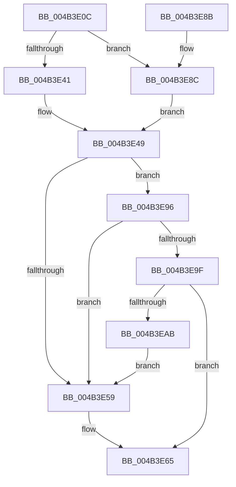

# MiConsumeOverCommit

- RVA: `0x004B3E0C`–`0x004B3EAD` (길이 `161` bytes)
- VA: `0x00000001404B3E0C`
- 실행 섹션: `.text`
- PDB 이름 있음: `예`; PDB Function 태그: `아니요`
- unwind 정보 RVA: `0x0007D214`
- 디코드: `47`개 명령, `161/161` bytes 표시
- 미해석 바이트: `0` (있으면 어셈블리에 `.byte`로 보존)

> 이 문서는 커널 이미지의 기계어와 PDB 기호를 분석해 생성했습니다. 4번과 5번은 함수 원형과 자료형을 바이너리 사용 방식에서 추정한 C 해석이며 원본 소스 복구 결과는 아닙니다.

## 1. Dependencies

- 직접 호출 지점: **3**; 고유 호출 대상: **3**
- 직접 호출자로 확인된 함수: **1**
- RIP 상대 이미지 참조: **0**

### Outgoing calls
- `0x004B3E44` → [ExAcquireSpinLockExclusiveAtDpcLevel](../24/ExAcquireSpinLockExclusiveAtDpcLevel_function_00248E80.md) (function, `0x00248E80`)
- `0x004B3E6B` → [MiReleaseSpinLockExclusive](../24/MiReleaseSpinLockExclusive_function_002482C0.md) (function, `0x002482C0`)
- `0x004B3E8C` → [ExAcquireSpinLockExclusive](../24/ExAcquireSpinLockExclusive_function_00248690.md) (function, `0x00248690`)

### Direct callers
- [MiChargeCommit](../28/MiChargeCommit_function_00286EB0.md) at `0x002872EA`

### Static image references
- 디코드된 RIP-relative 메모리 참조가 없습니다.

## 2. Other-region calls and transfers

- 다른 실행 섹션으로 향하는 call: **0**
- 별도 외부 분기/꼬리 이동을 확인하지 못했습니다.

## 3. Assembly (complete function range)

```asm
004B3E0C  48 89 5C 24 08                  mov qword ptr [rsp + 8], rbx
004B3E11  48 89 6C 24 10                  mov qword ptr [rsp + 0x10], rbp
004B3E16  48 89 74 24 18                  mov qword ptr [rsp + 0x18], rsi
004B3E1B  57                              push rdi
004B3E1C  41 56                           push r14
004B3E1E  41 57                           push r15
004B3E20  48 83 EC 20                     sub rsp, 0x20
004B3E24  4D 8B F8                        mov r15, r8
004B3E27  4C 8B F2                        mov r14, rdx
004B3E2A  48 8B F9                        mov rdi, rcx
004B3E2D  33 DB                           xor ebx, ebx
004B3E2F  44 0F 20 C0                     mov rax, cr8
004B3E33  48 8D B1 F8 41 00 00            lea rsi, [rcx + 0x41f8]
004B3E3A  48 8B CE                        mov rcx, rsi
004B3E3D  3C 02                           cmp al, 2
004B3E3F  75 4B                           jne 0x1404b3e8c
004B3E41  40 B5 11                        mov bpl, 0x11
004B3E44  E8 37 50 D9 FF                  call 0x140248e80
004B3E49  48 8B 87 40 4B 00 00            mov rax, qword ptr [rdi + 0x4b40]
004B3E50  4A 8D 0C 30                     lea rcx, [rax + r14]
004B3E54  48 3B C8                        cmp rcx, rax
004B3E57  77 3D                           ja 0x1404b3e96
004B3E59  4C 01 B7 08 42 00 00            add qword ptr [rdi + 0x4208], r14
004B3E60  BB 01 00 00 00                  mov ebx, 1
004B3E65  40 8A D5                        mov dl, bpl
004B3E68  48 8B CE                        mov rcx, rsi
004B3E6B  E8 50 44 D9 FF                  call 0x1402482c0
004B3E70  48 8B 6C 24 48                  mov rbp, qword ptr [rsp + 0x48]
004B3E75  8B C3                           mov eax, ebx
004B3E77  48 8B 5C 24 40                  mov rbx, qword ptr [rsp + 0x40]
004B3E7C  48 8B 74 24 50                  mov rsi, qword ptr [rsp + 0x50]
004B3E81  48 83 C4 20                     add rsp, 0x20
004B3E85  41 5F                           pop r15
004B3E87  41 5E                           pop r14
004B3E89  5F                              pop rdi
004B3E8A  C3                              ret
004B3E8B  CC                              int3
004B3E8C  E8 FF 47 D9 FF                  call 0x140248690
004B3E91  40 8A E8                        mov bpl, al
004B3E94  EB B3                           jmp 0x1404b3e49
004B3E96  4A 8D 14 39                     lea rdx, [rcx + r15]
004B3E9A  48 3B D1                        cmp rdx, rcx
004B3E9D  72 BA                           jb 0x1404b3e59
004B3E9F  48 8B 87 98 4C 00 00            mov rax, qword ptr [rdi + 0x4c98]
004B3EA6  48 3B D0                        cmp rdx, rax
004B3EA9  76 BA                           jbe 0x1404b3e65
004B3EAB  EB AC                           jmp 0x1404b3e59
```

## 4. C-style interpretation (structured pseudocode)

```c
__int64 __fastcall MiConsumeOverCommit(__int64 a1, __int64 a2, __int64 a3)
{
    __int64 result;
    __int64 v_rbx;
    __int64 v_rsp;
    unsigned __int64 v_stack_p10;
    unsigned __int64 v_stack_p18;
    unsigned __int64 v_stack_p8;

    v_stack_p8 = v_rbx;
    v_stack_p10 = v_rbp;
    v_stack_p18 = v_rsi;
    v_rsp = (v_rsp) - (32);
    v_rbx = 0;
    if (((unsigned __int8)(v_cr8)) != 2) goto loc_004B3E8C;
    result = ExAcquireSpinLockExclusiveAtDpcLevel(a1 + 16888, a2, a3, a4);
loc_004B3E49:
    if ((*(unsigned __int64 *)(a1 + 19264) + a2 * 1) > (*(unsigned __int64 *)(a1 + 19264))) goto loc_004B3E96;
loc_004B3E59:
loc_004B3E65:
    result = MiReleaseSpinLockExclusive(a1 + 16888, 17, a3, a4);
    v_rsp = (v_rsp) + (32);
    return 1;
loc_004B3E8C:
    result = ExAcquireSpinLockExclusive(a1 + 16888, 17, a3, a4);
    goto loc_004B3E49;
loc_004B3E96:
    if ((a1 + 16888 + a3 * 1) < (a1 + 16888)) goto loc_004B3E59;
    if ((a1 + 16888 + a3 * 1) <= (*(unsigned __int64 *)(a1 + 19608))) goto loc_004B3E65;
    goto loc_004B3E59;
}
```

## 5. (Beta) C Style

```c
int64_t MiConsumeOverCommit(void *Arg1, int64_t Arg2, int64_t Arg3)
{
    uint8_t *arg1 = (uint8_t *)Arg1;

    int64_t result;
    int64_t local_rbx;
    int64_t local_rsp;
    uint64_t v_stack_p10;
    uint64_t v_stack_p18;
    uint64_t v_stack_p8;

    v_stack_p8 = local_rbx;
    v_stack_p10 = local_rbp;
    v_stack_p18 = local_rsi;
    local_rsp = (local_rsp) - (32);
    local_rbx = 0;
    if (((uint8_t)(v_cr8)) != 2) goto loc_004B3E8C;
    result = ExAcquireSpinLockExclusiveAtDpcLevel(Arg1 + 16888, Arg2, Arg3, a4);
loc_004B3E49:
    if ((*(uint64_t *)(arg1 + 0x4B40) + Arg2 * 1) > (*(uint64_t *)(arg1 + 0x4B40))) goto loc_004B3E96;
loc_004B3E59:
loc_004B3E65:
    result = MiReleaseSpinLockExclusive(Arg1 + 16888, 17, Arg3, a4);
    local_rsp = (local_rsp) + (32);
    return 1;
loc_004B3E8C:
    result = ExAcquireSpinLockExclusive(Arg1 + 16888, 17, Arg3, a4);
    goto loc_004B3E49;
loc_004B3E96:
    if ((Arg1 + 16888 + Arg3 * 1) < (Arg1 + 16888)) goto loc_004B3E59;
    if ((Arg1 + 16888 + Arg3 * 1) <= (*(uint64_t *)(arg1 + 0x4C98))) goto loc_004B3E65;
    goto loc_004B3E59;
}
```

### 관측된 메모리 오프셋

구조체 형식이 확인되지 않은 접근은 인자 기준의 오프셋으로만 기록했습니다.

| 기준 인자 | 오프셋 표현 | 폭 (bit) | 접근 |
|---|---:|---:|---|
| `Arg1` | `+ 0x41F8` | `64` | `R` |
| `Arg1` | `+ 0x4208` | `64` | `R/W` |
| `Arg1` | `+ 0x4B40` | `64` | `R` |
| `Arg1` | `+ 0x4C98` | `64` | `R` |

## 6. Execution-region graph

[열기: 2D/3D 그래프와 함수 탐색 컨트롤 패널](../../../control-panel.html?section=text&rva=0x004B3E0C&view=graph)

- 2D 그래프는 위에서 아래로 흐르고, 3D 그래프는 빈 공간을 드래그해 회전합니다. Shift+드래그는 이동, 휠은 확대·축소, 함수 노드 선택은 대상 보고서 이동입니다.

### Static fallback


