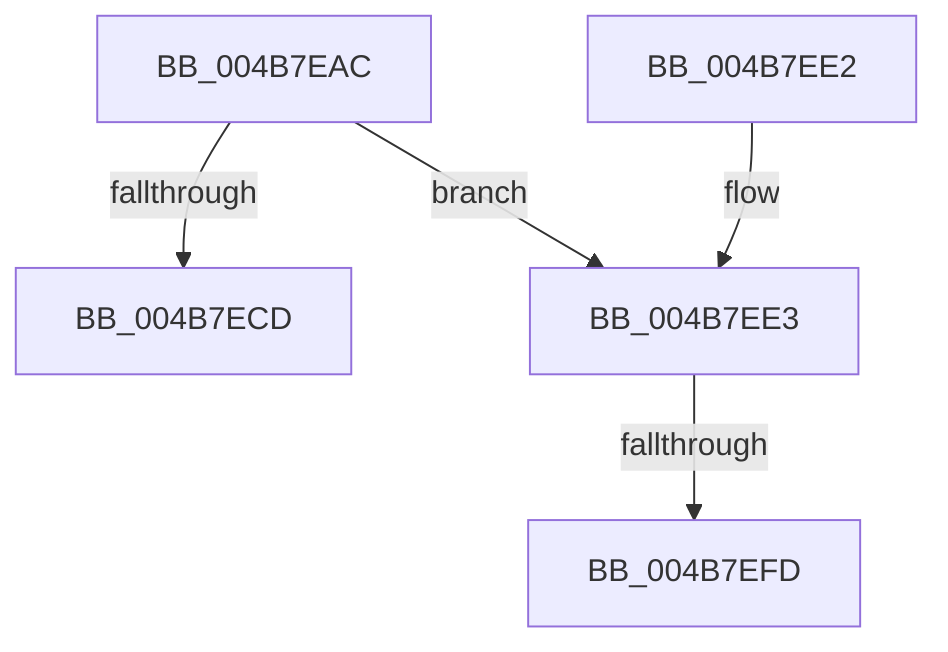

# MiDeleteDebuggerPatches

- RVA: `0x004B7EAC`–`0x004B7F0B` (길이 `95` bytes)
- VA: `0x00000001404B7EAC`
- 실행 섹션: `.text`
- PDB 이름 있음: `예`; PDB Function 태그: `예`
- unwind 정보 RVA: `0x000BAB94`
- 디코드: `26`개 명령, `95/95` bytes 표시
- 미해석 바이트: `0` (있으면 어셈블리에 `.byte`로 보존)

> 이 문서는 커널 이미지의 기계어와 PDB 기호를 분석해 생성했습니다. 4번과 5번은 함수 원형과 자료형을 바이너리 사용 방식에서 추정한 C 해석이며 원본 소스 복구 결과는 아닙니다.

## 1. Dependencies

- 직접 호출 지점: **1**; 고유 호출 대상: **1**
- 직접 호출자로 확인된 함수: **2**
- RIP 상대 이미지 참조: **1**

### Outgoing calls
- `0x004B7F00` → [KiRaiseIrqlProcessIrqlFlags](../4F/KiRaiseIrqlProcessIrqlFlags_function_004F56FC.md) (function, `0x004F56FC`)

### Direct callers
- [MiCheckControlArea](../28/MiCheckControlArea_function_002861B0.md) at `0x002862EC`
- [MiDestroySection](../46/MiDestroySection_function_00462FDC.md) at `0x00463036`

### Static image references
- `0x004B7EF0` → RVA `0x00FC6D20` (`ALMOSTRO`; read)

## 2. Other-region calls and transfers

- 다른 실행 섹션으로 향하는 call: **0**
- call이 아닌 외부 분기/꼬리 이동: **2**
  - `0x004B7EF7` → [sub_006FBD3C](../6F/Unknown_function_006FBD3C.md) (`tail-transfer`)
  - `0x004B7F06` → [sub_006FBD3C](../6F/Unknown_function_006FBD3C.md) (`tail-transfer`)

## 3. Assembly (complete function range)

```asm
004B7EAC  48 8B C4                        mov rax, rsp
004B7EAF  48 89 58 10                     mov qword ptr [rax + 0x10], rbx
004B7EB3  48 89 68 18                     mov qword ptr [rax + 0x18], rbp
004B7EB7  48 89 70 20                     mov qword ptr [rax + 0x20], rsi
004B7EBB  57                              push rdi
004B7EBC  48 83 EC 20                     sub rsp, 0x20
004B7EC0  83 60 08 00                     and dword ptr [rax + 8], 0
004B7EC4  48 8B F9                        mov rdi, rcx
004B7EC7  F6 41 60 01                     test byte ptr [rcx + 0x60], 1
004B7ECB  75 16                           jne 0x1404b7ee3
004B7ECD  48 8B 5C 24 38                  mov rbx, qword ptr [rsp + 0x38]
004B7ED2  48 8B 6C 24 40                  mov rbp, qword ptr [rsp + 0x40]
004B7ED7  48 8B 74 24 48                  mov rsi, qword ptr [rsp + 0x48]
004B7EDC  48 83 C4 20                     add rsp, 0x20
004B7EE0  5F                              pop rdi
004B7EE1  C3                              ret
004B7EE2  CC                              int3
004B7EE3  44 0F 20 C5                     mov rbp, cr8
004B7EE7  BA 02 00 00 00                  mov edx, 2
004B7EEC  44 0F 22 C2                     mov cr8, rdx
004B7EF0  83 3D 29 EE B0 00 00            cmp dword ptr [rip + 0xb0ee29], 0
004B7EF7  0F 84 3F 3E 24 00               je 0x1406fbd3c
004B7EFD  40 8A CD                        mov cl, bpl
004B7F00  E8 F7 D7 03 00                  call 0x1404f56fc
004B7F05  90                              nop
004B7F06  E9 31 3E 24 00                  jmp 0x1406fbd3c
```

## 4. C-style interpretation (structured pseudocode)

```c
__int64 __fastcall MiDeleteDebuggerPatches(__int64 a1)
{
    __int64 result;
    __int64 v_rsp;
    unsigned __int64 v_stack_p10;
    unsigned __int64 v_stack_p18;
    unsigned __int64 v_stack_p20;

    *(unsigned __int64 *)(v_rsp + 16) = v_rbx;
    *(unsigned __int64 *)(v_rsp + 24) = v_rbp;
    *(unsigned __int64 *)(v_rsp + 32) = v_rsi;
    v_rsp = (v_rsp) - (32);
    if (((*(unsigned __int8 *)(a1 + 96)) & (1)) != 0) goto loc_004B7EE3;
    v_rsp = (v_rsp) + (32);
    return v_rsp;
loc_004B7EE3:
    result = KiRaiseIrqlProcessIrqlFlags((unsigned __int8)(v_cr8), 2, a3, a4);
}
```

## 5. (Beta) C Style

```c
int64_t MiDeleteDebuggerPatches(void *Arg1)
{
    uint8_t *arg1 = (uint8_t *)Arg1;

    int64_t result;
    int64_t local_rsp;
    uint64_t v_stack_p10;
    uint64_t v_stack_p18;
    uint64_t v_stack_p20;

    *(uint64_t *)(local_rsp + 0x10) = local_rbx;
    *(uint64_t *)(local_rsp + 0x18) = local_rbp;
    *(uint64_t *)(local_rsp + 0x20) = local_rsi;
    local_rsp = (local_rsp) - (32);
    if (((*(uint8_t *)(arg1 + 0x60)) & (1)) != 0) goto loc_004B7EE3;
    local_rsp = (local_rsp) + (32);
    return local_rsp;
loc_004B7EE3:
    result = KiRaiseIrqlProcessIrqlFlags((uint8_t)(v_cr8), 2, a3, a4);
}
```

### 관측된 메모리 오프셋

구조체 형식이 확인되지 않은 접근은 인자 기준의 오프셋으로만 기록했습니다.

| 기준 인자 | 오프셋 표현 | 폭 (bit) | 접근 |
|---|---:|---:|---|
| `Arg1` | `+ 0x60` | `8` | `R` |

## 6. Execution-region graph

[열기: 2D/3D 그래프와 함수 탐색 컨트롤 패널](../../../control-panel.html?section=text&rva=0x004B7EAC&view=graph)

- 2D 그래프는 위에서 아래로 흐르고, 3D 그래프는 빈 공간을 드래그해 회전합니다. Shift+드래그는 이동, 휠은 확대·축소, 함수 노드 선택은 대상 보고서 이동입니다.

### Static fallback


