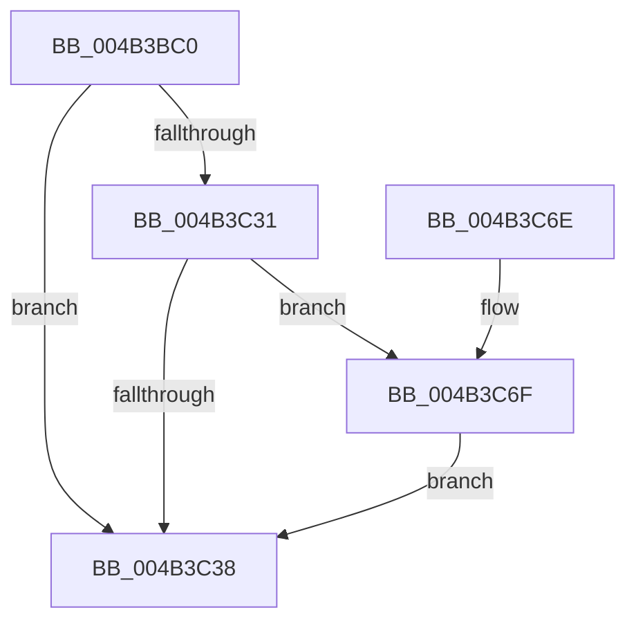

# MiFaultInPagedPool

- RVA: `0x004B3BC0`–`0x004B3C8C` (길이 `204` bytes)
- VA: `0x00000001404B3BC0`
- 실행 섹션: `.text`
- PDB 이름 있음: `예`; PDB Function 태그: `아니요`
- unwind 정보 RVA: `0x000B9AF8`
- 디코드: `50`개 명령, `204/204` bytes 표시
- 미해석 바이트: `0` (있으면 어셈블리에 `.byte`로 보존)

> 이 문서는 커널 이미지의 기계어와 PDB 기호를 분석해 생성했습니다. 4번과 5번은 함수 원형과 자료형을 바이너리 사용 방식에서 추정한 C 해석이며 원본 소스 복구 결과는 아닙니다.

## 1. Dependencies

- 직접 호출 지점: **5**; 고유 호출 대상: **5**
- 직접 호출자로 확인된 함수: **2**
- RIP 상대 이미지 참조: **1**

### Outgoing calls
- `0x004B3C12` → [MiLockWorkingSetShared](../27/MiLockWorkingSetShared_function_0027CBF0.md) (function, `0x0027CBF0`)
- `0x004B3C24` → [MiLockNestedPageTable](../23/MiLockNestedPageTable_function_0023E890.md) (function, `0x0023E890`)
- `0x004B3C42` → [MiUnlockPageTable](../21/MiUnlockPageTable_function_00216EC0.md) (function, `0x00216EC0`)
- `0x004B3C51` → [MiUnlockWorkingSetShared](../27/MiUnlockWorkingSetShared_function_0027D690.md) (function, `0x0027D690`)
- `0x004B3C85` → [MiCopyOnWrite](../36/MiCopyOnWrite_function_00362A0C.md) (function, `0x00362A0C`)

### Direct callers
- [MiProtectPrivateMemory](../2C/MiProtectPrivateMemory_function_002C45B0.md) at `0x002C4D64`
- [MiQueryAddressState](../32/MiQueryAddressState_function_0032C380.md) at `0x0032CC01`

### Static image references
- `0x004B3C08` → RVA `0x00E380C0` (`.data`; read)

## 2. Other-region calls and transfers

- 다른 실행 섹션으로 향하는 call: **0**
- 별도 외부 분기/꼬리 이동을 확인하지 못했습니다.

## 3. Assembly (complete function range)

```asm
004B3BC0  48 89 5C 24 08                  mov qword ptr [rsp + 8], rbx
004B3BC5  48 89 6C 24 10                  mov qword ptr [rsp + 0x10], rbp
004B3BCA  48 89 74 24 18                  mov qword ptr [rsp + 0x18], rsi
004B3BCF  57                              push rdi
004B3BD0  48 83 EC 30                     sub rsp, 0x30
004B3BD4  48 8B F1                        mov rsi, rcx
004B3BD7  49 B8 F8 FF FF FF 7F 00 00 00   movabs r8, 0x7ffffffff8
004B3BE1  48 C1 EE 09                     shr rsi, 9
004B3BE5  48 8B F9                        mov rdi, rcx
004B3BE8  49 23 F0                        and rsi, r8
004B3BEB  48 B9 00 00 00 00 80 F6 FF FF   movabs rcx, 0xfffff68000000000
004B3BF5  48 8B C1                        mov rax, rcx
004B3BF8  48 03 F0                        add rsi, rax
004B3BFB  48 8B DE                        mov rbx, rsi
004B3BFE  48 C1 EB 09                     shr rbx, 9
004B3C02  49 23 D8                        and rbx, r8
004B3C05  48 8B C1                        mov rax, rcx
004B3C08  48 8D 0D B1 44 98 00            lea rcx, [rip + 0x9844b1]
004B3C0F  48 03 D8                        add rbx, rax
004B3C12  E8 D9 8F DC FF                  call 0x14027cbf0
004B3C17  48 8B D3                        mov rdx, rbx
004B3C1A  48 8D 0D 9F 44 98 00            lea rcx, [rip + 0x98449f]
004B3C21  40 8A E8                        mov bpl, al
004B3C24  E8 67 AC D8 FF                  call 0x14023e890
004B3C29  48 8B 0E                        mov rcx, qword ptr [rsi]
004B3C2C  F6 C1 01                        test cl, 1
004B3C2F  74 07                           je 0x1404b3c38
004B3C31  48 0F BA E1 09                  bt rcx, 9
004B3C36  72 37                           jb 0x1404b3c6f
004B3C38  48 8B D3                        mov rdx, rbx
004B3C3B  48 8D 0D 7E 44 98 00            lea rcx, [rip + 0x98447e]
004B3C42  E8 79 32 D6 FF                  call 0x140216ec0
004B3C47  40 8A D5                        mov dl, bpl
004B3C4A  48 8D 0D 6F 44 98 00            lea rcx, [rip + 0x98446f]
004B3C51  E8 3A 9A DC FF                  call 0x14027d690
004B3C56  48 8B 07                        mov rax, qword ptr [rdi]
004B3C59  48 8B 5C 24 40                  mov rbx, qword ptr [rsp + 0x40]
004B3C5E  48 8B 6C 24 48                  mov rbp, qword ptr [rsp + 0x48]
004B3C63  48 8B 74 24 50                  mov rsi, qword ptr [rsp + 0x50]
004B3C68  48 83 C4 30                     add rsp, 0x30
004B3C6C  5F                              pop rdi
004B3C6D  C3                              ret
004B3C6E  CC                              int3
004B3C6F  48 83 64 24 20 00               and qword ptr [rsp + 0x20], 0
004B3C75  41 B9 04 00 00 00               mov r9d, 4
004B3C7B  49 83 C8 FF                     or r8, 0xffffffffffffffff
004B3C7F  48 8B D6                        mov rdx, rsi
004B3C82  48 8B CF                        mov rcx, rdi
004B3C85  E8 82 ED EA FF                  call 0x140362a0c
004B3C8A  EB AC                           jmp 0x1404b3c38
```

## 4. C-style interpretation (structured pseudocode)

```c
__int64 __fastcall MiFaultInPagedPool(__int64 a1)
{
    __int64 result;
    __int64 v_rbx;
    __int64 v_rsi;
    __int64 v_rsp;
    unsigned __int64 v_stack_p10;
    unsigned __int64 v_stack_p18;
    unsigned __int64 v_stack_p20;
    unsigned __int64 v_stack_p8;

    v_stack_p8 = v_rbx;
    v_stack_p10 = v_rbp;
    v_stack_p18 = v_rsi;
    v_rsp = (v_rsp) - (48);
    v_rsi = (a1) >> (9);
    v_rsi = (v_rsi) & (a3);
    v_rsi = (v_rsi) + (a1);
    v_rbx = (v_rsi) >> (9);
    v_rbx = (v_rbx) & (a3);
    v_rbx = (v_rbx) + (a1);
    result = MiLockWorkingSetShared(v_rip + 9979057, a2, a3, a4);
    result = MiLockNestedPageTable(v_rip + 9979039, v_rbx, a3, a4);
    if ((((unsigned __int8)(*(unsigned __int64 *)(v_rsi))) & (1)) == 0) goto loc_004B3C38;
    if (condition_is_below) goto loc_004B3C6F;
loc_004B3C38:
    result = MiUnlockPageTable(v_rip + 9979006, v_rbx, a3, a4);
    result = MiUnlockWorkingSetShared(v_rip + 9978991, (unsigned __int8)((unsigned __int8)(result)), a3, a4);
    v_rsp = (v_rsp) + (48);
    return *(unsigned __int64 *)(a1);
loc_004B3C6F:
    a3 = (a3) | (-1);
    result = MiCopyOnWrite(a1, v_stack_p18, a3, 4);
    goto loc_004B3C38;
}
```

## 5. (Beta) C Style

```c
int64_t MiFaultInPagedPool(void *Arg1)
{
    uint8_t *arg1 = (uint8_t *)Arg1;

    int64_t result;
    int64_t local_rbx;
    int64_t local_rsi;
    int64_t local_rsp;
    uint64_t v_stack_p10;
    uint64_t v_stack_p18;
    uint64_t v_stack_p20;
    uint64_t v_stack_p8;

    v_stack_p8 = local_rbx;
    v_stack_p10 = local_rbp;
    v_stack_p18 = local_rsi;
    local_rsp = (local_rsp) - (48);
    local_rsi = (Arg1) >> (9);
    local_rsi = (local_rsi) & (a3);
    local_rsi = (local_rsi) + (Arg1);
    local_rbx = (local_rsi) >> (9);
    local_rbx = (local_rbx) & (a3);
    local_rbx = (local_rbx) + (Arg1);
    result = MiLockWorkingSetShared(v_rip + 9979057, a2, a3, a4);
    result = MiLockNestedPageTable(v_rip + 9979039, local_rbx, a3, a4);
    if ((((uint8_t)(*(uint64_t *)(local_rsi))) & (1)) == 0) goto loc_004B3C38;
    if (condition_is_below) goto loc_004B3C6F;
loc_004B3C38:
    result = MiUnlockPageTable(v_rip + 9979006, local_rbx, a3, a4);
    result = MiUnlockWorkingSetShared(v_rip + 9978991, (uint8_t)((uint8_t)(result)), a3, a4);
    local_rsp = (local_rsp) + (48);
    return *(uint64_t *)(arg1);
loc_004B3C6F:
    a3 = (a3) | (-1);
    result = MiCopyOnWrite(Arg1, v_stack_p18, a3, 4);
    goto loc_004B3C38;
}
```

### 관측된 메모리 오프셋

구조체 형식이 확인되지 않은 접근은 인자 기준의 오프셋으로만 기록했습니다.

| 기준 인자 | 오프셋 표현 | 폭 (bit) | 접근 |
|---|---:|---:|---|
| `Arg1` | `+ 0x0` | `64` | `R` |

## 6. Execution-region graph

[열기: 2D/3D 그래프와 함수 탐색 컨트롤 패널](../../../control-panel.html?section=text&rva=0x004B3BC0&view=graph)

- 2D 그래프는 위에서 아래로 흐르고, 3D 그래프는 빈 공간을 드래그해 회전합니다. Shift+드래그는 이동, 휠은 확대·축소, 함수 노드 선택은 대상 보고서 이동입니다.

### Static fallback


