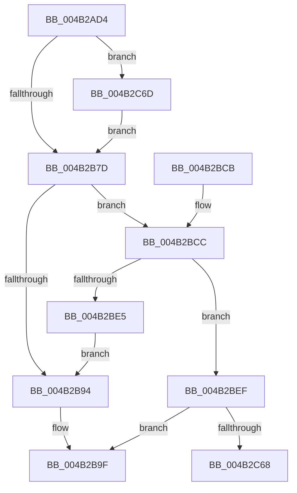

# MiFinishLastForkPageTable

- RVA: `0x004B2AD4`–`0x004B2C83` (길이 `431` bytes)
- VA: `0x00000001404B2AD4`
- 실행 섹션: `.text`
- PDB 이름 있음: `예`; PDB Function 태그: `예`
- unwind 정보 RVA: `0x000B9664`
- 디코드: `103`개 명령, `431/431` bytes 표시
- 미해석 바이트: `0` (있으면 어셈블리에 `.byte`로 보존)

> 이 문서는 커널 이미지의 기계어와 PDB 기호를 분석해 생성했습니다. 4번과 5번은 함수 원형과 자료형을 바이너리 사용 방식에서 추정한 C 해석이며 원본 소스 복구 결과는 아닙니다.

## 1. Dependencies

- 직접 호출 지점: **7**; 고유 호출 대상: **6**
- 직접 호출자로 확인된 함수: **2**
- RIP 상대 이미지 참조: **2**

### Outgoing calls
- `0x004B2B80` → [MiLockPageInline](../31/MiLockPageInline_function_0031A340.md) (function, `0x0031A340`)
- `0x004B2B8B` → [MiRemoveLockedPageChargeAndDecRef](../24/MiRemoveLockedPageChargeAndDecRef_function_002459D0.md) (function, `0x002459D0`)
- `0x004B2B9A` → [MiUnlockPage](../31/MiUnlockPage_function_0031A3E0.md) (function, `0x0031A3E0`)
- `0x004B2BAA` → [_security_check_cookie](../6A/_security_check_cookie_function_006AC640.md) (function, `0x006AC640`)
- `0x004B2BE8` → [MiDecrementShareCountEx](../33/MiDecrementShareCountEx_function_00333F70.md) (function, `0x00333F70`)
- `0x004B2C06` → [MiMapPageInHyperSpaceWorker](../33/MiMapPageInHyperSpaceWorker_function_00332B10.md) (function, `0x00332B10`)
- `0x004B2C5A` → [MiUnlockPage](../31/MiUnlockPage_function_0031A3E0.md) (function, `0x0031A3E0`)

### Direct callers
- [MiDoneWithThisPageGetAnother](../../page/A7/MiDoneWithThisPageGetAnother_function_00A7DDDC.md) at `0x00A7DE5F`
- [MiFreeForkMaps](../../page/AC/MiFreeForkMaps_function_00AC8534.md) at `0x00AC8593`

### Static image references
- `0x004B2AED` → RVA `0x00E0A740` (`.data`; read)
- `0x004B2C49` → RVA `0x00010880` (`.rdata`; read)

## 2. Other-region calls and transfers

- 다른 실행 섹션으로 향하는 call: **0**
- call이 아닌 외부 분기/꼬리 이동: **1**
  - `0x004B2C68` → [sub_006FB3A8](../6F/Unknown_function_006FB3A8.md) (`tail-transfer`)

## 3. Assembly (complete function range)

```asm
004B2AD4  48 89 5C 24 18                  mov qword ptr [rsp + 0x18], rbx
004B2AD9  48 89 6C 24 20                  mov qword ptr [rsp + 0x20], rbp
004B2ADE  56                              push rsi
004B2ADF  57                              push rdi
004B2AE0  41 55                           push r13
004B2AE2  41 56                           push r14
004B2AE4  41 57                           push r15
004B2AE6  48 81 EC 90 00 00 00            sub rsp, 0x90
004B2AED  48 8B 05 4C 7C 95 00            mov rax, qword ptr [rip + 0x957c4c]
004B2AF4  48 33 C4                        xor rax, rsp
004B2AF7  48 89 84 24 80 00 00 00         mov qword ptr [rsp + 0x80], rax
004B2AFF  0F 57 C0                        xorps xmm0, xmm0
004B2B02  C6 44 24 40 00                  mov byte ptr [rsp + 0x40], 0
004B2B07  48 8D 2C 52                     lea rbp, [rdx + rdx*2]
004B2B0B  4C 8B FA                        mov r15, rdx
004B2B0E  0F 11 44 24 50                  movups xmmword ptr [rsp + 0x50], xmm0
004B2B13  48 C1 E5 04                     shl rbp, 4
004B2B17  4C 8B E9                        mov r13, rcx
004B2B1A  0F 11 44 24 60                  movups xmmword ptr [rsp + 0x60], xmm0
004B2B1F  BB 01 00 00 00                  mov ebx, 1
004B2B24  0F 11 44 24 70                  movups xmmword ptr [rsp + 0x70], xmm0
004B2B29  48 B8 00 00 00 00 00 DE FF FF   movabs rax, 0xffffde0000000000
004B2B33  48 03 E8                        add rbp, rax
004B2B36  48 BE 00 00 00 00 80 F6 FF FF   movabs rsi, 0xfffff68000000000
004B2B40  48 B8 00 00 00 00 00 00 00 80   movabs rax, 0x8000000000000000
004B2B4A  4C 8B 75 08                     mov r14, qword ptr [rbp + 8]
004B2B4E  4C 0B F0                        or r14, rax
004B2B51  48 8B C6                        mov rax, rsi
004B2B54  48 C1 E0 19                     shl rax, 0x19
004B2B58  49 8B CE                        mov rcx, r14
004B2B5B  48 C1 E1 19                     shl rcx, 0x19
004B2B5F  48 2B C8                        sub rcx, rax
004B2B62  48 C1 F9 10                     sar rcx, 0x10
004B2B66  48 C1 E1 19                     shl rcx, 0x19
004B2B6A  48 2B C8                        sub rcx, rax
004B2B6D  48 C1 F9 10                     sar rcx, 0x10
004B2B71  48 8B C6                        mov rax, rsi
004B2B74  48 3B C8                        cmp rcx, rax
004B2B77  0F 83 F0 00 00 00               jae 0x1404b2c6d
004B2B7D  48 8B CD                        mov rcx, rbp
004B2B80  E8 BB 77 E6 FF                  call 0x14031a340
004B2B85  48 8B CD                        mov rcx, rbp
004B2B88  40 8A F8                        mov dil, al
004B2B8B  E8 40 2E D9 FF                  call 0x1402459d0
004B2B90  85 DB                           test ebx, ebx
004B2B92  75 38                           jne 0x1404b2bcc
004B2B94  40 8A D7                        mov dl, dil
004B2B97  48 8B CD                        mov rcx, rbp
004B2B9A  E8 41 78 E6 FF                  call 0x14031a3e0
004B2B9F  48 8B 8C 24 80 00 00 00         mov rcx, qword ptr [rsp + 0x80]
004B2BA7  48 33 CC                        xor rcx, rsp
004B2BAA  E8 91 9A 1F 00                  call 0x1406ac640
004B2BAF  4C 8D 9C 24 90 00 00 00         lea r11, [rsp + 0x90]
004B2BB7  49 8B 5B 40                     mov rbx, qword ptr [r11 + 0x40]
004B2BBB  49 8B 6B 48                     mov rbp, qword ptr [r11 + 0x48]
004B2BBF  49 8B E3                        mov rsp, r11
004B2BC2  41 5F                           pop r15
004B2BC4  41 5E                           pop r14
004B2BC6  41 5D                           pop r13
004B2BC8  5F                              pop rdi
004B2BC9  5E                              pop rsi
004B2BCA  C3                              ret
004B2BCB  CC                              int3
004B2BCC  48 8B 45 18                     mov rax, qword ptr [rbp + 0x18]
004B2BD0  48 B9 FF FF FF FF FF FF FF 3F   movabs rcx, 0x3fffffffffffffff
004B2BDA  48 23 C1                        and rax, rcx
004B2BDD  33 D2                           xor edx, edx
004B2BDF  48 83 F8 01                     cmp rax, 1
004B2BE3  77 0A                           ja 0x1404b2bef
004B2BE5  48 8B CD                        mov rcx, rbp
004B2BE8  E8 83 13 E8 FF                  call 0x140333f70
004B2BED  EB A5                           jmp 0x1404b2b94
004B2BEF  48 8B 4D 28                     mov rcx, qword ptr [rbp + 0x28]
004B2BF3  48 B8 FF FF FF FF FF 00 00 00   movabs rax, 0xffffffffff
004B2BFD  48 23 C8                        and rcx, rax
004B2C00  41 B8 00 00 00 80               mov r8d, 0x80000000
004B2C06  E8 05 FF E7 FF                  call 0x140332b10
004B2C0B  49 8B CE                        mov rcx, r14
004B2C0E  48 C1 E9 03                     shr rcx, 3
004B2C12  81 E1 FF 01 00 00               and ecx, 0x1ff
004B2C18  4C 8D 04 C8                     lea r8, [rax + rcx*8]
004B2C1C  48 B8 F8 FF FF FF 7F 00 00 00   movabs rax, 0x7ffffffff8
004B2C26  49 8B 18                        mov rbx, qword ptr [r8]
004B2C29  49 C1 E8 09                     shr r8, 9
004B2C2D  4C 23 C0                        and r8, rax
004B2C30  48 8B C6                        mov rax, rsi
004B2C33  4C 03 C0                        add r8, rax
004B2C36  40 8A D7                        mov dl, dil
004B2C39  65 48 8B 04 25 20 00 00 00      mov rax, qword ptr gs:[0x20]
004B2C42  48 8B 88 38 88 00 00            mov rcx, qword ptr [rax + 0x8838]
004B2C49  48 8B 05 30 DC B5 FF            mov rax, qword ptr [rip - 0x4a23d0]
004B2C50  48 83 21 00                     and qword ptr [rcx], 0
004B2C54  48 8B CD                        mov rcx, rbp
004B2C57  49 89 00                        mov qword ptr [r8], rax
004B2C5A  E8 81 77 E6 FF                  call 0x14031a3e0
004B2C5F  F6 C3 01                        test bl, 1
004B2C62  0F 85 37 FF FF FF               jne 0x1404b2b9f
004B2C68  E9 3B 87 24 00                  jmp 0x1406fb3a8
004B2C6D  48 B8 FF FF FF FF FF F6 FF FF   movabs rax, 0xfffff6ffffffffff
004B2C77  48 3B C1                        cmp rax, rcx
004B2C7A  1B C0                           sbb eax, eax
004B2C7C  23 D8                           and ebx, eax
004B2C7E  E9 FA FE FF FF                  jmp 0x1404b2b7d
```

## 4. C-style interpretation (structured pseudocode)

```c
__int64 __fastcall MiFinishLastForkPageTable(__int64 a1, __int64 a2)
{
    __int64 result;
    __int64 v_r14;
    __int64 v_rbp;
    __int64 v_rbx;
    __int64 v_rsp;
    unsigned __int64 v_stack_m28;
    unsigned __int64 v_stack_m38;
    unsigned __int64 v_stack_m48;
    unsigned __int64 v_stack_m58;
    unsigned __int64 v_stack_m68;
    unsigned __int8 v_stack_m78;
    unsigned __int64 v_stack_p18;
    unsigned __int64 v_stack_p20;

    v_stack_p18 = v_rbx;
    v_stack_p20 = v_rbp;
    v_rsp = (v_rsp) - (144);
    result = (*(unsigned __int64 *)(v_rip + 9796684)) ^ (v_rsp);
    v_stack_m38 = result;
    v_stack_m78 = 0;
    v_stack_m68 = v_xmm0;
    v_rbp = (a2 + a2 * 2) << (4);
    v_stack_m58 = v_xmm0;
    v_stack_m48 = v_xmm0;
    v_rbp = (v_rbp) + (result);
    v_r14 = (*(unsigned __int64 *)(v_rbp + 8)) | (result);
    result = (v_rsi) << (25);
    a1 = (v_r14) << (25);
    a1 = (a1) - (result);
    a1 = (a1) >> (16);
    a1 = (a1) << (25);
    a1 = (a1) - (result);
    a1 = (a1) >> (16);
    if (a1 >= v_rsi) goto loc_004B2C6D;
loc_004B2B7D:
    result = MiLockPageInline(v_rbp, a2, a3, a4);
    result = MiRemoveLockedPageChargeAndDecRef(v_rbp, a2, a3, a4);
    if (1 != 0) goto loc_004B2BCC;
loc_004B2B94:
    result = MiUnlockPage(v_rbp, (unsigned __int8)((unsigned __int8)(result)), a3, a4);
loc_004B2B9F:
    a1 = (v_stack_m38) ^ (v_rsp);
    result = _security_check_cookie(a1, (unsigned __int8)((unsigned __int8)(result)), a3, a4);
    return result;
loc_004B2BCC:
    result = (*(unsigned __int64 *)(*(unsigned __int64 *)(v_stack_m28 + 72) + 24)) & (a1);
    a2 = 0;
    if (result > 1) goto loc_004B2BEF;
    result = MiDecrementShareCountEx(*(unsigned __int64 *)(v_stack_m28 + 72), a2, a3, a4);
    goto loc_004B2B94;
loc_004B2BEF:
    a1 = (*(unsigned __int64 *)(*(unsigned __int64 *)(v_stack_m28 + 72) + 40)) & (result);
    result = MiMapPageInHyperSpaceWorker(a1, a2, (unsigned int)(0x80000000ULL), a4);
    a1 = (v_r14) >> (3);
    a1 = (unsigned int)((a1) & (511));
    a3 = (result + a1 * 8) >> (9);
    a3 = (a3) & (result);
    a3 = (a3) + (v_rsi);
    *(unsigned __int64 *)(a3) = *(unsigned __int64 *)(v_rip - 4858832);
    result = MiUnlockPage(*(unsigned __int64 *)(v_stack_m28 + 72), (unsigned __int8)((unsigned __int8)(result)), a3, a4);
    if ((((unsigned __int8)(*(unsigned __int64 *)(result + a1 * 8))) & (1)) != 0) goto loc_004B2B9F;
loc_004B2C6D:
    v_rbx = (unsigned int)((*(unsigned __int64 *)(result + a1 * 8)) & ((unsigned int)(result)));
    goto loc_004B2B7D;
}
```

## 5. (Beta) C Style

```c
int64_t MiFinishLastForkPageTable(int64_t Arg1, void *Arg2)
{
    uint8_t *arg2 = (uint8_t *)Arg2;

    int64_t result;
    int64_t local_r14;
    int64_t local_rbp;
    int64_t local_rbx;
    int64_t local_rsp;
    uint64_t v_stack_m28;
    uint64_t v_stack_m38;
    uint64_t v_stack_m48;
    uint64_t v_stack_m58;
    uint64_t v_stack_m68;
    uint8_t v_stack_m78;
    uint64_t v_stack_p18;
    uint64_t v_stack_p20;

    v_stack_p18 = local_rbx;
    v_stack_p20 = local_rbp;
    local_rsp = (local_rsp) - (144);
    result = (*(uint64_t *)(v_rip + 0x957C4C)) ^ (local_rsp);
    v_stack_m38 = result;
    v_stack_m78 = 0;
    v_stack_m68 = v_xmm0;
    local_rbp = (Arg2 + Arg2 * 2) << (4);
    v_stack_m58 = v_xmm0;
    v_stack_m48 = v_xmm0;
    local_rbp = (local_rbp) + (result);
    local_r14 = (*(uint64_t *)(local_rbp + 0x8)) | (result);
    result = (local_rsi) << (25);
    Arg1 = (local_r14) << (25);
    Arg1 = (Arg1) - (result);
    Arg1 = (Arg1) >> (16);
    Arg1 = (Arg1) << (25);
    Arg1 = (Arg1) - (result);
    Arg1 = (Arg1) >> (16);
    if (Arg1 >= local_rsi) goto loc_004B2C6D;
loc_004B2B7D:
    result = MiLockPageInline(local_rbp, Arg2, a3, a4);
    result = MiRemoveLockedPageChargeAndDecRef(local_rbp, Arg2, a3, a4);
    if (1 != 0) goto loc_004B2BCC;
loc_004B2B94:
    result = MiUnlockPage(local_rbp, (uint8_t)((uint8_t)(result)), a3, a4);
loc_004B2B9F:
    Arg1 = (v_stack_m38) ^ (local_rsp);
    result = _security_check_cookie(Arg1, (uint8_t)((uint8_t)(result)), a3, a4);
    return result;
loc_004B2BCC:
    result = (*(uint64_t *)(*(uint64_t *)(v_stack_m28 + 0x48) + 0x18)) & (Arg1);
    Arg2 = 0;
    if (result > 1) goto loc_004B2BEF;
    result = MiDecrementShareCountEx(*(uint64_t *)(v_stack_m28 + 0x48), Arg2, a3, a4);
    goto loc_004B2B94;
loc_004B2BEF:
    Arg1 = (*(uint64_t *)(*(uint64_t *)(v_stack_m28 + 0x48) + 0x28)) & (result);
    result = MiMapPageInHyperSpaceWorker(Arg1, Arg2, (uint32_t)(0x80000000ULL), a4);
    Arg1 = (local_r14) >> (3);
    Arg1 = (uint32_t)((Arg1) & (511));
    a3 = (result + Arg1 * 8) >> (9);
    a3 = (a3) & (result);
    a3 = (a3) + (local_rsi);
    *(uint64_t *)(a3) = *(uint64_t *)(v_rip - 0x4A23D0);
    result = MiUnlockPage(*(uint64_t *)(v_stack_m28 + 0x48), (uint8_t)((uint8_t)(result)), a3, a4);
    if ((((uint8_t)(*(uint64_t *)(result + Arg1 * 8))) & (1)) != 0) goto loc_004B2B9F;
loc_004B2C6D:
    local_rbx = (uint32_t)((*(uint64_t *)(result + Arg1 * 8)) & ((uint32_t)(result)));
    goto loc_004B2B7D;
}
```

### 관측된 메모리 오프셋

구조체 형식이 확인되지 않은 접근은 인자 기준의 오프셋으로만 기록했습니다.

| 기준 인자 | 오프셋 표현 | 폭 (bit) | 접근 |
|---|---:|---:|---|
| `Arg2` | `+ 0x0 + rdx*2` | `64` | `R` |

## 6. Execution-region graph

[열기: 2D/3D 그래프와 함수 탐색 컨트롤 패널](../../../control-panel.html?section=text&rva=0x004B2AD4&view=graph)

- 2D 그래프는 위에서 아래로 흐르고, 3D 그래프는 빈 공간을 드래그해 회전합니다. Shift+드래그는 이동, 휠은 확대·축소, 함수 노드 선택은 대상 보고서 이동입니다.

### Static fallback


