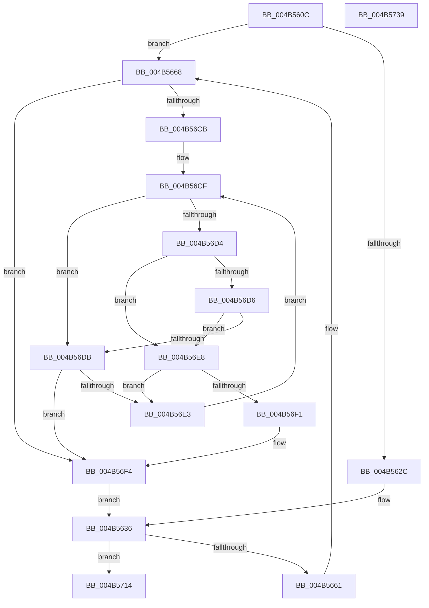

# MiFlowThroughInsertNode

- RVA: `0x004B560C`–`0x004B573A` (길이 `302` bytes)
- VA: `0x00000001404B560C`
- 실행 섹션: `.text`
- PDB 이름 있음: `예`; PDB Function 태그: `아니요`
- unwind 정보 RVA: `0x00060BC4`
- 디코드: `75`개 명령, `302/302` bytes 표시
- 미해석 바이트: `0` (있으면 어셈블리에 `.byte`로 보존)

> 이 문서는 커널 이미지의 기계어와 PDB 기호를 분석해 생성했습니다. 4번과 5번은 함수 원형과 자료형을 바이너리 사용 방식에서 추정한 C 해석이며 원본 소스 복구 결과는 아닙니다.

## 1. Dependencies

- 직접 호출 지점: **4**; 고유 호출 대상: **4**
- 직접 호출자로 확인된 함수: **3**
- RIP 상대 이미지 참조: **1**

### Outgoing calls
- `0x004B566B` → [MiGetPagingFileOffset](../36/MiGetPagingFileOffset_function_0036F530.md) (function, `0x0036F530`)
- `0x004B56AD` → [ExAcquireSpinLockExclusiveAtDpcLevel](../24/ExAcquireSpinLockExclusiveAtDpcLevel_function_00248E80.md) (function, `0x00248E80`)
- `0x004B56FE` → [RtlAvlInsertNodeEx](../26/RtlAvlInsertNodeEx_function_00265790.md) (function, `0x00265790`)
- `0x004B570A` → [ExReleaseSpinLockExclusiveFromDpcLevel](../24/ExReleaseSpinLockExclusiveFromDpcLevel_function_002497E0.md) (function, `0x002497E0`)

### Direct callers
- [MiFinishMdlForMappedFileFault](../2A/MiFinishMdlForMappedFileFault_function_002AC974.md) at `0x002ACC32`
- [MiCopyFileOnlyGlobalSubsectionPage](../36/MiCopyFileOnlyGlobalSubsectionPage_function_0036A9EC.md) at `0x0036AD42`
- [MiResolvePageFileFault](../36/MiResolvePageFileFault_function_0036D968.md) at `0x0036EBE7`

### Static image references
- `0x004B5674` → RVA `0x00E30088` (`.data`; read)

## 2. Other-region calls and transfers

- 다른 실행 섹션으로 향하는 call: **0**
- 별도 외부 분기/꼬리 이동을 확인하지 못했습니다.

## 3. Assembly (complete function range)

```asm
004B560C  48 89 5C 24 08                  mov qword ptr [rsp + 8], rbx
004B5611  48 89 74 24 10                  mov qword ptr [rsp + 0x10], rsi
004B5616  57                              push rdi
004B5617  48 83 EC 20                     sub rsp, 0x20
004B561B  4C 8B 42 10                     mov r8, qword ptr [rdx + 0x10]
004B561F  48 8B FA                        mov rdi, rdx
004B5622  48 8B D9                        mov rbx, rcx
004B5625  49 0F BA E0 0A                  bt r8, 0xa
004B562A  73 3C                           jae 0x1404b5668
004B562C  45 33 C0                        xor r8d, r8d
004B562F  4C 89 81 50 01 00 00            mov qword ptr [rcx + 0x150], r8
004B5636  8B 83 C0 00 00 00               mov eax, dword ptr [rbx + 0xc0]
004B563C  83 C8 40                        or eax, 0x40
004B563F  89 83 C0 00 00 00               mov dword ptr [rbx + 0xc0], eax
004B5645  48 8D 43 10                     lea rax, [rbx + 0x10]
004B5649  4C 8B 07                        mov r8, qword ptr [rdi]
004B564C  49 83 C0 E0                     add r8, -0x20
004B5650  49 8D 48 10                     lea rcx, [r8 + 0x10]
004B5654  48 8B 51 08                     mov rdx, qword ptr [rcx + 8]
004B5658  48 39 0A                        cmp qword ptr [rdx], rcx
004B565B  0F 84 B3 00 00 00               je 0x1404b5714
004B5661  B9 03 00 00 00                  mov ecx, 3
004B5666  CD 29                           int 0x29
004B5668  49 8B C8                        mov rcx, r8
004B566B  E8 C0 9E EB FF                  call 0x14036f530
004B5670  48 8B 4A 28                     mov rcx, qword ptr [rdx + 0x28]
004B5674  48 8B 15 0D AA 97 00            mov rdx, qword ptr [rip + 0x97aa0d]
004B567B  48 C1 E9 2B                     shr rcx, 0x2b
004B567F  81 E1 FF 03 00 00               and ecx, 0x3ff
004B5685  49 C1 E8 0C                     shr r8, 0xc
004B5689  41 83 E0 0F                     and r8d, 0xf
004B568D  4C 8B 0C CA                     mov r9, qword ptr [rdx + rcx*8]
004B5691  4B 8B B4 C1 60 48 00 00         mov rsi, qword ptr [r9 + r8*8 + 0x4860]
004B5699  48 89 B3 50 01 00 00            mov qword ptr [rbx + 0x150], rsi
004B56A0  89 83 58 01 00 00               mov dword ptr [rbx + 0x158], eax
004B56A6  48 8D 8E C8 00 00 00            lea rcx, [rsi + 0xc8]
004B56AD  E8 CE 37 D9 FF                  call 0x140248e80
004B56B2  4C 8D 96 D0 00 00 00            lea r10, [rsi + 0xd0]
004B56B9  45 33 C0                        xor r8d, r8d
004B56BC  49 8B 12                        mov rdx, qword ptr [r10]
004B56BF  4C 8D 8B 60 01 00 00            lea r9, [rbx + 0x160]
004B56C6  48 85 D2                        test rdx, rdx
004B56C9  74 29                           je 0x1404b56f4
004B56CB  41 8B 49 F8                     mov ecx, dword ptr [r9 - 8]
004B56CF  3B 4A F8                        cmp ecx, dword ptr [rdx - 8]
004B56D2  72 07                           jb 0x1404b56db
004B56D4  77 12                           ja 0x1404b56e8
004B56D6  4C 3B CA                        cmp r9, rdx
004B56D9  77 0D                           ja 0x1404b56e8
004B56DB  48 8B 02                        mov rax, qword ptr [rdx]
004B56DE  48 85 C0                        test rax, rax
004B56E1  74 11                           je 0x1404b56f4
004B56E3  48 8B D0                        mov rdx, rax
004B56E6  EB E7                           jmp 0x1404b56cf
004B56E8  48 8B 42 08                     mov rax, qword ptr [rdx + 8]
004B56EC  48 85 C0                        test rax, rax
004B56EF  75 F2                           jne 0x1404b56e3
004B56F1  41 B0 01                        mov r8b, 1
004B56F4  4C 8D 8B 60 01 00 00            lea r9, [rbx + 0x160]
004B56FB  49 8B CA                        mov rcx, r10
004B56FE  E8 8D 00 DB FF                  call 0x140265790
004B5703  48 8D 8E C8 00 00 00            lea rcx, [rsi + 0xc8]
004B570A  E8 D1 40 D9 FF                  call 0x1402497e0
004B570F  E9 22 FF FF FF                  jmp 0x1404b5636
004B5714  48 8B 74 24 38                  mov rsi, qword ptr [rsp + 0x38]
004B5719  48 89 08                        mov qword ptr [rax], rcx
004B571C  48 89 50 08                     mov qword ptr [rax + 8], rdx
004B5720  48 89 02                        mov qword ptr [rdx], rax
004B5723  48 89 41 08                     mov qword ptr [rcx + 8], rax
004B5727  4C 89 83 48 01 00 00            mov qword ptr [rbx + 0x148], r8
004B572E  48 8B 5C 24 30                  mov rbx, qword ptr [rsp + 0x30]
004B5733  48 83 C4 20                     add rsp, 0x20
004B5737  5F                              pop rdi
004B5738  C3                              ret
004B5739  CC                              int3
```

## 4. C-style interpretation (structured pseudocode)

```c
__int64 __fastcall MiFlowThroughInsertNode(__int64 a1, __int64 a2)
{
    __int64 result;
    __int64 v_rsp;
    unsigned __int64 v_stack_p10;
    unsigned __int64 v_stack_p8;

    v_stack_p8 = v_rbx;
    v_stack_p10 = v_rsi;
    v_rsp = (v_rsp) - (32);
    if (condition_is_above_or_equal) goto loc_004B5668;
    a3 = 0;
    *(unsigned __int64 *)(a1 + 336) = 0;
loc_004B5636:
    result = (unsigned int)(((unsigned int)(*(unsigned int *)(a1 + 192))) | (64));
    *(unsigned int *)(a1 + 192) = (unsigned int)(result);
    a3 = (*(unsigned __int64 *)(a2)) + (-32);
    if ((*(unsigned __int64 *)(*(unsigned __int64 *)(a3 + 16 + 8))) == (a3 + 16)) goto loc_004B5714;
loc_004B5668:
    result = MiGetPagingFileOffset(a3, *(unsigned __int64 *)(a3 + 16 + 8), a3, a4);
    a1 = (*(unsigned __int64 *)(*(unsigned __int64 *)(a3 + 16 + 8) + 40)) >> (43);
    a1 = (unsigned int)((a1) & (0x3FFULL));
    a3 = (a3) >> (12);
    a3 = (unsigned int)((a3) & (15));
    *(unsigned __int64 *)(a1 + 336) = *(unsigned __int64 *)(*(unsigned __int64 *)(*(unsigned __int64 *)(v_rip + 9939469) + a1 * 8) + a3 * 8 + 18528);
    *(unsigned int *)(a1 + 344) = (unsigned int)(result);
    result = ExAcquireSpinLockExclusiveAtDpcLevel(*(unsigned __int64 *)(*(unsigned __int64 *)(*(unsigned __int64 *)(v_rip + 9939469) + a1 * 8) + a3 * 8 + 18528) + 200, *(unsigned __int64 *)(v_rip + 9939469), a3, *(unsigned __int64 *)(*(unsigned __int64 *)(v_rip + 9939469) + a1 * 8));
    a3 = 0;
    if (*(unsigned __int64 *)(*(unsigned __int64 *)(*(unsigned __int64 *)(*(unsigned __int64 *)(v_rip + 9939469) + a1 * 8) + a3 * 8 + 18528) + 208) == 0) goto loc_004B56F4;
loc_004B56CF:
    if (((unsigned int)((unsigned int)(*(unsigned int *)(a1 + 352 - 8)))) < (*(unsigned int *)(*(unsigned __int64 *)(*(unsigned __int64 *)(*(unsigned __int64 *)(*(unsigned __int64 *)(v_rip + 9939469) + a1 * 8) + a3 * 8 + 18528) + 208) - 8))) goto loc_004B56DB;
    if (((unsigned int)((unsigned int)(*(unsigned int *)(a1 + 352 - 8)))) > (*(unsigned int *)(*(unsigned __int64 *)(*(unsigned __int64 *)(*(unsigned __int64 *)(*(unsigned __int64 *)(v_rip + 9939469) + a1 * 8) + a3 * 8 + 18528) + 208) - 8))) goto loc_004B56E8;
    if ((a1 + 352) > (*(unsigned __int64 *)(*(unsigned __int64 *)(*(unsigned __int64 *)(*(unsigned __int64 *)(v_rip + 9939469) + a1 * 8) + a3 * 8 + 18528) + 208))) goto loc_004B56E8;
loc_004B56DB:
    if (*(unsigned __int64 *)(*(unsigned __int64 *)(*(unsigned __int64 *)(*(unsigned __int64 *)(*(unsigned __int64 *)(v_rip + 9939469) + a1 * 8) + a3 * 8 + 18528) + 208)) == 0) goto loc_004B56F4;
loc_004B56E3:
    goto loc_004B56CF;
loc_004B56E8:
    if (*(unsigned __int64 *)(*(unsigned __int64 *)(*(unsigned __int64 *)(*(unsigned __int64 *)(*(unsigned __int64 *)(*(unsigned __int64 *)(v_rip + 9939469) + a1 * 8) + a3 * 8 + 18528) + 208)) + 8) != 0) goto loc_004B56E3;
loc_004B56F4:
    result = RtlAvlInsertNodeEx(*(unsigned __int64 *)(*(unsigned __int64 *)(*(unsigned __int64 *)(v_rip + 9939469) + a1 * 8) + a3 * 8 + 18528) + 208, *(unsigned __int64 *)(*(unsigned __int64 *)(*(unsigned __int64 *)(*(unsigned __int64 *)(*(unsigned __int64 *)(v_rip + 9939469) + a1 * 8) + a3 * 8 + 18528) + 208)), 1, a1 + 352);
    result = ExReleaseSpinLockExclusiveFromDpcLevel(*(unsigned __int64 *)(*(unsigned __int64 *)(*(unsigned __int64 *)(v_rip + 9939469) + a1 * 8) + a3 * 8 + 18528) + 200, *(unsigned __int64 *)(*(unsigned __int64 *)(*(unsigned __int64 *)(*(unsigned __int64 *)(*(unsigned __int64 *)(v_rip + 9939469) + a1 * 8) + a3 * 8 + 18528) + 208)), 1, a1 + 352);
    goto loc_004B5636;
loc_004B5714:
    *(unsigned __int64 *)(result) = *(unsigned __int64 *)(*(unsigned __int64 *)(*(unsigned __int64 *)(v_rip + 9939469) + a1 * 8) + a3 * 8 + 18528) + 200;
    *(unsigned __int64 *)(result + 8) = *(unsigned __int64 *)(*(unsigned __int64 *)(*(unsigned __int64 *)(*(unsigned __int64 *)(*(unsigned __int64 *)(v_rip + 9939469) + a1 * 8) + a3 * 8 + 18528) + 208));
    *(unsigned __int64 *)(*(unsigned __int64 *)(*(unsigned __int64 *)(*(unsigned __int64 *)(*(unsigned __int64 *)(*(unsigned __int64 *)(v_rip + 9939469) + a1 * 8) + a3 * 8 + 18528) + 208))) = result;
    *(unsigned __int64 *)(*(unsigned __int64 *)(*(unsigned __int64 *)(*(unsigned __int64 *)(v_rip + 9939469) + a1 * 8) + a3 * 8 + 18528) + 200 + 8) = result;
    *(unsigned __int64 *)(a1 + 328) = 1;
    v_rsp = (v_rsp) + (32);
    return result;
}
```

## 5. (Beta) C Style

```c
int64_t MiFlowThroughInsertNode(void *Arg1, void *Arg2)
{
    uint8_t *arg1 = (uint8_t *)Arg1;
    uint8_t *arg2 = (uint8_t *)Arg2;

    int64_t result;
    int64_t local_rsp;
    uint64_t v_stack_p10;
    uint64_t v_stack_p8;

    v_stack_p8 = local_rbx;
    v_stack_p10 = local_rsi;
    local_rsp = (local_rsp) - (32);
    if (condition_is_above_or_equal) goto loc_004B5668;
    a3 = 0;
    *(uint64_t *)(arg1 + 0x150) = 0;
loc_004B5636:
    result = (uint32_t)(((uint32_t)(*(uint32_t *)(arg1 + 0xC0))) | (64));
    *(uint32_t *)(arg1 + 0xC0) = (uint32_t)(result);
    a3 = (*(uint64_t *)(arg2)) + (-32);
    if ((*(uint64_t *)(*(uint64_t *)(a3 + 0x10 + 0x8))) == (a3 + 16)) goto loc_004B5714;
loc_004B5668:
    result = MiGetPagingFileOffset(a3, *(uint64_t *)(a3 + 0x10 + 0x8), a3, a4);
    Arg1 = (*(uint64_t *)(*(uint64_t *)(a3 + 0x10 + 0x8) + 0x28)) >> (43);
    Arg1 = (uint32_t)((Arg1) & (0x3FFULL));
    a3 = (a3) >> (12);
    a3 = (uint32_t)((a3) & (15));
    *(uint64_t *)(arg1 + 0x150) = *(uint64_t *)(*(uint64_t *)(*(uint64_t *)(v_rip + 0x97AA0D) + arg1 * 8) + a3 * 8 + 0x4860);
    *(uint32_t *)(arg1 + 0x158) = (uint32_t)(result);
    result = ExAcquireSpinLockExclusiveAtDpcLevel(*(uint64_t *)(*(uint64_t *)(*(uint64_t *)(v_rip + 0x97AA0D) + arg1 * 8) + a3 * 8 + 0x4860) + 200, *(uint64_t *)(v_rip + 0x97AA0D), a3, *(uint64_t *)(*(uint64_t *)(v_rip + 0x97AA0D) + arg1 * 8));
    a3 = 0;
    if (*(uint64_t *)(*(uint64_t *)(*(uint64_t *)(*(uint64_t *)(v_rip + 0x97AA0D) + arg1 * 8) + a3 * 8 + 0x4860) + 0xD0) == 0) goto loc_004B56F4;
loc_004B56CF:
    if (((uint32_t)((uint32_t)(*(uint32_t *)(arg1 + 0x160 - 0x8)))) < (*(uint32_t *)(*(uint64_t *)(*(uint64_t *)(*(uint64_t *)(*(uint64_t *)(v_rip + 0x97AA0D) + arg1 * 8) + a3 * 8 + 0x4860) + 0xD0) - 0x8))) goto loc_004B56DB;
    if (((uint32_t)((uint32_t)(*(uint32_t *)(arg1 + 0x160 - 0x8)))) > (*(uint32_t *)(*(uint64_t *)(*(uint64_t *)(*(uint64_t *)(*(uint64_t *)(v_rip + 0x97AA0D) + arg1 * 8) + a3 * 8 + 0x4860) + 0xD0) - 0x8))) goto loc_004B56E8;
    if ((Arg1 + 352) > (*(uint64_t *)(*(uint64_t *)(*(uint64_t *)(*(uint64_t *)(v_rip + 0x97AA0D) + arg1 * 8) + a3 * 8 + 0x4860) + 0xD0))) goto loc_004B56E8;
loc_004B56DB:
    if (*(uint64_t *)(*(uint64_t *)(*(uint64_t *)(*(uint64_t *)(*(uint64_t *)(v_rip + 0x97AA0D) + arg1 * 8) + a3 * 8 + 0x4860) + 0xD0)) == 0) goto loc_004B56F4;
loc_004B56E3:
    goto loc_004B56CF;
loc_004B56E8:
    if (*(uint64_t *)(*(uint64_t *)(*(uint64_t *)(*(uint64_t *)(*(uint64_t *)(*(uint64_t *)(v_rip + 0x97AA0D) + arg1 * 8) + a3 * 8 + 0x4860) + 0xD0)) + 0x8) != 0) goto loc_004B56E3;
loc_004B56F4:
    result = RtlAvlInsertNodeEx(*(uint64_t *)(*(uint64_t *)(*(uint64_t *)(v_rip + 0x97AA0D) + arg1 * 8) + a3 * 8 + 0x4860) + 208, *(uint64_t *)(*(uint64_t *)(*(uint64_t *)(*(uint64_t *)(*(uint64_t *)(v_rip + 0x97AA0D) + arg1 * 8) + a3 * 8 + 0x4860) + 0xD0)), 1, Arg1 + 352);
    result = ExReleaseSpinLockExclusiveFromDpcLevel(*(uint64_t *)(*(uint64_t *)(*(uint64_t *)(v_rip + 0x97AA0D) + arg1 * 8) + a3 * 8 + 0x4860) + 200, *(uint64_t *)(*(uint64_t *)(*(uint64_t *)(*(uint64_t *)(*(uint64_t *)(v_rip + 0x97AA0D) + arg1 * 8) + a3 * 8 + 0x4860) + 0xD0)), 1, Arg1 + 352);
    goto loc_004B5636;
loc_004B5714:
    *(uint64_t *)(result) = *(uint64_t *)(*(uint64_t *)(*(uint64_t *)(v_rip + 0x97AA0D) + arg1 * 8) + a3 * 8 + 0x4860) + 200;
    *(uint64_t *)(result + 0x8) = *(uint64_t *)(*(uint64_t *)(*(uint64_t *)(*(uint64_t *)(*(uint64_t *)(v_rip + 0x97AA0D) + arg1 * 8) + a3 * 8 + 0x4860) + 0xD0));
    *(uint64_t *)(*(uint64_t *)(*(uint64_t *)(*(uint64_t *)(*(uint64_t *)(*(uint64_t *)(v_rip + 0x97AA0D) + arg1 * 8) + a3 * 8 + 0x4860) + 0xD0))) = result;
    *(uint64_t *)(*(uint64_t *)(*(uint64_t *)(*(uint64_t *)(v_rip + 0x97AA0D) + arg1 * 8) + a3 * 8 + 0x4860) + 0xC8 + 0x8) = result;
    *(uint64_t *)(arg1 + 0x148) = 1;
    local_rsp = (local_rsp) + (32);
    return result;
}
```

### 관측된 메모리 오프셋

구조체 형식이 확인되지 않은 접근은 인자 기준의 오프셋으로만 기록했습니다.

| 기준 인자 | 오프셋 표현 | 폭 (bit) | 접근 |
|---|---:|---:|---|
| `Arg1` | `- 0x8` | `32` | `R` |
| `Arg1` | `+ 0x0` | `64` | `W` |
| `Arg1` | `+ 0x8` | `64` | `W` |
| `Arg1` | `+ 0x10` | `64` | `R` |
| `Arg1` | `+ 0xC0` | `32` | `R` |
| `Arg1` | `+ 0xC0` | `32` | `W` |
| `Arg1` | `+ 0x148` | `64` | `W` |
| `Arg1` | `+ 0x150` | `64` | `W` |
| `Arg1` | `+ 0x158` | `32` | `W` |
| `Arg1` | `+ 0x160` | `64` | `R` |
| `Arg2` | `+ 0x0` | `64` | `R` |
| `Arg2` | `+ 0x10` | `64` | `R` |

## 6. Execution-region graph

[열기: 2D/3D 그래프와 함수 탐색 컨트롤 패널](../../../control-panel.html?section=text&rva=0x004B560C&view=graph)

- 2D 그래프는 위에서 아래로 흐르고, 3D 그래프는 빈 공간을 드래그해 회전합니다. Shift+드래그는 이동, 휠은 확대·축소, 함수 노드 선택은 대상 보고서 이동입니다.

### Static fallback


