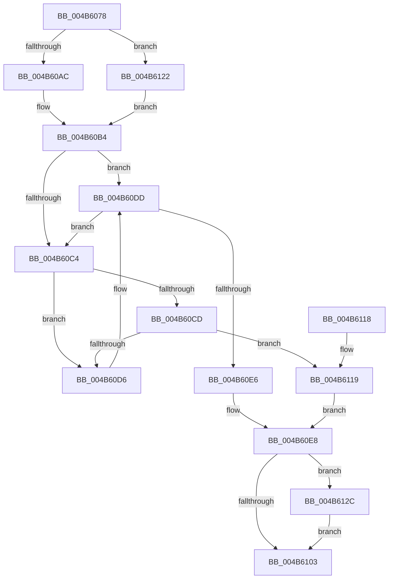

# MiFreeHardwareDescriptor

- RVA: `0x004B6078`–`0x004B6136` (길이 `190` bytes)
- VA: `0x00000001404B6078`
- 실행 섹션: `.text`
- PDB 이름 있음: `예`; PDB Function 태그: `아니요`
- unwind 정보 RVA: `0x0008EBC0`
- 디코드: `53`개 명령, `190/190` bytes 표시
- 미해석 바이트: `0` (있으면 어셈블리에 `.byte`로 보존)

> 이 문서는 커널 이미지의 기계어와 PDB 기호를 분석해 생성했습니다. 4번과 5번은 함수 원형과 자료형을 바이너리 사용 방식에서 추정한 C 해석이며 원본 소스 복구 결과는 아닙니다.

## 1. Dependencies

- 직접 호출 지점: **4**; 고유 호출 대상: **4**
- 직접 호출자로 확인된 함수: **2**
- RIP 상대 이미지 참조: **1**

### Outgoing calls
- `0x004B60AC` → [ExAcquireSpinLockExclusive](../24/ExAcquireSpinLockExclusive_function_00248690.md) (function, `0x00248690`)
- `0x004B60F9` → [MiReleaseSpinLockExclusive](../24/MiReleaseSpinLockExclusive_function_002482C0.md) (function, `0x002482C0`)
- `0x004B6125` → [ExAcquireSpinLockExclusiveAtDpcLevel](../24/ExAcquireSpinLockExclusiveAtDpcLevel_function_00248E80.md) (function, `0x00248E80`)
- `0x004B612F` → [MiDeleteAcceleratorDescriptor](../2C/MiDeleteAcceleratorDescriptor_function_002CA560.md) (function, `0x002CA560`)

### Direct callers
- [MiZeroThreadContextPrepareToWait](../31/MiZeroThreadContextPrepareToWait_function_0031E6D8.md) at `0x0031E703`
- [MiComputeCacheAttributeSpeeds](../69/MiComputeCacheAttributeSpeeds_function_006999E8.md) at `0x00699D5E`

### Static image references
- `0x004B60DD` → RVA `0x00E37554` (`.data`; read)

## 2. Other-region calls and transfers

- 다른 실행 섹션으로 향하는 call: **0**
- 별도 외부 분기/꼬리 이동을 확인하지 못했습니다.

## 3. Assembly (complete function range)

```asm
004B6078  48 89 5C 24 08                  mov qword ptr [rsp + 8], rbx
004B607D  48 89 6C 24 10                  mov qword ptr [rsp + 0x10], rbp
004B6082  48 89 74 24 18                  mov qword ptr [rsp + 0x18], rsi
004B6087  57                              push rdi
004B6088  48 83 EC 20                     sub rsp, 0x20
004B608C  48 8B FA                        mov rdi, rdx
004B608F  48 8D 5A E0                     lea rbx, [rdx - 0x20]
004B6093  48 8B E9                        mov rbp, rcx
004B6096  44 0F 20 C0                     mov rax, cr8
004B609A  48 8B 89 D0 00 00 00            mov rcx, qword ptr [rcx + 0xd0]
004B60A1  48 81 C1 B0 3B 00 00            add rcx, 0x3bb0
004B60A8  3C 02                           cmp al, 2
004B60AA  74 76                           je 0x1404b6122
004B60AC  E8 DF 25 D9 FF                  call 0x140248690
004B60B1  40 8A F0                        mov sil, al
004B60B4  48 8B 4B 18                     mov rcx, qword ptr [rbx + 0x18]
004B60B8  C6 43 10 00                     mov byte ptr [rbx + 0x10], 0
004B60BC  8B 51 34                        mov edx, dword ptr [rcx + 0x34]
004B60BF  F6 C2 01                        test dl, 1
004B60C2  74 19                           je 0x1404b60dd
004B60C4  48 8B 0B                        mov rcx, qword ptr [rbx]
004B60C7  48 39 59 08                     cmp qword ptr [rcx + 8], rbx
004B60CB  75 09                           jne 0x1404b60d6
004B60CD  48 8B 43 08                     mov rax, qword ptr [rbx + 8]
004B60D1  48 39 18                        cmp qword ptr [rax], rbx
004B60D4  74 43                           je 0x1404b6119
004B60D6  B9 03 00 00 00                  mov ecx, 3
004B60DB  CD 29                           int 0x29
004B60DD  80 3D 70 14 98 00 00            cmp byte ptr [rip + 0x981470], 0
004B60E4  75 DE                           jne 0x1404b60c4
004B60E6  33 FF                           xor edi, edi
004B60E8  48 8B 8D D0 00 00 00            mov rcx, qword ptr [rbp + 0xd0]
004B60EF  40 8A D6                        mov dl, sil
004B60F2  48 81 C1 B0 3B 00 00            add rcx, 0x3bb0
004B60F9  E8 C2 21 D9 FF                  call 0x1402482c0
004B60FE  48 85 FF                        test rdi, rdi
004B6101  75 29                           jne 0x1404b612c
004B6103  48 8B 5C 24 30                  mov rbx, qword ptr [rsp + 0x30]
004B6108  48 8B 6C 24 38                  mov rbp, qword ptr [rsp + 0x38]
004B610D  48 8B 74 24 40                  mov rsi, qword ptr [rsp + 0x40]
004B6112  48 83 C4 20                     add rsp, 0x20
004B6116  5F                              pop rdi
004B6117  C3                              ret
004B6118  CC                              int3
004B6119  48 89 08                        mov qword ptr [rax], rcx
004B611C  48 89 41 08                     mov qword ptr [rcx + 8], rax
004B6120  EB C6                           jmp 0x1404b60e8
004B6122  40 B6 11                        mov sil, 0x11
004B6125  E8 56 2D D9 FF                  call 0x140248e80
004B612A  EB 88                           jmp 0x1404b60b4
004B612C  48 8B CF                        mov rcx, rdi
004B612F  E8 2C 44 E1 FF                  call 0x1402ca560
004B6134  EB CD                           jmp 0x1404b6103
```

## 4. C-style interpretation (structured pseudocode)

```c
__int64 __fastcall MiFreeHardwareDescriptor(__int64 a1, __int64 a2)
{
    __int64 result;
    __int64 v_rdi;
    __int64 v_rsp;
    unsigned __int64 v_stack_p10;
    unsigned __int64 v_stack_p18;
    unsigned __int64 v_stack_p8;

    v_stack_p8 = v_rbx;
    v_stack_p10 = v_rbp;
    v_stack_p18 = v_rsi;
    v_rsp = (v_rsp) - (32);
    a1 = (*(unsigned __int64 *)(a1 + 208)) + (0x3BB0ULL);
    if (((unsigned __int8)(v_cr8)) == 2) goto loc_004B6122;
    result = ExAcquireSpinLockExclusive(a1, a2, a3, a4);
loc_004B60B4:
    *(unsigned __int8 *)(a2 - 32 + 16) = 0;
    if ((((unsigned __int8)((unsigned int)(*(unsigned int *)(*(unsigned __int64 *)(a2 - 32 + 24) + 52)))) & (1)) == 0) goto loc_004B60DD;
loc_004B60C4:
    if ((*(unsigned __int64 *)(*(unsigned __int64 *)(a2 - 32) + 8)) != (a2 - 32)) goto loc_004B60D6;
    if ((*(unsigned __int64 *)(*(unsigned __int64 *)(a2 - 32 + 8))) == (a2 - 32)) goto loc_004B6119;
loc_004B60D6:
loc_004B60DD:
    if ((*(unsigned __int8 *)(v_rip + 9966704)) != 0) goto loc_004B60C4;
    v_rdi = 0;
loc_004B60E8:
    a1 = (*(unsigned __int64 *)(a1 + 208)) + (0x3BB0ULL);
    result = MiReleaseSpinLockExclusive(a1, (unsigned __int8)((unsigned __int8)(result)), a3, a4);
    if (0 != 0) goto loc_004B612C;
loc_004B6103:
    v_rsp = (v_rsp) + (32);
    return result;
loc_004B6119:
    *(unsigned __int64 *)(result) = a1;
    *(unsigned __int64 *)(a1 + 8) = result;
    goto loc_004B60E8;
loc_004B6122:
    result = ExAcquireSpinLockExclusiveAtDpcLevel(a1, (unsigned __int8)((unsigned __int8)(result)), a3, a4);
    goto loc_004B60B4;
loc_004B612C:
    result = MiDeleteAcceleratorDescriptor(0, (unsigned __int8)((unsigned __int8)(result)), a3, a4);
    goto loc_004B6103;
}
```

## 5. (Beta) C Style

```c
int64_t MiFreeHardwareDescriptor(void *Arg1, void *Arg2)
{
    uint8_t *arg1 = (uint8_t *)Arg1;
    uint8_t *arg2 = (uint8_t *)Arg2;

    int64_t result;
    int64_t local_rdi;
    int64_t local_rsp;
    uint64_t v_stack_p10;
    uint64_t v_stack_p18;
    uint64_t v_stack_p8;

    v_stack_p8 = local_rbx;
    v_stack_p10 = local_rbp;
    v_stack_p18 = local_rsi;
    local_rsp = (local_rsp) - (32);
    Arg1 = (*(uint64_t *)(arg1 + 0xD0)) + (0x3BB0ULL);
    if (((uint8_t)(v_cr8)) == 2) goto loc_004B6122;
    result = ExAcquireSpinLockExclusive(Arg1, Arg2, a3, a4);
loc_004B60B4:
    *(uint8_t *)(arg2 - 0x20 + 0x10) = 0;
    if ((((uint8_t)((uint32_t)(*(uint32_t *)(*(uint64_t *)(arg2 - 0x20 + 0x18) + 0x34)))) & (1)) == 0) goto loc_004B60DD;
loc_004B60C4:
    if ((*(uint64_t *)(*(uint64_t *)(arg2 - 0x20) + 0x8)) != (Arg2 - 32)) goto loc_004B60D6;
    if ((*(uint64_t *)(*(uint64_t *)(arg2 - 0x20 + 0x8))) == (Arg2 - 32)) goto loc_004B6119;
loc_004B60D6:
loc_004B60DD:
    if ((*(uint8_t *)(v_rip + 0x981470)) != 0) goto loc_004B60C4;
    local_rdi = 0;
loc_004B60E8:
    Arg1 = (*(uint64_t *)(arg1 + 0xD0)) + (0x3BB0ULL);
    result = MiReleaseSpinLockExclusive(Arg1, (uint8_t)((uint8_t)(result)), a3, a4);
    if (0 != 0) goto loc_004B612C;
loc_004B6103:
    local_rsp = (local_rsp) + (32);
    return result;
loc_004B6119:
    *(void **)(result) = Arg1;
    *(uint64_t *)(arg1 + 0x8) = result;
    goto loc_004B60E8;
loc_004B6122:
    result = ExAcquireSpinLockExclusiveAtDpcLevel(Arg1, (uint8_t)((uint8_t)(result)), a3, a4);
    goto loc_004B60B4;
loc_004B612C:
    result = MiDeleteAcceleratorDescriptor(0, (uint8_t)((uint8_t)(result)), a3, a4);
    goto loc_004B6103;
}
```

### 관측된 메모리 오프셋

구조체 형식이 확인되지 않은 접근은 인자 기준의 오프셋으로만 기록했습니다.

| 기준 인자 | 오프셋 표현 | 폭 (bit) | 접근 |
|---|---:|---:|---|
| `Arg1` | `+ 0xD0` | `64` | `R` |
| `Arg2` | `- 0x20` | `64` | `R` |
| `Arg2` | `+ 0x0` | `64` | `R` |
| `Arg2` | `+ 0x8` | `64` | `R` |
| `Arg2` | `+ 0x10` | `8` | `W` |
| `Arg2` | `+ 0x18` | `64` | `R` |

## 6. Execution-region graph

[열기: 2D/3D 그래프와 함수 탐색 컨트롤 패널](../../../control-panel.html?section=text&rva=0x004B6078&view=graph)

- 2D 그래프는 위에서 아래로 흐르고, 3D 그래프는 빈 공간을 드래그해 회전합니다. Shift+드래그는 이동, 휠은 확대·축소, 함수 노드 선택은 대상 보고서 이동입니다.

### Static fallback


