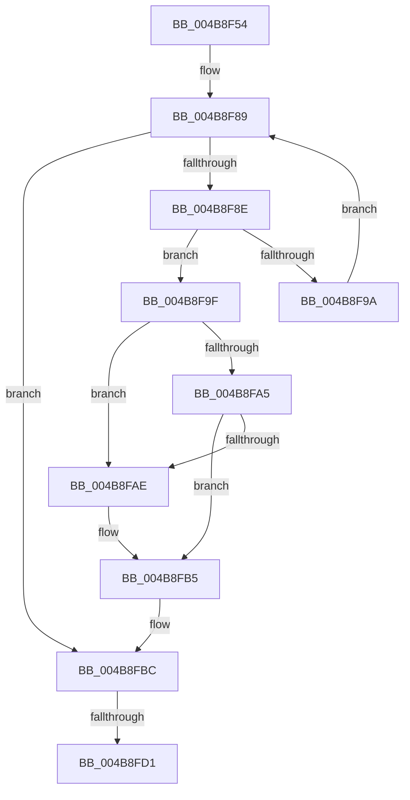

# MiFreePrivateFixupEntryForSystemImage

- RVA: `0x004B8F54`–`0x004B8FEC` (길이 `152` bytes)
- VA: `0x00000001404B8F54`
- 실행 섹션: `.text`
- PDB 이름 있음: `예`; PDB Function 태그: `예`
- unwind 정보 RVA: `0x000BB168`
- 디코드: `40`개 명령, `152/152` bytes 표시
- 미해석 바이트: `0` (있으면 어셈블리에 `.byte`로 보존)

> 이 문서는 커널 이미지의 기계어와 PDB 기호를 분석해 생성했습니다. 4번과 5번은 함수 원형과 자료형을 바이너리 사용 방식에서 추정한 C 해석이며 원본 소스 복구 결과는 아닙니다.

## 1. Dependencies

- 직접 호출 지점: **3**; 고유 호출 대상: **3**
- 직접 호출자로 확인된 함수: **1**
- RIP 상대 이미지 참조: **2**

### Outgoing calls
- `0x004B8F74` → [ExAcquireSpinLockExclusive](../24/ExAcquireSpinLockExclusive_function_00248690.md) (function, `0x00248690`)
- `0x004B8FC3` → [MiReleaseSpinLockExclusive](../24/MiReleaseSpinLockExclusive_function_002482C0.md) (function, `0x002482C0`)
- `0x004B8FE6` → [KeBugCheckEx](../4F/KeBugCheckEx_function_004FD660.md) (function, `0x004FD660`)

### Direct callers
- [MiUnloadSystemImage](../../page/AA/MiUnloadSystemImage_function_00AA2FD4.md) at `0x00AA3425`

### Static image references
- `0x004B8F6D` → RVA `0x00E2D91C` (`.data`; read)
- `0x004B8F79` → RVA `0x00E2D900` (`.data`; read)

## 2. Other-region calls and transfers

- 다른 실행 섹션으로 향하는 call: **0**
- call이 아닌 외부 분기/꼬리 이동: **1**
  - `0x004B8FCB` → [sub_006FC35A](../6F/Unknown_function_006FC35A.md) (`tail-transfer`)

## 3. Assembly (complete function range)

```asm
004B8F54  48 89 5C 24 08                  mov qword ptr [rsp + 8], rbx
004B8F59  48 89 6C 24 10                  mov qword ptr [rsp + 0x10], rbp
004B8F5E  48 89 74 24 18                  mov qword ptr [rsp + 0x18], rsi
004B8F63  57                              push rdi
004B8F64  48 83 EC 30                     sub rsp, 0x30
004B8F68  48 8B F1                        mov rsi, rcx
004B8F6B  33 FF                           xor edi, edi
004B8F6D  48 8D 0D A8 49 97 00            lea rcx, [rip + 0x9749a8]
004B8F74  E8 17 F7 D8 FF                  call 0x140248690
004B8F79  48 8B 1D 80 49 97 00            mov rbx, qword ptr [rip + 0x974980]
004B8F80  48 8D 2D 79 49 97 00            lea rbp, [rip + 0x974979]
004B8F87  8A D0                           mov dl, al
004B8F89  48 3B DD                        cmp rbx, rbp
004B8F8C  74 2E                           je 0x1404b8fbc
004B8F8E  48 8B FB                        mov rdi, rbx
004B8F91  48 8B 0B                        mov rcx, qword ptr [rbx]
004B8F94  48 3B 73 10                     cmp rsi, qword ptr [rbx + 0x10]
004B8F98  74 05                           je 0x1404b8f9f
004B8F9A  48 8B D9                        mov rbx, rcx
004B8F9D  EB EA                           jmp 0x1404b8f89
004B8F9F  48 39 59 08                     cmp qword ptr [rcx + 8], rbx
004B8FA3  75 09                           jne 0x1404b8fae
004B8FA5  48 8B 43 08                     mov rax, qword ptr [rbx + 8]
004B8FA9  48 39 18                        cmp qword ptr [rax], rbx
004B8FAC  74 07                           je 0x1404b8fb5
004B8FAE  B9 03 00 00 00                  mov ecx, 3
004B8FB3  CD 29                           int 0x29
004B8FB5  48 89 08                        mov qword ptr [rax], rcx
004B8FB8  48 89 41 08                     mov qword ptr [rcx + 8], rax
004B8FBC  48 8D 0D 59 49 97 00            lea rcx, [rip + 0x974959]
004B8FC3  E8 F8 F2 D8 FF                  call 0x1402482c0
004B8FC8  48 3B DD                        cmp rbx, rbp
004B8FCB  0F 85 89 33 24 00               jne 0x1406fc35a
004B8FD1  48 83 64 24 20 00               and qword ptr [rsp + 0x20], 0
004B8FD7  45 33 C9                        xor r9d, r9d
004B8FDA  4C 8B C6                        mov r8, rsi
004B8FDD  BA 11 10 00 00                  mov edx, 0x1011
004B8FE2  41 8D 49 1A                     lea ecx, [r9 + 0x1a]
004B8FE6  E8 75 46 04 00                  call 0x1404fd660
004B8FEB  CC                              int3
```

## 4. C-style interpretation (structured pseudocode)

```c
__int64 __fastcall MiFreePrivateFixupEntryForSystemImage(__int64 a1, __int64 a2, __int64 a3, int a4)
{
    __int64 result;
    __int64 v_rdi;
    __int64 v_rsp;
    unsigned __int64 v_stack_m18;
    unsigned __int64 v_stack_p10;
    unsigned __int64 v_stack_p18;
    unsigned __int64 v_stack_p8;

    v_stack_p8 = v_rbx;
    v_stack_p10 = v_rbp;
    v_stack_p18 = v_rsi;
    v_rsp = (v_rsp) - (48);
    v_rdi = 0;
    result = ExAcquireSpinLockExclusive(v_rip + 9914792, a2, a3, a4);
loc_004B8F89:
    if ((*(unsigned __int64 *)(v_rip + 9914752)) == (v_rip + 9914745)) goto loc_004B8FBC;
    if (a1 == (*(unsigned __int64 *)(*(unsigned __int64 *)(v_rip + 9914752) + 16))) goto loc_004B8F9F;
    goto loc_004B8F89;
loc_004B8F9F:
    if ((*(unsigned __int64 *)(*(unsigned __int64 *)(*(unsigned __int64 *)(v_rip + 9914752)) + 8)) != (*(unsigned __int64 *)(*(unsigned __int64 *)(v_rip + 9914752)))) goto loc_004B8FAE;
    if ((*(unsigned __int64 *)(*(unsigned __int64 *)(*(unsigned __int64 *)(*(unsigned __int64 *)(v_rip + 9914752)) + 8))) != (*(unsigned __int64 *)(*(unsigned __int64 *)(v_rip + 9914752)))) {
        a1 = 3;
    }
    *(unsigned __int64 *)(*(unsigned __int64 *)(*(unsigned __int64 *)(*(unsigned __int64 *)(v_rip + 9914752)) + 8)) = a1;
    *(unsigned __int64 *)(a1 + 8) = *(unsigned __int64 *)(*(unsigned __int64 *)(*(unsigned __int64 *)(v_rip + 9914752)) + 8);
loc_004B8FBC:
    result = MiReleaseSpinLockExclusive(v_rip + 9914713, (unsigned __int8)(result), a3, a4);
    a4 = 0;
    result = KeBugCheckEx(a4 + 26, (unsigned int)(0x1011ULL), a1, a4);
    return result;
}
```

## 5. (Beta) C Style

```c
int64_t MiFreePrivateFixupEntryForSystemImage(int64_t Arg1, int64_t Arg2, int64_t Arg3, int32_t Arg4)
{
    int64_t result;
    int64_t local_rdi;
    int64_t local_rsp;
    uint64_t v_stack_m18;
    uint64_t v_stack_p10;
    uint64_t v_stack_p18;
    uint64_t v_stack_p8;

    v_stack_p8 = local_rbx;
    v_stack_p10 = local_rbp;
    v_stack_p18 = local_rsi;
    local_rsp = (local_rsp) - (48);
    local_rdi = 0;
    result = ExAcquireSpinLockExclusive(v_rip + 9914792, Arg2, Arg3, Arg4);
loc_004B8F89:
    if ((*(uint64_t *)(v_rip + 0x974980)) == (v_rip + 9914745)) goto loc_004B8FBC;
    if (Arg1 == (*(uint64_t *)(*(uint64_t *)(v_rip + 0x974980) + 0x10))) goto loc_004B8F9F;
    goto loc_004B8F89;
loc_004B8F9F:
    if ((*(uint64_t *)(*(uint64_t *)(*(uint64_t *)(v_rip + 0x974980)) + 0x8)) != (*(uint64_t *)(*(uint64_t *)(v_rip + 0x974980)))) goto loc_004B8FAE;
    if ((*(uint64_t *)(*(uint64_t *)(*(uint64_t *)(*(uint64_t *)(v_rip + 0x974980)) + 0x8))) != (*(uint64_t *)(*(uint64_t *)(v_rip + 0x974980)))) {
        Arg1 = 3;
    }
    *(uint64_t *)(*(uint64_t *)(*(uint64_t *)(*(uint64_t *)(v_rip + 0x974980)) + 0x8)) = Arg1;
    *(uint64_t *)(Arg1 + 0x8) = *(uint64_t *)(*(uint64_t *)(*(uint64_t *)(v_rip + 0x974980)) + 0x8);
loc_004B8FBC:
    result = MiReleaseSpinLockExclusive(v_rip + 9914713, (uint8_t)(result), Arg3, Arg4);
    Arg4 = 0;
    result = KeBugCheckEx(Arg4 + 26, (uint32_t)(0x1011ULL), Arg1, Arg4);
    return result;
}
```

## 6. Execution-region graph

[열기: 2D/3D 그래프와 함수 탐색 컨트롤 패널](../../../control-panel.html?section=text&rva=0x004B8F54&view=graph)

- 2D 그래프는 위에서 아래로 흐르고, 3D 그래프는 빈 공간을 드래그해 회전합니다. Shift+드래그는 이동, 휠은 확대·축소, 함수 노드 선택은 대상 보고서 이동입니다.

### Static fallback


