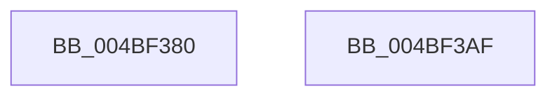

# MiGetOptimalProcessorWriteCount

- RVA: `0x004BF380`–`0x004BF3B0` (길이 `48` bytes)
- VA: `0x00000001404BF380`
- 실행 섹션: `.text`
- PDB 이름 있음: `예`; PDB Function 태그: `아니요`
- unwind 정보 RVA: `0x000DB714`
- 디코드: `12`개 명령, `48/48` bytes 표시
- 미해석 바이트: `0` (있으면 어셈블리에 `.byte`로 보존)

> 이 문서는 커널 이미지의 기계어와 PDB 기호를 분석해 생성했습니다. 4번과 5번은 함수 원형과 자료형을 바이너리 사용 방식에서 추정한 C 해석이며 원본 소스 복구 결과는 아닙니다.

## 1. Dependencies

- 직접 호출 지점: **0**; 고유 호출 대상: **0**
- 직접 호출자로 확인된 함수: **1**
- RIP 상대 이미지 참조: **1**

### Outgoing calls
- 직접 디코드된 call 명령이 없습니다.

### Direct callers
- [MiInitializeZeroEngines](../../page/81/MiInitializeZeroEngines_function_008106F4.md) at `0x00810832`

### Static image references
- `0x004BF38F` → RVA `0x00E2DBF8` (`.data`; read)

## 2. Other-region calls and transfers

- 다른 실행 섹션으로 향하는 call: **0**
- 별도 외부 분기/꼬리 이동을 확인하지 못했습니다.

## 3. Assembly (complete function range)

```asm
004BF380  48 63 C2                        movsxd rax, edx
004BF383  4C 6B C0 15                     imul r8, rax, 0x15
004BF387  49 63 D1                        movsxd rdx, r9d
004BF38A  4C 03 C2                        add r8, rdx
004BF38D  8B D1                           mov edx, ecx
004BF38F  48 8B 0D 62 E8 96 00            mov rcx, qword ptr [rip + 0x96e862]
004BF396  48 8D 04 52                     lea rax, [rdx + rdx*2]
004BF39A  48 C1 E0 07                     shl rax, 7
004BF39E  48 8B 84 08 78 01 00 00         mov rax, qword ptr [rax + rcx + 0x178]
004BF3A6  42 8B 84 C0 A4 00 00 00         mov eax, dword ptr [rax + r8*8 + 0xa4]
004BF3AE  C3                              ret
004BF3AF  CC                              int3
```

## 4. C-style interpretation (structured pseudocode)

```c
__int64 __fastcall MiGetOptimalProcessorWriteCount(int a1, int a2, __int64 a3, int a4)
{
    __int64 result;

    a3 = (a3) * ((int)(a2));
    a3 = (a3) + ((int)(a4));
    result = ((unsigned int)(a1) + (unsigned int)(a1) * 2) << (7);
    return (unsigned int)(*(unsigned int *)(*(unsigned __int64 *)(result + *(unsigned __int64 *)(v_rip + 9889890) * 1 + 376) + a3 * 8 + 164));
}
```

## 5. (Beta) C Style

```c
int64_t MiGetOptimalProcessorWriteCount(void *Arg1, int32_t Arg2, int64_t Arg3, int32_t Arg4)
{
    uint8_t *arg1 = (uint8_t *)Arg1;

    int64_t result;

    Arg3 = (Arg3) * ((int32_t)(Arg2));
    Arg3 = (Arg3) + ((int32_t)(Arg4));
    result = ((uint32_t)(Arg1) + (uint32_t)(Arg1) * 2) << (7);
    return (uint32_t)(*(uint32_t *)(*(uint64_t *)(result + *(uint64_t *)(v_rip + 0x96E862) * 1 + 0x178) + Arg3 * 8 + 0xA4));
}
```

### 관측된 메모리 오프셋

구조체 형식이 확인되지 않은 접근은 인자 기준의 오프셋으로만 기록했습니다.

| 기준 인자 | 오프셋 표현 | 폭 (bit) | 접근 |
|---|---:|---:|---|
| `Arg1` | `+ 0x0 + rdx*2` | `64` | `R` |

## 6. Execution-region graph

[열기: 2D/3D 그래프와 함수 탐색 컨트롤 패널](../../../control-panel.html?section=text&rva=0x004BF380&view=graph)

- 2D 그래프는 위에서 아래로 흐르고, 3D 그래프는 빈 공간을 드래그해 회전합니다. Shift+드래그는 이동, 휠은 확대·축소, 함수 노드 선택은 대상 보고서 이동입니다.

### Static fallback


