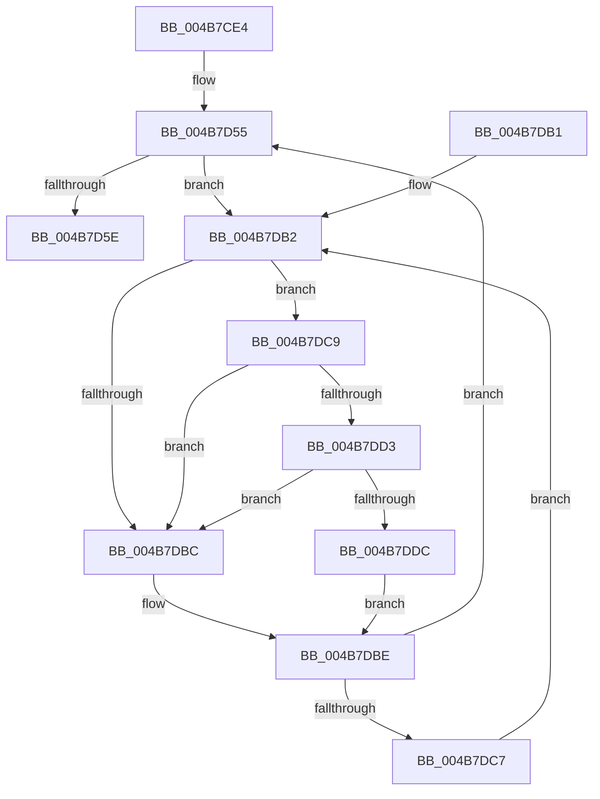

# MiInitializeLargeNonPagedPoolLeafFrames

- RVA: `0x004B7CE4`–`0x004B7DE5` (길이 `257` bytes)
- VA: `0x00000001404B7CE4`
- 실행 섹션: `.text`
- PDB 이름 있음: `예`; PDB Function 태그: `아니요`
- unwind 정보 RVA: `0x000BAB08`
- 디코드: `66`개 명령, `257/257` bytes 표시
- 미해석 바이트: `0` (있으면 어셈블리에 `.byte`로 보존)

> 이 문서는 커널 이미지의 기계어와 PDB 기호를 분석해 생성했습니다. 4번과 5번은 함수 원형과 자료형을 바이너리 사용 방식에서 추정한 C 해석이며 원본 소스 복구 결과는 아닙니다.

## 1. Dependencies

- 직접 호출 지점: **3**; 고유 호출 대상: **3**
- 직접 호출자로 확인된 함수: **1**
- RIP 상대 이미지 참조: **2**

### Outgoing calls
- `0x004B7D88` → [MiSetPfnContainingFrame](../36/MiSetPfnContainingFrame_function_00363FC0.md) (function, `0x00363FC0`)
- `0x004B7DD3` → [KiCheckVpBackingLongSpinWaitHypercall](../30/KiCheckVpBackingLongSpinWaitHypercall_function_0030F490.md) (function, `0x0030F490`)
- `0x004B7DDE` → [HvlNotifyLongSpinWait](../30/HvlNotifyLongSpinWait_function_0030F460.md) (function, `0x0030F460`)

### Direct callers
- [MiLinkPoolCommitChain](../31/MiLinkPoolCommitChain_function_00313D20.md) at `0x00314028`

### Static image references
- `0x004B7DB4` → RVA `0x00FC52AC` (`ALMOSTRO`; reference)
- `0x004B7DC9` → RVA `0x00FC6AB8` (`ALMOSTRO`; read)

## 2. Other-region calls and transfers

- 다른 실행 섹션으로 향하는 call: **0**
- 별도 외부 분기/꼬리 이동을 확인하지 못했습니다.

## 3. Assembly (complete function range)

```asm
004B7CE4  48 89 5C 24 10                  mov qword ptr [rsp + 0x10], rbx
004B7CE9  48 89 6C 24 18                  mov qword ptr [rsp + 0x18], rbp
004B7CEE  48 89 74 24 20                  mov qword ptr [rsp + 0x20], rsi
004B7CF3  57                              push rdi
004B7CF4  48 83 EC 20                     sub rsp, 0x20
004B7CF8  48 8D 1C 52                     lea rbx, [rdx + rdx*2]
004B7CFC  48 8B E9                        mov rbp, rcx
004B7CFF  48 C1 E3 04                     shl rbx, 4
004B7D03  48 B8 00 00 00 00 00 DE FF FF   movabs rax, 0xffffde0000000000
004B7D0D  48 8B D1                        mov rdx, rcx
004B7D10  49 B8 F8 FF FF FF 7F 00 00 00   movabs r8, 0x7ffffffff8
004B7D1A  48 C1 EA 09                     shr rdx, 9
004B7D1E  48 03 D8                        add rbx, rax
004B7D21  49 23 D0                        and rdx, r8
004B7D24  48 B9 00 00 00 00 80 F6 FF FF   movabs rcx, 0xfffff68000000000
004B7D2E  48 8B C1                        mov rax, rcx
004B7D31  48 03 D0                        add rdx, rax
004B7D34  48 C1 EA 09                     shr rdx, 9
004B7D38  49 23 D0                        and rdx, r8
004B7D3B  48 8B C1                        mov rax, rcx
004B7D3E  48 8B 34 02                     mov rsi, qword ptr [rdx + rax]
004B7D42  48 B8 FF FF FF FF FF 00 00 00   movabs rax, 0xffffffffff
004B7D4C  48 C1 EE 0C                     shr rsi, 0xc
004B7D50  48 23 F0                        and rsi, rax
004B7D53  33 FF                           xor edi, edi
004B7D55  F0 48 0F BA 6B 18 3F            lock bts qword ptr [rbx + 0x18], 0x3f
004B7D5C  72 54                           jb 0x1404b7db2
004B7D5E  48 89 6B 08                     mov qword ptr [rbx + 8], rbp
004B7D62  48 8B D6                        mov rdx, rsi
004B7D65  8B 43 20                        mov eax, dword ptr [rbx + 0x20]
004B7D68  48 8B CB                        mov rcx, rbx
004B7D6B  89 44 24 30                     mov dword ptr [rsp + 0x30], eax
004B7D6F  C1 E8 10                        shr eax, 0x10
004B7D72  24 FE                           and al, 0xfe
004B7D74  0C 06                           or al, 6
004B7D76  88 44 24 32                     mov byte ptr [rsp + 0x32], al
004B7D7A  8B 44 24 30                     mov eax, dword ptr [rsp + 0x30]
004B7D7E  89 43 20                        mov dword ptr [rbx + 0x20], eax
004B7D81  48 C7 03 00 00 00 00            mov qword ptr [rbx], 0
004B7D88  E8 33 C2 EA FF                  call 0x140363fc0
004B7D8D  48 B8 FF FF FF FF FF FF FF 7F   movabs rax, 0x7fffffffffffffff
004B7D97  F0 48 21 43 18                  lock and qword ptr [rbx + 0x18], rax
004B7D9C  48 8B 5C 24 38                  mov rbx, qword ptr [rsp + 0x38]
004B7DA1  48 8B 6C 24 40                  mov rbp, qword ptr [rsp + 0x40]
004B7DA6  48 8B 74 24 48                  mov rsi, qword ptr [rsp + 0x48]
004B7DAB  48 83 C4 20                     add rsp, 0x20
004B7DAF  5F                              pop rdi
004B7DB0  C3                              ret
004B7DB1  CC                              int3
004B7DB2  FF C7                           inc edi
004B7DB4  85 3D F2 D4 B0 00               test dword ptr [rip + 0xb0d4f2], edi
004B7DBA  74 0D                           je 0x1404b7dc9
004B7DBC  F3 90                           pause
004B7DBE  48 8B 43 18                     mov rax, qword ptr [rbx + 0x18]
004B7DC2  48 85 C0                        test rax, rax
004B7DC5  79 8E                           jns 0x1404b7d55
004B7DC7  EB E9                           jmp 0x1404b7db2
004B7DC9  8B 05 E9 EC B0 00               mov eax, dword ptr [rip + 0xb0ece9]
004B7DCF  A8 40                           test al, 0x40
004B7DD1  74 E9                           je 0x1404b7dbc
004B7DD3  E8 B8 76 E5 FF                  call 0x14030f490
004B7DD8  84 C0                           test al, al
004B7DDA  74 E0                           je 0x1404b7dbc
004B7DDC  8B CF                           mov ecx, edi
004B7DDE  E8 7D 76 E5 FF                  call 0x14030f460
004B7DE3  EB D9                           jmp 0x1404b7dbe
```

## 4. C-style interpretation (structured pseudocode)

```c
__int64 __fastcall MiInitializeLargeNonPagedPoolLeafFrames(__int64 a1, __int64 a2)
{
    __int64 result;
    __int64 v_rbx;
    __int64 v_rdi;
    __int64 v_rsi;
    __int64 v_rsp;
    unsigned __int64 v_stack_p10;
    unsigned __int64 v_stack_p18;
    unsigned __int64 v_stack_p20;
    unsigned int v_stack_p8;
    unsigned __int8 v_stack_pA;

    v_stack_p10 = v_rbx;
    v_stack_p18 = v_rbp;
    v_stack_p20 = v_rsi;
    v_rsp = (v_rsp) - (32);
    v_rbx = (a2 + a2 * 2) << (4);
    a2 = (a1) >> (9);
    v_rbx = (v_rbx) + (result);
    a2 = (a2) & (a3);
    a2 = (a2) + (a1);
    a2 = (a2) >> (9);
    a2 = (a2) & (a3);
    v_rsi = (*(unsigned __int64 *)(a2 + a1 * 1)) >> (12);
    v_rsi = (v_rsi) & (a1);
    v_rdi = 0;
loc_004B7D55:
    if (condition_is_below) goto loc_004B7DB2;
    *(unsigned __int64 *)(v_rbx + 8) = a1;
    v_stack_p8 = (unsigned int)((unsigned int)(*(unsigned int *)(v_rbx + 32)));
    result = (unsigned int)(((unsigned int)(*(unsigned int *)(v_rbx + 32))) >> (16));
    result = (unsigned __int8)((result) & (254));
    result = (unsigned __int8)((result) | (6));
    v_stack_pA = (unsigned __int8)(result);
    *(unsigned int *)(v_rbx + 32) = (unsigned int)((unsigned int)(v_stack_p8));
    *(unsigned __int64 *)(v_rbx) = 0;
    result = MiSetPfnContainingFrame(v_rbx, v_rsi, a3, a4);
    v_rsp = (v_rsp) + (32);
    return result;
loc_004B7DB2:
    v_rdi = (unsigned int)((v_rdi) + 1);
    if (((*(unsigned int *)(v_rip + 11588850)) & ((unsigned int)(v_rdi))) == 0) goto loc_004B7DC9;
loc_004B7DBC:
loc_004B7DBE:
    if (!sign_flag) goto loc_004B7D55;
    goto loc_004B7DB2;
loc_004B7DC9:
    if ((((unsigned __int8)((unsigned int)(*(unsigned int *)(v_rip + 11594985)))) & (64)) == 0) goto loc_004B7DBC;
    result = KiCheckVpBackingLongSpinWaitHypercall(v_rbx, v_rsi, a3, a4);
    if ((unsigned __int8)(result) == 0) goto loc_004B7DBC;
    result = HvlNotifyLongSpinWait((unsigned int)((unsigned int)(v_rdi)), v_rsi, a3, a4);
    goto loc_004B7DBE;
}
```

## 5. (Beta) C Style

```c
int64_t MiInitializeLargeNonPagedPoolLeafFrames(int64_t Arg1, void *Arg2)
{
    uint8_t *arg2 = (uint8_t *)Arg2;

    int64_t result;
    int64_t local_rbx;
    int64_t local_rdi;
    int64_t local_rsi;
    int64_t local_rsp;
    uint64_t v_stack_p10;
    uint64_t v_stack_p18;
    uint64_t v_stack_p20;
    uint32_t v_stack_p8;
    uint8_t v_stack_pA;

    v_stack_p10 = local_rbx;
    v_stack_p18 = local_rbp;
    v_stack_p20 = local_rsi;
    local_rsp = (local_rsp) - (32);
    local_rbx = (Arg2 + Arg2 * 2) << (4);
    Arg2 = (Arg1) >> (9);
    local_rbx = (local_rbx) + (result);
    Arg2 = (Arg2) & (a3);
    Arg2 = (Arg2) + (Arg1);
    Arg2 = (Arg2) >> (9);
    Arg2 = (Arg2) & (a3);
    local_rsi = (*(uint64_t *)(arg2 + Arg1 * 1)) >> (12);
    local_rsi = (local_rsi) & (Arg1);
    local_rdi = 0;
loc_004B7D55:
    if (condition_is_below) goto loc_004B7DB2;
    *(uint64_t *)(local_rbx + 0x8) = Arg1;
    v_stack_p8 = (uint32_t)((uint32_t)(*(uint32_t *)(local_rbx + 0x20)));
    result = (uint32_t)(((uint32_t)(*(uint32_t *)(local_rbx + 0x20))) >> (16));
    result = (uint8_t)((result) & (254));
    result = (uint8_t)((result) | (6));
    v_stack_pA = (uint8_t)(result);
    *(uint32_t *)(local_rbx + 0x20) = (uint32_t)((uint32_t)(v_stack_p8));
    *(uint64_t *)(local_rbx) = 0;
    result = MiSetPfnContainingFrame(local_rbx, local_rsi, a3, a4);
    local_rsp = (local_rsp) + (32);
    return result;
loc_004B7DB2:
    local_rdi = (uint32_t)((local_rdi) + 1);
    if (((*(uint32_t *)(v_rip + 0xB0D4F2)) & ((uint32_t)(local_rdi))) == 0) goto loc_004B7DC9;
loc_004B7DBC:
loc_004B7DBE:
    if (!sign_flag) goto loc_004B7D55;
    goto loc_004B7DB2;
loc_004B7DC9:
    if ((((uint8_t)((uint32_t)(*(uint32_t *)(v_rip + 0xB0ECE9)))) & (64)) == 0) goto loc_004B7DBC;
    result = KiCheckVpBackingLongSpinWaitHypercall(local_rbx, local_rsi, a3, a4);
    if ((uint8_t)(result) == 0) goto loc_004B7DBC;
    result = HvlNotifyLongSpinWait((uint32_t)((uint32_t)(local_rdi)), local_rsi, a3, a4);
    goto loc_004B7DBE;
}
```

### 관측된 메모리 오프셋

구조체 형식이 확인되지 않은 접근은 인자 기준의 오프셋으로만 기록했습니다.

| 기준 인자 | 오프셋 표현 | 폭 (bit) | 접근 |
|---|---:|---:|---|
| `Arg2` | `+ 0x0 + rdx*2` | `64` | `R` |

## 6. Execution-region graph

[열기: 2D/3D 그래프와 함수 탐색 컨트롤 패널](../../../control-panel.html?section=text&rva=0x004B7CE4&view=graph)

- 2D 그래프는 위에서 아래로 흐르고, 3D 그래프는 빈 공간을 드래그해 회전합니다. Shift+드래그는 이동, 휠은 확대·축소, 함수 노드 선택은 대상 보고서 이동입니다.

### Static fallback


