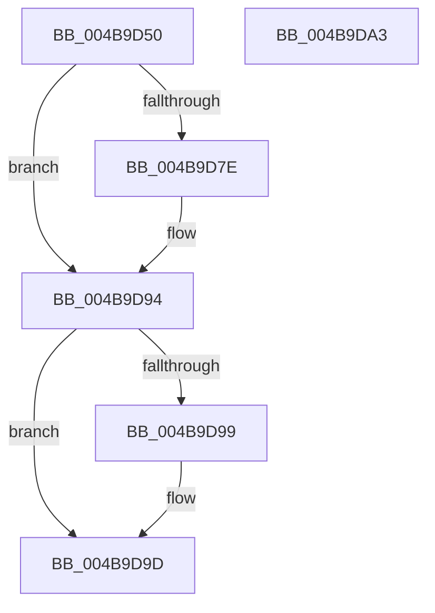

# MiLockDriverMappings

- RVA: `0x004B9D50`–`0x004B9DA4` (길이 `84` bytes)
- VA: `0x00000001404B9D50`
- 실행 섹션: `.text`
- PDB 이름 있음: `예`; PDB Function 태그: `아니요`
- unwind 정보 RVA: `0x0005CF00`
- 디코드: `22`개 명령, `84/84` bytes 표시
- 미해석 바이트: `0` (있으면 어셈블리에 `.byte`로 보존)

> 이 문서는 커널 이미지의 기계어와 PDB 기호를 분석해 생성했습니다. 4번과 5번은 함수 원형과 자료형을 바이너리 사용 방식에서 추정한 C 해석이며 원본 소스 복구 결과는 아닙니다.

## 1. Dependencies

- 직접 호출 지점: **2**; 고유 호출 대상: **2**
- 직접 호출자로 확인된 함수: **2**
- RIP 상대 이미지 참조: **2**

### Outgoing calls
- `0x004B9D6A` → [KeAbPreAcquire](../21/KeAbPreAcquire_function_00210230.md) (function, `0x00210230`)
- `0x004B9D8F` → [ExfAcquirePushLockExclusiveEx](../20/ExfAcquirePushLockExclusiveEx_function_0020FC90.md) (function, `0x0020FC90`)

### Direct callers
- [MiReserveDriverPtes](../../page/A7/MiReserveDriverPtes_function_00A75150.md) at `0x00A7518C`
- [MiReleaseDriverPtes](../../page/A7/MiReleaseDriverPtes_function_00A7F1B4.md) at `0x00A7F20A`

### Static image references
- `0x004B9D60` → RVA `0x00E2D958` (`.data`; read)
- `0x004B9D6F` → RVA `0x00E2D958` (`.data`; read/write)

## 2. Other-region calls and transfers

- 다른 실행 섹션으로 향하는 call: **0**
- 별도 외부 분기/꼬리 이동을 확인하지 못했습니다.

## 3. Assembly (complete function range)

```asm
004B9D50  40 53                           push rbx
004B9D52  48 83 EC 20                     sub rsp, 0x20
004B9D56  66 FF 89 E6 01 00 00            dec word ptr [rcx + 0x1e6]
004B9D5D  45 33 C0                        xor r8d, r8d
004B9D60  48 8D 0D F1 3B 97 00            lea rcx, [rip + 0x973bf1]
004B9D67  33 D2                           xor edx, edx
004B9D69  90                              nop
004B9D6A  E8 C1 64 D5 FF                  call 0x140210230
004B9D6F  F0 48 0F BA 2D DF 3B 97 00 00   lock bts qword ptr [rip + 0x973bdf], 0
004B9D79  48 8B D8                        mov rbx, rax
004B9D7C  73 16                           jae 0x1404b9d94
004B9D7E  4C 8D 05 D3 3B 97 00            lea r8, [rip + 0x973bd3]
004B9D85  48 8B D0                        mov rdx, rax
004B9D88  48 8D 0D C9 3B 97 00            lea rcx, [rip + 0x973bc9]
004B9D8F  E8 FC 5E D5 FF                  call 0x14020fc90
004B9D94  48 85 DB                        test rbx, rbx
004B9D97  74 04                           je 0x1404b9d9d
004B9D99  C6 43 0A 01                     mov byte ptr [rbx + 0xa], 1
004B9D9D  48 83 C4 20                     add rsp, 0x20
004B9DA1  5B                              pop rbx
004B9DA2  C3                              ret
004B9DA3  CC                              int3
```

## 4. C-style interpretation (structured pseudocode)

```c
__int64 __fastcall MiLockDriverMappings(__int64 a1, int a2, int a3)
{
    __int64 result;
    __int64 v_rsp;

    v_rsp = (v_rsp) - (32);
    a3 = 0;
    a2 = 0;
    result = KeAbPreAcquire(v_rip + 9911281, a2, a3, a4);
    if (!(condition_is_above_or_equal)) {
        a3 = v_rip + 9911251;
        a2 = result;
        a1 = v_rip + 9911241;
        result = ExfAcquirePushLockExclusiveEx(a1, a2, a3, a4);
    }
    if (result != 0) {
        *(unsigned __int8 *)(result + 10) = 1;
    }
    v_rsp = (v_rsp) + (32);
    return result;
}
```

## 5. (Beta) C Style

```c
int64_t MiLockDriverMappings(void *Arg1, int32_t Arg2, int32_t Arg3)
{
    uint8_t *arg1 = (uint8_t *)Arg1;

    int64_t result;
    int64_t local_rsp;

    local_rsp = (local_rsp) - (32);
    Arg3 = 0;
    Arg2 = 0;
    result = KeAbPreAcquire(v_rip + 9911281, Arg2, Arg3, a4);
    if (!(condition_is_above_or_equal)) {
        Arg3 = v_rip + 9911251;
        Arg2 = result;
        Arg1 = v_rip + 9911241;
        result = ExfAcquirePushLockExclusiveEx(Arg1, Arg2, Arg3, a4);
    }
    if (result != 0) {
        *(uint8_t *)(result + 0xA) = 1;
    }
    local_rsp = (local_rsp) + (32);
    return result;
}
```

### 관측된 메모리 오프셋

구조체 형식이 확인되지 않은 접근은 인자 기준의 오프셋으로만 기록했습니다.

| 기준 인자 | 오프셋 표현 | 폭 (bit) | 접근 |
|---|---:|---:|---|
| `Arg1` | `+ 0x1E6` | `16` | `R/W` |

## 6. Execution-region graph

[열기: 2D/3D 그래프와 함수 탐색 컨트롤 패널](../../../control-panel.html?section=text&rva=0x004B9D50&view=graph)

- 2D 그래프는 위에서 아래로 흐르고, 3D 그래프는 빈 공간을 드래그해 회전합니다. Shift+드래그는 이동, 휠은 확대·축소, 함수 노드 선택은 대상 보고서 이동입니다.

### Static fallback


