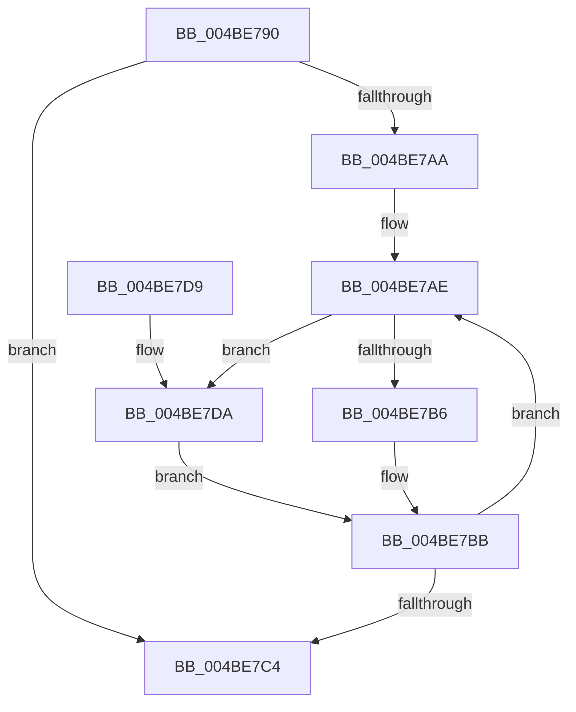

# MiLockMemoryListsCallback

- RVA: `0x004BE790`–`0x004BE7E1` (길이 `81` bytes)
- VA: `0x00000001404BE790`
- 실행 섹션: `.text`
- PDB 이름 있음: `예`; PDB Function 태그: `아니요`
- unwind 정보 RVA: `0x0006383C`
- 디코드: `25`개 명령, `81/81` bytes 표시
- 미해석 바이트: `0` (있으면 어셈블리에 `.byte`로 보존)

> 이 문서는 커널 이미지의 기계어와 PDB 기호를 분석해 생성했습니다. 4번과 5번은 함수 원형과 자료형을 바이너리 사용 방식에서 추정한 C 해석이며 원본 소스 복구 결과는 아닙니다.

## 1. Dependencies

- 직접 호출 지점: **2**; 고유 호출 대상: **2**
- 직접 호출자로 확인된 함수: **0**
- RIP 상대 이미지 참조: **0**

### Outgoing calls
- `0x004BE7B6` → [ExAcquireSpinLockExclusiveAtDpcLevel](../24/ExAcquireSpinLockExclusiveAtDpcLevel_function_00248E80.md) (function, `0x00248E80`)
- `0x004BE7DA` → [ExReleaseSpinLockExclusiveFromDpcLevel](../24/ExReleaseSpinLockExclusiveFromDpcLevel_function_002497E0.md) (function, `0x002497E0`)

### Direct callers
- 이 함수 시작 RVA로 연결되는 직접 call은 확인되지 않았습니다. 간접 호출은 완전히 역산할 수 없습니다.

### Static image references
- 디코드된 RIP-relative 메모리 참조가 없습니다.

## 2. Other-region calls and transfers

- 다른 실행 섹션으로 향하는 call: **0**
- 별도 외부 분기/꼬리 이동을 확인하지 못했습니다.

## 3. Assembly (complete function range)

```asm
004BE790  48 89 5C 24 08                  mov qword ptr [rsp + 8], rbx
004BE795  48 89 74 24 10                  mov qword ptr [rsp + 0x10], rsi
004BE79A  57                              push rdi
004BE79B  48 83 EC 20                     sub rsp, 0x20
004BE79F  41 8B F9                        mov edi, r9d
004BE7A2  48 8B F1                        mov rsi, rcx
004BE7A5  45 85 C9                        test r9d, r9d
004BE7A8  74 1A                           je 0x1404be7c4
004BE7AA  49 8D 58 20                     lea rbx, [r8 + 0x20]
004BE7AE  48 8B CB                        mov rcx, rbx
004BE7B1  48 85 F6                        test rsi, rsi
004BE7B4  74 24                           je 0x1404be7da
004BE7B6  E8 C5 A6 D8 FF                  call 0x140248e80
004BE7BB  48 83 C3 58                     add rbx, 0x58
004BE7BF  83 C7 FF                        add edi, -1
004BE7C2  75 EA                           jne 0x1404be7ae
004BE7C4  48 8B 5C 24 30                  mov rbx, qword ptr [rsp + 0x30]
004BE7C9  B8 01 00 00 00                  mov eax, 1
004BE7CE  48 8B 74 24 38                  mov rsi, qword ptr [rsp + 0x38]
004BE7D3  48 83 C4 20                     add rsp, 0x20
004BE7D7  5F                              pop rdi
004BE7D8  C3                              ret
004BE7D9  CC                              int3
004BE7DA  E8 01 B0 D8 FF                  call 0x1402497e0
004BE7DF  EB DA                           jmp 0x1404be7bb
```

## 4. C-style interpretation (structured pseudocode)

```c
__int64 __fastcall MiLockMemoryListsCallback(__int64 a1, __int64 a2, __int64 a3, int a4)
{
    __int64 result;
    __int64 v_rbx;
    __int64 v_rdi;
    __int64 v_rsp;
    unsigned __int64 v_stack_p10;
    unsigned __int64 v_stack_p8;

    v_stack_p8 = v_rbx;
    v_stack_p10 = v_rsi;
    v_rsp = (v_rsp) - (32);
    if (a4 == 0) goto loc_004BE7C4;
loc_004BE7AE:
    if (a1 == 0) goto loc_004BE7DA;
    result = ExAcquireSpinLockExclusiveAtDpcLevel(a3 + 32, a2, a3, a4);
loc_004BE7BB:
    v_rbx = (a3 + 32) + (88);
    v_rdi = (unsigned int)(((unsigned int)(a4)) + (-1));
    if (condition_is_not_equal) goto loc_004BE7AE;
loc_004BE7C4:
    v_rsp = (v_rsp) + (32);
    return 1;
loc_004BE7DA:
    result = ExReleaseSpinLockExclusiveFromDpcLevel(a3 + 32, a2, a3, a4);
    goto loc_004BE7BB;
}
```

## 5. (Beta) C Style

```c
int64_t MiLockMemoryListsCallback(int64_t Arg1, int64_t Arg2, void *Arg3, int32_t Arg4)
{
    uint8_t *arg3 = (uint8_t *)Arg3;

    int64_t result;
    int64_t local_rbx;
    int64_t local_rdi;
    int64_t local_rsp;
    uint64_t v_stack_p10;
    uint64_t v_stack_p8;

    v_stack_p8 = local_rbx;
    v_stack_p10 = local_rsi;
    local_rsp = (local_rsp) - (32);
    if (Arg4 == 0) goto loc_004BE7C4;
loc_004BE7AE:
    if (Arg1 == 0) goto loc_004BE7DA;
    result = ExAcquireSpinLockExclusiveAtDpcLevel(Arg3 + 32, Arg2, Arg3, Arg4);
loc_004BE7BB:
    local_rbx = (Arg3 + 32) + (88);
    local_rdi = (uint32_t)(((uint32_t)(Arg4)) + (-1));
    if (condition_is_not_equal) goto loc_004BE7AE;
loc_004BE7C4:
    local_rsp = (local_rsp) + (32);
    return 1;
loc_004BE7DA:
    result = ExReleaseSpinLockExclusiveFromDpcLevel(Arg3 + 32, Arg2, Arg3, Arg4);
    goto loc_004BE7BB;
}
```

### 관측된 메모리 오프셋

구조체 형식이 확인되지 않은 접근은 인자 기준의 오프셋으로만 기록했습니다.

| 기준 인자 | 오프셋 표현 | 폭 (bit) | 접근 |
|---|---:|---:|---|
| `Arg3` | `+ 0x20` | `64` | `R` |

## 6. Execution-region graph

[열기: 2D/3D 그래프와 함수 탐색 컨트롤 패널](../../../control-panel.html?section=text&rva=0x004BE790&view=graph)

- 2D 그래프는 위에서 아래로 흐르고, 3D 그래프는 빈 공간을 드래그해 회전합니다. Shift+드래그는 이동, 휠은 확대·축소, 함수 노드 선택은 대상 보고서 이동입니다.

### Static fallback


