# MiLockMemoryLists

- RVA: `0x004BB470`–`0x004BB693` (길이 `547` bytes)
- VA: `0x00000001404BB470`
- 실행 섹션: `.text`
- PDB 이름 있음: `예`; PDB Function 태그: `아니요`
- unwind 정보 RVA: `0x00075C18`
- 디코드: `143`개 명령, `547/547` bytes 표시
- 미해석 바이트: `0` (있으면 어셈블리에 `.byte`로 보존)

> 이 문서는 커널 이미지의 기계어와 PDB 기호를 분석해 생성했습니다. 4번과 5번은 함수 원형과 자료형을 바이너리 사용 방식에서 추정한 C 해석이며 원본 소스 복구 결과는 아닙니다.

## 1. Dependencies

- 직접 호출 지점: **19**; 고유 호출 대상: **5**
- 직접 호출자로 확인된 함수: **0**
- RIP 상대 이미지 참조: **2**

### Outgoing calls
- `0x004BB4A1` → [ExAcquireSpinLockExclusiveAtDpcLevel](../24/ExAcquireSpinLockExclusiveAtDpcLevel_function_00248E80.md) (function, `0x00248E80`)
- `0x004BB4A8` → [ExReleaseSpinLockExclusiveFromDpcLevel](../24/ExReleaseSpinLockExclusiveFromDpcLevel_function_002497E0.md) (function, `0x002497E0`)
- `0x004BB4BA` → [MiWalkAllFreeZeroLists](MiWalkAllFreeZeroLists_function_004BB6C8.md) (function, `0x004BB6C8`)
- `0x004BB4D3` → [ExAcquireSpinLockExclusiveAtDpcLevel](../24/ExAcquireSpinLockExclusiveAtDpcLevel_function_00248E80.md) (function, `0x00248E80`)
- `0x004BB4DA` → [ExReleaseSpinLockExclusiveFromDpcLevel](../24/ExReleaseSpinLockExclusiveFromDpcLevel_function_002497E0.md) (function, `0x002497E0`)
- `0x004BB4F5` → [ExAcquireSpinLockExclusiveAtDpcLevel](../24/ExAcquireSpinLockExclusiveAtDpcLevel_function_00248E80.md) (function, `0x00248E80`)
- `0x004BB501` → [ExAcquireSpinLockExclusiveAtDpcLevel](../24/ExAcquireSpinLockExclusiveAtDpcLevel_function_00248E80.md) (function, `0x00248E80`)
- `0x004BB508` → [ExReleaseSpinLockExclusiveFromDpcLevel](../24/ExReleaseSpinLockExclusiveFromDpcLevel_function_002497E0.md) (function, `0x002497E0`)
- `0x004BB514` → [ExReleaseSpinLockExclusiveFromDpcLevel](../24/ExReleaseSpinLockExclusiveFromDpcLevel_function_002497E0.md) (function, `0x002497E0`)
- `0x004BB530` → [ExAcquireSpinLockExclusiveAtDpcLevel](../24/ExAcquireSpinLockExclusiveAtDpcLevel_function_00248E80.md) (function, `0x00248E80`)
- `0x004BB537` → [ExReleaseSpinLockExclusiveFromDpcLevel](../24/ExReleaseSpinLockExclusiveFromDpcLevel_function_002497E0.md) (function, `0x002497E0`)
- `0x004BB555` → [ExAcquireSpinLockExclusiveAtDpcLevel](../24/ExAcquireSpinLockExclusiveAtDpcLevel_function_00248E80.md) (function, `0x00248E80`)
- `0x004BB55C` → [ExReleaseSpinLockExclusiveFromDpcLevel](../24/ExReleaseSpinLockExclusiveFromDpcLevel_function_002497E0.md) (function, `0x002497E0`)
- `0x004BB5A8` → [MiLockSlabAllocator](MiLockSlabAllocator_function_004BB6A0.md) (function, `0x004BB6A0`)
- `0x004BB5F9` → [MiLockSlabRepurposedStandbyList](../68/MiLockSlabRepurposedStandbyList_function_0068ED78.md) (function, `0x0068ED78`)
- `0x004BB623` → [ExAcquireSpinLockExclusiveAtDpcLevel](../24/ExAcquireSpinLockExclusiveAtDpcLevel_function_00248E80.md) (function, `0x00248E80`)
- `0x004BB62A` → [ExReleaseSpinLockExclusiveFromDpcLevel](../24/ExReleaseSpinLockExclusiveFromDpcLevel_function_002497E0.md) (function, `0x002497E0`)
- `0x004BB655` → [ExAcquireSpinLockExclusiveAtDpcLevel](../24/ExAcquireSpinLockExclusiveAtDpcLevel_function_00248E80.md) (function, `0x00248E80`)
- `0x004BB65C` → [ExReleaseSpinLockExclusiveFromDpcLevel](../24/ExReleaseSpinLockExclusiveFromDpcLevel_function_002497E0.md) (function, `0x002497E0`)

### Direct callers
- 이 함수 시작 RVA로 연결되는 직접 call은 확인되지 않았습니다. 간접 호출은 완전히 역산할 수 없습니다.

### Static image references
- `0x004BB4B0` → RVA `0x004BE790` (`MiLockMemoryListsCallback`; read)
- `0x004BB56B` → RVA `0x00FC5000` (`ALMOSTRO`; read)

## 2. Other-region calls and transfers

- 다른 실행 섹션으로 향하는 call: **0**
- 별도 외부 분기/꼬리 이동을 확인하지 못했습니다.

## 3. Assembly (complete function range)

```asm
004BB470  48 89 5C 24 08                  mov qword ptr [rsp + 8], rbx
004BB475  48 89 6C 24 10                  mov qword ptr [rsp + 0x10], rbp
004BB47A  48 89 74 24 18                  mov qword ptr [rsp + 0x18], rsi
004BB47F  57                              push rdi
004BB480  41 54                           push r12
004BB482  41 55                           push r13
004BB484  41 56                           push r14
004BB486  41 57                           push r15
004BB488  48 83 EC 20                     sub rsp, 0x20
004BB48C  48 8B D9                        mov rbx, rcx
004BB48F  45 33 ED                        xor r13d, r13d
004BB492  48 81 C1 A0 1B 00 00            add rcx, 0x1ba0
004BB499  48 8B F2                        mov rsi, rdx
004BB49C  48 85 D2                        test rdx, rdx
004BB49F  74 07                           je 0x1404bb4a8
004BB4A1  E8 DA D9 D8 FF                  call 0x140248e80
004BB4A6  EB 05                           jmp 0x1404bb4ad
004BB4A8  E8 33 E3 D8 FF                  call 0x1402497e0
004BB4AD  4C 8B C6                        mov r8, rsi
004BB4B0  48 8D 15 D9 32 00 00            lea rdx, [rip + 0x32d9]
004BB4B7  48 8B CB                        mov rcx, rbx
004BB4BA  E8 09 02 00 00                  call 0x1404bb6c8
004BB4BF  48 8D BB E0 0C 00 00            lea rdi, [rbx + 0xce0]
004BB4C6  BD 08 00 00 00                  mov ebp, 8
004BB4CB  48 8B CF                        mov rcx, rdi
004BB4CE  48 85 F6                        test rsi, rsi
004BB4D1  74 07                           je 0x1404bb4da
004BB4D3  E8 A8 D9 D8 FF                  call 0x140248e80
004BB4D8  EB 05                           jmp 0x1404bb4df
004BB4DA  E8 01 E3 D8 FF                  call 0x1402497e0
004BB4DF  48 83 C7 58                     add rdi, 0x58
004BB4E3  48 83 ED 01                     sub rbp, 1
004BB4E7  75 E2                           jne 0x1404bb4cb
004BB4E9  48 8D 8B A0 0F 00 00            lea rcx, [rbx + 0xfa0]
004BB4F0  48 85 F6                        test rsi, rsi
004BB4F3  74 13                           je 0x1404bb508
004BB4F5  E8 86 D9 D8 FF                  call 0x140248e80
004BB4FA  48 8D 8B 20 10 00 00            lea rcx, [rbx + 0x1020]
004BB501  E8 7A D9 D8 FF                  call 0x140248e80
004BB506  EB 11                           jmp 0x1404bb519
004BB508  E8 D3 E2 D8 FF                  call 0x1402497e0
004BB50D  48 8D 8B 20 10 00 00            lea rcx, [rbx + 0x1020]
004BB514  E8 C7 E2 D8 FF                  call 0x1402497e0
004BB519  BD 10 00 00 00                  mov ebp, 0x10
004BB51E  48 8D BB A0 10 00 00            lea rdi, [rbx + 0x10a0]
004BB525  44 8B F5                        mov r14d, ebp
004BB528  48 8B CF                        mov rcx, rdi
004BB52B  48 85 F6                        test rsi, rsi
004BB52E  74 07                           je 0x1404bb537
004BB530  E8 4B D9 D8 FF                  call 0x140248e80
004BB535  EB 05                           jmp 0x1404bb53c
004BB537  E8 A4 E2 D8 FF                  call 0x1402497e0
004BB53C  48 83 C7 58                     add rdi, 0x58
004BB540  49 83 EE 01                     sub r14, 1
004BB544  75 E2                           jne 0x1404bb528
004BB546  48 8D BB 20 16 00 00            lea rdi, [rbx + 0x1620]
004BB54D  48 8B CF                        mov rcx, rdi
004BB550  48 85 F6                        test rsi, rsi
004BB553  74 07                           je 0x1404bb55c
004BB555  E8 26 D9 D8 FF                  call 0x140248e80
004BB55A  EB 05                           jmp 0x1404bb561
004BB55C  E8 7F E2 D8 FF                  call 0x1402497e0
004BB561  48 83 C7 58                     add rdi, 0x58
004BB565  48 83 ED 01                     sub rbp, 1
004BB569  75 E2                           jne 0x1404bb54d
004BB56B  0F B7 05 8E 9A B0 00            movzx eax, word ptr [rip + 0xb09a8e]
004BB572  48 85 F6                        test rsi, rsi
004BB575  48 8B 7B 10                     mov rdi, qword ptr [rbx + 0x10]
004BB579  4D 8B E5                        mov r12, r13
004BB57C  41 0F 95 C4                     setne r12b
004BB580  4C 69 F0 80 DF 00 00            imul r14, rax, 0xdf80
004BB587  4C 03 F7                        add r14, rdi
004BB58A  EB 35                           jmp 0x1404bb5c1
004BB58C  48 8D AF 50 3D 00 00            lea rbp, [rdi + 0x3d50]
004BB593  4C 8D BF 78 45 00 00            lea r15, [rdi + 0x4578]
004BB59A  49 3B EF                        cmp rbp, r15
004BB59D  73 1B                           jae 0x1404bb5ba
004BB59F  4D 8B C4                        mov r8, r12
004BB5A2  48 8B D5                        mov rdx, rbp
004BB5A5  48 8B CB                        mov rcx, rbx
004BB5A8  E8 F3 00 00 00                  call 0x1404bb6a0
004BB5AD  85 C0                           test eax, eax
004BB5AF  75 15                           jne 0x1404bb5c6
004BB5B1  48 81 C5 E8 00 00 00            add rbp, 0xe8
004BB5B8  EB E0                           jmp 0x1404bb59a
004BB5BA  48 81 C7 80 DF 00 00            add rdi, 0xdf80
004BB5C1  49 3B FE                        cmp rdi, r14
004BB5C4  72 C6                           jb 0x1404bb58c
004BB5C6  0F B7 05 33 9A B0 00            movzx eax, word ptr [rip + 0xb09a33]
004BB5CD  48 8B 7B 10                     mov rdi, qword ptr [rbx + 0x10]
004BB5D1  4C 69 F0 80 DF 00 00            imul r14, rax, 0xdf80
004BB5D8  4C 03 F7                        add r14, rdi
004BB5DB  EB 35                           jmp 0x1404bb612
004BB5DD  48 8D AF 50 3D 00 00            lea rbp, [rdi + 0x3d50]
004BB5E4  4C 8D BF 78 45 00 00            lea r15, [rdi + 0x4578]
004BB5EB  49 3B EF                        cmp rbp, r15
004BB5EE  73 1B                           jae 0x1404bb60b
004BB5F0  4D 8B C4                        mov r8, r12
004BB5F3  48 8B D5                        mov rdx, rbp
004BB5F6  48 8B CB                        mov rcx, rbx
004BB5F9  E8 7A 37 1D 00                  call 0x14068ed78
004BB5FE  85 C0                           test eax, eax
004BB600  75 15                           jne 0x1404bb617
004BB602  48 81 C5 E8 00 00 00            add rbp, 0xe8
004BB609  EB E0                           jmp 0x1404bb5eb
004BB60B  48 81 C7 80 DF 00 00            add rdi, 0xdf80
004BB612  49 3B FE                        cmp rdi, r14
004BB615  72 C6                           jb 0x1404bb5dd
004BB617  48 8D 8B 60 4C 00 00            lea rcx, [rbx + 0x4c60]
004BB61E  48 85 F6                        test rsi, rsi
004BB621  74 07                           je 0x1404bb62a
004BB623  E8 58 D8 D8 FF                  call 0x140248e80
004BB628  EB 05                           jmp 0x1404bb62f
004BB62A  E8 B1 E1 D8 FF                  call 0x1402497e0
004BB62F  66 44 3B 2D C9 99 B0 00         cmp r13w, word ptr [rip + 0xb099c9]
004BB637  48 8B 7B 10                     mov rdi, qword ptr [rbx + 0x10]
004BB63B  41 8B DD                        mov ebx, r13d
004BB63E  73 35                           jae 0x1404bb675
004BB640  48 81 C7 B0 3B 00 00            add rdi, 0x3bb0
004BB647  4C 39 6F F8                     cmp qword ptr [rdi - 8], r13
004BB64B  74 14                           je 0x1404bb661
004BB64D  48 8B CF                        mov rcx, rdi
004BB650  48 85 F6                        test rsi, rsi
004BB653  74 07                           je 0x1404bb65c
004BB655  E8 26 D8 D8 FF                  call 0x140248e80
004BB65A  EB 05                           jmp 0x1404bb661
004BB65C  E8 7F E1 D8 FF                  call 0x1402497e0
004BB661  0F B7 05 98 99 B0 00            movzx eax, word ptr [rip + 0xb09998]
004BB668  48 81 C7 80 DF 00 00            add rdi, 0xdf80
004BB66F  FF C3                           inc ebx
004BB671  3B D8                           cmp ebx, eax
004BB673  72 D2                           jb 0x1404bb647
004BB675  48 8B 5C 24 50                  mov rbx, qword ptr [rsp + 0x50]
004BB67A  48 8B 6C 24 58                  mov rbp, qword ptr [rsp + 0x58]
004BB67F  48 8B 74 24 60                  mov rsi, qword ptr [rsp + 0x60]
004BB684  48 83 C4 20                     add rsp, 0x20
004BB688  41 5F                           pop r15
004BB68A  41 5E                           pop r14
004BB68C  41 5D                           pop r13
004BB68E  41 5C                           pop r12
004BB690  5F                              pop rdi
004BB691  C3                              ret
004BB692  CC                              int3
```

## 4. C-style interpretation (structured pseudocode)

```c
__int64 __fastcall MiLockMemoryLists(__int64 a1, __int64 a2)
{
    __int64 result;
    __int64 v_r12;
    __int64 v_r13;
    __int64 v_r14;
    __int64 v_rbp;
    __int64 v_rbx;
    __int64 v_rdi;
    __int64 v_rsp;
    unsigned __int64 v_stack_p10;
    unsigned __int64 v_stack_p18;
    unsigned __int64 v_stack_p8;

    v_stack_p8 = v_rbx;
    v_stack_p10 = v_rbp;
    v_stack_p18 = v_rsi;
    v_rsp = (v_rsp) - (32);
    v_r13 = 0;
    a1 = (a1) + (0x1BA0ULL);
    if (a2 == 0) goto loc_004BB4A8;
    result = ExAcquireSpinLockExclusiveAtDpcLevel(a1, a2, a3, a4);
    goto loc_004BB4AD;
loc_004BB4A8:
    result = ExReleaseSpinLockExclusiveFromDpcLevel(a1, a2, a3, a4);
loc_004BB4AD:
    result = MiWalkAllFreeZeroLists(a1, v_rip + 13017, a2, a4);
loc_004BB4CB:
    if (a2 == 0) goto loc_004BB4DA;
    result = ExAcquireSpinLockExclusiveAtDpcLevel(a1 + 3296, v_rip + 13017, a2, a4);
    goto loc_004BB4DF;
loc_004BB4DA:
    result = ExReleaseSpinLockExclusiveFromDpcLevel(a1 + 3296, v_rip + 13017, a2, a4);
loc_004BB4DF:
    v_rdi = (a1 + 3296) + (88);
    v_rbp = (8) - (1);
    if (condition_is_not_equal) goto loc_004BB4CB;
    if (a2 == 0) goto loc_004BB508;
    result = ExAcquireSpinLockExclusiveAtDpcLevel(a1 + 4000, v_rip + 13017, a2, a4);
    result = ExAcquireSpinLockExclusiveAtDpcLevel(a1 + 4128, v_rip + 13017, a2, a4);
    goto loc_004BB519;
loc_004BB508:
    result = ExReleaseSpinLockExclusiveFromDpcLevel(a1 + 4128, v_rip + 13017, a2, a4);
    result = ExReleaseSpinLockExclusiveFromDpcLevel(a1 + 4128, v_rip + 13017, a2, a4);
loc_004BB519:
loc_004BB528:
    if (a2 == 0) goto loc_004BB537;
    result = ExAcquireSpinLockExclusiveAtDpcLevel(a1 + 4256, v_rip + 13017, a2, a4);
    goto loc_004BB53C;
loc_004BB537:
    result = ExReleaseSpinLockExclusiveFromDpcLevel(a1 + 4256, v_rip + 13017, a2, a4);
loc_004BB53C:
    v_rdi = (a1 + 4256) + (88);
    v_r14 = (16) - (1);
    if (condition_is_not_equal) goto loc_004BB528;
loc_004BB54D:
    if (a2 == 0) goto loc_004BB55C;
    result = ExAcquireSpinLockExclusiveAtDpcLevel(a1 + 5664, v_rip + 13017, a2, a4);
    goto loc_004BB561;
loc_004BB55C:
    result = ExReleaseSpinLockExclusiveFromDpcLevel(a1 + 5664, v_rip + 13017, a2, a4);
loc_004BB561:
    v_rdi = (a1 + 5664) + (88);
    v_rbp = (16) - (1);
    if (condition_is_not_equal) goto loc_004BB54D;
    v_r12 = (a2 != 0) ? 1 : 0;
    v_r14 = (v_r14) * (*(unsigned __int16 *)(v_rip + 11573902));
    v_r14 = (v_r14) + (*(unsigned __int64 *)(a1 + 16));
    goto loc_004BB5C1;
loc_004BB58C:
loc_004BB59A:
    if ((*(unsigned __int64 *)(a1 + 16) + 15696) >= (*(unsigned __int64 *)(a1 + 16) + 17784)) goto loc_004BB5BA;
    result = MiLockSlabAllocator(a1, *(unsigned __int64 *)(a1 + 16) + 15696, v_r12, a4);
    if ((unsigned int)(result) != 0) goto loc_004BB5C6;
    v_rbp = (*(unsigned __int64 *)(a1 + 16) + 15696) + (232);
    goto loc_004BB59A;
loc_004BB5BA:
    v_rdi = (*(unsigned __int64 *)(a1 + 16)) + (0xDF80ULL);
loc_004BB5C1:
    if (v_rdi < v_r14) goto loc_004BB58C;
loc_004BB5C6:
    v_r14 = (v_r14) * (*(unsigned __int16 *)(v_rip + 11573811));
    v_r14 = (v_r14) + (*(unsigned __int64 *)(a1 + 16));
    goto loc_004BB612;
loc_004BB5DD:
loc_004BB5EB:
    if ((*(unsigned __int64 *)(a1 + 16) + 15696) >= (*(unsigned __int64 *)(a1 + 16) + 17784)) goto loc_004BB60B;
    result = MiLockSlabRepurposedStandbyList(a1, *(unsigned __int64 *)(a1 + 16) + 15696, v_r12, a4);
    if ((unsigned int)(result) != 0) goto loc_004BB617;
    v_rbp = (*(unsigned __int64 *)(a1 + 16) + 15696) + (232);
    goto loc_004BB5EB;
loc_004BB60B:
    v_rdi = (*(unsigned __int64 *)(a1 + 16)) + (0xDF80ULL);
loc_004BB612:
    if (v_rdi < v_r14) goto loc_004BB5DD;
loc_004BB617:
    if (a2 == 0) goto loc_004BB62A;
    result = ExAcquireSpinLockExclusiveAtDpcLevel(a1 + 19552, *(unsigned __int64 *)(a1 + 16) + 15696, v_r12, a4);
    goto loc_004BB62F;
loc_004BB62A:
    result = ExReleaseSpinLockExclusiveFromDpcLevel(a1 + 19552, *(unsigned __int64 *)(a1 + 16) + 15696, v_r12, a4);
loc_004BB62F:
    if (0 >= (*(unsigned __int16 *)(v_rip + 11573705))) goto loc_004BB675;
    v_rdi = (*(unsigned __int64 *)(a1 + 16)) + (0x3BB0ULL);
loc_004BB647:
    if ((*(unsigned __int64 *)(v_rdi - 8)) == 0) goto loc_004BB661;
    if (a2 == 0) goto loc_004BB65C;
    result = ExAcquireSpinLockExclusiveAtDpcLevel(v_rdi, *(unsigned __int64 *)(a1 + 16) + 15696, v_r12, a4);
    goto loc_004BB661;
loc_004BB65C:
    result = ExReleaseSpinLockExclusiveFromDpcLevel(v_rdi, *(unsigned __int64 *)(a1 + 16) + 15696, v_r12, a4);
loc_004BB661:
    v_rdi = (v_rdi) + (0xDF80ULL);
    v_rbx = (unsigned int)((0) + 1);
    if (((unsigned int)(v_rbx)) < ((unsigned int)(*(unsigned __int16 *)(v_rip + 11573656)))) goto loc_004BB647;
loc_004BB675:
    v_rsp = (v_rsp) + (32);
    return *(unsigned __int16 *)(v_rip + 11573656);
}
```

## 5. (Beta) C Style

```c
int64_t MiLockMemoryLists(void *Arg1, int64_t Arg2)
{
    uint8_t *arg1 = (uint8_t *)Arg1;

    int64_t result;
    int64_t local_r12;
    int64_t local_r13;
    int64_t local_r14;
    int64_t local_rbp;
    int64_t local_rbx;
    int64_t local_rdi;
    int64_t local_rsp;
    uint64_t v_stack_p10;
    uint64_t v_stack_p18;
    uint64_t v_stack_p8;

    v_stack_p8 = local_rbx;
    v_stack_p10 = local_rbp;
    v_stack_p18 = local_rsi;
    local_rsp = (local_rsp) - (32);
    local_r13 = 0;
    Arg1 = (Arg1) + (0x1BA0ULL);
    if (Arg2 == 0) goto loc_004BB4A8;
    result = ExAcquireSpinLockExclusiveAtDpcLevel(Arg1, Arg2, a3, a4);
    goto loc_004BB4AD;
loc_004BB4A8:
    result = ExReleaseSpinLockExclusiveFromDpcLevel(Arg1, Arg2, a3, a4);
loc_004BB4AD:
    result = MiWalkAllFreeZeroLists(Arg1, v_rip + 13017, Arg2, a4);
loc_004BB4CB:
    if (Arg2 == 0) goto loc_004BB4DA;
    result = ExAcquireSpinLockExclusiveAtDpcLevel(Arg1 + 3296, v_rip + 13017, Arg2, a4);
    goto loc_004BB4DF;
loc_004BB4DA:
    result = ExReleaseSpinLockExclusiveFromDpcLevel(Arg1 + 3296, v_rip + 13017, Arg2, a4);
loc_004BB4DF:
    local_rdi = (Arg1 + 3296) + (88);
    local_rbp = (8) - (1);
    if (condition_is_not_equal) goto loc_004BB4CB;
    if (Arg2 == 0) goto loc_004BB508;
    result = ExAcquireSpinLockExclusiveAtDpcLevel(Arg1 + 4000, v_rip + 13017, Arg2, a4);
    result = ExAcquireSpinLockExclusiveAtDpcLevel(Arg1 + 4128, v_rip + 13017, Arg2, a4);
    goto loc_004BB519;
loc_004BB508:
    result = ExReleaseSpinLockExclusiveFromDpcLevel(Arg1 + 4128, v_rip + 13017, Arg2, a4);
    result = ExReleaseSpinLockExclusiveFromDpcLevel(Arg1 + 4128, v_rip + 13017, Arg2, a4);
loc_004BB519:
loc_004BB528:
    if (Arg2 == 0) goto loc_004BB537;
    result = ExAcquireSpinLockExclusiveAtDpcLevel(Arg1 + 4256, v_rip + 13017, Arg2, a4);
    goto loc_004BB53C;
loc_004BB537:
    result = ExReleaseSpinLockExclusiveFromDpcLevel(Arg1 + 4256, v_rip + 13017, Arg2, a4);
loc_004BB53C:
    local_rdi = (Arg1 + 4256) + (88);
    local_r14 = (16) - (1);
    if (condition_is_not_equal) goto loc_004BB528;
loc_004BB54D:
    if (Arg2 == 0) goto loc_004BB55C;
    result = ExAcquireSpinLockExclusiveAtDpcLevel(Arg1 + 5664, v_rip + 13017, Arg2, a4);
    goto loc_004BB561;
loc_004BB55C:
    result = ExReleaseSpinLockExclusiveFromDpcLevel(Arg1 + 5664, v_rip + 13017, Arg2, a4);
loc_004BB561:
    local_rdi = (Arg1 + 5664) + (88);
    local_rbp = (16) - (1);
    if (condition_is_not_equal) goto loc_004BB54D;
    local_r12 = (Arg2 != 0) ? 1 : 0;
    local_r14 = (local_r14) * (*(uint16_t *)(v_rip + 0xB09A8E));
    local_r14 = (local_r14) + (*(uint64_t *)(arg1 + 0x10));
    goto loc_004BB5C1;
loc_004BB58C:
loc_004BB59A:
    if ((*(uint64_t *)(arg1 + 0x10) + 15696) >= (*(uint64_t *)(arg1 + 0x10) + 17784)) goto loc_004BB5BA;
    result = MiLockSlabAllocator(Arg1, *(uint64_t *)(arg1 + 0x10) + 15696, local_r12, a4);
    if ((uint32_t)(result) != 0) goto loc_004BB5C6;
    local_rbp = (*(uint64_t *)(arg1 + 0x10) + 15696) + (232);
    goto loc_004BB59A;
loc_004BB5BA:
    local_rdi = (*(uint64_t *)(arg1 + 0x10)) + (0xDF80ULL);
loc_004BB5C1:
    if (local_rdi < local_r14) goto loc_004BB58C;
loc_004BB5C6:
    local_r14 = (local_r14) * (*(uint16_t *)(v_rip + 0xB09A33));
    local_r14 = (local_r14) + (*(uint64_t *)(arg1 + 0x10));
    goto loc_004BB612;
loc_004BB5DD:
loc_004BB5EB:
    if ((*(uint64_t *)(arg1 + 0x10) + 15696) >= (*(uint64_t *)(arg1 + 0x10) + 17784)) goto loc_004BB60B;
    result = MiLockSlabRepurposedStandbyList(Arg1, *(uint64_t *)(arg1 + 0x10) + 15696, local_r12, a4);
    if ((uint32_t)(result) != 0) goto loc_004BB617;
    local_rbp = (*(uint64_t *)(arg1 + 0x10) + 15696) + (232);
    goto loc_004BB5EB;
loc_004BB60B:
    local_rdi = (*(uint64_t *)(arg1 + 0x10)) + (0xDF80ULL);
loc_004BB612:
    if (local_rdi < local_r14) goto loc_004BB5DD;
loc_004BB617:
    if (Arg2 == 0) goto loc_004BB62A;
    result = ExAcquireSpinLockExclusiveAtDpcLevel(Arg1 + 19552, *(uint64_t *)(arg1 + 0x10) + 15696, local_r12, a4);
    goto loc_004BB62F;
loc_004BB62A:
    result = ExReleaseSpinLockExclusiveFromDpcLevel(Arg1 + 19552, *(uint64_t *)(arg1 + 0x10) + 15696, local_r12, a4);
loc_004BB62F:
    if (0 >= (*(uint16_t *)(v_rip + 0xB099C9))) goto loc_004BB675;
    local_rdi = (*(uint64_t *)(arg1 + 0x10)) + (0x3BB0ULL);
loc_004BB647:
    if ((*(uint64_t *)(local_rdi - 0x8)) == 0) goto loc_004BB661;
    if (Arg2 == 0) goto loc_004BB65C;
    result = ExAcquireSpinLockExclusiveAtDpcLevel(local_rdi, *(uint64_t *)(arg1 + 0x10) + 15696, local_r12, a4);
    goto loc_004BB661;
loc_004BB65C:
    result = ExReleaseSpinLockExclusiveFromDpcLevel(local_rdi, *(uint64_t *)(arg1 + 0x10) + 15696, local_r12, a4);
loc_004BB661:
    local_rdi = (local_rdi) + (0xDF80ULL);
    local_rbx = (uint32_t)((0) + 1);
    if (((uint32_t)(local_rbx)) < ((uint32_t)(*(uint16_t *)(v_rip + 0xB09998)))) goto loc_004BB647;
loc_004BB675:
    local_rsp = (local_rsp) + (32);
    return *(uint16_t *)(v_rip + 0xB09998);
}
```

### 관측된 메모리 오프셋

구조체 형식이 확인되지 않은 접근은 인자 기준의 오프셋으로만 기록했습니다.

| 기준 인자 | 오프셋 표현 | 폭 (bit) | 접근 |
|---|---:|---:|---|
| `Arg1` | `+ 0x10` | `64` | `R` |
| `Arg1` | `+ 0xCE0` | `64` | `R` |
| `Arg1` | `+ 0xFA0` | `64` | `R` |
| `Arg1` | `+ 0x1020` | `64` | `R` |
| `Arg1` | `+ 0x10A0` | `64` | `R` |
| `Arg1` | `+ 0x1620` | `64` | `R` |
| `Arg1` | `+ 0x4C60` | `64` | `R` |

## 6. Execution-region graph

[열기: 2D/3D 그래프와 함수 탐색 컨트롤 패널](../../../control-panel.html?section=text&rva=0x004BB470&view=graph)

- 2D 그래프는 위에서 아래로 흐르고, 3D 그래프는 빈 공간을 드래그해 회전합니다. Shift+드래그는 이동, 휠은 확대·축소, 함수 노드 선택은 대상 보고서 이동입니다.

### Static fallback

```mermaid
flowchart TD
  bb_004BB470[BB_004BB470]
  bb_004BB4A1[BB_004BB4A1]
  bb_004BB4A8[BB_004BB4A8]
  bb_004BB4AD[BB_004BB4AD]
  bb_004BB4CB[BB_004BB4CB]
  bb_004BB4D3[BB_004BB4D3]
  bb_004BB4DA[BB_004BB4DA]
  bb_004BB4DF[BB_004BB4DF]
  bb_004BB4E9[BB_004BB4E9]
  bb_004BB4F5[BB_004BB4F5]
  bb_004BB508[BB_004BB508]
  bb_004BB519[BB_004BB519]
  bb_004BB528[BB_004BB528]
  bb_004BB530[BB_004BB530]
  bb_004BB537[BB_004BB537]
  bb_004BB53C[BB_004BB53C]
  bb_004BB546[BB_004BB546]
  bb_004BB54D[BB_004BB54D]
  bb_004BB555[BB_004BB555]
  bb_004BB55C[BB_004BB55C]
  bb_004BB561[BB_004BB561]
  bb_004BB56B[BB_004BB56B]
  bb_004BB58C[BB_004BB58C]
  bb_004BB59A[BB_004BB59A]
  bb_004BB59F[BB_004BB59F]
  bb_004BB5B1[BB_004BB5B1]
  bb_004BB5BA[BB_004BB5BA]
  bb_004BB5C1[BB_004BB5C1]
  bb_004BB5C6[BB_004BB5C6]
  bb_004BB5DD[BB_004BB5DD]
  bb_004BB5EB[BB_004BB5EB]
  bb_004BB5F0[BB_004BB5F0]
  bb_004BB602[BB_004BB602]
  bb_004BB60B[BB_004BB60B]
  bb_004BB612[BB_004BB612]
  bb_004BB617[BB_004BB617]
  bb_004BB623[BB_004BB623]
  bb_004BB62A[BB_004BB62A]
  bb_004BB62F[BB_004BB62F]
  bb_004BB640[BB_004BB640]
  bb_004BB647[BB_004BB647]
  bb_004BB64D[BB_004BB64D]
  bb_004BB655[BB_004BB655]
  bb_004BB65C[BB_004BB65C]
  bb_004BB661[BB_004BB661]
  bb_004BB675[BB_004BB675]
  bb_004BB692[BB_004BB692]
  bb_004BB470 -->|branch| bb_004BB4A8
  bb_004BB470 -->|fallthrough| bb_004BB4A1
  bb_004BB4A1 -->|branch| bb_004BB4AD
  bb_004BB4A8 -->|flow| bb_004BB4AD
  bb_004BB4AD -->|flow| bb_004BB4CB
  bb_004BB4CB -->|branch| bb_004BB4DA
  bb_004BB4CB -->|fallthrough| bb_004BB4D3
  bb_004BB4D3 -->|branch| bb_004BB4DF
  bb_004BB4DA -->|flow| bb_004BB4DF
  bb_004BB4DF -->|branch| bb_004BB4CB
  bb_004BB4DF -->|fallthrough| bb_004BB4E9
  bb_004BB4E9 -->|branch| bb_004BB508
  bb_004BB4E9 -->|fallthrough| bb_004BB4F5
  bb_004BB4F5 -->|branch| bb_004BB519
  bb_004BB508 -->|flow| bb_004BB519
  bb_004BB519 -->|flow| bb_004BB528
  bb_004BB528 -->|branch| bb_004BB537
  bb_004BB528 -->|fallthrough| bb_004BB530
  bb_004BB530 -->|branch| bb_004BB53C
  bb_004BB537 -->|flow| bb_004BB53C
  bb_004BB53C -->|branch| bb_004BB528
  bb_004BB53C -->|fallthrough| bb_004BB546
  bb_004BB546 -->|flow| bb_004BB54D
  bb_004BB54D -->|branch| bb_004BB55C
  bb_004BB54D -->|fallthrough| bb_004BB555
  bb_004BB555 -->|branch| bb_004BB561
  bb_004BB55C -->|flow| bb_004BB561
  bb_004BB561 -->|branch| bb_004BB54D
  bb_004BB561 -->|fallthrough| bb_004BB56B
  bb_004BB56B -->|branch| bb_004BB5C1
  bb_004BB58C -->|flow| bb_004BB59A
  bb_004BB59A -->|branch| bb_004BB5BA
  bb_004BB59A -->|fallthrough| bb_004BB59F
  bb_004BB59F -->|branch| bb_004BB5C6
  bb_004BB59F -->|fallthrough| bb_004BB5B1
  bb_004BB5B1 -->|branch| bb_004BB59A
  bb_004BB5BA -->|flow| bb_004BB5C1
  bb_004BB5C1 -->|branch| bb_004BB58C
  bb_004BB5C1 -->|fallthrough| bb_004BB5C6
  bb_004BB5C6 -->|branch| bb_004BB612
  bb_004BB5DD -->|flow| bb_004BB5EB
  bb_004BB5EB -->|branch| bb_004BB60B
  bb_004BB5EB -->|fallthrough| bb_004BB5F0
  bb_004BB5F0 -->|branch| bb_004BB617
  bb_004BB5F0 -->|fallthrough| bb_004BB602
  bb_004BB602 -->|branch| bb_004BB5EB
  bb_004BB60B -->|flow| bb_004BB612
  bb_004BB612 -->|branch| bb_004BB5DD
  bb_004BB612 -->|fallthrough| bb_004BB617
  bb_004BB617 -->|branch| bb_004BB62A
  bb_004BB617 -->|fallthrough| bb_004BB623
  bb_004BB623 -->|branch| bb_004BB62F
  bb_004BB62A -->|flow| bb_004BB62F
  bb_004BB62F -->|branch| bb_004BB675
  bb_004BB62F -->|fallthrough| bb_004BB640
  bb_004BB640 -->|flow| bb_004BB647
  bb_004BB647 -->|branch| bb_004BB661
  bb_004BB647 -->|fallthrough| bb_004BB64D
  bb_004BB64D -->|branch| bb_004BB65C
  bb_004BB64D -->|fallthrough| bb_004BB655
  bb_004BB655 -->|branch| bb_004BB661
  bb_004BB65C -->|flow| bb_004BB661
  bb_004BB661 -->|branch| bb_004BB647
  bb_004BB661 -->|fallthrough| bb_004BB675
```


