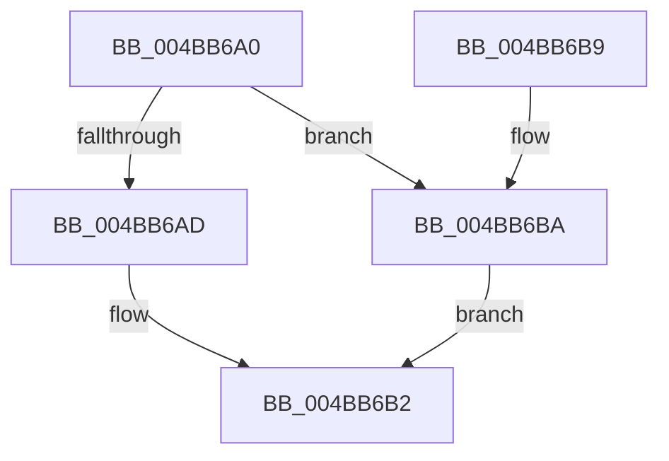

# MiLockSlabAllocator

- RVA: `0x004BB6A0`–`0x004BB6C1` (길이 `33` bytes)
- VA: `0x00000001404BB6A0`
- 실행 섹션: `.text`
- PDB 이름 있음: `예`; PDB Function 태그: `아니요`
- unwind 정보 RVA: `0x0005CEE8`
- 디코드: `11`개 명령, `33/33` bytes 표시
- 미해석 바이트: `0` (있으면 어셈블리에 `.byte`로 보존)

> 이 문서는 커널 이미지의 기계어와 PDB 기호를 분석해 생성했습니다. 4번과 5번은 함수 원형과 자료형을 바이너리 사용 방식에서 추정한 C 해석이며 원본 소스 복구 결과는 아닙니다.

## 1. Dependencies

- 직접 호출 지점: **2**; 고유 호출 대상: **2**
- 직접 호출자로 확인된 함수: **1**
- RIP 상대 이미지 참조: **0**

### Outgoing calls
- `0x004BB6AD` → [ExAcquireSpinLockExclusiveAtDpcLevel](../24/ExAcquireSpinLockExclusiveAtDpcLevel_function_00248E80.md) (function, `0x00248E80`)
- `0x004BB6BA` → [ExReleaseSpinLockExclusiveFromDpcLevel](../24/ExReleaseSpinLockExclusiveFromDpcLevel_function_002497E0.md) (function, `0x002497E0`)

### Direct callers
- [MiLockMemoryLists](MiLockMemoryLists_function_004BB470.md) at `0x004BB5A8`

### Static image references
- 디코드된 RIP-relative 메모리 참조가 없습니다.

## 2. Other-region calls and transfers

- 다른 실행 섹션으로 향하는 call: **0**
- 별도 외부 분기/꼬리 이동을 확인하지 못했습니다.

## 3. Assembly (complete function range)

```asm
004BB6A0  48 83 EC 28                     sub rsp, 0x28
004BB6A4  48 8D 4A 10                     lea rcx, [rdx + 0x10]
004BB6A8  45 85 C0                        test r8d, r8d
004BB6AB  74 0D                           je 0x1404bb6ba
004BB6AD  E8 CE D7 D8 FF                  call 0x140248e80
004BB6B2  33 C0                           xor eax, eax
004BB6B4  48 83 C4 28                     add rsp, 0x28
004BB6B8  C3                              ret
004BB6B9  CC                              int3
004BB6BA  E8 21 E1 D8 FF                  call 0x1402497e0
004BB6BF  EB F1                           jmp 0x1404bb6b2
```

## 4. C-style interpretation (structured pseudocode)

```c
__int64 __fastcall MiLockSlabAllocator(__int64 a1, __int64 a2, int a3)
{
    __int64 result;
    __int64 v_rsp;

    v_rsp = (v_rsp) - (40);
    if (a3 == 0) goto loc_004BB6BA;
    result = ExAcquireSpinLockExclusiveAtDpcLevel(a2 + 16, a2, a3, a4);
loc_004BB6B2:
    result = 0;
    v_rsp = (v_rsp) + (40);
    return result;
loc_004BB6BA:
    result = ExReleaseSpinLockExclusiveFromDpcLevel(a2 + 16, a2, a3, a4);
    goto loc_004BB6B2;
}
```

## 5. (Beta) C Style

```c
int64_t MiLockSlabAllocator(int64_t Arg1, void *Arg2, int32_t Arg3)
{
    uint8_t *arg2 = (uint8_t *)Arg2;

    int64_t result;
    int64_t local_rsp;

    local_rsp = (local_rsp) - (40);
    if (Arg3 == 0) goto loc_004BB6BA;
    result = ExAcquireSpinLockExclusiveAtDpcLevel(Arg2 + 16, Arg2, Arg3, a4);
loc_004BB6B2:
    result = 0;
    local_rsp = (local_rsp) + (40);
    return result;
loc_004BB6BA:
    result = ExReleaseSpinLockExclusiveFromDpcLevel(Arg2 + 16, Arg2, Arg3, a4);
    goto loc_004BB6B2;
}
```

### 관측된 메모리 오프셋

구조체 형식이 확인되지 않은 접근은 인자 기준의 오프셋으로만 기록했습니다.

| 기준 인자 | 오프셋 표현 | 폭 (bit) | 접근 |
|---|---:|---:|---|
| `Arg2` | `+ 0x10` | `64` | `R` |

## 6. Execution-region graph

[열기: 2D/3D 그래프와 함수 탐색 컨트롤 패널](../../../control-panel.html?section=text&rva=0x004BB6A0&view=graph)

- 2D 그래프는 위에서 아래로 흐르고, 3D 그래프는 빈 공간을 드래그해 회전합니다. Shift+드래그는 이동, 휠은 확대·축소, 함수 노드 선택은 대상 보고서 이동입니다.

### Static fallback


