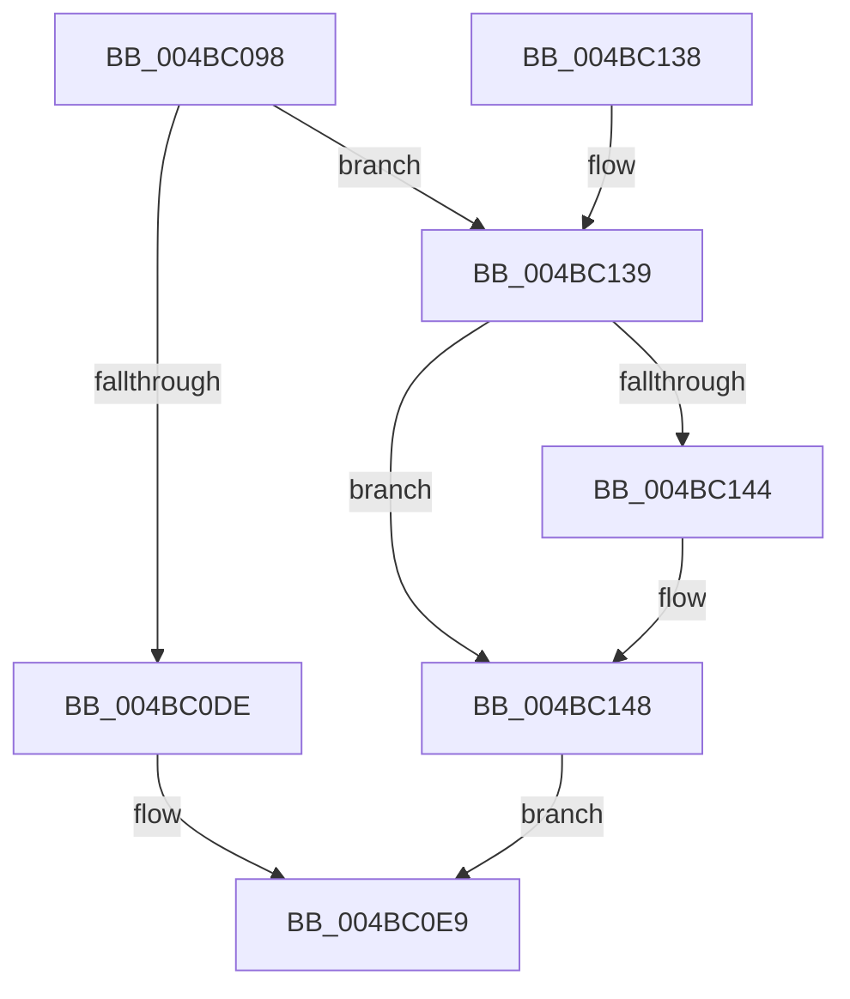

# MiLogAllocateWsleEvent

- RVA: `0x004BC098`–`0x004BC15A` (길이 `194` bytes)
- VA: `0x00000001404BC098`
- 실행 섹션: `.text`
- PDB 이름 있음: `예`; PDB Function 태그: `아니요`
- unwind 정보 RVA: `0x000BB84C`
- 디코드: `47`개 명령, `194/194` bytes 표시
- 미해석 바이트: `0` (있으면 어셈블리에 `.byte`로 보존)

> 이 문서는 커널 이미지의 기계어와 PDB 기호를 분석해 생성했습니다. 4번과 5번은 함수 원형과 자료형을 바이너리 사용 방식에서 추정한 C 해석이며 원본 소스 복구 결과는 아닙니다.

## 1. Dependencies

- 직접 호출 지점: **3**; 고유 호출 대상: **3**
- 직접 호출자로 확인된 함수: **1**
- RIP 상대 이미지 참조: **1**

### Outgoing calls
- `0x004BC0D0` → [MiIdentifyPfnWrapper](../31/MiIdentifyPfnWrapper_function_0031C8F0.md) (function, `0x0031C8F0`)
- `0x004BC114` → [EtwTraceKernelEvent](../23/EtwTraceKernelEvent_function_00235350.md) (function, `0x00235350`)
- `0x004BC121` → [_security_check_cookie](../6A/_security_check_cookie_function_006AC640.md) (function, `0x006AC640`)

### Direct callers
- [MiAllocateWsle](../33/MiAllocateWsle_function_003332C0.md) at `0x00333D70`

### Static image references
- `0x004BC0A7` → RVA `0x00E0A740` (`.data`; read)

## 2. Other-region calls and transfers

- 다른 실행 섹션으로 향하는 call: **0**
- 별도 외부 분기/꼬리 이동을 확인하지 못했습니다.

## 3. Assembly (complete function range)

```asm
004BC098  48 89 5C 24 10                  mov qword ptr [rsp + 0x10], rbx
004BC09D  48 89 74 24 18                  mov qword ptr [rsp + 0x18], rsi
004BC0A2  57                              push rdi
004BC0A3  48 83 EC 70                     sub rsp, 0x70
004BC0A7  48 8B 05 92 E6 94 00            mov rax, qword ptr [rip + 0x94e692]
004BC0AE  48 33 C4                        xor rax, rsp
004BC0B1  48 89 44 24 60                  mov qword ptr [rsp + 0x60], rax
004BC0B6  0F 57 C0                        xorps xmm0, xmm0
004BC0B9  8B F2                           mov esi, edx
004BC0BB  48 8D 54 24 30                  lea rdx, [rsp + 0x30]
004BC0C0  49 8B F8                        mov rdi, r8
004BC0C3  0F 11 44 24 30                  movups xmmword ptr [rsp + 0x30], xmm0
004BC0C8  48 8B D9                        mov rbx, rcx
004BC0CB  0F 11 44 24 40                  movups xmmword ptr [rsp + 0x40], xmm0
004BC0D0  E8 1B 08 E6 FF                  call 0x14031c8f0
004BC0D5  48 8B 43 28                     mov rax, qword ptr [rbx + 0x28]
004BC0D9  48 85 C0                        test rax, rax
004BC0DC  78 5B                           js 0x1404bc139
004BC0DE  B8 18 00 00 00                  mov eax, 0x18
004BC0E3  41 B9 76 02 00 00               mov r9d, 0x276
004BC0E9  83 64 24 5C 00                  and dword ptr [rsp + 0x5c], 0
004BC0EE  48 8D 4C 24 30                  lea rcx, [rsp + 0x30]
004BC0F3  48 89 4C 24 50                  mov qword ptr [rsp + 0x50], rcx
004BC0F8  BA 01 00 00 00                  mov edx, 1
004BC0FD  48 8D 4C 24 50                  lea rcx, [rsp + 0x50]
004BC102  89 44 24 58                     mov dword ptr [rsp + 0x58], eax
004BC106  41 B8 01 00 00 28               mov r8d, 0x28000001
004BC10C  C7 44 24 20 04 1B 50 11         mov dword ptr [rsp + 0x20], 0x11501b04
004BC114  E8 37 92 D7 FF                  call 0x140235350
004BC119  48 8B 4C 24 60                  mov rcx, qword ptr [rsp + 0x60]
004BC11E  48 33 CC                        xor rcx, rsp
004BC121  E8 1A 05 1F 00                  call 0x1406ac640
004BC126  4C 8D 5C 24 70                  lea r11, [rsp + 0x70]
004BC12B  49 8B 5B 18                     mov rbx, qword ptr [r11 + 0x18]
004BC12F  49 8B 73 20                     mov rsi, qword ptr [r11 + 0x20]
004BC133  49 8B E3                        mov rsp, r11
004BC136  5F                              pop rdi
004BC137  C3                              ret
004BC138  CC                              int3
004BC139  48 81 E7 00 F0 FF FF            and rdi, 0xfffffffffffff000
004BC140  85 F6                           test esi, esi
004BC142  74 04                           je 0x1404bc148
004BC144  48 83 CF 02                     or rdi, 2
004BC148  48 89 7C 24 48                  mov qword ptr [rsp + 0x48], rdi
004BC14D  B8 20 00 00 00                  mov eax, 0x20
004BC152  41 B9 82 02 00 00               mov r9d, 0x282
004BC158  EB 8F                           jmp 0x1404bc0e9
```

## 4. C-style interpretation (structured pseudocode)

```c
__int64 __fastcall MiLogAllocateWsleEvent(__int64 a1, int a2, __int64 a3)
{
    __int64 result;
    __int64 v_rdi;
    __int64 v_rsp;
    unsigned __int64 v_stack_m18;
    unsigned int v_stack_m1C;
    unsigned int v_stack_m20;
    unsigned __int64 v_stack_m28;
    unsigned __int64 v_stack_m38;
    unsigned __int64 v_stack_m48;
    unsigned int v_stack_m58;
    unsigned __int64 v_stack_m8;
    unsigned __int64 v_stack_p10;
    unsigned __int64 v_stack_p18;

    v_stack_p10 = v_rbx;
    v_stack_p18 = v_rsi;
    v_rsp = (v_rsp) - (112);
    result = (*(unsigned __int64 *)(v_rip + 9758354)) ^ (v_rsp);
    v_stack_m18 = result;
    v_stack_m48 = v_xmm0;
    v_stack_m38 = v_xmm0;
    result = MiIdentifyPfnWrapper(a1, v_stack_m48, a3, a4);
    if (sign_flag) goto loc_004BC139;
loc_004BC0E9:
    v_stack_m28 = v_stack_m48;
    v_stack_m20 = 24;
    v_stack_m58 = 0x11501B04ULL;
    result = EtwTraceKernelEvent(v_stack_m28, 1, (unsigned int)(0x28000001ULL), 630);
    a1 = (v_stack_m18) ^ (v_rsp);
    result = _security_check_cookie(a1, 1, (unsigned int)(0x28000001ULL), 630);
    return result;
loc_004BC139:
    v_rdi = (a3) & (0xFFFFFFFFFFFFF000ULL);
    if ((unsigned int)(*(unsigned __int64 *)(v_stack_m8 + 32)) != 0) {
        v_rdi = (v_rdi) | (2);
    }
    v_stack_m28 = v_rdi;
    goto loc_004BC0E9;
}
```

## 5. (Beta) C Style

```c
int64_t MiLogAllocateWsleEvent(void *Arg1, int32_t Arg2, int64_t Arg3)
{
    uint8_t *arg1 = (uint8_t *)Arg1;

    int64_t result;
    int64_t local_rdi;
    int64_t local_rsp;
    uint64_t v_stack_m18;
    uint32_t v_stack_m1C;
    uint32_t v_stack_m20;
    uint64_t v_stack_m28;
    uint64_t v_stack_m38;
    uint64_t v_stack_m48;
    uint32_t v_stack_m58;
    uint64_t v_stack_m8;
    uint64_t v_stack_p10;
    uint64_t v_stack_p18;

    v_stack_p10 = local_rbx;
    v_stack_p18 = local_rsi;
    local_rsp = (local_rsp) - (112);
    result = (*(uint64_t *)(v_rip + 0x94E692)) ^ (local_rsp);
    v_stack_m18 = result;
    v_stack_m48 = v_xmm0;
    v_stack_m38 = v_xmm0;
    result = MiIdentifyPfnWrapper(Arg1, v_stack_m48, Arg3, a4);
    if (sign_flag) goto loc_004BC139;
loc_004BC0E9:
    v_stack_m28 = v_stack_m48;
    v_stack_m20 = 24;
    v_stack_m58 = 0x11501B04ULL;
    result = EtwTraceKernelEvent(v_stack_m28, 1, (uint32_t)(0x28000001ULL), 630);
    Arg1 = (v_stack_m18) ^ (local_rsp);
    result = _security_check_cookie(Arg1, 1, (uint32_t)(0x28000001ULL), 630);
    return result;
loc_004BC139:
    local_rdi = (Arg3) & (0xFFFFFFFFFFFFF000ULL);
    if ((uint32_t)(*(uint64_t *)(v_stack_m8 + 0x20)) != 0) {
        local_rdi = (local_rdi) | (2);
    }
    v_stack_m28 = local_rdi;
    goto loc_004BC0E9;
}
```

### 관측된 메모리 오프셋

구조체 형식이 확인되지 않은 접근은 인자 기준의 오프셋으로만 기록했습니다.

| 기준 인자 | 오프셋 표현 | 폭 (bit) | 접근 |
|---|---:|---:|---|
| `Arg1` | `+ 0x28` | `64` | `R` |

## 6. Execution-region graph

[열기: 2D/3D 그래프와 함수 탐색 컨트롤 패널](../../../control-panel.html?section=text&rva=0x004BC098&view=graph)

- 2D 그래프는 위에서 아래로 흐르고, 3D 그래프는 빈 공간을 드래그해 회전합니다. Shift+드래그는 이동, 휠은 확대·축소, 함수 노드 선택은 대상 보고서 이동입니다.

### Static fallback


