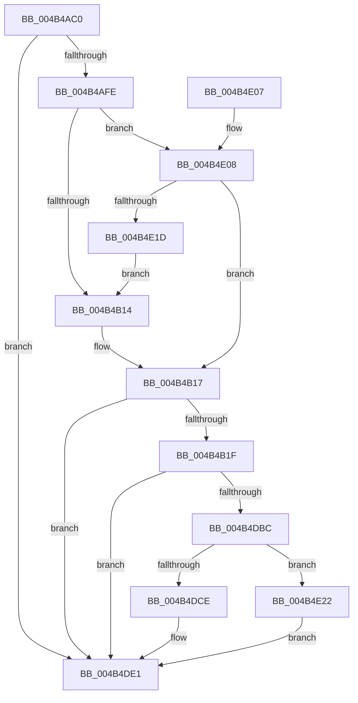

# MiLogPeriodicTelemetryForSlabAllocator

- RVA: `0x004B4AC0`–`0x004B4E4E` (길이 `910` bytes)
- VA: `0x00000001404B4AC0`
- 실행 섹션: `.text`
- PDB 이름 있음: `예`; PDB Function 태그: `아니요`
- unwind 정보 RVA: `0x000BA0A0`
- 디코드: `176`개 명령, `910/910` bytes 표시
- 미해석 바이트: `0` (있으면 어셈블리에 `.byte`로 보존)

> 이 문서는 커널 이미지의 기계어와 PDB 기호를 분석해 생성했습니다. 4번과 5번은 함수 원형과 자료형을 바이너리 사용 방식에서 추정한 C 해석이며 원본 소스 복구 결과는 아닙니다.

## 1. Dependencies

- 직접 호출 지점: **4**; 고유 호출 대상: **4**
- 직접 호출자로 확인된 함수: **0**
- RIP 상대 이미지 참조: **7**

### Outgoing calls
- `0x004B4DC0` → [ExtractAggregateFieldTypes](../2F/ExtractAggregateFieldTypes_function_002F1390.md) (function, `0x002F1390`)
- `0x004B4DDC` → [InsertEventEntryInLookUpTable](../2F/InsertEventEntryInLookUpTable_function_002F1424.md) (function, `0x002F1424`)
- `0x004B4DED` → [_security_check_cookie](../6A/_security_check_cookie_function_006AC640.md) (function, `0x006AC640`)
- `0x004B4E47` → [EtwWriteEx](../25/EtwWriteEx_function_0025F0D0.md) (function, `0x0025F0D0`)

### Direct callers
- 이 함수 시작 RVA로 연결되는 직접 call은 확인되지 않았습니다. 간접 호출은 완전히 역산할 수 없습니다.

### Static image references
- `0x004B4ADA` → RVA `0x00E0A740` (`.data`; read)
- `0x004B4AEB` → RVA `0x00E37618` (`.data`; read)
- `0x004B4CE6` → RVA `0x00043590` (`.rdata`; read)
- `0x004B4D2F` → RVA `0x0005A172` (`.rdata`; read)
- `0x004B4D7E` → RVA `0x0005A17C` (`.rdata`; read)
- `0x004B4D89` → RVA `0x0005BCFD` (`.rdata`; read)
- `0x004B4DAF` → RVA `0x00A69500` (`TlgAggregateInternalRegisteredProviderEtwCallback`; read)

## 2. Other-region calls and transfers

- 다른 실행 섹션으로 향하는 call: **0**
- 별도 외부 분기/꼬리 이동을 확인하지 못했습니다.

## 3. Assembly (complete function range)

```asm
004B4AC0  48 89 5C 24 08                  mov qword ptr [rsp + 8], rbx
004B4AC5  48 89 7C 24 10                  mov qword ptr [rsp + 0x10], rdi
004B4ACA  55                              push rbp
004B4ACB  48 8D AC 24 C0 FE FF FF         lea rbp, [rsp - 0x140]
004B4AD3  48 81 EC 40 02 00 00            sub rsp, 0x240
004B4ADA  48 8B 05 5F 5C 95 00            mov rax, qword ptr [rip + 0x955c5f]
004B4AE1  48 33 C4                        xor rax, rsp
004B4AE4  48 89 85 30 01 00 00            mov qword ptr [rbp + 0x130], rax
004B4AEB  48 8B 1D 26 2B 98 00            mov rbx, qword ptr [rip + 0x982b26]
004B4AF2  4C 8B C1                        mov r8, rcx
004B4AF5  83 3B 05                        cmp dword ptr [rbx], 5
004B4AF8  0F 86 E3 02 00 00               jbe 0x1404b4de1
004B4AFE  33 FF                           xor edi, edi
004B4B00  49 BA 00 04 00 00 00 40 00 00   movabs r10, 0x400000000400
004B4B0A  4C 85 53 10                     test qword ptr [rbx + 0x10], r10
004B4B0E  0F 85 F4 02 00 00               jne 0x1404b4e08
004B4B14  40 8A C7                        mov al, dil
004B4B17  84 C0                           test al, al
004B4B19  0F 84 C2 02 00 00               je 0x1404b4de1
004B4B1F  48 8B 42 78                     mov rax, qword ptr [rdx + 0x78]
004B4B23  48 89 44 24 68                  mov qword ptr [rsp + 0x68], rax
004B4B28  48 8D 44 24 68                  lea rax, [rsp + 0x68]
004B4B2D  48 89 45 00                     mov qword ptr [rbp], rax
004B4B31  48 8B 42 78                     mov rax, qword ptr [rdx + 0x78]
004B4B35  48 89 44 24 70                  mov qword ptr [rsp + 0x70], rax
004B4B3A  48 8D 44 24 70                  lea rax, [rsp + 0x70]
004B4B3F  48 89 45 10                     mov qword ptr [rbp + 0x10], rax
004B4B43  48 8B 42 60                     mov rax, qword ptr [rdx + 0x60]
004B4B47  48 89 44 24 78                  mov qword ptr [rsp + 0x78], rax
004B4B4C  48 8D 44 24 78                  lea rax, [rsp + 0x78]
004B4B51  48 89 45 20                     mov qword ptr [rbp + 0x20], rax
004B4B55  48 8B 42 60                     mov rax, qword ptr [rdx + 0x60]
004B4B59  48 89 45 80                     mov qword ptr [rbp - 0x80], rax
004B4B5D  48 8D 45 80                     lea rax, [rbp - 0x80]
004B4B61  48 89 45 30                     mov qword ptr [rbp + 0x30], rax
004B4B65  48 8B 42 70                     mov rax, qword ptr [rdx + 0x70]
004B4B69  48 89 45 88                     mov qword ptr [rbp - 0x78], rax
004B4B6D  48 8D 45 88                     lea rax, [rbp - 0x78]
004B4B71  48 89 45 40                     mov qword ptr [rbp + 0x40], rax
004B4B75  48 8B 42 70                     mov rax, qword ptr [rdx + 0x70]
004B4B79  48 89 45 90                     mov qword ptr [rbp - 0x70], rax
004B4B7D  48 8D 45 90                     lea rax, [rbp - 0x70]
004B4B81  48 89 45 50                     mov qword ptr [rbp + 0x50], rax
004B4B85  48 8B 42 50                     mov rax, qword ptr [rdx + 0x50]
004B4B89  48 C7 45 08 08 00 00 00         mov qword ptr [rbp + 8], 8
004B4B91  48 C7 45 18 08 00 00 00         mov qword ptr [rbp + 0x18], 8
004B4B99  48 C7 45 28 08 00 00 00         mov qword ptr [rbp + 0x28], 8
004B4BA1  48 C7 45 38 08 00 00 00         mov qword ptr [rbp + 0x38], 8
004B4BA9  48 C7 45 48 08 00 00 00         mov qword ptr [rbp + 0x48], 8
004B4BB1  48 C7 45 58 08 00 00 00         mov qword ptr [rbp + 0x58], 8
004B4BB9  48 8B 08                        mov rcx, qword ptr [rax]
004B4BBC  48 8D 45 98                     lea rax, [rbp - 0x68]
004B4BC0  48 89 45 60                     mov qword ptr [rbp + 0x60], rax
004B4BC4  48 8B 42 50                     mov rax, qword ptr [rdx + 0x50]
004B4BC8  48 89 4D 98                     mov qword ptr [rbp - 0x68], rcx
004B4BCC  48 C7 45 68 08 00 00 00         mov qword ptr [rbp + 0x68], 8
004B4BD4  48 8B 08                        mov rcx, qword ptr [rax]
004B4BD7  48 8D 45 A0                     lea rax, [rbp - 0x60]
004B4BDB  48 89 45 70                     mov qword ptr [rbp + 0x70], rax
004B4BDF  8B 82 90 00 00 00               mov eax, dword ptr [rdx + 0x90]
004B4BE5  48 89 45 A8                     mov qword ptr [rbp - 0x58], rax
004B4BE9  48 8D 45 A8                     lea rax, [rbp - 0x58]
004B4BED  48 89 85 80 00 00 00            mov qword ptr [rbp + 0x80], rax
004B4BF4  8B 82 94 00 00 00               mov eax, dword ptr [rdx + 0x94]
004B4BFA  48 89 45 B0                     mov qword ptr [rbp - 0x50], rax
004B4BFE  48 8D 45 B0                     lea rax, [rbp - 0x50]
004B4C02  48 89 85 90 00 00 00            mov qword ptr [rbp + 0x90], rax
004B4C09  8B 82 98 00 00 00               mov eax, dword ptr [rdx + 0x98]
004B4C0F  48 89 45 B8                     mov qword ptr [rbp - 0x48], rax
004B4C13  48 8D 45 B8                     lea rax, [rbp - 0x48]
004B4C17  48 89 85 A0 00 00 00            mov qword ptr [rbp + 0xa0], rax
004B4C1E  8B 82 9C 00 00 00               mov eax, dword ptr [rdx + 0x9c]
004B4C24  48 89 45 C0                     mov qword ptr [rbp - 0x40], rax
004B4C28  48 8D 45 C0                     lea rax, [rbp - 0x40]
004B4C2C  48 89 85 B0 00 00 00            mov qword ptr [rbp + 0xb0], rax
004B4C33  8B 82 A0 00 00 00               mov eax, dword ptr [rdx + 0xa0]
004B4C39  48 89 45 C8                     mov qword ptr [rbp - 0x38], rax
004B4C3D  48 8D 45 C8                     lea rax, [rbp - 0x38]
004B4C41  48 89 85 C0 00 00 00            mov qword ptr [rbp + 0xc0], rax
004B4C48  8B 82 A4 00 00 00               mov eax, dword ptr [rdx + 0xa4]
004B4C4E  48 89 45 D0                     mov qword ptr [rbp - 0x30], rax
004B4C52  48 8D 45 D0                     lea rax, [rbp - 0x30]
004B4C56  48 89 85 D0 00 00 00            mov qword ptr [rbp + 0xd0], rax
004B4C5D  8B 82 80 00 00 00               mov eax, dword ptr [rdx + 0x80]
004B4C63  89 44 24 40                     mov dword ptr [rsp + 0x40], eax
004B4C67  48 8D 44 24 40                  lea rax, [rsp + 0x40]
004B4C6C  48 89 85 E0 00 00 00            mov qword ptr [rbp + 0xe0], rax
004B4C73  8B 82 84 00 00 00               mov eax, dword ptr [rdx + 0x84]
004B4C79  89 44 24 44                     mov dword ptr [rsp + 0x44], eax
004B4C7D  48 8D 44 24 44                  lea rax, [rsp + 0x44]
004B4C82  48 89 85 F0 00 00 00            mov qword ptr [rbp + 0xf0], rax
004B4C89  48 89 4D A0                     mov qword ptr [rbp - 0x60], rcx
004B4C8D  48 C7 45 78 08 00 00 00         mov qword ptr [rbp + 0x78], 8
004B4C95  48 C7 85 88 00 00 00 08 00 00 00  mov qword ptr [rbp + 0x88], 8
004B4CA0  48 C7 85 98 00 00 00 08 00 00 00  mov qword ptr [rbp + 0x98], 8
004B4CAB  48 C7 85 A8 00 00 00 08 00 00 00  mov qword ptr [rbp + 0xa8], 8
004B4CB6  48 C7 85 B8 00 00 00 08 00 00 00  mov qword ptr [rbp + 0xb8], 8
004B4CC1  48 C7 85 C8 00 00 00 08 00 00 00  mov qword ptr [rbp + 0xc8], 8
004B4CCC  48 C7 85 D8 00 00 00 08 00 00 00  mov qword ptr [rbp + 0xd8], 8
004B4CD7  48 C7 85 E8 00 00 00 04 00 00 00  mov qword ptr [rbp + 0xe8], 4
004B4CE2  41 0F B7 00                     movzx eax, word ptr [r8]
004B4CE6  48 8D 0D A3 E8 B8 FF            lea rcx, [rip - 0x47175d]
004B4CED  89 44 24 48                     mov dword ptr [rsp + 0x48], eax
004B4CF1  48 8D 44 24 48                  lea rax, [rsp + 0x48]
004B4CF6  48 89 85 00 01 00 00            mov qword ptr [rbp + 0x100], rax
004B4CFD  8B 82 88 00 00 00               mov eax, dword ptr [rdx + 0x88]
004B4D03  C1 E8 04                        shr eax, 4
004B4D06  83 E0 03                        and eax, 3
004B4D09  48 C7 85 F8 00 00 00 04 00 00 00  mov qword ptr [rbp + 0xf8], 4
004B4D14  89 44 24 4C                     mov dword ptr [rsp + 0x4c], eax
004B4D18  48 8D 44 24 4C                  lea rax, [rsp + 0x4c]
004B4D1D  48 89 85 10 01 00 00            mov qword ptr [rbp + 0x110], rax
004B4D24  48 8D 45 D8                     lea rax, [rbp - 0x28]
004B4D28  48 89 85 20 01 00 00            mov qword ptr [rbp + 0x120], rax
004B4D2F  0F B7 05 3C 54 BA FF            movzx eax, word ptr [rip - 0x45abc4]
004B4D36  89 44 24 5C                     mov dword ptr [rsp + 0x5c], eax
004B4D3A  48 8B 43 08                     mov rax, qword ptr [rbx + 8]
004B4D3E  48 89 45 E0                     mov qword ptr [rbp - 0x20], rax
004B4D42  48 C7 85 08 01 00 00 04 00 00 00  mov qword ptr [rbp + 0x108], 4
004B4D4D  48 C7 85 18 01 00 00 04 00 00 00  mov qword ptr [rbp + 0x118], 4
004B4D58  48 C7 45 D8 00 00 00 01         mov qword ptr [rbp - 0x28], 0x1000000
004B4D60  48 C7 85 28 01 00 00 08 00 00 00  mov qword ptr [rbp + 0x128], 8
004B4D6B  C7 44 24 58 00 00 00 0B         mov dword ptr [rsp + 0x58], 0xb000000
004B4D73  4C 89 54 24 60                  mov qword ptr [rsp + 0x60], r10
004B4D78  0F B7 00                        movzx eax, word ptr [rax]
004B4D7B  89 45 E8                        mov dword ptr [rbp - 0x18], eax
004B4D7E  48 8D 05 F7 53 BA FF            lea rax, [rip - 0x45ac09]
004B4D85  48 89 45 F0                     mov qword ptr [rbp - 0x10], rax
004B4D89  48 8D 05 6D 6F BA FF            lea rax, [rip - 0x459093]
004B4D90  2B C1                           sub eax, ecx
004B4D92  C7 45 EC 02 00 00 00            mov dword ptr [rbp - 0x14], 2
004B4D99  C7 45 F8 F0 01 00 00            mov dword ptr [rbp - 8], 0x1f0
004B4DA0  C7 45 FC 01 00 00 00            mov dword ptr [rbp - 4], 1
004B4DA7  89 44 24 50                     mov dword ptr [rsp + 0x50], eax
004B4DAB  8B 44 24 50                     mov eax, dword ptr [rsp + 0x50]
004B4DAF  48 8D 05 4A 47 5B 00            lea rax, [rip + 0x5b474a]
004B4DB6  48 39 43 28                     cmp qword ptr [rbx + 0x28], rax
004B4DBA  75 25                           jne 0x1404b4de1
004B4DBC  48 8D 55 E0                     lea rdx, [rbp - 0x20]
004B4DC0  E8 CB C5 E3 FF                  call 0x1402f1390
004B4DC5  48 8D 54 24 58                  lea rdx, [rsp + 0x58]
004B4DCA  84 C0                           test al, al
004B4DCC  74 54                           je 0x1404b4e22
004B4DCE  4C 8D 4D E0                     lea r9, [rbp - 0x20]
004B4DD2  88 44 24 20                     mov byte ptr [rsp + 0x20], al
004B4DD6  41 B0 15                        mov r8b, 0x15
004B4DD9  48 8B CB                        mov rcx, rbx
004B4DDC  E8 43 C6 E3 FF                  call 0x1402f1424
004B4DE1  33 C0                           xor eax, eax
004B4DE3  48 8B 8D 30 01 00 00            mov rcx, qword ptr [rbp + 0x130]
004B4DEA  48 33 CC                        xor rcx, rsp
004B4DED  E8 4E 78 1F 00                  call 0x1406ac640
004B4DF2  4C 8D 9C 24 40 02 00 00         lea r11, [rsp + 0x240]
004B4DFA  49 8B 5B 10                     mov rbx, qword ptr [r11 + 0x10]
004B4DFE  49 8B 7B 18                     mov rdi, qword ptr [r11 + 0x18]
004B4E02  49 8B E3                        mov rsp, r11
004B4E05  5D                              pop rbp
004B4E06  C3                              ret
004B4E07  CC                              int3
004B4E08  48 8B 4B 18                     mov rcx, qword ptr [rbx + 0x18]
004B4E0C  48 8B C1                        mov rax, rcx
004B4E0F  49 23 C2                        and rax, r10
004B4E12  48 3B C1                        cmp rax, rcx
004B4E15  B0 01                           mov al, 1
004B4E17  0F 84 FA FC FF FF               je 0x1404b4b17
004B4E1D  E9 F2 FC FF FF                  jmp 0x1404b4b14
004B4E22  48 8B 4B 20                     mov rcx, qword ptr [rbx + 0x20]
004B4E26  48 8D 45 E0                     lea rax, [rbp - 0x20]
004B4E2A  48 89 44 24 38                  mov qword ptr [rsp + 0x38], rax
004B4E2F  45 33 C9                        xor r9d, r9d
004B4E32  C7 44 24 30 15 00 00 00         mov dword ptr [rsp + 0x30], 0x15
004B4E3A  45 33 C0                        xor r8d, r8d
004B4E3D  48 89 7C 24 28                  mov qword ptr [rsp + 0x28], rdi
004B4E42  48 89 7C 24 20                  mov qword ptr [rsp + 0x20], rdi
004B4E47  E8 84 A2 DA FF                  call 0x14025f0d0
004B4E4C  EB 93                           jmp 0x1404b4de1
```

## 4. C-style interpretation (structured pseudocode)

```c
__int64 __fastcall MiLogPeriodicTelemetryForSlabAllocator(__int64 a1, __int64 a2)
{
    __int64 result;
    __int64 v_rdi;
    __int64 v_rsp;
    unsigned __int64 v_stack_m100;
    unsigned __int64 v_stack_m108;
    unsigned __int64 v_stack_m110;
    unsigned __int64 v_stack_m118;
    unsigned __int64 v_stack_m120;
    unsigned __int64 v_stack_m128;
    unsigned __int64 v_stack_m130;
    unsigned __int64 v_stack_m138;
    unsigned __int64 v_stack_m140;
    unsigned __int64 v_stack_m148;
    unsigned int v_stack_m14C;
    unsigned int v_stack_m150;
    unsigned __int64 v_stack_m158;
    unsigned int v_stack_m15C;
    unsigned int v_stack_m160;
    unsigned __int64 v_stack_m168;
    unsigned __int64 v_stack_m170;
    unsigned __int64 v_stack_m178;
    unsigned __int64 v_stack_m18;
    unsigned __int64 v_stack_m180;
    unsigned __int64 v_stack_m188;
    unsigned __int64 v_stack_m190;
    unsigned __int64 v_stack_m198;
    unsigned __int64 v_stack_m1A0;
    unsigned __int64 v_stack_m1A8;
    unsigned __int64 v_stack_m1B0;
    unsigned __int64 v_stack_m1B8;
    unsigned __int64 v_stack_m1C0;
    unsigned __int64 v_stack_m1C8;
    unsigned __int64 v_stack_m1D0;
    unsigned __int64 v_stack_m1D8;
    unsigned __int64 v_stack_m1E0;
    unsigned __int64 v_stack_m1E8;
    unsigned int v_stack_m1EC;
    unsigned int v_stack_m1F0;
    unsigned int v_stack_m1F8;
    unsigned int v_stack_m1FC;
    unsigned __int64 v_stack_m20;
    unsigned int v_stack_m200;
    unsigned int v_stack_m204;
    unsigned int v_stack_m208;
    unsigned int v_stack_m210;
    unsigned __int64 v_stack_m218;
    unsigned __int64 v_stack_m220;
    unsigned __int8 v_stack_m228;
    unsigned __int64 v_stack_m28;
    unsigned __int64 v_stack_m30;
    unsigned __int64 v_stack_m38;
    unsigned __int64 v_stack_m40;
    unsigned __int64 v_stack_m48;
    unsigned __int64 v_stack_m50;
    unsigned __int64 v_stack_m58;
    unsigned __int64 v_stack_m60;
    unsigned __int64 v_stack_m68;
    unsigned __int64 v_stack_m70;
    unsigned __int64 v_stack_m78;
    unsigned __int64 v_stack_m8;
    unsigned __int64 v_stack_m80;
    unsigned __int64 v_stack_m88;
    unsigned __int64 v_stack_m90;
    unsigned __int64 v_stack_m98;
    unsigned __int64 v_stack_mA0;
    unsigned __int64 v_stack_mA8;
    unsigned __int64 v_stack_mB0;
    unsigned __int64 v_stack_mB8;
    unsigned __int64 v_stack_mC0;
    unsigned __int64 v_stack_mC8;
    unsigned __int64 v_stack_mD0;
    unsigned __int64 v_stack_mD8;
    unsigned __int64 v_stack_mE0;
    unsigned __int64 v_stack_mE8;
    unsigned __int64 v_stack_mF0;
    unsigned __int64 v_stack_mF8;
    unsigned __int64 v_stack_p10;
    unsigned __int64 v_stack_p8;

    v_stack_p8 = v_rbx;
    v_stack_p10 = v_rdi;
    v_rsp = (v_rsp) - (576);
    result = (*(unsigned __int64 *)(v_rip + 9788511)) ^ (v_rsp);
    v_stack_m18 = result;
    if ((*(unsigned int *)(*(unsigned __int64 *)(v_rip + 9972518))) <= 5) goto loc_004B4DE1;
    v_rdi = 0;
    if (((*(unsigned __int64 *)(*(unsigned __int64 *)(v_rip + 9972518) + 16)) & (v_r10)) != 0) goto loc_004B4E08;
loc_004B4B14:
loc_004B4B17:
    if (0 == 0) goto loc_004B4DE1;
    v_stack_m1E0 = *(unsigned __int64 *)(a2 + 120);
    v_stack_m148 = v_stack_m1E0;
    v_stack_m1D8 = *(unsigned __int64 *)(a2 + 120);
    v_stack_m138 = v_stack_m1D8;
    v_stack_m1D0 = *(unsigned __int64 *)(a2 + 96);
    v_stack_m128 = v_stack_m1D0;
    v_stack_m1C8 = *(unsigned __int64 *)(a2 + 96);
    v_stack_m118 = v_stack_m1C8;
    v_stack_m1C0 = *(unsigned __int64 *)(a2 + 112);
    v_stack_m108 = v_stack_m1C0;
    v_stack_m1B8 = *(unsigned __int64 *)(a2 + 112);
    v_stack_mF8 = v_stack_m1B8;
    v_stack_m140 = 8;
    v_stack_m130 = 8;
    v_stack_m120 = 8;
    v_stack_m110 = 8;
    v_stack_m100 = 8;
    v_stack_mF0 = 8;
    v_stack_mE8 = v_stack_m1B0;
    v_stack_m1B0 = *(unsigned __int64 *)(*(unsigned __int64 *)(a2 + 80));
    v_stack_mE0 = 8;
    v_stack_mD8 = v_stack_m1A8;
    v_stack_m1A0 = (unsigned int)(*(unsigned int *)(a2 + 144));
    v_stack_mC8 = v_stack_m1A0;
    v_stack_m198 = (unsigned int)(*(unsigned int *)(a2 + 148));
    v_stack_mB8 = v_stack_m198;
    v_stack_m190 = (unsigned int)(*(unsigned int *)(a2 + 152));
    v_stack_mA8 = v_stack_m190;
    v_stack_m188 = (unsigned int)(*(unsigned int *)(a2 + 156));
    v_stack_m98 = v_stack_m188;
    v_stack_m180 = (unsigned int)(*(unsigned int *)(a2 + 160));
    v_stack_m88 = v_stack_m180;
    v_stack_m178 = (unsigned int)(*(unsigned int *)(a2 + 164));
    v_stack_m78 = v_stack_m178;
    v_stack_m208 = (unsigned int)((unsigned int)(*(unsigned int *)(a2 + 128)));
    v_stack_m68 = v_stack_m208;
    v_stack_m204 = (unsigned int)((unsigned int)(*(unsigned int *)(a2 + 132)));
    v_stack_m58 = v_stack_m204;
    v_stack_m1A8 = *(unsigned __int64 *)(*(unsigned __int64 *)(a2 + 80));
    v_stack_mD0 = 8;
    v_stack_mC0 = 8;
    v_stack_mB0 = 8;
    v_stack_mA0 = 8;
    v_stack_m90 = 8;
    v_stack_m80 = 8;
    v_stack_m70 = 8;
    v_stack_m60 = 4;
    v_stack_m200 = (unsigned int)(*(unsigned __int16 *)(a1));
    v_stack_m48 = v_stack_m200;
    result = (unsigned int)(((unsigned int)(*(unsigned int *)(a2 + 136))) >> (4));
    result = (unsigned int)((result) & (3));
    v_stack_m50 = 4;
    v_stack_m1FC = (unsigned int)(result);
    v_stack_m38 = v_stack_m1FC;
    v_stack_m28 = v_stack_m170;
    v_stack_m1EC = (unsigned int)(*(unsigned __int16 *)(v_rip - 4565956));
    v_stack_m168 = *(unsigned __int64 *)(*(unsigned __int64 *)(v_rip + 9972518) + 8);
    v_stack_m40 = 4;
    v_stack_m30 = 4;
    v_stack_m170 = 0x1000000ULL;
    v_stack_m20 = 8;
    v_stack_m1F0 = 0xB000000ULL;
    v_stack_m1E8 = v_r10;
    v_stack_m160 = (unsigned int)(*(unsigned __int16 *)(*(unsigned __int64 *)(*(unsigned __int64 *)(v_rip + 9972518) + 8)));
    v_stack_m158 = v_rip - 4566025;
    result = (unsigned int)((v_rip - 4558995) - ((unsigned int)(v_rip - 4659037)));
    v_stack_m15C = 2;
    v_stack_m150 = 496;
    v_stack_m14C = 1;
    v_stack_m1F8 = (unsigned int)(result);
    if ((*(unsigned __int64 *)(*(unsigned __int64 *)(v_rip + 9972518) + 40)) != (v_rip + 5982026)) goto loc_004B4DE1;
    result = ExtractAggregateFieldTypes(v_rip - 4659037, v_stack_m168, a1, a4);
    if ((unsigned __int8)(result) == 0) goto loc_004B4E22;
    v_stack_m228 = (unsigned __int8)(result);
    result = InsertEventEntryInLookUpTable(*(unsigned __int64 *)(v_rip + 9972518), v_stack_m1F0, 21, v_stack_m168);
loc_004B4DE1:
    result = 0;
    a1 = (v_stack_m18) ^ (v_rsp);
    result = _security_check_cookie(a1, v_stack_m1F0, 21, v_stack_m168);
    return result;
loc_004B4E08:
    result = (*(unsigned __int64 *)(*(unsigned __int64 *)(v_stack_m8 + 16) + 24)) & (v_r10);
    if (result == (*(unsigned __int64 *)(*(unsigned __int64 *)(v_stack_m8 + 16) + 24))) goto loc_004B4B17;
    goto loc_004B4B14;
loc_004B4E22:
    v_stack_m208 = v_stack_m168;
    a4 = 0;
    v_stack_m210 = 21;
    a3 = 0;
    v_stack_m218 = *(unsigned __int64 *)(v_stack_m8 + 24);
    v_stack_m220 = *(unsigned __int64 *)(v_stack_m8 + 24);
    result = EtwWriteEx(*(unsigned __int64 *)(*(unsigned __int64 *)(v_stack_m8 + 16) + 32), v_stack_m1F0, a3, a4);
    goto loc_004B4DE1;
}
```

## 5. (Beta) C Style

```c
int64_t MiLogPeriodicTelemetryForSlabAllocator(void *Arg1, void *Arg2)
{
    uint8_t *arg1 = (uint8_t *)Arg1;
    uint8_t *arg2 = (uint8_t *)Arg2;

    int64_t result;
    int64_t local_rdi;
    int64_t local_rsp;
    uint64_t v_stack_m100;
    uint64_t v_stack_m108;
    uint64_t v_stack_m110;
    uint64_t v_stack_m118;
    uint64_t v_stack_m120;
    uint64_t v_stack_m128;
    uint64_t v_stack_m130;
    uint64_t v_stack_m138;
    uint64_t v_stack_m140;
    uint64_t v_stack_m148;
    uint32_t v_stack_m14C;
    uint32_t v_stack_m150;
    uint64_t v_stack_m158;
    uint32_t v_stack_m15C;
    uint32_t v_stack_m160;
    uint64_t v_stack_m168;
    uint64_t v_stack_m170;
    uint64_t v_stack_m178;
    uint64_t v_stack_m18;
    uint64_t v_stack_m180;
    uint64_t v_stack_m188;
    uint64_t v_stack_m190;
    uint64_t v_stack_m198;
    uint64_t v_stack_m1A0;
    uint64_t v_stack_m1A8;
    uint64_t v_stack_m1B0;
    uint64_t v_stack_m1B8;
    uint64_t v_stack_m1C0;
    uint64_t v_stack_m1C8;
    uint64_t v_stack_m1D0;
    uint64_t v_stack_m1D8;
    uint64_t v_stack_m1E0;
    uint64_t v_stack_m1E8;
    uint32_t v_stack_m1EC;
    uint32_t v_stack_m1F0;
    uint32_t v_stack_m1F8;
    uint32_t v_stack_m1FC;
    uint64_t v_stack_m20;
    uint32_t v_stack_m200;
    uint32_t v_stack_m204;
    uint32_t v_stack_m208;
    uint32_t v_stack_m210;
    uint64_t v_stack_m218;
    uint64_t v_stack_m220;
    uint8_t v_stack_m228;
    uint64_t v_stack_m28;
    uint64_t v_stack_m30;
    uint64_t v_stack_m38;
    uint64_t v_stack_m40;
    uint64_t v_stack_m48;
    uint64_t v_stack_m50;
    uint64_t v_stack_m58;
    uint64_t v_stack_m60;
    uint64_t v_stack_m68;
    uint64_t v_stack_m70;
    uint64_t v_stack_m78;
    uint64_t v_stack_m8;
    uint64_t v_stack_m80;
    uint64_t v_stack_m88;
    uint64_t v_stack_m90;
    uint64_t v_stack_m98;
    uint64_t v_stack_mA0;
    uint64_t v_stack_mA8;
    uint64_t v_stack_mB0;
    uint64_t v_stack_mB8;
    uint64_t v_stack_mC0;
    uint64_t v_stack_mC8;
    uint64_t v_stack_mD0;
    uint64_t v_stack_mD8;
    uint64_t v_stack_mE0;
    uint64_t v_stack_mE8;
    uint64_t v_stack_mF0;
    uint64_t v_stack_mF8;
    uint64_t v_stack_p10;
    uint64_t v_stack_p8;

    v_stack_p8 = local_rbx;
    v_stack_p10 = local_rdi;
    local_rsp = (local_rsp) - (576);
    result = (*(uint64_t *)(v_rip + 0x955C5F)) ^ (local_rsp);
    v_stack_m18 = result;
    if ((*(uint32_t *)(*(uint64_t *)(v_rip + 0x982B26))) <= 5) goto loc_004B4DE1;
    local_rdi = 0;
    if (((*(uint64_t *)(*(uint64_t *)(v_rip + 0x982B26) + 0x10)) & (local_r10)) != 0) goto loc_004B4E08;
loc_004B4B14:
loc_004B4B17:
    if (0 == 0) goto loc_004B4DE1;
    v_stack_m1E0 = *(uint64_t *)(arg2 + 0x78);
    v_stack_m148 = v_stack_m1E0;
    v_stack_m1D8 = *(uint64_t *)(arg2 + 0x78);
    v_stack_m138 = v_stack_m1D8;
    v_stack_m1D0 = *(uint64_t *)(arg2 + 0x60);
    v_stack_m128 = v_stack_m1D0;
    v_stack_m1C8 = *(uint64_t *)(arg2 + 0x60);
    v_stack_m118 = v_stack_m1C8;
    v_stack_m1C0 = *(uint64_t *)(arg2 + 0x70);
    v_stack_m108 = v_stack_m1C0;
    v_stack_m1B8 = *(uint64_t *)(arg2 + 0x70);
    v_stack_mF8 = v_stack_m1B8;
    v_stack_m140 = 8;
    v_stack_m130 = 8;
    v_stack_m120 = 8;
    v_stack_m110 = 8;
    v_stack_m100 = 8;
    v_stack_mF0 = 8;
    v_stack_mE8 = v_stack_m1B0;
    v_stack_m1B0 = *(uint64_t *)(*(uint64_t *)(arg2 + 0x50));
    v_stack_mE0 = 8;
    v_stack_mD8 = v_stack_m1A8;
    v_stack_m1A0 = (uint32_t)(*(uint32_t *)(arg2 + 0x90));
    v_stack_mC8 = v_stack_m1A0;
    v_stack_m198 = (uint32_t)(*(uint32_t *)(arg2 + 0x94));
    v_stack_mB8 = v_stack_m198;
    v_stack_m190 = (uint32_t)(*(uint32_t *)(arg2 + 0x98));
    v_stack_mA8 = v_stack_m190;
    v_stack_m188 = (uint32_t)(*(uint32_t *)(arg2 + 0x9C));
    v_stack_m98 = v_stack_m188;
    v_stack_m180 = (uint32_t)(*(uint32_t *)(arg2 + 0xA0));
    v_stack_m88 = v_stack_m180;
    v_stack_m178 = (uint32_t)(*(uint32_t *)(arg2 + 0xA4));
    v_stack_m78 = v_stack_m178;
    v_stack_m208 = (uint32_t)((uint32_t)(*(uint32_t *)(arg2 + 0x80)));
    v_stack_m68 = v_stack_m208;
    v_stack_m204 = (uint32_t)((uint32_t)(*(uint32_t *)(arg2 + 0x84)));
    v_stack_m58 = v_stack_m204;
    v_stack_m1A8 = *(uint64_t *)(*(uint64_t *)(arg2 + 0x50));
    v_stack_mD0 = 8;
    v_stack_mC0 = 8;
    v_stack_mB0 = 8;
    v_stack_mA0 = 8;
    v_stack_m90 = 8;
    v_stack_m80 = 8;
    v_stack_m70 = 8;
    v_stack_m60 = 4;
    v_stack_m200 = (uint32_t)(*(uint16_t *)(arg1));
    v_stack_m48 = v_stack_m200;
    result = (uint32_t)(((uint32_t)(*(uint32_t *)(arg2 + 0x88))) >> (4));
    result = (uint32_t)((result) & (3));
    v_stack_m50 = 4;
    v_stack_m1FC = (uint32_t)(result);
    v_stack_m38 = v_stack_m1FC;
    v_stack_m28 = v_stack_m170;
    v_stack_m1EC = (uint32_t)(*(uint16_t *)(v_rip - 0x45ABC4));
    v_stack_m168 = *(uint64_t *)(*(uint64_t *)(v_rip + 0x982B26) + 0x8);
    v_stack_m40 = 4;
    v_stack_m30 = 4;
    v_stack_m170 = 0x1000000ULL;
    v_stack_m20 = 8;
    v_stack_m1F0 = 0xB000000ULL;
    v_stack_m1E8 = local_r10;
    v_stack_m160 = (uint32_t)(*(uint16_t *)(*(uint64_t *)(*(uint64_t *)(v_rip + 0x982B26) + 0x8)));
    v_stack_m158 = v_rip - 4566025;
    result = (uint32_t)((v_rip - 4558995) - ((uint32_t)(v_rip - 4659037)));
    v_stack_m15C = 2;
    v_stack_m150 = 496;
    v_stack_m14C = 1;
    v_stack_m1F8 = (uint32_t)(result);
    if ((*(uint64_t *)(*(uint64_t *)(v_rip + 0x982B26) + 0x28)) != (v_rip + 5982026)) goto loc_004B4DE1;
    result = ExtractAggregateFieldTypes(v_rip - 4659037, v_stack_m168, Arg1, a4);
    if ((uint8_t)(result) == 0) goto loc_004B4E22;
    v_stack_m228 = (uint8_t)(result);
    result = InsertEventEntryInLookUpTable(*(uint64_t *)(v_rip + 0x982B26), v_stack_m1F0, 21, v_stack_m168);
loc_004B4DE1:
    result = 0;
    Arg1 = (v_stack_m18) ^ (local_rsp);
    result = _security_check_cookie(Arg1, v_stack_m1F0, 21, v_stack_m168);
    return result;
loc_004B4E08:
    result = (*(uint64_t *)(*(uint64_t *)(v_stack_m8 + 0x10) + 0x18)) & (local_r10);
    if (result == (*(uint64_t *)(*(uint64_t *)(v_stack_m8 + 0x10) + 0x18))) goto loc_004B4B17;
    goto loc_004B4B14;
loc_004B4E22:
    v_stack_m208 = v_stack_m168;
    a4 = 0;
    v_stack_m210 = 21;
    a3 = 0;
    v_stack_m218 = *(uint64_t *)(v_stack_m8 + 0x18);
    v_stack_m220 = *(uint64_t *)(v_stack_m8 + 0x18);
    result = EtwWriteEx(*(uint64_t *)(*(uint64_t *)(v_stack_m8 + 0x10) + 0x20), v_stack_m1F0, a3, a4);
    goto loc_004B4DE1;
}
```

### 관측된 메모리 오프셋

구조체 형식이 확인되지 않은 접근은 인자 기준의 오프셋으로만 기록했습니다.

| 기준 인자 | 오프셋 표현 | 폭 (bit) | 접근 |
|---|---:|---:|---|
| `Arg1` | `+ 0x0` | `16` | `R` |
| `Arg2` | `+ 0x50` | `64` | `R` |
| `Arg2` | `+ 0x60` | `64` | `R` |
| `Arg2` | `+ 0x70` | `64` | `R` |
| `Arg2` | `+ 0x78` | `64` | `R` |
| `Arg2` | `+ 0x80` | `32` | `R` |
| `Arg2` | `+ 0x84` | `32` | `R` |
| `Arg2` | `+ 0x88` | `32` | `R` |
| `Arg2` | `+ 0x90` | `32` | `R` |
| `Arg2` | `+ 0x94` | `32` | `R` |
| `Arg2` | `+ 0x98` | `32` | `R` |
| `Arg2` | `+ 0x9C` | `32` | `R` |
| `Arg2` | `+ 0xA0` | `32` | `R` |
| `Arg2` | `+ 0xA4` | `32` | `R` |

## 6. Execution-region graph

[열기: 2D/3D 그래프와 함수 탐색 컨트롤 패널](../../../control-panel.html?section=text&rva=0x004B4AC0&view=graph)

- 2D 그래프는 위에서 아래로 흐르고, 3D 그래프는 빈 공간을 드래그해 회전합니다. Shift+드래그는 이동, 휠은 확대·축소, 함수 노드 선택은 대상 보고서 이동입니다.

### Static fallback


