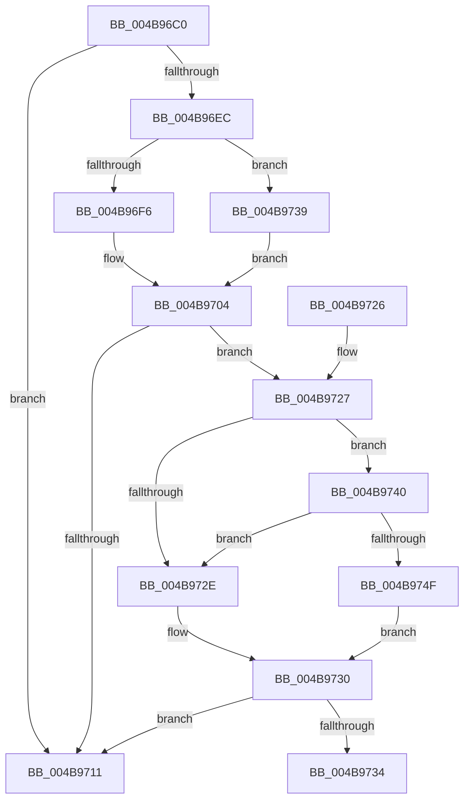

# MiLogWsEmptyControl

- RVA: `0x004B96C0`–`0x004B9753` (길이 `147` bytes)
- VA: `0x00000001404B96C0`
- 실행 섹션: `.text`
- PDB 이름 있음: `예`; PDB Function 태그: `예`
- unwind 정보 RVA: `0x000BB284`
- 디코드: `41`개 명령, `147/147` bytes 표시
- 미해석 바이트: `0` (있으면 어셈블리에 `.byte`로 보존)

> 이 문서는 커널 이미지의 기계어와 PDB 기호를 분석해 생성했습니다. 4번과 5번은 함수 원형과 자료형을 바이너리 사용 방식에서 추정한 C 해석이며 원본 소스 복구 결과는 아닙니다.

## 1. Dependencies

- 직접 호출 지점: **1**; 고유 호출 대상: **1**
- 직접 호출자로 확인된 함수: **1**
- RIP 상대 이미지 참조: **2**

### Outgoing calls
- `0x004B9718` → [_security_check_cookie](../6A/_security_check_cookie_function_006AC640.md) (function, `0x006AC640`)

### Direct callers
- [MmProcessWorkingSetControl](../../page/A6/MmProcessWorkingSetControl_function_00A616C4.md) at `0x00A61846`

### Static image references
- `0x004B96CE` → RVA `0x00E0A740` (`.data`; read)
- `0x004B96DC` → RVA `0x00E37618` (`.data`; read)

## 2. Other-region calls and transfers

- 다른 실행 섹션으로 향하는 call: **0**
- call이 아닌 외부 분기/꼬리 이동: **1**
  - `0x004B9734` → [sub_006FC388](../6F/Unknown_function_006FC388.md) (`tail-transfer`)

## 3. Assembly (complete function range)

```asm
004B96C0  40 55                           push rbp
004B96C2  48 8D 6C 24 A9                  lea rbp, [rsp - 0x57]
004B96C7  48 81 EC C0 00 00 00            sub rsp, 0xc0
004B96CE  48 8B 05 6B 10 95 00            mov rax, qword ptr [rip + 0x95106b]
004B96D5  48 33 C4                        xor rax, rsp
004B96D8  48 89 45 47                     mov qword ptr [rbp + 0x47], rax
004B96DC  48 83 3D 34 DF 97 00 00         cmp qword ptr [rip + 0x97df34], 0
004B96E4  44 8B DA                        mov r11d, edx
004B96E7  4C 8B C9                        mov r9, rcx
004B96EA  74 25                           je 0x1404b9711
004B96EC  8B 81 B8 00 00 00               mov eax, dword ptr [rcx + 0xb8]
004B96F2  A8 0F                           test al, 0xf
004B96F4  75 43                           jne 0x1404b9739
004B96F6  44 8B 91 D0 FD FF FF            mov r10d, dword ptr [rcx - 0x230]
004B96FD  48 8D 91 38 FF FF FF            lea rdx, [rcx - 0xc8]
004B9704  4C 8B 05 0D DF 97 00            mov r8, qword ptr [rip + 0x97df0d]
004B970B  41 83 38 05                     cmp dword ptr [r8], 5
004B970F  77 16                           ja 0x1404b9727
004B9711  48 8B 4D 47                     mov rcx, qword ptr [rbp + 0x47]
004B9715  48 33 CC                        xor rcx, rsp
004B9718  E8 23 2F 1F 00                  call 0x1406ac640
004B971D  48 81 C4 C0 00 00 00            add rsp, 0xc0
004B9724  5D                              pop rbp
004B9725  C3                              ret
004B9726  CC                              int3
004B9727  41 F6 40 10 10                  test byte ptr [r8 + 0x10], 0x10
004B972C  75 12                           jne 0x1404b9740
004B972E  32 C0                           xor al, al
004B9730  84 C0                           test al, al
004B9732  74 DD                           je 0x1404b9711
004B9734  E9 4F 2C 24 00                  jmp 0x1406fc388
004B9739  45 33 D2                        xor r10d, r10d
004B973C  33 D2                           xor edx, edx
004B973E  EB C4                           jmp 0x1404b9704
004B9740  49 8B 48 18                     mov rcx, qword ptr [r8 + 0x18]
004B9744  48 8B C1                        mov rax, rcx
004B9747  83 E0 10                        and eax, 0x10
004B974A  48 3B C1                        cmp rax, rcx
004B974D  75 DF                           jne 0x1404b972e
004B974F  B0 01                           mov al, 1
004B9751  EB DD                           jmp 0x1404b9730
```

## 4. C-style interpretation (structured pseudocode)

```c
__int64 __fastcall MiLogWsEmptyControl(__int64 a1, int a2)
{
    __int64 result;
    __int64 v_r10;
    __int64 v_rsp;
    unsigned __int64 v_stack_m18;
    unsigned __int64 v_stack_m5F;

    v_rsp = (v_rsp) - (192);
    result = (*(unsigned __int64 *)(v_rip + 9769067)) ^ (v_rsp);
    v_stack_m18 = result;
    if ((*(unsigned __int64 *)(v_rip + 9953076)) == 0) goto loc_004B9711;
    if ((((unsigned __int8)((unsigned int)(*(unsigned int *)(a1 + 184)))) & (15)) != 0) goto loc_004B9739;
loc_004B9704:
    if ((*(unsigned int *)(*(unsigned __int64 *)(v_rip + 9953037))) > 5) goto loc_004B9727;
loc_004B9711:
    a1 = (v_stack_m18) ^ (v_rsp);
    result = _security_check_cookie(a1, a1 - 200, *(unsigned __int64 *)(v_rip + 9953037), a1);
    v_rsp = (v_rsp) + (192);
    return result;
loc_004B9727:
    if (((*(unsigned __int8 *)(*(unsigned __int64 *)(v_rip + 9953037) + 16)) & (16)) != 0) goto loc_004B9740;
loc_004B972E:
    result = 0;
loc_004B9730:
    if (0 == 0) goto loc_004B9711;
loc_004B9739:
    v_r10 = 0;
    a2 = 0;
    goto loc_004B9704;
loc_004B9740:
    result = (unsigned int)((*(unsigned __int64 *)(*(unsigned __int64 *)(v_rip + 9953037) + 24)) & (16));
    if (result != (*(unsigned __int64 *)(*(unsigned __int64 *)(v_rip + 9953037) + 24))) goto loc_004B972E;
    goto loc_004B9730;
}
```

## 5. (Beta) C Style

```c
int64_t MiLogWsEmptyControl(void *Arg1, int32_t Arg2)
{
    uint8_t *arg1 = (uint8_t *)Arg1;

    int64_t result;
    int64_t local_r10;
    int64_t local_rsp;
    uint64_t v_stack_m18;
    uint64_t v_stack_m5F;

    local_rsp = (local_rsp) - (192);
    result = (*(uint64_t *)(v_rip + 0x95106B)) ^ (local_rsp);
    v_stack_m18 = result;
    if ((*(uint64_t *)(v_rip + 0x97DF34)) == 0) goto loc_004B9711;
    if ((((uint8_t)((uint32_t)(*(uint32_t *)(arg1 + 0xB8)))) & (15)) != 0) goto loc_004B9739;
loc_004B9704:
    if ((*(uint32_t *)(*(uint64_t *)(v_rip + 0x97DF0D))) > 5) goto loc_004B9727;
loc_004B9711:
    Arg1 = (v_stack_m18) ^ (local_rsp);
    result = _security_check_cookie(Arg1, Arg1 - 200, *(uint64_t *)(v_rip + 0x97DF0D), Arg1);
    local_rsp = (local_rsp) + (192);
    return result;
loc_004B9727:
    if (((*(uint8_t *)(*(uint64_t *)(v_rip + 0x97DF0D) + 0x10)) & (16)) != 0) goto loc_004B9740;
loc_004B972E:
    result = 0;
loc_004B9730:
    if (0 == 0) goto loc_004B9711;
loc_004B9739:
    local_r10 = 0;
    Arg2 = 0;
    goto loc_004B9704;
loc_004B9740:
    result = (uint32_t)((*(uint64_t *)(*(uint64_t *)(v_rip + 0x97DF0D) + 0x18)) & (16));
    if (result != (*(uint64_t *)(*(uint64_t *)(v_rip + 0x97DF0D) + 0x18))) goto loc_004B972E;
    goto loc_004B9730;
}
```

### 관측된 메모리 오프셋

구조체 형식이 확인되지 않은 접근은 인자 기준의 오프셋으로만 기록했습니다.

| 기준 인자 | 오프셋 표현 | 폭 (bit) | 접근 |
|---|---:|---:|---|
| `Arg1` | `- 0x230` | `32` | `R` |
| `Arg1` | `- 0xC8` | `64` | `R` |
| `Arg1` | `+ 0xB8` | `32` | `R` |

## 6. Execution-region graph

[열기: 2D/3D 그래프와 함수 탐색 컨트롤 패널](../../../control-panel.html?section=text&rva=0x004B96C0&view=graph)

- 2D 그래프는 위에서 아래로 흐르고, 3D 그래프는 빈 공간을 드래그해 회전합니다. Shift+드래그는 이동, 휠은 확대·축소, 함수 노드 선택은 대상 보고서 이동입니다.

### Static fallback


