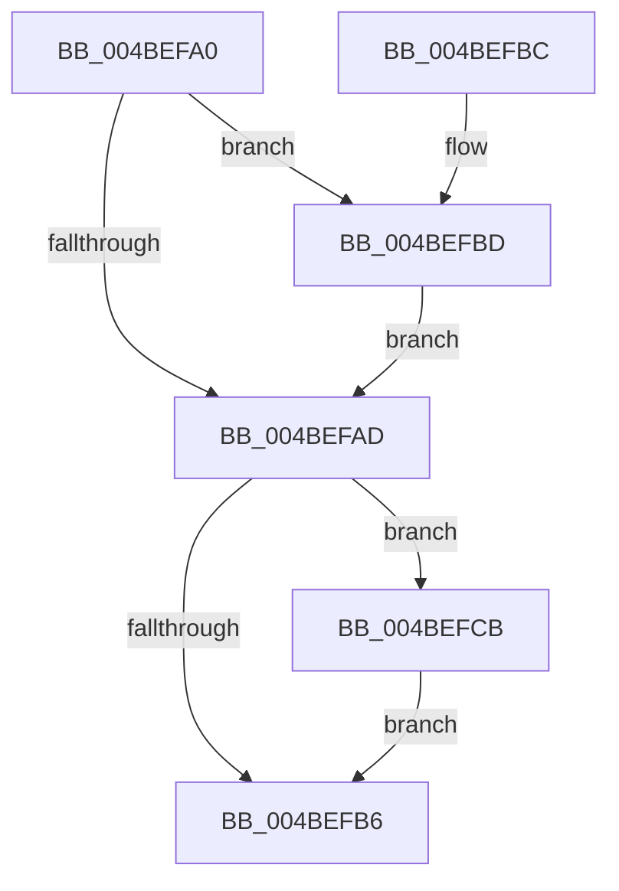

# MiMirrorPurgePartitionPages

- RVA: `0x004BEFA0`–`0x004BEFEE` (길이 `78` bytes)
- VA: `0x00000001404BEFA0`
- 실행 섹션: `.text`
- PDB 이름 있음: `예`; PDB Function 태그: `아니요`
- unwind 정보 RVA: `0x0008E1E4`
- 디코드: `22`개 명령, `78/78` bytes 표시
- 미해석 바이트: `0` (있으면 어셈블리에 `.byte`로 보존)

> 이 문서는 커널 이미지의 기계어와 PDB 기호를 분석해 생성했습니다. 4번과 5번은 함수 원형과 자료형을 바이너리 사용 방식에서 추정한 C 해석이며 원본 소스 복구 결과는 아닙니다.

## 1. Dependencies

- 직접 호출 지점: **3**; 고유 호출 대상: **3**
- 직접 호출자로 확인된 함수: **0**
- RIP 상대 이미지 참조: **1**

### Outgoing calls
- `0x004BEFBD` → [MiPurgePartitionStandby](../33/MiPurgePartitionStandby_function_00334460.md) (function, `0x00334460`)
- `0x004BEFD8` → [MiWalkAllFreeZeroLists](MiWalkAllFreeZeroLists_function_004BB6C8.md) (function, `0x004BB6C8`)
- `0x004BEFE0` → [MiHugePurgeZeroList](../67/MiHugePurgeZeroList_function_00676124.md) (function, `0x00676124`)

### Direct callers
- 이 함수 시작 RVA로 연결되는 직접 call은 확인되지 않았습니다. 간접 호출은 완전히 역산할 수 없습니다.

### Static image references
- `0x004BEFCE` → RVA `0x004CE410` (`MiPurgeZeroListHeads`; read)

## 2. Other-region calls and transfers

- 다른 실행 섹션으로 향하는 call: **0**
- 별도 외부 분기/꼬리 이동을 확인하지 못했습니다.

## 3. Assembly (complete function range)

```asm
004BEFA0  40 53                           push rbx
004BEFA2  48 83 EC 20                     sub rsp, 0x20
004BEFA6  48 8B D9                        mov rbx, rcx
004BEFA9  85 D2                           test edx, edx
004BEFAB  75 10                           jne 0x1404befbd
004BEFAD  80 BB E5 3E 00 00 00            cmp byte ptr [rbx + 0x3ee5], 0
004BEFB4  75 15                           jne 0x1404befcb
004BEFB6  48 83 C4 20                     add rsp, 0x20
004BEFBA  5B                              pop rbx
004BEFBB  C3                              ret
004BEFBC  CC                              int3
004BEFBD  E8 9E 54 E7 FF                  call 0x140334460
004BEFC2  C6 83 E4 3E 00 00 00            mov byte ptr [rbx + 0x3ee4], 0
004BEFC9  EB E2                           jmp 0x1404befad
004BEFCB  45 33 C0                        xor r8d, r8d
004BEFCE  48 8D 15 3B F4 00 00            lea rdx, [rip + 0xf43b]
004BEFD5  48 8B CB                        mov rcx, rbx
004BEFD8  E8 EB C6 FF FF                  call 0x1404bb6c8
004BEFDD  48 8B CB                        mov rcx, rbx
004BEFE0  E8 3F 71 1B 00                  call 0x140676124
004BEFE5  C6 83 E5 3E 00 00 00            mov byte ptr [rbx + 0x3ee5], 0
004BEFEC  EB C8                           jmp 0x1404befb6
```

## 4. C-style interpretation (structured pseudocode)

```c
__int64 __fastcall MiMirrorPurgePartitionPages(__int64 a1, int a2, int a3)
{
    __int64 result;
    __int64 v_rsp;

    v_rsp = (v_rsp) - (32);
    if (a2 != 0) goto loc_004BEFBD;
loc_004BEFAD:
    if ((*(unsigned __int8 *)(a1 + 16101)) != 0) goto loc_004BEFCB;
loc_004BEFB6:
    v_rsp = (v_rsp) + (32);
    return result;
loc_004BEFBD:
    result = MiPurgePartitionStandby(a1, a2, a3, a4);
    *(unsigned __int8 *)(a1 + 16100) = 0;
    goto loc_004BEFAD;
loc_004BEFCB:
    a3 = 0;
    result = MiWalkAllFreeZeroLists(a1, v_rip + 62523, a3, a4);
    result = MiHugePurgeZeroList(a1, v_rip + 62523, a3, a4);
    *(unsigned __int8 *)(a1 + 16101) = 0;
    goto loc_004BEFB6;
}
```

## 5. (Beta) C Style

```c
int64_t MiMirrorPurgePartitionPages(void *Arg1, int32_t Arg2, int32_t Arg3)
{
    uint8_t *arg1 = (uint8_t *)Arg1;

    int64_t result;
    int64_t local_rsp;

    local_rsp = (local_rsp) - (32);
    if (Arg2 != 0) goto loc_004BEFBD;
loc_004BEFAD:
    if ((*(uint8_t *)(arg1 + 0x3EE5)) != 0) goto loc_004BEFCB;
loc_004BEFB6:
    local_rsp = (local_rsp) + (32);
    return result;
loc_004BEFBD:
    result = MiPurgePartitionStandby(Arg1, Arg2, Arg3, a4);
    *(uint8_t *)(arg1 + 0x3EE4) = 0;
    goto loc_004BEFAD;
loc_004BEFCB:
    Arg3 = 0;
    result = MiWalkAllFreeZeroLists(Arg1, v_rip + 62523, Arg3, a4);
    result = MiHugePurgeZeroList(Arg1, v_rip + 62523, Arg3, a4);
    *(uint8_t *)(arg1 + 0x3EE5) = 0;
    goto loc_004BEFB6;
}
```

### 관측된 메모리 오프셋

구조체 형식이 확인되지 않은 접근은 인자 기준의 오프셋으로만 기록했습니다.

| 기준 인자 | 오프셋 표현 | 폭 (bit) | 접근 |
|---|---:|---:|---|
| `Arg1` | `+ 0x3EE4` | `8` | `W` |
| `Arg1` | `+ 0x3EE5` | `8` | `R` |
| `Arg1` | `+ 0x3EE5` | `8` | `W` |

## 6. Execution-region graph

[열기: 2D/3D 그래프와 함수 탐색 컨트롤 패널](../../../control-panel.html?section=text&rva=0x004BEFA0&view=graph)

- 2D 그래프는 위에서 아래로 흐르고, 3D 그래프는 빈 공간을 드래그해 회전합니다. Shift+드래그는 이동, 휠은 확대·축소, 함수 노드 선택은 대상 보고서 이동입니다.

### Static fallback


