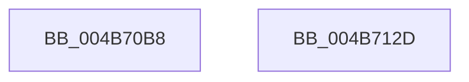

# MiQueueSyncModifiedWriterApc

- RVA: `0x004B70B8`–`0x004B712E` (길이 `118` bytes)
- VA: `0x00000001404B70B8`
- 실행 섹션: `.text`
- PDB 이름 있음: `예`; PDB Function 태그: `아니요`
- unwind 정보 RVA: `0x0005D2F4`
- 디코드: `30`개 명령, `118/118` bytes 표시
- 미해석 바이트: `0` (있으면 어셈블리에 `.byte`로 보존)

> 이 문서는 커널 이미지의 기계어와 PDB 기호를 분석해 생성했습니다. 4번과 5번은 함수 원형과 자료형을 바이너리 사용 방식에서 추정한 C 해석이며 원본 소스 복구 결과는 아닙니다.

## 1. Dependencies

- 직접 호출 지점: **2**; 고유 호출 대상: **2**
- 직접 호출자로 확인된 함수: **1**
- RIP 상대 이미지 참조: **1**

### Outgoing calls
- `0x004B710B` → [KeInsertQueueApc](../20/KeInsertQueueApc_function_00203F10.md) (function, `0x00203F10`)
- `0x004B7123` → [KeWaitForSingleObject](../20/KeWaitForSingleObject_function_0020E6B0.md) (function, `0x0020E6B0`)

### Direct callers
- [MiStoreDeletePartition](../69/MiStoreDeletePartition_function_006926F4.md) at `0x00692786`

### Static image references
- `0x004B70D7` → RVA `0x0049E550` (`EmpCheckErrataList`; read)

## 2. Other-region calls and transfers

- 다른 실행 섹션으로 향하는 call: **0**
- 별도 외부 분기/꼬리 이동을 확인하지 못했습니다.

## 3. Assembly (complete function range)

```asm
004B70B8  48 83 EC 38                     sub rsp, 0x38
004B70BC  48 8B 81 E0 03 00 00            mov rax, qword ptr [rcx + 0x3e0]
004B70C3  4C 8B D2                        mov r10, rdx
004B70C6  66 83 62 50 00                  and word ptr [rdx + 0x50], 0
004B70CB  49 8B CA                        mov rcx, r10
004B70CE  48 83 62 28 00                  and qword ptr [rdx + 0x28], 0
004B70D3  48 89 42 08                     mov qword ptr [rdx + 8], rax
004B70D7  48 8D 05 72 74 FE FF            lea rax, [rip - 0x18b8e]
004B70DE  4C 89 42 30                     mov qword ptr [rdx + 0x30], r8
004B70E2  49 F7 D8                        neg r8
004B70E5  48 89 42 20                     mov qword ptr [rdx + 0x20], rax
004B70E9  48 1B C0                        sbb rax, rax
004B70EC  66 C7 02 12 00                  mov word ptr [rdx], 0x12
004B70F1  49 23 C1                        and rax, r9
004B70F4  C6 42 02 58                     mov byte ptr [rdx + 2], 0x58
004B70F8  48 89 42 38                     mov qword ptr [rdx + 0x38], rax
004B70FC  45 33 C9                        xor r9d, r9d
004B70FF  C6 42 52 00                     mov byte ptr [rdx + 0x52], 0
004B7103  45 33 C0                        xor r8d, r8d
004B7106  48 8B 54 24 60                  mov rdx, qword ptr [rsp + 0x60]
004B710B  E8 00 CE D4 FF                  call 0x140203f10
004B7110  48 8B 4C 24 60                  mov rcx, qword ptr [rsp + 0x60]
004B7115  45 33 C9                        xor r9d, r9d
004B7118  48 83 64 24 20 00               and qword ptr [rsp + 0x20], 0
004B711E  45 33 C0                        xor r8d, r8d
004B7121  33 D2                           xor edx, edx
004B7123  E8 88 75 D5 FF                  call 0x14020e6b0
004B7128  48 83 C4 38                     add rsp, 0x38
004B712C  C3                              ret
004B712D  CC                              int3
```

## 4. C-style interpretation (structured pseudocode)

```c
__int64 __fastcall MiQueueSyncModifiedWriterApc(__int64 a1, __int64 a2, __int64 a3, __int64 a4, __int64 a5)
{
    __int64 result;
    __int64 v_rsp;
    unsigned __int64 v_stack_m18;

    v_rsp = (v_rsp) - (56);
    *(unsigned __int64 *)(a2 + 8) = *(unsigned __int64 *)(a1 + 992);
    *(unsigned __int64 *)(a2 + 48) = a3;
    a3 = -(a3);
    *(unsigned __int64 *)(a2 + 32) = v_rip - 101262;
    *(unsigned __int16 *)(a2) = 18;
    result = (v_rip - 101262) & (a4);
    *(unsigned __int8 *)(a2 + 2) = 88;
    *(unsigned __int64 *)(a2 + 56) = result;
    a4 = 0;
    *(unsigned __int8 *)(a2 + 82) = 0;
    a3 = 0;
    result = KeInsertQueueApc(a2, a5, a3, a4);
    a4 = 0;
    a3 = 0;
    a2 = 0;
    result = KeWaitForSingleObject(a5, a2, a3, a4);
    v_rsp = (v_rsp) + (56);
    return result;
}
```

## 5. (Beta) C Style

```c
int64_t MiQueueSyncModifiedWriterApc(void *Arg1, void *Arg2, int64_t Arg3, int64_t Arg4, int64_t Arg5)
{
    uint8_t *arg1 = (uint8_t *)Arg1;
    uint8_t *arg2 = (uint8_t *)Arg2;

    int64_t result;
    int64_t local_rsp;
    uint64_t v_stack_m18;

    local_rsp = (local_rsp) - (56);
    *(uint64_t *)(arg2 + 0x8) = *(uint64_t *)(arg1 + 0x3E0);
    *(uint64_t *)(arg2 + 0x30) = Arg3;
    Arg3 = -(Arg3);
    *(uint64_t *)(arg2 + 0x20) = v_rip - 101262;
    *(uint16_t *)(arg2) = 18;
    result = (v_rip - 101262) & (Arg4);
    *(uint8_t *)(arg2 + 0x2) = 88;
    *(uint64_t *)(arg2 + 0x38) = result;
    Arg4 = 0;
    *(uint8_t *)(arg2 + 0x52) = 0;
    Arg3 = 0;
    result = KeInsertQueueApc(Arg2, Arg5, Arg3, Arg4);
    Arg4 = 0;
    Arg3 = 0;
    Arg2 = 0;
    result = KeWaitForSingleObject(Arg5, Arg2, Arg3, Arg4);
    local_rsp = (local_rsp) + (56);
    return result;
}
```

### 관측된 메모리 오프셋

구조체 형식이 확인되지 않은 접근은 인자 기준의 오프셋으로만 기록했습니다.

| 기준 인자 | 오프셋 표현 | 폭 (bit) | 접근 |
|---|---:|---:|---|
| `Arg1` | `+ 0x3E0` | `64` | `R` |
| `Arg2` | `+ 0x0` | `16` | `W` |
| `Arg2` | `+ 0x2` | `8` | `W` |
| `Arg2` | `+ 0x8` | `64` | `W` |
| `Arg2` | `+ 0x20` | `64` | `W` |
| `Arg2` | `+ 0x28` | `64` | `R/W` |
| `Arg2` | `+ 0x30` | `64` | `W` |
| `Arg2` | `+ 0x38` | `64` | `W` |
| `Arg2` | `+ 0x50` | `16` | `R/W` |
| `Arg2` | `+ 0x52` | `8` | `W` |

## 6. Execution-region graph

[열기: 2D/3D 그래프와 함수 탐색 컨트롤 패널](../../../control-panel.html?section=text&rva=0x004B70B8&view=graph)

- 2D 그래프는 위에서 아래로 흐르고, 3D 그래프는 빈 공간을 드래그해 회전합니다. Shift+드래그는 이동, 휠은 확대·축소, 함수 노드 선택은 대상 보고서 이동입니다.

### Static fallback


