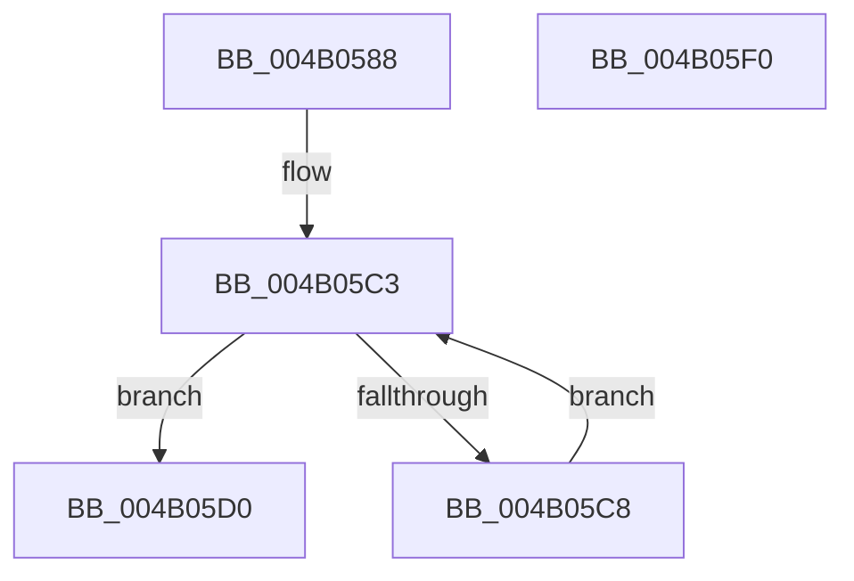

# MiRotateComplete

- RVA: `0x004B0588`–`0x004B05F1` (길이 `105` bytes)
- VA: `0x00000001404B0588`
- 실행 섹션: `.text`
- PDB 이름 있음: `예`; PDB Function 태그: `아니요`
- unwind 정보 RVA: `0x00060BC4`
- 디코드: `28`개 명령, `105/105` bytes 표시
- 미해석 바이트: `0` (있으면 어셈블리에 `.byte`로 보존)

> 이 문서는 커널 이미지의 기계어와 PDB 기호를 분석해 생성했습니다. 4번과 5번은 함수 원형과 자료형을 바이너리 사용 방식에서 추정한 C 해석이며 원본 소스 복구 결과는 아닙니다.

## 1. Dependencies

- 직접 호출 지점: **2**; 고유 호출 대상: **2**
- 직접 호출자로 확인된 함수: **2**
- RIP 상대 이미지 참조: **0**

### Outgoing calls
- `0x004B05BB` → [MiLockWorkingSetExclusive](../32/MiLockWorkingSetExclusive_function_003238A0.md) (function, `0x003238A0`)
- `0x004B05DB` → [MiUnlockWorkingSetExclusive](../27/MiUnlockWorkingSetExclusive_function_0027EC70.md) (function, `0x0027EC70`)

### Direct callers
- [MiRotateToFrameBuffer](../../page/A3/MiRotateToFrameBuffer_function_00A38214.md) at `0x00A384CB`
- [MiRotateToFrameBufferNoCopy](../../page/A3/MiRotateToFrameBufferNoCopy_function_00A38530.md) at `0x00A38662`

### Static image references
- 디코드된 RIP-relative 메모리 참조가 없습니다.

## 2. Other-region calls and transfers

- 다른 실행 섹션으로 향하는 call: **0**
- 별도 외부 분기/꼬리 이동을 확인하지 못했습니다.

## 3. Assembly (complete function range)

```asm
004B0588  48 89 5C 24 08                  mov qword ptr [rsp + 8], rbx
004B058D  48 89 74 24 10                  mov qword ptr [rsp + 0x10], rsi
004B0592  57                              push rdi
004B0593  48 83 EC 20                     sub rsp, 0x20
004B0597  65 48 8B 04 25 88 01 00 00      mov rax, qword ptr gs:[0x188]
004B05A0  48 8B F9                        mov rdi, rcx
004B05A3  48 8B 90 B8 00 00 00            mov rdx, qword ptr [rax + 0xb8]
004B05AA  48 8D B2 00 04 00 00            lea rsi, [rdx + 0x400]
004B05B1  48 8B CE                        mov rcx, rsi
004B05B4  48 8D 9A 68 02 00 00            lea rbx, [rdx + 0x268]
004B05BB  E8 E0 32 E7 FF                  call 0x1403238a0
004B05C0  48 8B 13                        mov rdx, qword ptr [rbx]
004B05C3  48 3B D7                        cmp rdx, rdi
004B05C6  74 08                           je 0x1404b05d0
004B05C8  48 8B DA                        mov rbx, rdx
004B05CB  48 8B 12                        mov rdx, qword ptr [rdx]
004B05CE  EB F3                           jmp 0x1404b05c3
004B05D0  48 8B 12                        mov rdx, qword ptr [rdx]
004B05D3  48 8B CE                        mov rcx, rsi
004B05D6  48 89 13                        mov qword ptr [rbx], rdx
004B05D9  8A D0                           mov dl, al
004B05DB  E8 90 E6 DC FF                  call 0x14027ec70
004B05E0  48 8B 5C 24 30                  mov rbx, qword ptr [rsp + 0x30]
004B05E5  48 8B 74 24 38                  mov rsi, qword ptr [rsp + 0x38]
004B05EA  48 83 C4 20                     add rsp, 0x20
004B05EE  5F                              pop rdi
004B05EF  C3                              ret
004B05F0  CC                              int3
```

## 4. C-style interpretation (structured pseudocode)

```c
__int64 __fastcall MiRotateComplete(__int64 a1)
{
    __int64 result;
    __int64 v_rsp;
    unsigned __int64 v_stack_p10;
    unsigned __int64 v_stack_p8;

    v_stack_p8 = v_rbx;
    v_stack_p10 = v_rsi;
    v_rsp = (v_rsp) - (32);
    result = MiLockWorkingSetExclusive(*(unsigned __int64 *)(*(unsigned __int64 *)(gs_base + (0 + 392)) + 184) + 1024, *(unsigned __int64 *)(*(unsigned __int64 *)(gs_base + (0 + 392)) + 184), a3, a4);
loc_004B05C3:
    if ((*(unsigned __int64 *)(*(unsigned __int64 *)(*(unsigned __int64 *)(gs_base + (0 + 392)) + 184) + 616)) == a1) goto loc_004B05D0;
    goto loc_004B05C3;
loc_004B05D0:
    *(unsigned __int64 *)(*(unsigned __int64 *)(*(unsigned __int64 *)(*(unsigned __int64 *)(gs_base + (0 + 392)) + 184) + 616)) = *(unsigned __int64 *)(*(unsigned __int64 *)(*(unsigned __int64 *)(*(unsigned __int64 *)(*(unsigned __int64 *)(gs_base + (0 + 392)) + 184) + 616)));
    result = MiUnlockWorkingSetExclusive(*(unsigned __int64 *)(*(unsigned __int64 *)(gs_base + (0 + 392)) + 184) + 1024, (unsigned __int8)(result), a3, a4);
    v_rsp = (v_rsp) + (32);
    return result;
}
```

## 5. (Beta) C Style

```c
int64_t MiRotateComplete(int64_t Arg1)
{
    int64_t result;
    int64_t local_rsp;
    uint64_t v_stack_p10;
    uint64_t v_stack_p8;

    v_stack_p8 = local_rbx;
    v_stack_p10 = local_rsi;
    local_rsp = (local_rsp) - (32);
    result = MiLockWorkingSetExclusive(*(uint64_t *)(*(uint64_t *)(gs_base + (0 + 0x188)) + 0xB8) + 1024, *(uint64_t *)(*(uint64_t *)(gs_base + (0 + 0x188)) + 0xB8), a3, a4);
loc_004B05C3:
    if ((*(uint64_t *)(*(uint64_t *)(*(uint64_t *)(gs_base + (0 + 0x188)) + 0xB8) + 0x268)) == Arg1) goto loc_004B05D0;
    goto loc_004B05C3;
loc_004B05D0:
    *(uint64_t *)(*(uint64_t *)(*(uint64_t *)(*(uint64_t *)(gs_base + (0 + 0x188)) + 0xB8) + 0x268)) = *(uint64_t *)(*(uint64_t *)(*(uint64_t *)(*(uint64_t *)(*(uint64_t *)(gs_base + (0 + 0x188)) + 0xB8) + 0x268)));
    result = MiUnlockWorkingSetExclusive(*(uint64_t *)(*(uint64_t *)(gs_base + (0 + 0x188)) + 0xB8) + 1024, (uint8_t)(result), a3, a4);
    local_rsp = (local_rsp) + (32);
    return result;
}
```

## 6. Execution-region graph

[열기: 2D/3D 그래프와 함수 탐색 컨트롤 패널](../../../control-panel.html?section=text&rva=0x004B0588&view=graph)

- 2D 그래프는 위에서 아래로 흐르고, 3D 그래프는 빈 공간을 드래그해 회전합니다. Shift+드래그는 이동, 휠은 확대·축소, 함수 노드 선택은 대상 보고서 이동입니다.

### Static fallback


