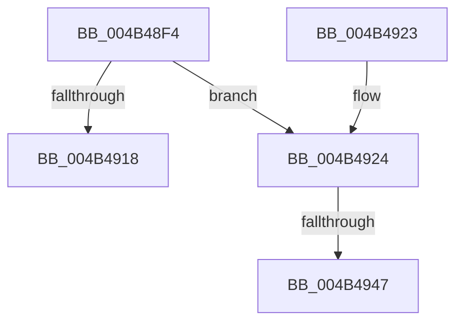

# MiSlabEntryBecameEmpty

- RVA: `0x004B48F4`–`0x004B4954` (길이 `96` bytes)
- VA: `0x00000001404B48F4`
- 실행 섹션: `.text`
- PDB 이름 있음: `예`; PDB Function 태그: `예`
- unwind 정보 RVA: `0x000B9F68`
- 디코드: `21`개 명령, `96/96` bytes 표시
- 미해석 바이트: `0` (있으면 어셈블리에 `.byte`로 보존)

> 이 문서는 커널 이미지의 기계어와 PDB 기호를 분석해 생성했습니다. 4번과 5번은 함수 원형과 자료형을 바이너리 사용 방식에서 추정한 C 해석이며 원본 소스 복구 결과는 아닙니다.

## 1. Dependencies

- 직접 호출 지점: **0**; 고유 호출 대상: **0**
- 직접 호출자로 확인된 함수: **2**
- RIP 상대 이미지 참조: **0**

### Outgoing calls
- 직접 디코드된 call 명령이 없습니다.

### Direct callers
- [MiFreeSlabEntries](../2D/MiFreeSlabEntries_function_002DAFC0.md) at `0x002DB121`
- [MiInsertSlabEntry](../37/MiInsertSlabEntry_function_00378AF4.md) at `0x00378CCE`

### Static image references
- 디코드된 RIP-relative 메모리 참조가 없습니다.

## 2. Other-region calls and transfers

- 다른 실행 섹션으로 향하는 call: **0**
- call이 아닌 외부 분기/꼬리 이동: **2**
  - `0x004B4941` → [sub_006FB90E](../6F/Unknown_function_006FB90E.md) (`tail-transfer`)
  - `0x004B494F` → [sub_006FB90E + 0x6](../6F/Unknown_function_006FB90E.md) (`tail-transfer`)

## 3. Assembly (complete function range)

```asm
004B48F4  48 89 5C 24 08                  mov qword ptr [rsp + 8], rbx
004B48F9  48 89 7C 24 10                  mov qword ptr [rsp + 0x10], rdi
004B48FE  48 8B D9                        mov rbx, rcx
004B4901  41 BA 01 00 00 00               mov r10d, 1
004B4907  F0 44 09 91 88 00 00 00         lock or dword ptr [rcx + 0x88], r10d
004B490F  83 B9 80 00 00 00 08            cmp dword ptr [rcx + 0x80], 8
004B4916  74 0C                           je 0x1404b4924
004B4918  48 8B 5C 24 08                  mov rbx, qword ptr [rsp + 8]
004B491D  48 8B 7C 24 10                  mov rdi, qword ptr [rsp + 0x10]
004B4922  C3                              ret
004B4923  CC                              int3
004B4924  8B 81 84 00 00 00               mov eax, dword ptr [rcx + 0x84]
004B492A  44 8B 4A 5C                     mov r9d, dword ptr [rdx + 0x5c]
004B492E  4C 69 D8 80 DF 00 00            imul r11, rax, 0xdf80
004B4935  48 8B 41 18                     mov rax, qword ptr [rcx + 0x18]
004B4939  4C 03 58 10                     add r11, qword ptr [rax + 0x10]
004B493D  41 F6 C1 04                     test r9b, 4
004B4941  0F 84 C7 6F 24 00               je 0x1406fb90e
004B4947  41 C1 E9 03                     shr r9d, 3
004B494B  41 83 E1 3F                     and r9d, 0x3f
004B494F  E9 C0 6F 24 00                  jmp 0x1406fb914
```

## 4. C-style interpretation (structured pseudocode)

```c
__int64 __fastcall MiSlabEntryBecameEmpty(__int64 a1, __int64 a2)
{
    __int64 v_r11;
    unsigned __int64 v_stack_p10;
    unsigned __int64 v_stack_p8;

    v_stack_p8 = v_rbx;
    v_stack_p10 = v_rdi;
    if ((*(unsigned int *)(a1 + 128)) == 8) goto loc_004B4924;
    return result;
loc_004B4924:
    v_r11 = (v_r11) * ((unsigned int)(*(unsigned int *)(a1 + 132)));
    v_r11 = (v_r11) + (*(unsigned __int64 *)(*(unsigned __int64 *)(a1 + 24) + 16));
    a4 = (unsigned int)(((unsigned int)(*(unsigned int *)(a2 + 92))) >> (3));
    a4 = (unsigned int)((a4) & (63));
}
```

## 5. (Beta) C Style

```c
int64_t MiSlabEntryBecameEmpty(void *Arg1, void *Arg2)
{
    uint8_t *arg1 = (uint8_t *)Arg1;
    uint8_t *arg2 = (uint8_t *)Arg2;

    int64_t local_r11;
    uint64_t v_stack_p10;
    uint64_t v_stack_p8;

    v_stack_p8 = local_rbx;
    v_stack_p10 = local_rdi;
    if ((*(uint32_t *)(arg1 + 0x80)) == 8) goto loc_004B4924;
    return result;
loc_004B4924:
    local_r11 = (local_r11) * ((uint32_t)(*(uint32_t *)(arg1 + 0x84)));
    local_r11 = (local_r11) + (*(uint64_t *)(*(uint64_t *)(arg1 + 0x18) + 0x10));
    a4 = (uint32_t)(((uint32_t)(*(uint32_t *)(arg2 + 0x5C))) >> (3));
    a4 = (uint32_t)((a4) & (63));
}
```

### 관측된 메모리 오프셋

구조체 형식이 확인되지 않은 접근은 인자 기준의 오프셋으로만 기록했습니다.

| 기준 인자 | 오프셋 표현 | 폭 (bit) | 접근 |
|---|---:|---:|---|
| `Arg1` | `+ 0x18` | `64` | `R` |
| `Arg1` | `+ 0x80` | `32` | `R` |
| `Arg1` | `+ 0x84` | `32` | `R` |
| `Arg1` | `+ 0x88` | `32` | `R/W` |
| `Arg2` | `+ 0x5C` | `32` | `R` |

## 6. Execution-region graph

[열기: 2D/3D 그래프와 함수 탐색 컨트롤 패널](../../../control-panel.html?section=text&rva=0x004B48F4&view=graph)

- 2D 그래프는 위에서 아래로 흐르고, 3D 그래프는 빈 공간을 드래그해 회전합니다. Shift+드래그는 이동, 휠은 확대·축소, 함수 노드 선택은 대상 보고서 이동입니다.

### Static fallback


