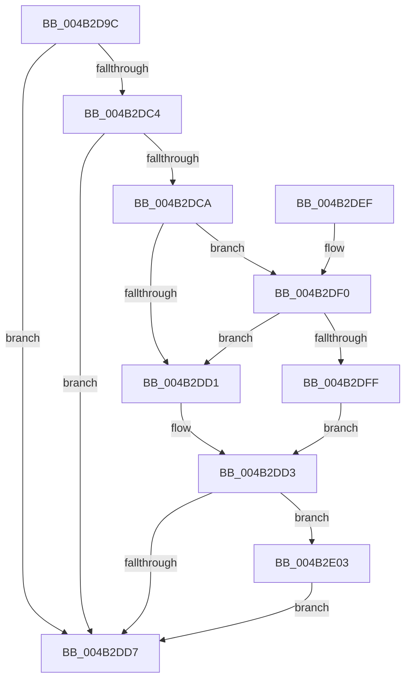

# MiStoreLogWriteDisabled

- RVA: `0x004B2D9C`–`0x004B2E66` (길이 `202` bytes)
- VA: `0x00000001404B2D9C`
- 실행 섹션: `.text`
- PDB 이름 있음: `예`; PDB Function 태그: `아니요`
- unwind 정보 RVA: `0x000B96D8`
- 디코드: `47`개 명령, `202/202` bytes 표시
- 미해석 바이트: `0` (있으면 어셈블리에 `.byte`로 보존)

> 이 문서는 커널 이미지의 기계어와 PDB 기호를 분석해 생성했습니다. 4번과 5번은 함수 원형과 자료형을 바이너리 사용 방식에서 추정한 C 해석이며 원본 소스 복구 결과는 아닙니다.

## 1. Dependencies

- 직접 호출 지점: **2**; 고유 호출 대상: **2**
- 직접 호출자로 확인된 함수: **1**
- RIP 상대 이미지 참조: **3**

### Outgoing calls
- `0x004B2DE2` → [_security_check_cookie](../6A/_security_check_cookie_function_006AC640.md) (function, `0x006AC640`)
- `0x004B2E5C` → [tlgWriteEx_EtwWriteEx](../4A/tlgWriteEx_EtwWriteEx_function_004AA348.md) (function, `0x004AA348`)

### Direct callers
- [MiStoreWriteModifiedPages](../2B/MiStoreWriteModifiedPages_function_002B46C4.md) at `0x002B5346`

### Static image references
- `0x004B2DA3` → RVA `0x00E0A740` (`.data`; read)
- `0x004B2DB5` → RVA `0x00E37618` (`.data`; read)
- `0x004B2E4B` → RVA `0x00059A8A` (`.rdata`; read)

## 2. Other-region calls and transfers

- 다른 실행 섹션으로 향하는 call: **0**
- 별도 외부 분기/꼬리 이동을 확인하지 못했습니다.

## 3. Assembly (complete function range)

```asm
004B2D9C  48 81 EC A8 00 00 00            sub rsp, 0xa8
004B2DA3  48 8B 05 96 79 95 00            mov rax, qword ptr [rip + 0x957996]
004B2DAA  48 33 C4                        xor rax, rsp
004B2DAD  48 89 84 24 90 00 00 00         mov qword ptr [rsp + 0x90], rax
004B2DB5  4C 8B 05 5C 48 98 00            mov r8, qword ptr [rip + 0x98485c]
004B2DBC  44 8B C9                        mov r9d, ecx
004B2DBF  4D 85 C0                        test r8, r8
004B2DC2  74 13                           je 0x1404b2dd7
004B2DC4  41 83 38 05                     cmp dword ptr [r8], 5
004B2DC8  76 0D                           jbe 0x1404b2dd7
004B2DCA  41 F6 40 10 02                  test byte ptr [r8 + 0x10], 2
004B2DCF  75 1F                           jne 0x1404b2df0
004B2DD1  32 C0                           xor al, al
004B2DD3  84 C0                           test al, al
004B2DD5  75 2C                           jne 0x1404b2e03
004B2DD7  48 8B 8C 24 90 00 00 00         mov rcx, qword ptr [rsp + 0x90]
004B2DDF  48 33 CC                        xor rcx, rsp
004B2DE2  E8 59 98 1F 00                  call 0x1406ac640
004B2DE7  48 81 C4 A8 00 00 00            add rsp, 0xa8
004B2DEE  C3                              ret
004B2DEF  CC                              int3
004B2DF0  49 8B 48 18                     mov rcx, qword ptr [r8 + 0x18]
004B2DF4  48 8B C1                        mov rax, rcx
004B2DF7  83 E0 02                        and eax, 2
004B2DFA  48 3B C1                        cmp rax, rcx
004B2DFD  75 D2                           jne 0x1404b2dd1
004B2DFF  B0 01                           mov al, 1
004B2E01  EB D0                           jmp 0x1404b2dd3
004B2E03  83 64 24 7C 00                  and dword ptr [rsp + 0x7c], 0
004B2E08  48 8D 44 24 40                  lea rax, [rsp + 0x40]
004B2E0D  83 A4 24 8C 00 00 00 00         and dword ptr [rsp + 0x8c], 0
004B2E15  B9 04 00 00 00                  mov ecx, 4
004B2E1A  48 89 44 24 70                  mov qword ptr [rsp + 0x70], rax
004B2E1F  48 8D 44 24 44                  lea rax, [rsp + 0x44]
004B2E24  48 89 84 24 80 00 00 00         mov qword ptr [rsp + 0x80], rax
004B2E2C  48 8D 44 24 50                  lea rax, [rsp + 0x50]
004B2E31  48 89 44 24 38                  mov qword ptr [rsp + 0x38], rax
004B2E36  44 89 4C 24 40                  mov dword ptr [rsp + 0x40], r9d
004B2E3B  44 8D 49 FD                     lea r9d, [rcx - 3]
004B2E3F  89 4C 24 30                     mov dword ptr [rsp + 0x30], ecx
004B2E43  89 4C 24 78                     mov dword ptr [rsp + 0x78], ecx
004B2E47  89 54 24 44                     mov dword ptr [rsp + 0x44], edx
004B2E4B  48 8D 15 38 6C BA FF            lea rdx, [rip - 0x4593c8]
004B2E52  89 8C 24 88 00 00 00            mov dword ptr [rsp + 0x88], ecx
004B2E59  49 8B C8                        mov rcx, r8
004B2E5C  E8 E7 74 FF FF                  call 0x1404aa348
004B2E61  E9 71 FF FF FF                  jmp 0x1404b2dd7
```

## 4. C-style interpretation (structured pseudocode)

```c
__int64 __fastcall MiStoreLogWriteDisabled(int a1, int a2)
{
    __int64 result;
    __int64 v_rsp;
    unsigned __int64 v_stack_m18;
    unsigned int v_stack_p30;
    unsigned __int64 v_stack_p38;
    unsigned __int64 v_stack_p40;
    unsigned __int64 v_stack_p44;
    unsigned __int64 v_stack_p50;
    unsigned __int64 v_stack_p70;
    unsigned int v_stack_p78;
    unsigned int v_stack_p7C;
    unsigned __int64 v_stack_p80;
    unsigned int v_stack_p88;
    unsigned int v_stack_p8C;

    v_rsp = (v_rsp) - (168);
    result = (*(unsigned __int64 *)(v_rip + 9795990)) ^ (v_rsp);
    v_stack_m18 = result;
    if (*(unsigned __int64 *)(v_rip + 9979996) == 0) goto loc_004B2DD7;
    if ((*(unsigned int *)(*(unsigned __int64 *)(v_rip + 9979996))) <= 5) goto loc_004B2DD7;
    if (((*(unsigned __int8 *)(*(unsigned __int64 *)(v_rip + 9979996) + 16)) & (2)) != 0) goto loc_004B2DF0;
loc_004B2DD1:
    result = 0;
loc_004B2DD3:
    if (0 != 0) goto loc_004B2E03;
loc_004B2DD7:
    a1 = (v_stack_m18) ^ (v_rsp);
    result = _security_check_cookie(a1, a2, *(unsigned __int64 *)(v_rip + 9979996), (unsigned int)(a1));
    v_rsp = (v_rsp) + (168);
    return result;
loc_004B2DF0:
    result = (unsigned int)((*(unsigned __int64 *)(*(unsigned __int64 *)(v_rip + 9979996) + 24)) & (2));
    if (result != (*(unsigned __int64 *)(*(unsigned __int64 *)(v_rip + 9979996) + 24))) goto loc_004B2DD1;
    goto loc_004B2DD3;
loc_004B2E03:
    v_stack_p70 = v_stack_p40;
    v_stack_p80 = v_stack_p44;
    v_stack_p38 = v_stack_p50;
    v_stack_p40 = (unsigned int)((unsigned int)(a1));
    v_stack_p30 = 4;
    v_stack_p78 = 4;
    v_stack_p44 = a2;
    v_stack_p88 = 4;
    result = tlgWriteEx_EtwWriteEx(*(unsigned __int64 *)(v_rip + 9979996), v_rip - 4559816, *(unsigned __int64 *)(v_rip + 9979996), 4 - 3);
    goto loc_004B2DD7;
}
```

## 5. (Beta) C Style

```c
int64_t MiStoreLogWriteDisabled(int32_t Arg1, int32_t Arg2)
{
    int64_t result;
    int64_t local_rsp;
    uint64_t v_stack_m18;
    uint32_t v_stack_p30;
    uint64_t v_stack_p38;
    uint64_t v_stack_p40;
    uint64_t v_stack_p44;
    uint64_t v_stack_p50;
    uint64_t v_stack_p70;
    uint32_t v_stack_p78;
    uint32_t v_stack_p7C;
    uint64_t v_stack_p80;
    uint32_t v_stack_p88;
    uint32_t v_stack_p8C;

    local_rsp = (local_rsp) - (168);
    result = (*(uint64_t *)(v_rip + 0x957996)) ^ (local_rsp);
    v_stack_m18 = result;
    if (*(uint64_t *)(v_rip + 0x98485C) == 0) goto loc_004B2DD7;
    if ((*(uint32_t *)(*(uint64_t *)(v_rip + 0x98485C))) <= 5) goto loc_004B2DD7;
    if (((*(uint8_t *)(*(uint64_t *)(v_rip + 0x98485C) + 0x10)) & (2)) != 0) goto loc_004B2DF0;
loc_004B2DD1:
    result = 0;
loc_004B2DD3:
    if (0 != 0) goto loc_004B2E03;
loc_004B2DD7:
    Arg1 = (v_stack_m18) ^ (local_rsp);
    result = _security_check_cookie(Arg1, Arg2, *(uint64_t *)(v_rip + 0x98485C), (uint32_t)(Arg1));
    local_rsp = (local_rsp) + (168);
    return result;
loc_004B2DF0:
    result = (uint32_t)((*(uint64_t *)(*(uint64_t *)(v_rip + 0x98485C) + 0x18)) & (2));
    if (result != (*(uint64_t *)(*(uint64_t *)(v_rip + 0x98485C) + 0x18))) goto loc_004B2DD1;
    goto loc_004B2DD3;
loc_004B2E03:
    v_stack_p70 = v_stack_p40;
    v_stack_p80 = v_stack_p44;
    v_stack_p38 = v_stack_p50;
    v_stack_p40 = (uint32_t)((uint32_t)(Arg1));
    v_stack_p30 = 4;
    v_stack_p78 = 4;
    v_stack_p44 = Arg2;
    v_stack_p88 = 4;
    result = tlgWriteEx_EtwWriteEx(*(uint64_t *)(v_rip + 0x98485C), v_rip - 4559816, *(uint64_t *)(v_rip + 0x98485C), 4 - 3);
    goto loc_004B2DD7;
}
```

## 6. Execution-region graph

[열기: 2D/3D 그래프와 함수 탐색 컨트롤 패널](../../../control-panel.html?section=text&rva=0x004B2D9C&view=graph)

- 2D 그래프는 위에서 아래로 흐르고, 3D 그래프는 빈 공간을 드래그해 회전합니다. Shift+드래그는 이동, 휠은 확대·축소, 함수 노드 선택은 대상 보고서 이동입니다.

### Static fallback


