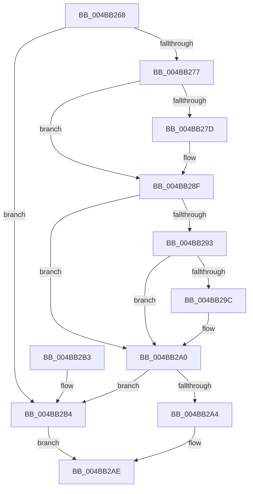

# MiTrimNoStealPagesFromWorkingSets

- RVA: `0x004BB268`–`0x004BB2B8` (길이 `80` bytes)
- VA: `0x00000001404BB268`
- 실행 섹션: `.text`
- PDB 이름 있음: `예`; PDB Function 태그: `아니요`
- unwind 정보 RVA: `0x00069B1C`
- 디코드: `24`개 명령, `80/80` bytes 표시
- 미해석 바이트: `0` (있으면 어셈블리에 `.byte`로 보존)

> 이 문서는 커널 이미지의 기계어와 PDB 기호를 분석해 생성했습니다. 4번과 5번은 함수 원형과 자료형을 바이너리 사용 방식에서 추정한 C 해석이며 원본 소스 복구 결과는 아닙니다.

## 1. Dependencies

- 직접 호출 지점: **1**; 고유 호출 대상: **1**
- 직접 호출자로 확인된 함수: **1**
- RIP 상대 이미지 참조: **1**

### Outgoing calls
- `0x004BB2A4` → [MiQueueWorkingSetRequest](../4F/MiQueueWorkingSetRequest_function_004F7168.md) (function, `0x004F7168`)

### Direct callers
- [sub_006DA40C](../6D/Unknown_function_006DA40C.md) at `0x006DA4A9`

### Static image references
- `0x004BB26C` → RVA `0x00E37614` (`.data`; read)

## 2. Other-region calls and transfers

- 다른 실행 섹션으로 향하는 call: **0**
- 별도 외부 분기/꼬리 이동을 확인하지 못했습니다.

## 3. Assembly (complete function range)

```asm
004BB268  48 83 EC 28                     sub rsp, 0x28
004BB26C  80 3D A1 C3 97 00 00            cmp byte ptr [rip + 0x97c3a1], 0
004BB273  8B C2                           mov eax, edx
004BB275  74 3D                           je 0x1404bb2b4
004BB277  33 D2                           xor edx, edx
004BB279  A8 02                           test al, 2
004BB27B  74 12                           je 0x1404bb28f
004BB27D  48 83 B9 D8 06 00 00 01         cmp qword ptr [rcx + 0x6d8], 1
004BB285  41 B8 00 01 00 00               mov r8d, 0x100
004BB28B  41 0F 4F D0                     cmovg edx, r8d
004BB28F  A8 01                           test al, 1
004BB291  74 0D                           je 0x1404bb2a0
004BB293  83 B9 DC 43 00 00 00            cmp dword ptr [rcx + 0x43dc], 0
004BB29A  74 04                           je 0x1404bb2a0
004BB29C  0F BA EA 09                     bts edx, 9
004BB2A0  85 D2                           test edx, edx
004BB2A2  74 10                           je 0x1404bb2b4
004BB2A4  E8 BF BE 03 00                  call 0x1404f7168
004BB2A9  B8 01 00 00 00                  mov eax, 1
004BB2AE  48 83 C4 28                     add rsp, 0x28
004BB2B2  C3                              ret
004BB2B3  CC                              int3
004BB2B4  33 C0                           xor eax, eax
004BB2B6  EB F6                           jmp 0x1404bb2ae
```

## 4. C-style interpretation (structured pseudocode)

```c
__int64 __fastcall MiTrimNoStealPagesFromWorkingSets(__int64 a1, int a2)
{
    __int64 result;
    __int64 v_rsp;

    v_rsp = (v_rsp) - (40);
    if ((*(unsigned __int8 *)(v_rip + 9946017)) == 0) goto loc_004BB2B4;
    a2 = 0;
    if ((((unsigned __int8)((unsigned int)(a2))) & (2)) != 0) {
        a3 = 256;
        if ((*(unsigned __int64 *)(a1 + 1752)) > 1) { a2 = (unsigned int)(a3); }
    }
    if ((((unsigned __int8)((unsigned int)(a2))) & (1)) == 0) goto loc_004BB2A0;
    if ((*(unsigned int *)(a1 + 17372)) != 0) {
    }
    if (a2 == 0) goto loc_004BB2B4;
    result = MiQueueWorkingSetRequest(a1, a2, a3, a4);
loc_004BB2AE:
    v_rsp = (v_rsp) + (40);
    return 1;
loc_004BB2B4:
    result = 0;
    goto loc_004BB2AE;
}
```

## 5. (Beta) C Style

```c
int64_t MiTrimNoStealPagesFromWorkingSets(void *Arg1, int32_t Arg2)
{
    uint8_t *arg1 = (uint8_t *)Arg1;

    int64_t result;
    int64_t local_rsp;

    local_rsp = (local_rsp) - (40);
    if ((*(uint8_t *)(v_rip + 0x97C3A1)) == 0) goto loc_004BB2B4;
    Arg2 = 0;
    if ((((uint8_t)((uint32_t)(Arg2))) & (2)) != 0) {
        a3 = 256;
        if ((*(uint64_t *)(arg1 + 0x6D8)) > 1) { Arg2 = (uint32_t)(a3); }
    }
    if ((((uint8_t)((uint32_t)(Arg2))) & (1)) == 0) goto loc_004BB2A0;
    if ((*(uint32_t *)(arg1 + 0x43DC)) != 0) {
    }
    if (Arg2 == 0) goto loc_004BB2B4;
    result = MiQueueWorkingSetRequest(Arg1, Arg2, a3, a4);
loc_004BB2AE:
    local_rsp = (local_rsp) + (40);
    return 1;
loc_004BB2B4:
    result = 0;
    goto loc_004BB2AE;
}
```

### 관측된 메모리 오프셋

구조체 형식이 확인되지 않은 접근은 인자 기준의 오프셋으로만 기록했습니다.

| 기준 인자 | 오프셋 표현 | 폭 (bit) | 접근 |
|---|---:|---:|---|
| `Arg1` | `+ 0x6D8` | `64` | `R` |
| `Arg1` | `+ 0x43DC` | `32` | `R` |

## 6. Execution-region graph

[열기: 2D/3D 그래프와 함수 탐색 컨트롤 패널](../../../control-panel.html?section=text&rva=0x004BB268&view=graph)

- 2D 그래프는 위에서 아래로 흐르고, 3D 그래프는 빈 공간을 드래그해 회전합니다. Shift+드래그는 이동, 휠은 확대·축소, 함수 노드 선택은 대상 보고서 이동입니다.

### Static fallback


