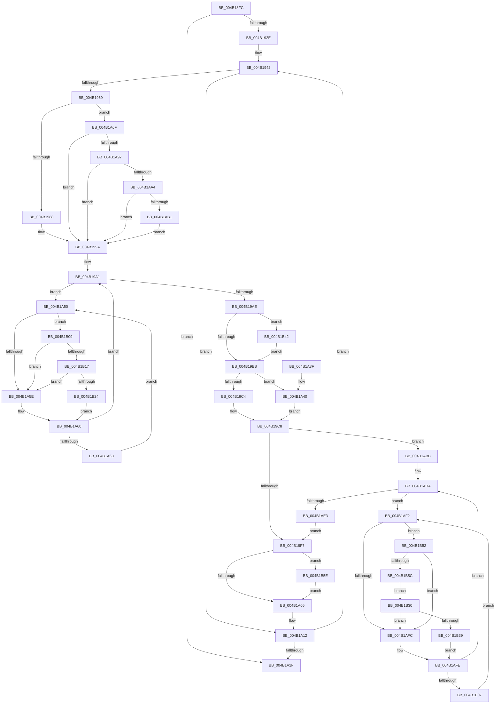

# MiTrimSystemImagePages

- RVA: `0x004B18FC`–`0x004B1B78` (길이 `636` bytes)
- VA: `0x00000001404B18FC`
- 실행 섹션: `.text`
- PDB 이름 있음: `예`; PDB Function 태그: `아니요`
- unwind 정보 RVA: `0x000B8F84`
- 디코드: `161`개 명령, `636/636` bytes 표시
- 미해석 바이트: `0` (있으면 어셈블리에 `.byte`로 보존)

> 이 문서는 커널 이미지의 기계어와 PDB 기호를 분석해 생성했습니다. 4번과 5번은 함수 원형과 자료형을 바이너리 사용 방식에서 추정한 C 해석이며 원본 소스 복구 결과는 아닙니다.

## 1. Dependencies

- 직접 호출 지점: **11**; 고유 호출 대상: **8**
- 직접 호출자로 확인된 함수: **1**
- RIP 상대 이미지 참조: **3**

### Outgoing calls
- `0x004B1992` → [MiMakeTransitionPte](../36/MiMakeTransitionPte_function_00363F70.md) (function, `0x00363F70`)
- `0x004B19E8` → [MiDecrementShareCountEx](../33/MiDecrementShareCountEx_function_00333F70.md) (function, `0x00333F70`)
- `0x004B1A43` → [MiGetContainingPageTable](../34/MiGetContainingPageTable_function_003467F0.md) (function, `0x003467F0`)
- `0x004B1A80` → [MiMakePrototypePteDirect](../29/MiMakePrototypePteDirect_function_00294DE0.md) (function, `0x00294DE0`)
- `0x004B1AE8` → [MiDecrementShareCountEx](../33/MiDecrementShareCountEx_function_00333F70.md) (function, `0x00333F70`)
- `0x004B1B17` → [KiCheckVpBackingLongSpinWaitHypercall](../30/KiCheckVpBackingLongSpinWaitHypercall_function_0030F490.md) (function, `0x0030F490`)
- `0x004B1B26` → [HvlNotifyLongSpinWait](../30/HvlNotifyLongSpinWait_function_0030F460.md) (function, `0x0030F460`)
- `0x004B1B30` → [KiCheckVpBackingLongSpinWaitHypercall](../30/KiCheckVpBackingLongSpinWaitHypercall_function_0030F490.md) (function, `0x0030F490`)
- `0x004B1B3B` → [HvlNotifyLongSpinWait](../30/HvlNotifyLongSpinWait_function_0030F460.md) (function, `0x0030F460`)
- `0x004B1B45` → [MiCaptureDirtyBitToPfn](../37/MiCaptureDirtyBitToPfn_function_00370DD0.md) (function, `0x00370DD0`)
- `0x004B1B6E` → [MiReleasePageFileInfo](../28/MiReleasePageFileInfo_function_00283FD0.md) (function, `0x00283FD0`)

### Direct callers
- [sub_006F9B92](../6F/Unknown_function_006F9B92.md) at `0x006F9B99`
- [sub_006F9B92](../6F/Unknown_function_006F9B92.md) at `0x006F9BB0`
- [sub_006F9B92](../6F/Unknown_function_006F9B92.md) at `0x006F9BC6`

### Static image references
- `0x004B1A52` → RVA `0x00FC52AC` (`ALMOSTRO`; reference)
- `0x004B1B09` → RVA `0x00FC6AB8` (`ALMOSTRO`; read)
- `0x004B1B64` → RVA `0x00E38D00` (`.data`; read)

## 2. Other-region calls and transfers

- 다른 실행 섹션으로 향하는 call: **0**
- 별도 외부 분기/꼬리 이동을 확인하지 못했습니다.

## 3. Assembly (complete function range)

```asm
004B18FC  48 8B C4                        mov rax, rsp
004B18FF  48 89 58 08                     mov qword ptr [rax + 8], rbx
004B1903  48 89 68 10                     mov qword ptr [rax + 0x10], rbp
004B1907  48 89 70 20                     mov qword ptr [rax + 0x20], rsi
004B190B  44 89 40 18                     mov dword ptr [rax + 0x18], r8d
004B190F  57                              push rdi
004B1910  41 54                           push r12
004B1912  41 55                           push r13
004B1914  41 56                           push r14
004B1916  41 57                           push r15
004B1918  48 83 EC 20                     sub rsp, 0x20
004B191C  45 33 FF                        xor r15d, r15d
004B191F  4C 8B E2                        mov r12, rdx
004B1922  4C 8B F1                        mov r14, rcx
004B1925  48 3B CA                        cmp rcx, rdx
004B1928  0F 87 F1 00 00 00               ja 0x1404b1a1f
004B192E  48 BA 00 00 00 00 00 DE FF FF   movabs rdx, 0xffffde0000000000
004B1938  49 BD FF FF FF FF FF FF FF 7F   movabs r13, 0x7fffffffffffffff
004B1942  49 8B 1E                        mov rbx, qword ptr [r14]
004B1945  48 8B C3                        mov rax, rbx
004B1948  25 01 04 00 00                  and eax, 0x401
004B194D  48 3D 00 04 00 00               cmp rax, 0x400
004B1953  0F 85 B9 00 00 00               jne 0x1404b1a12
004B1959  48 8B CB                        mov rcx, rbx
004B195C  48 B8 FF FF FF FF FF 00 00 00   movabs rax, 0xffffffffff
004B1966  48 C1 E9 0C                     shr rcx, 0xc
004B196A  48 23 C8                        and rcx, rax
004B196D  48 8D 34 49                     lea rsi, [rcx + rcx*2]
004B1971  48 C1 E6 04                     shl rsi, 4
004B1975  48 8B C2                        mov rax, rdx
004B1978  48 03 F0                        add rsi, rax
004B197B  48 8B 46 28                     mov rax, qword ptr [rsi + 0x28]
004B197F  48 85 C0                        test rax, rax
004B1982  0F 88 E7 00 00 00               js 0x1404b1a6f
004B1988  8B 56 10                        mov edx, dword ptr [rsi + 0x10]
004B198B  48 C1 EA 05                     shr rdx, 5
004B198F  83 E2 1F                        and edx, 0x1f
004B1992  E8 D9 25 EB FF                  call 0x140363f70
004B1997  4C 8B C0                        mov r8, rax
004B199A  33 FF                           xor edi, edi
004B199C  4D 89 06                        mov qword ptr [r14], r8
004B199F  33 ED                           xor ebp, ebp
004B19A1  F0 48 0F BA 6E 18 3F            lock bts qword ptr [rsi + 0x18], 0x3f
004B19A8  0F 82 A2 00 00 00               jb 0x1404b1a50
004B19AE  80 66 23 F7                     and byte ptr [rsi + 0x23], 0xf7
004B19B2  F6 C3 42                        test bl, 0x42
004B19B5  0F 85 87 01 00 00               jne 0x1404b1b42
004B19BB  48 8B 46 28                     mov rax, qword ptr [rsi + 0x28]
004B19BF  48 85 C0                        test rax, rax
004B19C2  78 7C                           js 0x1404b1a40
004B19C4  48 83 CB FF                     or rbx, 0xffffffffffffffff
004B19C8  8B 4E 20                        mov ecx, dword ptr [rsi + 0x20]
004B19CB  33 D2                           xor edx, edx
004B19CD  89 4C 24 60                     mov dword ptr [rsp + 0x60], ecx
004B19D1  C1 E9 18                        shr ecx, 0x18
004B19D4  80 E1 FA                        and cl, 0xfa
004B19D7  80 C9 02                        or cl, 2
004B19DA  88 4C 24 63                     mov byte ptr [rsp + 0x63], cl
004B19DE  8B 4C 24 60                     mov ecx, dword ptr [rsp + 0x60]
004B19E2  89 4E 20                        mov dword ptr [rsi + 0x20], ecx
004B19E5  48 8B CE                        mov rcx, rsi
004B19E8  E8 83 25 E8 FF                  call 0x140333f70
004B19ED  48 83 FB FF                     cmp rbx, -1
004B19F1  0F 85 C4 00 00 00               jne 0x1404b1abb
004B19F7  F0 4C 21 6E 18                  lock and qword ptr [rsi + 0x18], r13
004B19FC  48 85 FF                        test rdi, rdi
004B19FF  0F 85 59 01 00 00               jne 0x1404b1b5e
004B1A05  49 FF C7                        inc r15
004B1A08  48 BA 00 00 00 00 00 DE FF FF   movabs rdx, 0xffffde0000000000
004B1A12  49 83 C6 08                     add r14, 8
004B1A16  4D 3B F4                        cmp r14, r12
004B1A19  0F 86 23 FF FF FF               jbe 0x1404b1942
004B1A1F  48 8B 5C 24 50                  mov rbx, qword ptr [rsp + 0x50]
004B1A24  49 8B C7                        mov rax, r15
004B1A27  48 8B 6C 24 58                  mov rbp, qword ptr [rsp + 0x58]
004B1A2C  48 8B 74 24 68                  mov rsi, qword ptr [rsp + 0x68]
004B1A31  48 83 C4 20                     add rsp, 0x20
004B1A35  41 5F                           pop r15
004B1A37  41 5E                           pop r14
004B1A39  41 5D                           pop r13
004B1A3B  41 5C                           pop r12
004B1A3D  5F                              pop rdi
004B1A3E  C3                              ret
004B1A3F  CC                              int3
004B1A40  49 8B CE                        mov rcx, r14
004B1A43  E8 A8 4D E9 FF                  call 0x1403467f0
004B1A48  48 8B D8                        mov rbx, rax
004B1A4B  E9 78 FF FF FF                  jmp 0x1404b19c8
004B1A50  FF C5                           inc ebp
004B1A52  85 2D 54 38 B1 00               test dword ptr [rip + 0xb13854], ebp
004B1A58  0F 84 AB 00 00 00               je 0x1404b1b09
004B1A5E  F3 90                           pause
004B1A60  48 8B 46 18                     mov rax, qword ptr [rsi + 0x18]
004B1A64  48 85 C0                        test rax, rax
004B1A67  0F 89 34 FF FF FF               jns 0x1404b19a1
004B1A6D  EB E1                           jmp 0x1404b1a50
004B1A6F  48 8B 4E 08                     mov rcx, qword ptr [rsi + 8]
004B1A73  48 B8 00 00 00 00 00 00 00 80   movabs rax, 0x8000000000000000
004B1A7D  48 0B C8                        or rcx, rax
004B1A80  E8 5B 33 DE FF                  call 0x140294de0
004B1A85  4C 8B C0                        mov r8, rax
004B1A88  48 8B 46 28                     mov rax, qword ptr [rsi + 0x28]
004B1A8C  48 0F BA E0 28                  bt rax, 0x28
004B1A91  0F 82 03 FF FF FF               jb 0x1404b199a
004B1A97  48 8B 46 08                     mov rax, qword ptr [rsi + 8]
004B1A9B  48 85 C0                        test rax, rax
004B1A9E  0F 88 F6 FE FF FF               js 0x1404b199a
004B1AA4  48 8B 46 08                     mov rax, qword ptr [rsi + 8]
004B1AA8  48 85 C0                        test rax, rax
004B1AAB  0F 84 E9 FE FF FF               je 0x1404b199a
004B1AB1  49 0F BA E8 0B                  bts r8, 0xb
004B1AB6  E9 DF FE FF FF                  jmp 0x1404b199a
004B1ABB  F0 4C 21 6E 18                  lock and qword ptr [rsi + 0x18], r13
004B1AC0  48 8D 34 5B                     lea rsi, [rbx + rbx*2]
004B1AC4  48 B8 00 00 00 00 00 DE FF FF   movabs rax, 0xffffde0000000000
004B1ACE  48 C1 E6 04                     shl rsi, 4
004B1AD2  48 8B C0                        mov rax, rax
004B1AD5  48 03 F0                        add rsi, rax
004B1AD8  33 DB                           xor ebx, ebx
004B1ADA  F0 48 0F BA 6E 18 3F            lock bts qword ptr [rsi + 0x18], 0x3f
004B1AE1  72 0F                           jb 0x1404b1af2
004B1AE3  33 D2                           xor edx, edx
004B1AE5  48 8B CE                        mov rcx, rsi
004B1AE8  E8 83 24 E8 FF                  call 0x140333f70
004B1AED  E9 05 FF FF FF                  jmp 0x1404b19f7
004B1AF2  FF C3                           inc ebx
004B1AF4  85 1D B2 37 B1 00               test dword ptr [rip + 0xb137b2], ebx
004B1AFA  74 56                           je 0x1404b1b52
004B1AFC  F3 90                           pause
004B1AFE  48 8B 46 18                     mov rax, qword ptr [rsi + 0x18]
004B1B02  48 85 C0                        test rax, rax
004B1B05  79 D3                           jns 0x1404b1ada
004B1B07  EB E9                           jmp 0x1404b1af2
004B1B09  8B 05 A9 4F B1 00               mov eax, dword ptr [rip + 0xb14fa9]
004B1B0F  A8 40                           test al, 0x40
004B1B11  0F 84 47 FF FF FF               je 0x1404b1a5e
004B1B17  E8 74 D9 E5 FF                  call 0x14030f490
004B1B1C  84 C0                           test al, al
004B1B1E  0F 84 3A FF FF FF               je 0x1404b1a5e
004B1B24  8B CD                           mov ecx, ebp
004B1B26  E8 35 D9 E5 FF                  call 0x14030f460
004B1B2B  E9 30 FF FF FF                  jmp 0x1404b1a60
004B1B30  E8 5B D9 E5 FF                  call 0x14030f490
004B1B35  84 C0                           test al, al
004B1B37  74 C3                           je 0x1404b1afc
004B1B39  8B CB                           mov ecx, ebx
004B1B3B  E8 20 D9 E5 FF                  call 0x14030f460
004B1B40  EB BC                           jmp 0x1404b1afe
004B1B42  48 8B CE                        mov rcx, rsi
004B1B45  E8 86 F2 EB FF                  call 0x140370dd0
004B1B4A  48 8B F8                        mov rdi, rax
004B1B4D  E9 69 FE FF FF                  jmp 0x1404b19bb
004B1B52  8B 05 60 4F B1 00               mov eax, dword ptr [rip + 0xb14f60]
004B1B58  A8 40                           test al, 0x40
004B1B5A  74 A0                           je 0x1404b1afc
004B1B5C  EB D2                           jmp 0x1404b1b30
004B1B5E  41 B8 01 00 00 00               mov r8d, 1
004B1B64  48 8D 0D 95 71 98 00            lea rcx, [rip + 0x987195]
004B1B6B  48 8B D7                        mov rdx, rdi
004B1B6E  E8 5D 24 DD FF                  call 0x140283fd0
004B1B73  E9 8D FE FF FF                  jmp 0x1404b1a05
```

## 4. C-style interpretation (structured pseudocode)

```c
__int64 __fastcall MiTrimSystemImagePages(__int64 a1, __int64 a2, int a3)
{
    __int64 result;
    __int64 v_r14;
    __int64 v_r15;
    __int64 v_rbp;
    __int64 v_rbx;
    __int64 v_rdi;
    __int64 v_rsi;
    __int64 v_rsp;
    unsigned __int64 v_stack_p10;
    unsigned int v_stack_p18;
    unsigned __int8 v_stack_p1B;
    unsigned __int64 v_stack_p20;
    unsigned __int64 v_stack_p8;

    *(unsigned __int64 *)(v_rsp + 8) = v_rbx;
    *(unsigned __int64 *)(v_rsp + 16) = v_rbp;
    *(unsigned __int64 *)(v_rsp + 32) = v_rsi;
    *(unsigned int *)(v_rsp + 24) = a3;
    v_rsp = (v_rsp) - (32);
    v_r15 = 0;
    if (a1 > a2) goto loc_004B1A1F;
loc_004B1942:
    result = (unsigned int)((*(unsigned __int64 *)(a1)) & (0x401ULL));
    if (result != 0x400ULL) goto loc_004B1A12;
    a1 = (*(unsigned __int64 *)(a1)) >> (12);
    a1 = (a1) & (result);
    v_rsi = (a1 + a1 * 2) << (4);
    v_rsi = (v_rsi) + (a2);
    if (sign_flag) goto loc_004B1A6F;
    a2 = ((unsigned int)(*(unsigned int *)(v_rsi + 16))) >> (5);
    a2 = (unsigned int)((a2) & (31));
    result = MiMakeTransitionPte(a1, a2, a3, a4);
loc_004B199A:
    v_rdi = 0;
    *(unsigned __int64 *)(a1) = result;
    v_rbp = 0;
loc_004B19A1:
    if (condition_is_below) goto loc_004B1A50;
    if ((((unsigned __int8)(*(unsigned __int64 *)(a1))) & (66)) != 0) goto loc_004B1B42;
loc_004B19BB:
    if (sign_flag) goto loc_004B1A40;
    v_rbx = (*(unsigned __int64 *)(a1)) | (-1);
loc_004B19C8:
    a2 = 0;
    v_stack_p18 = (unsigned int)((unsigned int)(*(unsigned int *)(v_rsi + 32)));
    a1 = (unsigned int)(((unsigned int)(*(unsigned int *)(v_rsi + 32))) >> (24));
    a1 = (unsigned __int8)((a1) & (250));
    a1 = (unsigned __int8)((a1) | (2));
    v_stack_p1B = (unsigned __int8)(a1);
    *(unsigned int *)(v_rsi + 32) = (unsigned int)((unsigned int)(v_stack_p18));
    result = MiDecrementShareCountEx(v_rsi, a2, result, a4);
    if (v_rbx != -1) goto loc_004B1ABB;
loc_004B19F7:
    if (0 != 0) goto loc_004B1B5E;
loc_004B1A05:
    v_r15 = (v_r15) + 1;
loc_004B1A12:
    v_r14 = (a1) + (8);
    if (v_r14 <= 0) goto loc_004B1942;
loc_004B1A1F:
    v_rsp = (v_rsp) + (32);
    return v_r15;
loc_004B1A40:
    result = MiGetContainingPageTable(v_r14, a2, result, a4);
    goto loc_004B19C8;
loc_004B1A50:
    v_rbp = (unsigned int)((v_stack_p10) + 1);
    if (((*(unsigned int *)(v_rip + 11614292)) & ((unsigned int)(v_rbp))) == 0) goto loc_004B1B09;
loc_004B1A5E:
loc_004B1A60:
    if (!sign_flag) goto loc_004B19A1;
    goto loc_004B1A50;
loc_004B1A6F:
    a1 = (*(unsigned __int64 *)(v_stack_p20 + 8)) | (*(unsigned __int64 *)(v_stack_p20 + 24));
    result = MiMakePrototypePteDirect(a1, a2, result, a4);
    if (condition_is_below) goto loc_004B199A;
    if (sign_flag) goto loc_004B199A;
    if (*(unsigned __int64 *)(v_stack_p20 + 8) == 0) goto loc_004B199A;
    goto loc_004B199A;
loc_004B1ABB:
    v_rsi = (result + result * 2) << (4);
    v_rsi = (v_rsi) + (*(unsigned __int64 *)(v_stack_p20 + 8));
    v_rbx = 0;
loc_004B1ADA:
    if (condition_is_below) goto loc_004B1AF2;
    a2 = 0;
    result = MiDecrementShareCountEx(v_rsi, a2, result, a4);
    goto loc_004B19F7;
loc_004B1AF2:
    v_rbx = (unsigned int)((v_rbx) + 1);
    if (((*(unsigned int *)(v_rip + 11614130)) & ((unsigned int)(v_rbx))) == 0) goto loc_004B1B52;
loc_004B1AFC:
loc_004B1AFE:
    if (!sign_flag) goto loc_004B1ADA;
    goto loc_004B1AF2;
loc_004B1B09:
    if ((((unsigned __int8)((unsigned int)(*(unsigned int *)(v_rip + 11620265)))) & (64)) == 0) goto loc_004B1A5E;
    result = KiCheckVpBackingLongSpinWaitHypercall(v_rsi, a2, result, a4);
    if ((unsigned __int8)(result) == 0) goto loc_004B1A5E;
    result = HvlNotifyLongSpinWait((unsigned int)((unsigned int)(v_rbp)), a2, result, a4);
    goto loc_004B1A60;
loc_004B1B30:
    result = KiCheckVpBackingLongSpinWaitHypercall((unsigned int)((unsigned int)(v_rbp)), a2, result, a4);
    if ((unsigned __int8)(result) == 0) goto loc_004B1AFC;
    result = HvlNotifyLongSpinWait((unsigned int)((unsigned int)(v_rbx)), a2, result, a4);
    goto loc_004B1AFE;
loc_004B1B42:
    result = MiCaptureDirtyBitToPfn(v_rsi, a2, result, a4);
    goto loc_004B19BB;
loc_004B1B52:
    if ((((unsigned __int8)((unsigned int)(*(unsigned int *)(v_rip + 11620192)))) & (64)) == 0) goto loc_004B1AFC;
    goto loc_004B1B30;
loc_004B1B5E:
    result = MiReleasePageFileInfo(v_rip + 9990549, result, 1, a4);
    goto loc_004B1A05;
}
```

## 5. (Beta) C Style

```c
int64_t MiTrimSystemImagePages(int64_t Arg1, int64_t Arg2, int32_t Arg3)
{
    int64_t result;
    int64_t local_r14;
    int64_t local_r15;
    int64_t local_rbp;
    int64_t local_rbx;
    int64_t local_rdi;
    int64_t local_rsi;
    int64_t local_rsp;
    uint64_t v_stack_p10;
    uint32_t v_stack_p18;
    uint8_t v_stack_p1B;
    uint64_t v_stack_p20;
    uint64_t v_stack_p8;

    *(uint64_t *)(local_rsp + 0x8) = local_rbx;
    *(uint64_t *)(local_rsp + 0x10) = local_rbp;
    *(uint64_t *)(local_rsp + 0x20) = local_rsi;
    *(uint32_t *)(local_rsp + 0x18) = Arg3;
    local_rsp = (local_rsp) - (32);
    local_r15 = 0;
    if (Arg1 > Arg2) goto loc_004B1A1F;
loc_004B1942:
    result = (uint32_t)((*(uint64_t *)(Arg1)) & (0x401ULL));
    if (result != 0x400ULL) goto loc_004B1A12;
    Arg1 = (*(uint64_t *)(Arg1)) >> (12);
    Arg1 = (Arg1) & (result);
    local_rsi = (Arg1 + Arg1 * 2) << (4);
    local_rsi = (local_rsi) + (Arg2);
    if (sign_flag) goto loc_004B1A6F;
    Arg2 = ((uint32_t)(*(uint32_t *)(local_rsi + 0x10))) >> (5);
    Arg2 = (uint32_t)((Arg2) & (31));
    result = MiMakeTransitionPte(Arg1, Arg2, Arg3, a4);
loc_004B199A:
    local_rdi = 0;
    *(uint64_t *)(Arg1) = result;
    local_rbp = 0;
loc_004B19A1:
    if (condition_is_below) goto loc_004B1A50;
    if ((((uint8_t)(*(uint64_t *)(Arg1))) & (66)) != 0) goto loc_004B1B42;
loc_004B19BB:
    if (sign_flag) goto loc_004B1A40;
    local_rbx = (*(uint64_t *)(Arg1)) | (-1);
loc_004B19C8:
    Arg2 = 0;
    v_stack_p18 = (uint32_t)((uint32_t)(*(uint32_t *)(local_rsi + 0x20)));
    Arg1 = (uint32_t)(((uint32_t)(*(uint32_t *)(local_rsi + 0x20))) >> (24));
    Arg1 = (uint8_t)((Arg1) & (250));
    Arg1 = (uint8_t)((Arg1) | (2));
    v_stack_p1B = (uint8_t)(Arg1);
    *(uint32_t *)(local_rsi + 0x20) = (uint32_t)((uint32_t)(v_stack_p18));
    result = MiDecrementShareCountEx(local_rsi, Arg2, result, a4);
    if (local_rbx != -1) goto loc_004B1ABB;
loc_004B19F7:
    if (0 != 0) goto loc_004B1B5E;
loc_004B1A05:
    local_r15 = (local_r15) + 1;
loc_004B1A12:
    local_r14 = (Arg1) + (8);
    if (local_r14 <= 0) goto loc_004B1942;
loc_004B1A1F:
    local_rsp = (local_rsp) + (32);
    return local_r15;
loc_004B1A40:
    result = MiGetContainingPageTable(local_r14, Arg2, result, a4);
    goto loc_004B19C8;
loc_004B1A50:
    local_rbp = (uint32_t)((v_stack_p10) + 1);
    if (((*(uint32_t *)(v_rip + 0xB13854)) & ((uint32_t)(local_rbp))) == 0) goto loc_004B1B09;
loc_004B1A5E:
loc_004B1A60:
    if (!sign_flag) goto loc_004B19A1;
    goto loc_004B1A50;
loc_004B1A6F:
    Arg1 = (*(uint64_t *)(v_stack_p20 + 0x8)) | (*(uint64_t *)(v_stack_p20 + 0x18));
    result = MiMakePrototypePteDirect(Arg1, Arg2, result, a4);
    if (condition_is_below) goto loc_004B199A;
    if (sign_flag) goto loc_004B199A;
    if (*(uint64_t *)(v_stack_p20 + 0x8) == 0) goto loc_004B199A;
    goto loc_004B199A;
loc_004B1ABB:
    local_rsi = (result + result * 2) << (4);
    local_rsi = (local_rsi) + (*(uint64_t *)(v_stack_p20 + 0x8));
    local_rbx = 0;
loc_004B1ADA:
    if (condition_is_below) goto loc_004B1AF2;
    Arg2 = 0;
    result = MiDecrementShareCountEx(local_rsi, Arg2, result, a4);
    goto loc_004B19F7;
loc_004B1AF2:
    local_rbx = (uint32_t)((local_rbx) + 1);
    if (((*(uint32_t *)(v_rip + 0xB137B2)) & ((uint32_t)(local_rbx))) == 0) goto loc_004B1B52;
loc_004B1AFC:
loc_004B1AFE:
    if (!sign_flag) goto loc_004B1ADA;
    goto loc_004B1AF2;
loc_004B1B09:
    if ((((uint8_t)((uint32_t)(*(uint32_t *)(v_rip + 0xB14FA9)))) & (64)) == 0) goto loc_004B1A5E;
    result = KiCheckVpBackingLongSpinWaitHypercall(local_rsi, Arg2, result, a4);
    if ((uint8_t)(result) == 0) goto loc_004B1A5E;
    result = HvlNotifyLongSpinWait((uint32_t)((uint32_t)(local_rbp)), Arg2, result, a4);
    goto loc_004B1A60;
loc_004B1B30:
    result = KiCheckVpBackingLongSpinWaitHypercall((uint32_t)((uint32_t)(local_rbp)), Arg2, result, a4);
    if ((uint8_t)(result) == 0) goto loc_004B1AFC;
    result = HvlNotifyLongSpinWait((uint32_t)((uint32_t)(local_rbx)), Arg2, result, a4);
    goto loc_004B1AFE;
loc_004B1B42:
    result = MiCaptureDirtyBitToPfn(local_rsi, Arg2, result, a4);
    goto loc_004B19BB;
loc_004B1B52:
    if ((((uint8_t)((uint32_t)(*(uint32_t *)(v_rip + 0xB14F60)))) & (64)) == 0) goto loc_004B1AFC;
    goto loc_004B1B30;
loc_004B1B5E:
    result = MiReleasePageFileInfo(v_rip + 9990549, result, 1, a4);
    goto loc_004B1A05;
}
```

## 6. Execution-region graph

[열기: 2D/3D 그래프와 함수 탐색 컨트롤 패널](../../../control-panel.html?section=text&rva=0x004B18FC&view=graph)

- 2D 그래프는 위에서 아래로 흐르고, 3D 그래프는 빈 공간을 드래그해 회전합니다. Shift+드래그는 이동, 휠은 확대·축소, 함수 노드 선택은 대상 보고서 이동입니다.

### Static fallback


