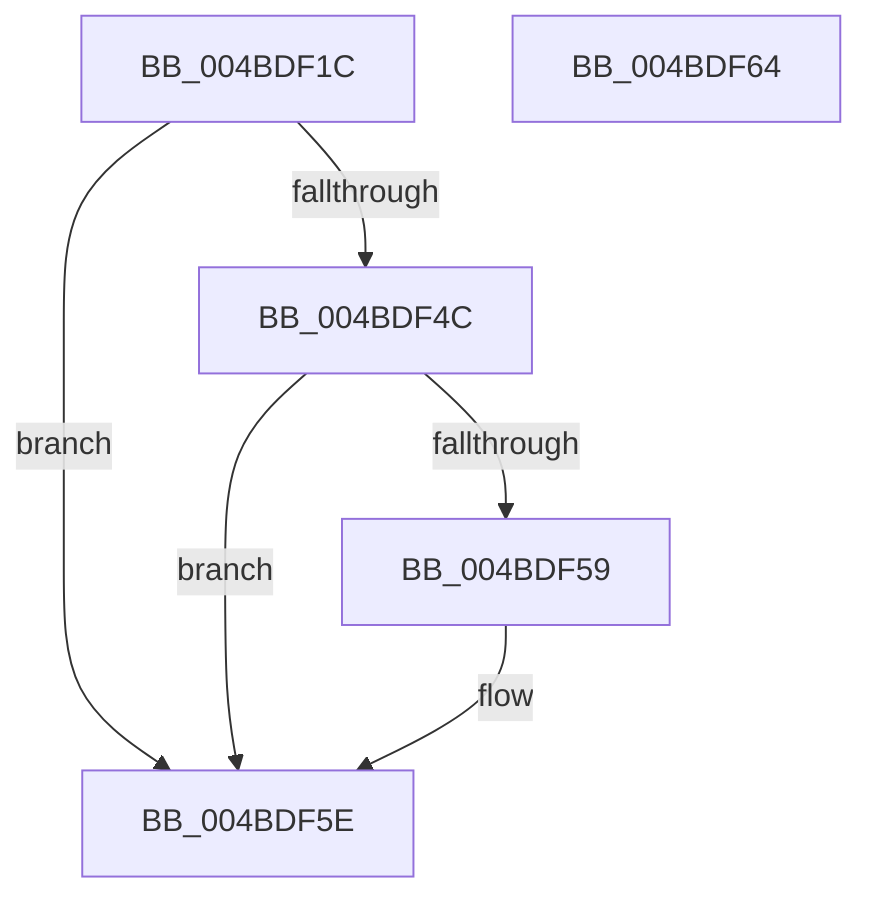

# MiUnlockAweVadsExclusive

- RVA: `0x004BDF1C`–`0x004BDF65` (길이 `73` bytes)
- VA: `0x00000001404BDF1C`
- 실행 섹션: `.text`
- PDB 이름 있음: `예`; PDB Function 태그: `아니요`
- unwind 정보 RVA: `0x0005CF00`
- 디코드: `20`개 명령, `73/73` bytes 표시
- 미해석 바이트: `0` (있으면 어셈블리에 `.byte`로 보존)

> 이 문서는 커널 이미지의 기계어와 PDB 기호를 분석해 생성했습니다. 4번과 5번은 함수 원형과 자료형을 바이너리 사용 방식에서 추정한 C 해석이며 원본 소스 복구 결과는 아닙니다.

## 1. Dependencies

- 직접 호출 지점: **2**; 고유 호출 대상: **2**
- 직접 호출자로 확인된 함수: **4**
- RIP 상대 이미지 참조: **0**

### Outgoing calls
- `0x004BDF3C` → [ExReleaseAutoExpandPushLockExclusive](../26/ExReleaseAutoExpandPushLockExclusive_function_00264DE0.md) (function, `0x00264DE0`)
- `0x004BDF59` → [KiCheckForKernelApcDelivery](../2E/KiCheckForKernelApcDelivery_function_002E2C80.md) (function, `0x002E2C80`)

### Direct callers
- [MiCloneVads](../22/MiCloneVads_function_0022DC1C.md) at `0x0022DD9D`
- [MiCloneVads](../22/MiCloneVads_function_0022DC1C.md) at `0x0022E1AA`
- [MiCloneVads](../22/MiCloneVads_function_0022DC1C.md) at `0x0022E22A`
- [MiRemoveUserPhysicalPagesView](../68/MiRemoveUserPhysicalPagesView_function_00689658.md) at `0x00689726`
- [MmSetGraphicsPtes](../../page/7F/MmSetGraphicsPtes_function_007FC8B0.md) at `0x007FCAA7`
- [MiCreateProcessDefaultAweInfo](../../page/80/MiCreateProcessDefaultAweInfo_function_0080A8C0.md) at `0x0080A950`

### Static image references
- 디코드된 RIP-relative 메모리 참조가 없습니다.

## 2. Other-region calls and transfers

- 다른 실행 섹션으로 향하는 call: **0**
- 별도 외부 분기/꼬리 이동을 확인하지 못했습니다.

## 3. Assembly (complete function range)

```asm
004BDF1C  40 53                           push rbx
004BDF1E  48 83 EC 20                     sub rsp, 0x20
004BDF22  48 8B 81 B8 00 00 00            mov rax, qword ptr [rcx + 0xb8]
004BDF29  48 8B D9                        mov rbx, rcx
004BDF2C  33 D2                           xor edx, edx
004BDF2E  48 8B 88 10 04 00 00            mov rcx, qword ptr [rax + 0x410]
004BDF35  48 81 C1 58 04 00 00            add rcx, 0x458
004BDF3C  E8 9F 6E DA FF                  call 0x140264de0
004BDF41  90                              nop
004BDF42  66 83 83 E6 01 00 00 01         add word ptr [rbx + 0x1e6], 1
004BDF4A  75 12                           jne 0x1404bdf5e
004BDF4C  48 8D 83 98 00 00 00            lea rax, [rbx + 0x98]
004BDF53  90                              nop
004BDF54  48 39 00                        cmp qword ptr [rax], rax
004BDF57  74 05                           je 0x1404bdf5e
004BDF59  E8 22 4D E2 FF                  call 0x1402e2c80
004BDF5E  48 83 C4 20                     add rsp, 0x20
004BDF62  5B                              pop rbx
004BDF63  C3                              ret
004BDF64  CC                              int3
```

## 4. C-style interpretation (structured pseudocode)

```c
__int64 __fastcall MiUnlockAweVadsExclusive(__int64 a1, int a2)
{
    __int64 result;
    __int64 v_rsp;

    v_rsp = (v_rsp) - (32);
    a2 = 0;
    a1 = (*(unsigned __int64 *)(*(unsigned __int64 *)(a1 + 184) + 1040)) + (0x458ULL);
    result = ExReleaseAutoExpandPushLockExclusive(a1, a2, a3, a4);
    if (condition_is_not_equal) goto loc_004BDF5E;
    result = a1 + 152;
    if ((*(unsigned __int64 *)(a1 + 152)) != (a1 + 152)) {
        result = KiCheckForKernelApcDelivery(a1, a2, a3, a4);
    }
    v_rsp = (v_rsp) + (32);
    return result;
}
```

## 5. (Beta) C Style

```c
int64_t MiUnlockAweVadsExclusive(void *Arg1, int32_t Arg2)
{
    uint8_t *arg1 = (uint8_t *)Arg1;

    int64_t result;
    int64_t local_rsp;

    local_rsp = (local_rsp) - (32);
    Arg2 = 0;
    Arg1 = (*(uint64_t *)(*(uint64_t *)(arg1 + 0xB8) + 0x410)) + (0x458ULL);
    result = ExReleaseAutoExpandPushLockExclusive(Arg1, Arg2, a3, a4);
    if (condition_is_not_equal) goto loc_004BDF5E;
    result = Arg1 + 152;
    if ((*(uint64_t *)(arg1 + 0x98)) != (Arg1 + 152)) {
        result = KiCheckForKernelApcDelivery(Arg1, Arg2, a3, a4);
    }
    local_rsp = (local_rsp) + (32);
    return result;
}
```

### 관측된 메모리 오프셋

구조체 형식이 확인되지 않은 접근은 인자 기준의 오프셋으로만 기록했습니다.

| 기준 인자 | 오프셋 표현 | 폭 (bit) | 접근 |
|---|---:|---:|---|
| `Arg1` | `+ 0x0` | `64` | `R` |
| `Arg1` | `+ 0x98` | `64` | `R` |
| `Arg1` | `+ 0xB8` | `64` | `R` |
| `Arg1` | `+ 0x1E6` | `16` | `R/W` |

## 6. Execution-region graph

[열기: 2D/3D 그래프와 함수 탐색 컨트롤 패널](../../../control-panel.html?section=text&rva=0x004BDF1C&view=graph)

- 2D 그래프는 위에서 아래로 흐르고, 3D 그래프는 빈 공간을 드래그해 회전합니다. Shift+드래그는 이동, 휠은 확대·축소, 함수 노드 선택은 대상 보고서 이동입니다.

### Static fallback


