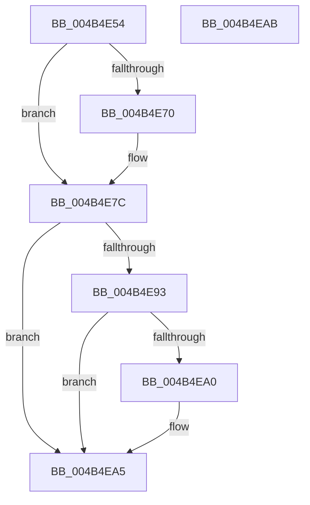

# MiUnlockDriverMappings

- RVA: `0x004B4E54`–`0x004B4EAC` (길이 `88` bytes)
- VA: `0x00000001404B4E54`
- 실행 섹션: `.text`
- PDB 이름 있음: `예`; PDB Function 태그: `아니요`
- unwind 정보 RVA: `0x0005CF00`
- 디코드: `24`개 명령, `88/88` bytes 표시
- 미해석 바이트: `0` (있으면 어셈블리에 `.byte`로 보존)

> 이 문서는 커널 이미지의 기계어와 PDB 기호를 분석해 생성했습니다. 4번과 5번은 함수 원형과 자료형을 바이너리 사용 방식에서 추정한 C 해석이며 원본 소스 복구 결과는 아닙니다.

## 1. Dependencies

- 직접 호출 지점: **3**; 고유 호출 대상: **3**
- 직접 호출자로 확인된 함수: **3**
- RIP 상대 이미지 참조: **2**

### Outgoing calls
- `0x004B4E77` → [ExfTryToWakePushLock](../26/ExfTryToWakePushLock_function_00265DD0.md) (function, `0x00265DD0`)
- `0x004B4E83` → [KeAbPostRelease](../2E/KeAbPostRelease_function_002E1600.md) (function, `0x002E1600`)
- `0x004B4EA0` → [KiCheckForKernelApcDelivery](../2E/KiCheckForKernelApcDelivery_function_002E2C80.md) (function, `0x002E2C80`)

### Direct callers
- [MiReserveDriverPtes](../../page/A7/MiReserveDriverPtes_function_00A75150.md) at `0x00A75248`
- [MiReserveDriverPtes](../../page/A7/MiReserveDriverPtes_function_00A75150.md) at `0x00A7536E`
- [MiReleaseDriverPtes](../../page/A7/MiReleaseDriverPtes_function_00A7F1B4.md) at `0x00A7F312`
- [sub_00B42BDE](../../page/B4/Unknown_function_00B42BDE.md) at `0x00B42BE4`

### Static image references
- `0x004B4E61` → RVA `0x00E2D958` (`.data`; read/write)
- `0x004B4E70` → RVA `0x00E2D958` (`.data`; read)

## 2. Other-region calls and transfers

- 다른 실행 섹션으로 향하는 call: **0**
- 별도 외부 분기/꼬리 이동을 확인하지 못했습니다.

## 3. Assembly (complete function range)

```asm
004B4E54  40 53                           push rbx
004B4E56  48 83 EC 20                     sub rsp, 0x20
004B4E5A  48 8B D9                        mov rbx, rcx
004B4E5D  48 83 C8 FF                     or rax, 0xffffffffffffffff
004B4E61  F0 48 0F C1 05 EE 8A 97 00      lock xadd qword ptr [rip + 0x978aee], rax
004B4E6A  24 06                           and al, 6
004B4E6C  3C 02                           cmp al, 2
004B4E6E  75 0C                           jne 0x1404b4e7c
004B4E70  48 8D 0D E1 8A 97 00            lea rcx, [rip + 0x978ae1]
004B4E77  E8 54 0F DB FF                  call 0x140265dd0
004B4E7C  48 8D 0D D5 8A 97 00            lea rcx, [rip + 0x978ad5]
004B4E83  E8 78 C7 E2 FF                  call 0x1402e1600
004B4E88  90                              nop
004B4E89  66 83 83 E6 01 00 00 01         add word ptr [rbx + 0x1e6], 1
004B4E91  75 12                           jne 0x1404b4ea5
004B4E93  48 8D 83 98 00 00 00            lea rax, [rbx + 0x98]
004B4E9A  90                              nop
004B4E9B  48 39 00                        cmp qword ptr [rax], rax
004B4E9E  74 05                           je 0x1404b4ea5
004B4EA0  E8 DB DD E2 FF                  call 0x1402e2c80
004B4EA5  48 83 C4 20                     add rsp, 0x20
004B4EA9  5B                              pop rbx
004B4EAA  C3                              ret
004B4EAB  CC                              int3
```

## 4. C-style interpretation (structured pseudocode)

```c
__int64 __fastcall MiUnlockDriverMappings(__int64 a1)
{
    __int64 result;
    __int64 v_rsp;

    v_rsp = (v_rsp) - (32);
    result = (result) | (-1);
    result = (unsigned __int8)((result) & (6));
    if (((unsigned __int8)(result)) == 2) {
        a1 = v_rip + 9931489;
        result = ExfTryToWakePushLock(a1, a2, a3, a4);
    }
    result = KeAbPostRelease(v_rip + 9931477, a2, a3, a4);
    if (((unsigned __int8)(result)) != 2) goto loc_004B4EA5;
    result = a1 + 152;
    if ((*(unsigned __int64 *)(a1 + 152)) != (a1 + 152)) {
        result = KiCheckForKernelApcDelivery(v_rip + 9931477, a2, a3, a4);
    }
    v_rsp = (v_rsp) + (32);
    return result;
}
```

## 5. (Beta) C Style

```c
int64_t MiUnlockDriverMappings(void *Arg1)
{
    uint8_t *arg1 = (uint8_t *)Arg1;

    int64_t result;
    int64_t local_rsp;

    local_rsp = (local_rsp) - (32);
    result = (result) | (-1);
    result = (uint8_t)((result) & (6));
    if (((uint8_t)(result)) == 2) {
        Arg1 = v_rip + 9931489;
        result = ExfTryToWakePushLock(Arg1, a2, a3, a4);
    }
    result = KeAbPostRelease(v_rip + 9931477, a2, a3, a4);
    if (((uint8_t)(result)) != 2) goto loc_004B4EA5;
    result = Arg1 + 152;
    if ((*(uint64_t *)(arg1 + 0x98)) != (Arg1 + 152)) {
        result = KiCheckForKernelApcDelivery(v_rip + 9931477, a2, a3, a4);
    }
    local_rsp = (local_rsp) + (32);
    return result;
}
```

### 관측된 메모리 오프셋

구조체 형식이 확인되지 않은 접근은 인자 기준의 오프셋으로만 기록했습니다.

| 기준 인자 | 오프셋 표현 | 폭 (bit) | 접근 |
|---|---:|---:|---|
| `Arg1` | `+ 0x0` | `64` | `R` |
| `Arg1` | `+ 0x98` | `64` | `R` |
| `Arg1` | `+ 0x1E6` | `16` | `R/W` |

## 6. Execution-region graph

[열기: 2D/3D 그래프와 함수 탐색 컨트롤 패널](../../../control-panel.html?section=text&rva=0x004B4E54&view=graph)

- 2D 그래프는 위에서 아래로 흐르고, 3D 그래프는 빈 공간을 드래그해 회전합니다. Shift+드래그는 이동, 휠은 확대·축소, 함수 노드 선택은 대상 보고서 이동입니다.

### Static fallback


