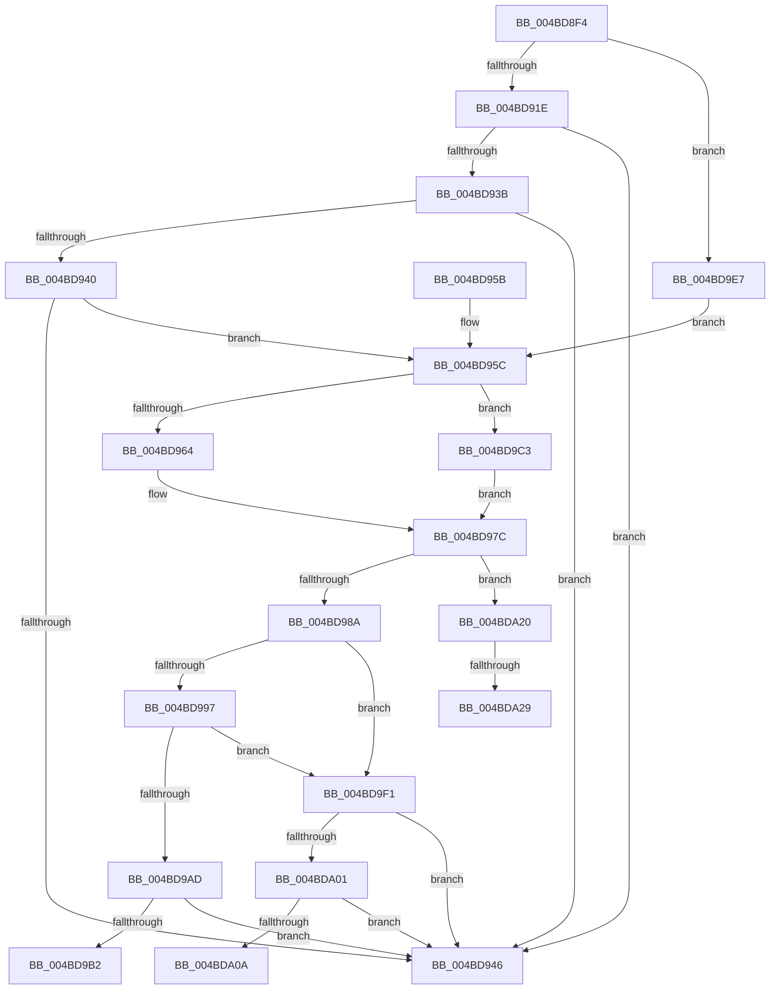

# MiValidateAndLockAweMapCountPage

- RVA: `0x004BD8F4`–`0x004BDA3A` (길이 `326` bytes)
- VA: `0x00000001404BD8F4`
- 실행 섹션: `.text`
- PDB 이름 있음: `예`; PDB Function 태그: `예`
- unwind 정보 RVA: `0x000BC134`
- 디코드: `89`개 명령, `326/326` bytes 표시
- 미해석 바이트: `0` (있으면 어셈블리에 `.byte`로 보존)

> 이 문서는 커널 이미지의 기계어와 PDB 기호를 분석해 생성했습니다. 4번과 5번은 함수 원형과 자료형을 바이너리 사용 방식에서 추정한 C 해석이며 원본 소스 복구 결과는 아닙니다.

## 1. Dependencies

- 직접 호출 지점: **2**; 고유 호출 대상: **2**
- 직접 호출자로 확인된 함수: **2**
- RIP 상대 이미지 참조: **2**

### Outgoing calls
- `0x004BD9F4` → [MiIsPageInHugePfn](../2A/MiIsPageInHugePfn_function_002AB770.md) (function, `0x002AB770`)
- `0x004BDA15` → [MiLockHugePfnInternal](../3F/MiLockHugePfnInternal_function_003FBC80.md) (function, `0x003FBC80`)

### Direct callers
- [MiDecrementAweMapCount](../68/MiDecrementAweMapCount_function_00688158.md) at `0x006881B6`
- [MiIncrementAweMapCount](../68/MiIncrementAweMapCount_function_00688DB0.md) at `0x00688DF4`

### Static image references
- `0x004BD98A` → RVA `0x00E2DCE0` (`.data`; read)
- `0x004BD9C3` → RVA `0x00E300C0` (`.data`; read)

## 2. Other-region calls and transfers

- 다른 실행 섹션으로 향하는 call: **0**
- call이 아닌 외부 분기/꼬리 이동: **4**
  - `0x004BD9BE` → [sub_006FC98E](../6F/Unknown_function_006FC98E.md) (`tail-transfer`)
  - `0x004BDA1B` → [sub_006FC98E + 0x1E](../6F/Unknown_function_006FC98E.md) (`tail-transfer`)
  - `0x004BDA23` → [sub_006FC98E + 0x8B](../6F/Unknown_function_006FC98E.md) (`tail-transfer`)
  - `0x004BDA35` → [sub_006FC98E + 0x6D](../6F/Unknown_function_006FC98E.md) (`tail-transfer`)

## 3. Assembly (complete function range)

```asm
004BD8F4  48 89 5C 24 08                  mov qword ptr [rsp + 8], rbx
004BD8F9  48 89 6C 24 10                  mov qword ptr [rsp + 0x10], rbp
004BD8FE  56                              push rsi
004BD8FF  57                              push rdi
004BD900  41 56                           push r14
004BD902  48 83 EC 30                     sub rsp, 0x30
004BD906  49 83 21 00                     and qword ptr [r9], 0
004BD90A  4C 8B D2                        mov r10, rdx
004BD90D  33 D2                           xor edx, edx
004BD90F  45 8B F0                        mov r14d, r8d
004BD912  4C 8B D9                        mov r11, rcx
004BD915  45 85 C0                        test r8d, r8d
004BD918  0F 84 C9 00 00 00               je 0x1404bd9e7
004BD91E  48 8B 49 10                     mov rcx, qword ptr [rcx + 0x10]
004BD922  49 8B C2                        mov rax, r10
004BD925  48 F7 F1                        div rcx
004BD928  48 FF C9                        dec rcx
004BD92B  49 8D 53 18                     lea rdx, [r11 + 0x18]
004BD92F  4C 8B 42 08                     mov r8, qword ptr [rdx + 8]
004BD933  48 8B E8                        mov rbp, rax
004BD936  49 85 CA                        test r10, rcx
004BD939  75 0B                           jne 0x1404bd946
004BD93B  48 3B 02                        cmp rax, qword ptr [rdx]
004BD93E  73 06                           jae 0x1404bd946
004BD940  49 0F A3 00                     bt qword ptr [r8], rax
004BD944  72 16                           jb 0x1404bd95c
004BD946  33 C0                           xor eax, eax
004BD948  48 8B 5C 24 50                  mov rbx, qword ptr [rsp + 0x50]
004BD94D  48 8B 6C 24 58                  mov rbp, qword ptr [rsp + 0x58]
004BD952  48 83 C4 30                     add rsp, 0x30
004BD956  41 5E                           pop r14
004BD958  5F                              pop rdi
004BD959  5E                              pop rsi
004BD95A  C3                              ret
004BD95B  CC                              int3
004BD95C  41 8B 43 08                     mov eax, dword ptr [r11 + 8]
004BD960  A8 08                           test al, 8
004BD962  75 5F                           jne 0x1404bd9c3
004BD964  4B 8D 04 52                     lea rax, [r10 + r10*2]
004BD968  48 C1 E0 04                     shl rax, 4
004BD96C  48 B9 00 00 00 00 00 DE FF FF   movabs rcx, 0xffffde0000000000
004BD976  48 8D 1C 08                     lea rbx, [rax + rcx]
004BD97A  33 FF                           xor edi, edi
004BD97C  BE 01 00 00 00                  mov esi, 1
004BD981  45 85 F6                        test r14d, r14d
004BD984  0F 84 96 00 00 00               je 0x1404bda20
004BD98A  4C 3B 15 4F 03 97 00            cmp r10, qword ptr [rip + 0x97034f]
004BD991  4C 8B 72 08                     mov r14, qword ptr [rdx + 8]
004BD995  77 5A                           ja 0x1404bd9f1
004BD997  48 B9 28 00 00 00 00 DE FF FF   movabs rcx, 0xffffde0000000028
004BD9A1  48 8B 04 08                     mov rax, qword ptr [rax + rcx]
004BD9A5  48 C1 E8 36                     shr rax, 0x36
004BD9A9  85 C6                           test esi, eax
004BD9AB  74 44                           je 0x1404bd9f1
004BD9AD  48 85 DB                        test rbx, rbx
004BD9B0  74 94                           je 0x1404bd946
004BD9B2  83 64 24 60 00                  and dword ptr [rsp + 0x60], 0
004BD9B7  49 89 19                        mov qword ptr [r9], rbx
004BD9BA  41 89 71 08                     mov dword ptr [r9 + 8], esi
004BD9BE  E9 CB EF 23 00                  jmp 0x1406fc98e
004BD9C3  48 8B 05 F6 26 97 00            mov rax, qword ptr [rip + 0x9726f6]
004BD9CA  49 8B CA                        mov rcx, r10
004BD9CD  48 C1 E9 12                     shr rcx, 0x12
004BD9D1  33 DB                           xor ebx, ebx
004BD9D3  81 E1 FF FF 3F 00               and ecx, 0x3fffff
004BD9D9  48 8D 3C C8                     lea rdi, [rax + rcx*8]
004BD9DD  4B 8D 04 52                     lea rax, [r10 + r10*2]
004BD9E1  48 C1 E0 04                     shl rax, 4
004BD9E5  EB 95                           jmp 0x1404bd97c
004BD9E7  BD FF FF FF FF                  mov ebp, 0xffffffff
004BD9EC  E9 6B FF FF FF                  jmp 0x1404bd95c
004BD9F1  49 8B CA                        mov rcx, r10
004BD9F4  E8 77 DD DE FF                  call 0x1402ab770
004BD9F9  85 C0                           test eax, eax
004BD9FB  0F 84 45 FF FF FF               je 0x1404bd946
004BDA01  48 85 FF                        test rdi, rdi
004BDA04  0F 84 3C FF FF FF               je 0x1404bd946
004BDA0A  41 83 61 08 00                  and dword ptr [r9 + 8], 0
004BDA0F  48 8B CF                        mov rcx, rdi
004BDA12  49 89 39                        mov qword ptr [r9], rdi
004BDA15  E8 66 E2 F3 FF                  call 0x1403fbc80
004BDA1A  90                              nop
004BDA1B  E9 8C EF 23 00                  jmp 0x1406fc9ac
004BDA20  48 85 DB                        test rbx, rbx
004BDA23  0F 84 F0 EF 23 00               je 0x1406fca19
004BDA29  83 64 24 68 00                  and dword ptr [rsp + 0x68], 0
004BDA2E  49 89 19                        mov qword ptr [r9], rbx
004BDA31  41 89 71 08                     mov dword ptr [r9 + 8], esi
004BDA35  E9 C1 EF 23 00                  jmp 0x1406fc9fb
```

## 4. C-style interpretation (structured pseudocode)

```c
__int64 __fastcall MiValidateAndLockAweMapCountPage(__int64 a1, __int64 a2, int a3, __int64 a4)
{
    __int64 result;
    __int64 v_rbx;
    __int64 v_rdi;
    __int64 v_rsp;
    unsigned __int64 v_stack_p10;
    unsigned int v_stack_p60;
    unsigned int v_stack_p68;
    unsigned __int64 v_stack_p8;

    v_stack_p8 = v_rbx;
    v_stack_p10 = v_rbp;
    v_rsp = (v_rsp) - (48);
    a2 = 0;
    if (a3 == 0) goto loc_004BD9E7;
    a1 = (*(unsigned __int64 *)(a1 + 16)) - 1;
    if (((0) & (a1)) != 0) goto loc_004BD946;
    if (0 >= (*(unsigned __int64 *)(a1 + 24))) goto loc_004BD946;
    if (0 < (*(unsigned __int64 *)(a1 + 24))) goto loc_004BD95C;
loc_004BD946:
    result = 0;
    v_rsp = (v_rsp) + (48);
    return result;
loc_004BD95C:
    if ((((unsigned __int8)((unsigned int)(*(unsigned int *)(a1 + 8)))) & (8)) != 0) goto loc_004BD9C3;
    result = (a2 + a2 * 2) << (4);
    v_rdi = 0;
loc_004BD97C:
    if ((unsigned int)((unsigned int)(a3)) == 0) goto loc_004BDA20;
    if (0 > (*(unsigned __int64 *)(v_rip + 9896783))) goto loc_004BD9F1;
    result = (*(unsigned __int64 *)(result + a1 * 1)) >> (54);
    if (((1) & ((unsigned int)(result))) == 0) goto loc_004BD9F1;
    if (result + a1 * 1 == 0) goto loc_004BD946;
    *(unsigned __int64 *)(a4) = result + a1 * 1;
    *(unsigned int *)(a4 + 8) = 1;
loc_004BD9C3:
    a1 = (0) >> (18);
    v_rbx = 0;
    a1 = (unsigned int)((a1) & (0x3FFFFFULL));
    result = (a2 + a2 * 2) << (4);
    goto loc_004BD97C;
loc_004BD9E7:
    goto loc_004BD95C;
loc_004BD9F1:
    result = MiIsPageInHugePfn(0, a1 + 24, *(unsigned __int64 *)(a1 + 24 + 8), a4);
    if ((unsigned int)(result) == 0) goto loc_004BD946;
    if (*(unsigned __int64 *)(v_rip + 9905910) + a1 * 8 == 0) goto loc_004BD946;
    *(unsigned __int64 *)(a4) = *(unsigned __int64 *)(v_rip + 9905910) + a1 * 8;
    result = MiLockHugePfnInternal(*(unsigned __int64 *)(v_rip + 9905910) + a1 * 8, a1 + 24, *(unsigned __int64 *)(a1 + 24 + 8), a4);
loc_004BDA20:
    *(unsigned __int64 *)(a4) = 0;
    *(unsigned int *)(a4 + 8) = 1;
}
```

## 5. (Beta) C Style

```c
int64_t MiValidateAndLockAweMapCountPage(void *Arg1, int64_t Arg2, int32_t Arg3, void *Arg4)
{
    uint8_t *arg1 = (uint8_t *)Arg1;
    uint8_t *arg4 = (uint8_t *)Arg4;

    int64_t result;
    int64_t local_rbx;
    int64_t local_rdi;
    int64_t local_rsp;
    uint64_t v_stack_p10;
    uint32_t v_stack_p60;
    uint32_t v_stack_p68;
    uint64_t v_stack_p8;

    v_stack_p8 = local_rbx;
    v_stack_p10 = local_rbp;
    local_rsp = (local_rsp) - (48);
    Arg2 = 0;
    if (Arg3 == 0) goto loc_004BD9E7;
    Arg1 = (*(uint64_t *)(arg1 + 0x10)) - 1;
    if (((0) & (Arg1)) != 0) goto loc_004BD946;
    if (0 >= (*(uint64_t *)(arg1 + 0x18))) goto loc_004BD946;
    if (0 < (*(uint64_t *)(arg1 + 0x18))) goto loc_004BD95C;
loc_004BD946:
    result = 0;
    local_rsp = (local_rsp) + (48);
    return result;
loc_004BD95C:
    if ((((uint8_t)((uint32_t)(*(uint32_t *)(arg1 + 0x8)))) & (8)) != 0) goto loc_004BD9C3;
    result = (Arg2 + Arg2 * 2) << (4);
    local_rdi = 0;
loc_004BD97C:
    if ((uint32_t)((uint32_t)(Arg3)) == 0) goto loc_004BDA20;
    if (0 > (*(uint64_t *)(v_rip + 0x97034F))) goto loc_004BD9F1;
    result = (*(uint64_t *)(result + arg1 * 1)) >> (54);
    if (((1) & ((uint32_t)(result))) == 0) goto loc_004BD9F1;
    if (result + Arg1 * 1 == 0) goto loc_004BD946;
    *(uint64_t *)(arg4) = result + Arg1 * 1;
    *(uint32_t *)(arg4 + 0x8) = 1;
loc_004BD9C3:
    Arg1 = (0) >> (18);
    local_rbx = 0;
    Arg1 = (uint32_t)((Arg1) & (0x3FFFFFULL));
    result = (Arg2 + Arg2 * 2) << (4);
    goto loc_004BD97C;
loc_004BD9E7:
    goto loc_004BD95C;
loc_004BD9F1:
    result = MiIsPageInHugePfn(0, Arg1 + 24, *(uint64_t *)(arg1 + 0x18 + 0x8), Arg4);
    if ((uint32_t)(result) == 0) goto loc_004BD946;
    if (*(uint64_t *)(v_rip + 0x9726F6) + Arg1 * 8 == 0) goto loc_004BD946;
    *(uint64_t *)(arg4) = *(uint64_t *)(v_rip + 0x9726F6) + Arg1 * 8;
    result = MiLockHugePfnInternal(*(uint64_t *)(v_rip + 0x9726F6) + Arg1 * 8, Arg1 + 24, *(uint64_t *)(arg1 + 0x18 + 0x8), Arg4);
loc_004BDA20:
    *(uint64_t *)(arg4) = 0;
    *(uint32_t *)(arg4 + 0x8) = 1;
}
```

### 관측된 메모리 오프셋

구조체 형식이 확인되지 않은 접근은 인자 기준의 오프셋으로만 기록했습니다.

| 기준 인자 | 오프셋 표현 | 폭 (bit) | 접근 |
|---|---:|---:|---|
| `Arg1` | `+ 0x0` | `64` | `R` |
| `Arg1` | `+ 0x8` | `32` | `R` |
| `Arg1` | `+ 0x8` | `64` | `R` |
| `Arg1` | `+ 0x10` | `64` | `R` |
| `Arg1` | `+ 0x18` | `64` | `R` |
| `Arg4` | `+ 0x0` | `64` | `R/W` |
| `Arg4` | `+ 0x0` | `64` | `W` |
| `Arg4` | `+ 0x8` | `32` | `W` |

## 6. Execution-region graph

[열기: 2D/3D 그래프와 함수 탐색 컨트롤 패널](../../../control-panel.html?section=text&rva=0x004BD8F4&view=graph)

- 2D 그래프는 위에서 아래로 흐르고, 3D 그래프는 빈 공간을 드래그해 회전합니다. Shift+드래그는 이동, 휠은 확대·축소, 함수 노드 선택은 대상 보고서 이동입니다.

### Static fallback


