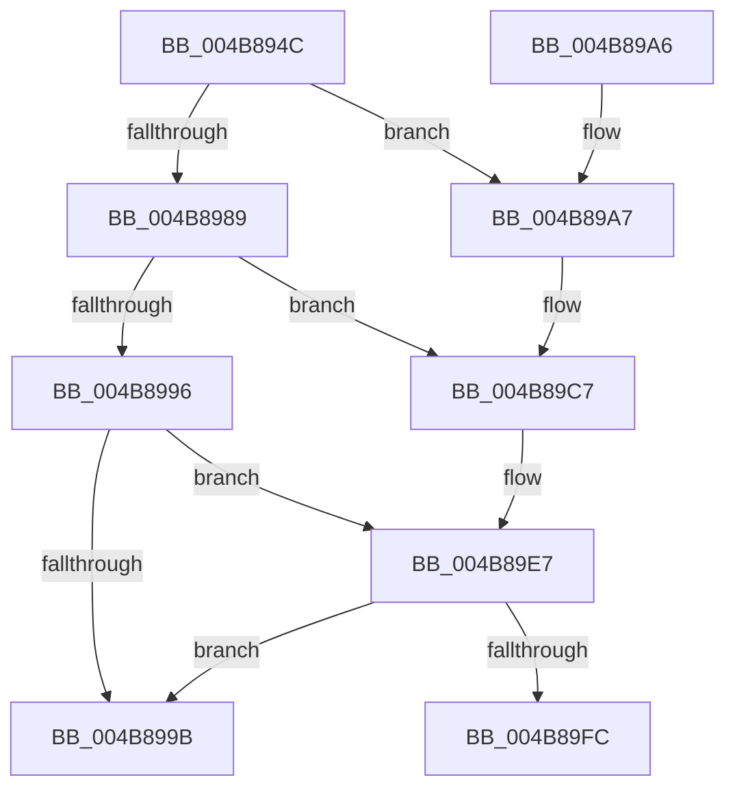

# MiValidateMdlTracker

- RVA: `0x004B894C`–`0x004B8A22` (길이 `214` bytes)
- VA: `0x00000001404B894C`
- 실행 섹션: `.text`
- PDB 이름 있음: `예`; PDB Function 태그: `아니요`
- unwind 정보 RVA: `0x000BAFE4`
- 디코드: `62`개 명령, `214/214` bytes 표시
- 미해석 바이트: `0` (있으면 어셈블리에 `.byte`로 보존)

> 이 문서는 커널 이미지의 기계어와 PDB 기호를 분석해 생성했습니다. 4번과 5번은 함수 원형과 자료형을 바이너리 사용 방식에서 추정한 C 해석이며 원본 소스 복구 결과는 아닙니다.

## 1. Dependencies

- 직접 호출 지점: **4**; 고유 호출 대상: **2**
- 직접 호출자로 확인된 함수: **2**
- RIP 상대 이미지 참조: **0**

### Outgoing calls
- `0x004B89C1` → [KeBugCheckEx](../4F/KeBugCheckEx_function_004FD660.md) (function, `0x004FD660`)
- `0x004B89E1` → [KeBugCheckEx](../4F/KeBugCheckEx_function_004FD660.md) (function, `0x004FD660`)
- `0x004B89F2` → [wyhash](../26/wyhash_function_00269FE4.md) (function, `0x00269FE4`)
- `0x004B8A1C` → [KeBugCheckEx](../4F/KeBugCheckEx_function_004FD660.md) (function, `0x004FD660`)

### Direct callers
- [MiFreeMdlTracker](../49/MiFreeMdlTracker_function_00494838.md) at `0x00494915`
- [MmUpdateMdlTrackerForMdlSwitch](../67/MmUpdateMdlTrackerForMdlSwitch_function_00674298.md) at `0x0067436D`
- [MmUpdateMdlTrackerForMdlSwitch](../67/MmUpdateMdlTrackerForMdlSwitch_function_00674298.md) at `0x00674402`

### Static image references
- 디코드된 RIP-relative 메모리 참조가 없습니다.

## 2. Other-region calls and transfers

- 다른 실행 섹션으로 향하는 call: **0**
- 별도 외부 분기/꼬리 이동을 확인하지 못했습니다.

## 3. Assembly (complete function range)

```asm
004B894C  48 89 5C 24 08                  mov qword ptr [rsp + 8], rbx
004B8951  57                              push rdi
004B8952  48 83 EC 30                     sub rsp, 0x30
004B8956  48 8B 79 18                     mov rdi, qword ptr [rcx + 0x18]
004B895A  44 8B C2                        mov r8d, edx
004B895D  48 8B 41 28                     mov rax, qword ptr [rcx + 0x28]
004B8961  48 8B D9                        mov rbx, rcx
004B8964  44 8B 4F 2C                     mov r9d, dword ptr [rdi + 0x2c]
004B8968  44 03 4F 20                     add r9d, dword ptr [rdi + 0x20]
004B896C  8B 57 28                        mov edx, dword ptr [rdi + 0x28]
004B896F  41 81 E1 FF 0F 00 00            and r9d, 0xfff
004B8976  48 81 C2 FF 0F 00 00            add rdx, 0xfff
004B897D  49 03 D1                        add rdx, r9
004B8980  48 C1 EA 0C                     shr rdx, 0xc
004B8984  48 3B C2                        cmp rax, rdx
004B8987  75 1E                           jne 0x1404b89a7
004B8989  48 8B 4F 30                     mov rcx, qword ptr [rdi + 0x30]
004B898D  48 8B 43 40                     mov rax, qword ptr [rbx + 0x40]
004B8991  48 3B C1                        cmp rax, rcx
004B8994  75 31                           jne 0x1404b89c7
004B8996  45 85 C0                        test r8d, r8d
004B8999  75 4C                           jne 0x1404b89e7
004B899B  48 8B 5C 24 40                  mov rbx, qword ptr [rsp + 0x40]
004B89A0  48 83 C4 30                     add rsp, 0x30
004B89A4  5F                              pop rdi
004B89A5  C3                              ret
004B89A6  CC                              int3
004B89A7  48 C1 E0 20                     shl rax, 0x20
004B89AB  4C 8B CB                        mov r9, rbx
004B89AE  48 0B C2                        or rax, rdx
004B89B1  4C 8B C7                        mov r8, rdi
004B89B4  BA 05 00 00 00                  mov edx, 5
004B89B9  48 89 44 24 20                  mov qword ptr [rsp + 0x20], rax
004B89BE  8D 4A 71                        lea ecx, [rdx + 0x71]
004B89C1  E8 9A 4C 04 00                  call 0x1404fd660
004B89C6  CC                              int3
004B89C7  BA 06 00 00 00                  mov edx, 6
004B89CC  48 C1 E0 20                     shl rax, 0x20
004B89D0  48 0B C1                        or rax, rcx
004B89D3  4C 8B CB                        mov r9, rbx
004B89D6  4C 8B C7                        mov r8, rdi
004B89D9  48 89 44 24 20                  mov qword ptr [rsp + 0x20], rax
004B89DE  8D 4A 70                        lea ecx, [rdx + 0x70]
004B89E1  E8 7A 4C 04 00                  call 0x1404fd660
004B89E6  CC                              int3
004B89E7  48 C1 E2 03                     shl rdx, 3
004B89EB  48 8D 4F 30                     lea rcx, [rdi + 0x30]
004B89EF  45 33 C0                        xor r8d, r8d
004B89F2  E8 ED 15 DB FF                  call 0x140269fe4
004B89F7  39 43 3C                        cmp dword ptr [rbx + 0x3c], eax
004B89FA  74 9F                           je 0x1404b899b
004B89FC  48 8B 4B 40                     mov rcx, qword ptr [rbx + 0x40]
004B8A00  BA 07 00 00 00                  mov edx, 7
004B8A05  48 C1 E1 20                     shl rcx, 0x20
004B8A09  4C 8B CB                        mov r9, rbx
004B8A0C  8B C0                           mov eax, eax
004B8A0E  4C 8B C7                        mov r8, rdi
004B8A11  48 0B C8                        or rcx, rax
004B8A14  48 89 4C 24 20                  mov qword ptr [rsp + 0x20], rcx
004B8A19  8D 4A 6F                        lea ecx, [rdx + 0x6f]
004B8A1C  E8 3F 4C 04 00                  call 0x1404fd660
004B8A21  CC                              int3
```

## 4. C-style interpretation (structured pseudocode)

```c
__int64 __fastcall MiValidateMdlTracker(__int64 a1, int a2)
{
    __int64 result;
    __int64 v_rsp;
    unsigned __int64 v_stack_p20;
    unsigned __int64 v_stack_p8;

    v_stack_p8 = v_rbx;
    v_rsp = (v_rsp) - (48);
    a4 = (unsigned int)(((unsigned int)(*(unsigned int *)(*(unsigned __int64 *)(a1 + 24) + 44))) + (*(unsigned int *)(*(unsigned __int64 *)(a1 + 24) + 32)));
    a4 = (unsigned int)((a4) & (0xFFFULL));
    a2 = ((unsigned int)(*(unsigned int *)(*(unsigned __int64 *)(a1 + 24) + 40))) + (0xFFFULL);
    a2 = (a2) + (a4);
    a2 = (a2) >> (12);
    if ((*(unsigned __int64 *)(a1 + 40)) != a2) goto loc_004B89A7;
    if ((*(unsigned __int64 *)(a1 + 64)) != (*(unsigned __int64 *)(*(unsigned __int64 *)(a1 + 24) + 48))) goto loc_004B89C7;
    if ((unsigned int)((unsigned int)(a2)) != 0) goto loc_004B89E7;
loc_004B899B:
    v_rsp = (v_rsp) + (48);
    return *(unsigned __int64 *)(a1 + 64);
loc_004B89A7:
    result = (*(unsigned __int64 *)(a1 + 64)) << (32);
    result = (result) | (a2);
    v_stack_p20 = result;
    result = KeBugCheckEx(5 + 113, 5, *(unsigned __int64 *)(a1 + 24), v_stack_p8);
loc_004B89C7:
    result = (result) << (32);
    result = (result) | (5 + 113);
    v_stack_p20 = result;
    result = KeBugCheckEx(6 + 112, 6, *(unsigned __int64 *)(a1 + 24), v_stack_p8);
loc_004B89E7:
    a2 = (6) << (3);
    a3 = 0;
    result = wyhash(*(unsigned __int64 *)(a1 + 24) + 48, a2, a3, v_stack_p8);
    if ((*(unsigned int *)(v_stack_p8 + 60)) == ((unsigned int)(result))) goto loc_004B899B;
    a1 = (*(unsigned __int64 *)(v_stack_p8 + 64)) << (32);
    a1 = (a1) | ((unsigned int)((unsigned int)(result)));
    v_stack_p20 = a1;
    result = KeBugCheckEx(7 + 111, 7, *(unsigned __int64 *)(a1 + 24), v_stack_p8);
    return result;
}
```

## 5. (Beta) C Style

```c
int64_t MiValidateMdlTracker(void *Arg1, int32_t Arg2)
{
    uint8_t *arg1 = (uint8_t *)Arg1;

    int64_t result;
    int64_t local_rsp;
    uint64_t v_stack_p20;
    uint64_t v_stack_p8;

    v_stack_p8 = local_rbx;
    local_rsp = (local_rsp) - (48);
    a4 = (uint32_t)(((uint32_t)(*(uint32_t *)(*(uint64_t *)(arg1 + 0x18) + 0x2C))) + (*(uint32_t *)(*(uint64_t *)(arg1 + 0x18) + 0x20)));
    a4 = (uint32_t)((a4) & (0xFFFULL));
    Arg2 = ((uint32_t)(*(uint32_t *)(*(uint64_t *)(arg1 + 0x18) + 0x28))) + (0xFFFULL);
    Arg2 = (Arg2) + (a4);
    Arg2 = (Arg2) >> (12);
    if ((*(uint64_t *)(arg1 + 0x28)) != Arg2) goto loc_004B89A7;
    if ((*(uint64_t *)(arg1 + 0x40)) != (*(uint64_t *)(*(uint64_t *)(arg1 + 0x18) + 0x30))) goto loc_004B89C7;
    if ((uint32_t)((uint32_t)(Arg2)) != 0) goto loc_004B89E7;
loc_004B899B:
    local_rsp = (local_rsp) + (48);
    return *(uint64_t *)(arg1 + 0x40);
loc_004B89A7:
    result = (*(uint64_t *)(arg1 + 0x40)) << (32);
    result = (result) | (Arg2);
    v_stack_p20 = result;
    result = KeBugCheckEx(5 + 113, 5, *(uint64_t *)(arg1 + 0x18), v_stack_p8);
loc_004B89C7:
    result = (result) << (32);
    result = (result) | (5 + 113);
    v_stack_p20 = result;
    result = KeBugCheckEx(6 + 112, 6, *(uint64_t *)(arg1 + 0x18), v_stack_p8);
loc_004B89E7:
    Arg2 = (6) << (3);
    a3 = 0;
    result = wyhash(*(uint64_t *)(arg1 + 0x18) + 48, Arg2, a3, v_stack_p8);
    if ((*(uint32_t *)(v_stack_p8 + 0x3C)) == ((uint32_t)(result))) goto loc_004B899B;
    Arg1 = (*(uint64_t *)(v_stack_p8 + 0x40)) << (32);
    Arg1 = (Arg1) | ((uint32_t)((uint32_t)(result)));
    v_stack_p20 = Arg1;
    result = KeBugCheckEx(7 + 111, 7, *(uint64_t *)(arg1 + 0x18), v_stack_p8);
    return result;
}
```

### 관측된 메모리 오프셋

구조체 형식이 확인되지 않은 접근은 인자 기준의 오프셋으로만 기록했습니다.

| 기준 인자 | 오프셋 표현 | 폭 (bit) | 접근 |
|---|---:|---:|---|
| `Arg1` | `+ 0x18` | `64` | `R` |
| `Arg1` | `+ 0x28` | `64` | `R` |
| `Arg1` | `+ 0x3C` | `32` | `R` |
| `Arg1` | `+ 0x40` | `64` | `R` |

## 6. Execution-region graph

[열기: 2D/3D 그래프와 함수 탐색 컨트롤 패널](../../../control-panel.html?section=text&rva=0x004B894C&view=graph)

- 2D 그래프는 위에서 아래로 흐르고, 3D 그래프는 빈 공간을 드래그해 회전합니다. Shift+드래그는 이동, 휠은 확대·축소, 함수 노드 선택은 대상 보고서 이동입니다.

### Static fallback


