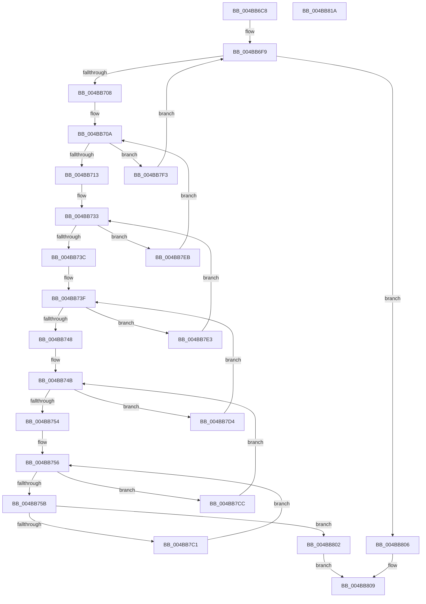

# MiWalkAllFreeZeroLists

- RVA: `0x004BB6C8`–`0x004BB81B` (길이 `339` bytes)
- VA: `0x00000001404BB6C8`
- 실행 섹션: `.text`
- PDB 이름 있음: `예`; PDB Function 태그: `아니요`
- unwind 정보 RVA: `0x000BB714`
- 디코드: `101`개 명령, `339/339` bytes 표시
- 미해석 바이트: `0` (있으면 어셈블리에 `.byte`로 보존)

> 이 문서는 커널 이미지의 기계어와 PDB 기호를 분석해 생성했습니다. 4번과 5번은 함수 원형과 자료형을 바이너리 사용 방식에서 추정한 C 해석이며 원본 소스 복구 결과는 아닙니다.

## 1. Dependencies

- 직접 호출 지점: **2**; 고유 호출 대상: **2**
- 직접 호출자로 확인된 함수: **3**
- RIP 상대 이미지 참조: **3**

### Outgoing calls
- `0x004BB795` → [MiGetColorHeadBase](../3B/MiGetColorHeadBase_function_003BB8B0.md) (function, `0x003BB8B0`)
- `0x004BB7B8` → [guard_dispatch_icall](../6B/guard_dispatch_icall_function_006BAAD0.md) (function, `0x006BAAD0`)

### Direct callers
- [MiLockMemoryLists](MiLockMemoryLists_function_004BB470.md) at `0x004BB4BA`
- [MiMirrorPurgePartitionPages](MiMirrorPurgePartitionPages_function_004BEFA0.md) at `0x004BEFD8`
- [MiMirrorNodeFreeZeroPages](../4F/MiMirrorNodeFreeZeroPages_function_004FC8CC.md) at `0x004FC8F1`

### Static image references
- `0x004BB6E2` → RVA `0x00FC5002` (`ALMOSTRO`; read)
- `0x004BB6F9` → RVA `0x00FC5000` (`ALMOSTRO`; read)
- `0x004BB715` → RVA `0x00E2DCC0` (`.data`; read)

## 2. Other-region calls and transfers

- 다른 실행 섹션으로 향하는 call: **0**
- 별도 외부 분기/꼬리 이동을 확인하지 못했습니다.

## 3. Assembly (complete function range)

```asm
004BB6C8  4C 89 44 24 18                  mov qword ptr [rsp + 0x18], r8
004BB6CD  48 89 54 24 10                  mov qword ptr [rsp + 0x10], rdx
004BB6D2  53                              push rbx
004BB6D3  55                              push rbp
004BB6D4  56                              push rsi
004BB6D5  57                              push rdi
004BB6D6  41 54                           push r12
004BB6D8  41 55                           push r13
004BB6DA  41 56                           push r14
004BB6DC  41 57                           push r15
004BB6DE  48 83 EC 38                     sub rsp, 0x38
004BB6E2  8A 15 1A 99 B0 00               mov dl, byte ptr [rip + 0xb0991a]
004BB6E8  33 DB                           xor ebx, ebx
004BB6EA  4C 8B 69 10                     mov r13, qword ptr [rcx + 0x10]
004BB6EE  88 94 24 80 00 00 00            mov byte ptr [rsp + 0x80], dl
004BB6F5  44 8D 43 01                     lea r8d, [rbx + 1]
004BB6F9  0F B7 05 00 99 B0 00            movzx eax, word ptr [rip + 0xb09900]
004BB700  3B D8                           cmp ebx, eax
004BB702  0F 83 FE 00 00 00               jae 0x1404bb806
004BB708  33 FF                           xor edi, edi
004BB70A  83 FF 03                        cmp edi, 3
004BB70D  0F 87 E0 00 00 00               ja 0x1404bb7f3
004BB713  33 F6                           xor esi, esi
004BB715  48 8D 0D A4 25 97 00            lea rcx, [rip + 0x9725a4]
004BB71C  8B 04 B9                        mov eax, dword ptr [rcx + rdi*4]
004BB71F  83 FF 03                        cmp edi, 3
004BB722  89 84 24 98 00 00 00            mov dword ptr [rsp + 0x98], eax
004BB729  40 0F 95 C6                     setne sil
004BB72D  41 03 F0                        add esi, r8d
004BB730  45 33 E4                        xor r12d, r12d
004BB733  44 3B E6                        cmp r12d, esi
004BB736  0F 8D AF 00 00 00               jge 0x1404bb7eb
004BB73C  45 32 FF                        xor r15b, r15b
004BB73F  44 3A FA                        cmp r15b, dl
004BB742  0F 83 9B 00 00 00               jae 0x1404bb7e3
004BB748  45 33 F6                        xor r14d, r14d
004BB74B  45 3B F0                        cmp r14d, r8d
004BB74E  0F 8F 80 00 00 00               jg 0x1404bb7d4
004BB754  33 ED                           xor ebp, ebp
004BB756  83 FD 03                        cmp ebp, 3
004BB759  7F 71                           jg 0x1404bb7cc
004BB75B  8B D5                           mov edx, ebp
004BB75D  8B C7                           mov eax, edi
004BB75F  83 E2 03                        and edx, 3
004BB762  83 E0 03                        and eax, 3
004BB765  C1 E2 02                        shl edx, 2
004BB768  44 8B CD                        mov r9d, ebp
004BB76B  0B D0                           or edx, eax
004BB76D  49 8B CD                        mov rcx, r13
004BB770  03 D2                           add edx, edx
004BB772  41 8B C4                        mov eax, r12d
004BB775  41 23 C0                        and eax, r8d
004BB778  0B D0                           or edx, eax
004BB77A  8B C3                           mov eax, ebx
004BB77C  C1 E2 06                        shl edx, 6
004BB77F  83 E0 3F                        and eax, 0x3f
004BB782  0B D0                           or edx, eax
004BB784  41 0F B6 C7                     movzx eax, r15b
004BB788  41 23 C0                        and eax, r8d
004BB78B  03 D2                           add edx, edx
004BB78D  0B D0                           or edx, eax
004BB78F  45 8B C6                        mov r8d, r14d
004BB792  C1 E2 08                        shl edx, 8
004BB795  E8 16 01 F0 FF                  call 0x1403bb8b0
004BB79A  44 8B 8C 24 98 00 00 00         mov r9d, dword ptr [rsp + 0x98]
004BB7A2  4C 8B C0                        mov r8, rax
004BB7A5  48 8B 84 24 88 00 00 00         mov rax, qword ptr [rsp + 0x88]
004BB7AD  49 8B D5                        mov rdx, r13
004BB7B0  48 8B 8C 24 90 00 00 00         mov rcx, qword ptr [rsp + 0x90]
004BB7B8  E8 13 F3 1F 00                  call 0x1406baad0
004BB7BD  85 C0                           test eax, eax
004BB7BF  74 41                           je 0x1404bb802
004BB7C1  41 B8 01 00 00 00               mov r8d, 1
004BB7C7  41 03 E8                        add ebp, r8d
004BB7CA  EB 8A                           jmp 0x1404bb756
004BB7CC  45 03 F0                        add r14d, r8d
004BB7CF  E9 77 FF FF FF                  jmp 0x1404bb74b
004BB7D4  8A 94 24 80 00 00 00            mov dl, byte ptr [rsp + 0x80]
004BB7DB  45 02 F8                        add r15b, r8b
004BB7DE  E9 5C FF FF FF                  jmp 0x1404bb73f
004BB7E3  45 03 E0                        add r12d, r8d
004BB7E6  E9 48 FF FF FF                  jmp 0x1404bb733
004BB7EB  41 03 F8                        add edi, r8d
004BB7EE  E9 17 FF FF FF                  jmp 0x1404bb70a
004BB7F3  49 81 C5 80 DF 00 00            add r13, 0xdf80
004BB7FA  41 03 D8                        add ebx, r8d
004BB7FD  E9 F7 FE FF FF                  jmp 0x1404bb6f9
004BB802  33 C0                           xor eax, eax
004BB804  EB 03                           jmp 0x1404bb809
004BB806  41 8B C0                        mov eax, r8d
004BB809  48 83 C4 38                     add rsp, 0x38
004BB80D  41 5F                           pop r15
004BB80F  41 5E                           pop r14
004BB811  41 5D                           pop r13
004BB813  41 5C                           pop r12
004BB815  5F                              pop rdi
004BB816  5E                              pop rsi
004BB817  5D                              pop rbp
004BB818  5B                              pop rbx
004BB819  C3                              ret
004BB81A  CC                              int3
```

## 4. C-style interpretation (structured pseudocode)

```c
__int64 __fastcall MiWalkAllFreeZeroLists(__int64 a1, __int64 a2, __int64 a3)
{
    __int64 result;
    __int64 v_r12;
    __int64 v_r13;
    __int64 v_r14;
    __int64 v_r15;
    __int64 v_rbp;
    __int64 v_rbx;
    __int64 v_rdi;
    __int64 v_rsi;
    __int64 v_rsp;
    unsigned __int64 v_stack_p10;
    unsigned __int64 v_stack_p18;
    unsigned int v_stack_p20;
    unsigned __int8 v_stack_p8;

    v_stack_p18 = a3;
    v_stack_p10 = a2;
    v_rsp = (v_rsp) - (56);
    v_rbx = 0;
    v_stack_p8 = (unsigned __int8)(*(unsigned __int8 *)(v_rip + 11573530));
loc_004BB6F9:
    if (0 >= ((unsigned int)(*(unsigned __int16 *)(v_rip + 11573504)))) goto loc_004BB806;
    v_rdi = 0;
loc_004BB70A:
    if (0 > 3) goto loc_004BB7F3;
    v_rsi = 0;
    v_stack_p20 = (unsigned int)((unsigned int)(*(unsigned int *)(v_rip + 9905572 + v_rdi * 4)));
    v_rsi = (0 != 3) ? 1 : 0;
    v_rsi = (unsigned int)((v_rsi) + ((unsigned int)(v_rbx + 1)));
    v_r12 = 0;
loc_004BB733:
    if (0 >= ((unsigned int)(v_rsi))) goto loc_004BB7EB;
    v_r15 = 0;
loc_004BB73F:
    if (0 >= ((unsigned __int8)(*(unsigned __int8 *)(v_rip + 11573530)))) goto loc_004BB7E3;
    v_r14 = 0;
loc_004BB74B:
    if (0 > ((unsigned int)(v_rbx + 1))) goto loc_004BB7D4;
    v_rbp = 0;
loc_004BB756:
    if (0 > 3) goto loc_004BB7CC;
    a2 = (unsigned int)((0) & (3));
    result = (unsigned int)((0) & (3));
    a2 = (unsigned int)((a2) << (2));
    a2 = (unsigned int)((a2) | ((unsigned int)(result)));
    a2 = (unsigned int)((a2) + ((unsigned int)(a2)));
    result = (unsigned int)((0) & ((unsigned int)(v_rbx + 1)));
    a2 = (unsigned int)((a2) | ((unsigned int)(result)));
    a2 = (unsigned int)((a2) << (6));
    result = (unsigned int)((0) & (63));
    a2 = (unsigned int)((a2) | ((unsigned int)(result)));
    result = (unsigned int)((0) & ((unsigned int)(v_rbx + 1)));
    a2 = (unsigned int)((a2) + ((unsigned int)(a2)));
    a2 = (unsigned int)((a2) | ((unsigned int)(result)));
    a2 = (unsigned int)((a2) << (8));
    result = MiGetColorHeadBase(*(unsigned __int64 *)(a1 + 16), a2, 0, 0);
    result = guard_dispatch_icall(v_stack_p18, *(unsigned __int64 *)(a1 + 16), result, (unsigned int)(v_stack_p20));
    if ((unsigned int)(result) == 0) goto loc_004BB802;
    v_rbp = (unsigned int)((v_rbp) + (1));
    goto loc_004BB756;
loc_004BB7CC:
    v_r14 = (unsigned int)((v_r14) + (1));
    goto loc_004BB74B;
loc_004BB7D4:
    v_r15 = (unsigned __int8)((v_r15) + (1));
    goto loc_004BB73F;
loc_004BB7E3:
    v_r12 = (unsigned int)((v_r12) + (1));
    goto loc_004BB733;
loc_004BB7EB:
    v_rdi = (unsigned int)((v_rdi) + (1));
    goto loc_004BB70A;
loc_004BB7F3:
    v_r13 = (*(unsigned __int64 *)(a1 + 16)) + (0xDF80ULL);
    v_rbx = (unsigned int)((v_rbx) + (1));
    goto loc_004BB6F9;
loc_004BB802:
    result = 0;
    goto loc_004BB809;
loc_004BB806:
loc_004BB809:
    v_rsp = (v_rsp) + (56);
    return 1;
}
```

## 5. (Beta) C Style

```c
int64_t MiWalkAllFreeZeroLists(void *Arg1, int64_t Arg2, int64_t Arg3)
{
    uint8_t *arg1 = (uint8_t *)Arg1;

    int64_t result;
    int64_t local_r12;
    int64_t local_r13;
    int64_t local_r14;
    int64_t local_r15;
    int64_t local_rbp;
    int64_t local_rbx;
    int64_t local_rdi;
    int64_t local_rsi;
    int64_t local_rsp;
    uint64_t v_stack_p10;
    uint64_t v_stack_p18;
    uint32_t v_stack_p20;
    uint8_t v_stack_p8;

    v_stack_p18 = Arg3;
    v_stack_p10 = Arg2;
    local_rsp = (local_rsp) - (56);
    local_rbx = 0;
    v_stack_p8 = (uint8_t)(*(uint8_t *)(v_rip + 0xB0991A));
loc_004BB6F9:
    if (0 >= ((uint32_t)(*(uint16_t *)(v_rip + 0xB09900)))) goto loc_004BB806;
    local_rdi = 0;
loc_004BB70A:
    if (0 > 3) goto loc_004BB7F3;
    local_rsi = 0;
    v_stack_p20 = (uint32_t)((uint32_t)(*(uint32_t *)(v_rip + 0x9725A4 + local_rdi * 4)));
    local_rsi = (0 != 3) ? 1 : 0;
    local_rsi = (uint32_t)((local_rsi) + ((uint32_t)(local_rbx + 1)));
    local_r12 = 0;
loc_004BB733:
    if (0 >= ((uint32_t)(local_rsi))) goto loc_004BB7EB;
    local_r15 = 0;
loc_004BB73F:
    if (0 >= ((uint8_t)(*(uint8_t *)(v_rip + 0xB0991A)))) goto loc_004BB7E3;
    local_r14 = 0;
loc_004BB74B:
    if (0 > ((uint32_t)(local_rbx + 1))) goto loc_004BB7D4;
    local_rbp = 0;
loc_004BB756:
    if (0 > 3) goto loc_004BB7CC;
    Arg2 = (uint32_t)((0) & (3));
    result = (uint32_t)((0) & (3));
    Arg2 = (uint32_t)((Arg2) << (2));
    Arg2 = (uint32_t)((Arg2) | ((uint32_t)(result)));
    Arg2 = (uint32_t)((Arg2) + ((uint32_t)(Arg2)));
    result = (uint32_t)((0) & ((uint32_t)(local_rbx + 1)));
    Arg2 = (uint32_t)((Arg2) | ((uint32_t)(result)));
    Arg2 = (uint32_t)((Arg2) << (6));
    result = (uint32_t)((0) & (63));
    Arg2 = (uint32_t)((Arg2) | ((uint32_t)(result)));
    result = (uint32_t)((0) & ((uint32_t)(local_rbx + 1)));
    Arg2 = (uint32_t)((Arg2) + ((uint32_t)(Arg2)));
    Arg2 = (uint32_t)((Arg2) | ((uint32_t)(result)));
    Arg2 = (uint32_t)((Arg2) << (8));
    result = MiGetColorHeadBase(*(uint64_t *)(arg1 + 0x10), Arg2, 0, 0);
    result = guard_dispatch_icall(v_stack_p18, *(uint64_t *)(arg1 + 0x10), result, (uint32_t)(v_stack_p20));
    if ((uint32_t)(result) == 0) goto loc_004BB802;
    local_rbp = (uint32_t)((local_rbp) + (1));
    goto loc_004BB756;
loc_004BB7CC:
    local_r14 = (uint32_t)((local_r14) + (1));
    goto loc_004BB74B;
loc_004BB7D4:
    local_r15 = (uint8_t)((local_r15) + (1));
    goto loc_004BB73F;
loc_004BB7E3:
    local_r12 = (uint32_t)((local_r12) + (1));
    goto loc_004BB733;
loc_004BB7EB:
    local_rdi = (uint32_t)((local_rdi) + (1));
    goto loc_004BB70A;
loc_004BB7F3:
    local_r13 = (*(uint64_t *)(arg1 + 0x10)) + (0xDF80ULL);
    local_rbx = (uint32_t)((local_rbx) + (1));
    goto loc_004BB6F9;
loc_004BB802:
    result = 0;
    goto loc_004BB809;
loc_004BB806:
loc_004BB809:
    local_rsp = (local_rsp) + (56);
    return 1;
}
```

### 관측된 메모리 오프셋

구조체 형식이 확인되지 않은 접근은 인자 기준의 오프셋으로만 기록했습니다.

| 기준 인자 | 오프셋 표현 | 폭 (bit) | 접근 |
|---|---:|---:|---|
| `Arg1` | `+ 0x10` | `64` | `R` |

## 6. Execution-region graph

[열기: 2D/3D 그래프와 함수 탐색 컨트롤 패널](../../../control-panel.html?section=text&rva=0x004BB6C8&view=graph)

- 2D 그래프는 위에서 아래로 흐르고, 3D 그래프는 빈 공간을 드래그해 회전합니다. Shift+드래그는 이동, 휠은 확대·축소, 함수 노드 선택은 대상 보고서 이동입니다.

### Static fallback


