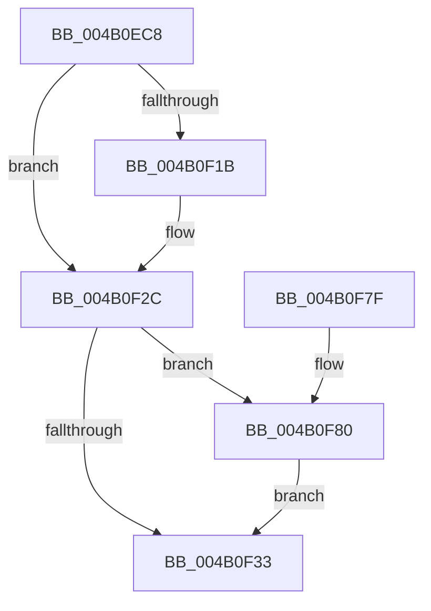

# MiWriteRepurposedTransitionPte

- RVA: `0x004B0EC8`–`0x004B0F8D` (길이 `197` bytes)
- VA: `0x00000001404B0EC8`
- 실행 섹션: `.text`
- PDB 이름 있음: `예`; PDB Function 태그: `아니요`
- unwind 정보 RVA: `0x000B8C38`
- 디코드: `48`개 명령, `197/197` bytes 표시
- 미해석 바이트: `0` (있으면 어셈블리에 `.byte`로 보존)

> 이 문서는 커널 이미지의 기계어와 PDB 기호를 분석해 생성했습니다. 4번과 5번은 함수 원형과 자료형을 바이너리 사용 방식에서 추정한 C 해석이며 원본 소스 복구 결과는 아닙니다.

## 1. Dependencies

- 직접 호출 지점: **4**; 고유 호출 대상: **4**
- 직접 호출자로 확인된 함수: **2**
- RIP 상대 이미지 참조: **1**

### Outgoing calls
- `0x004B0EF6` → [MiMapPageInHyperSpaceWorker](../33/MiMapPageInHyperSpaceWorker_function_00332B10.md) (function, `0x00332B10`)
- `0x004B0F12` → [MiPteInShadowRange](../23/MiPteInShadowRange_function_0023FB00.md) (function, `0x0023FB00`)
- `0x004B0F20` → [MiSanitizeShadowPxe](../29/MiSanitizeShadowPxe_function_00294B68.md) (function, `0x00294B68`)
- `0x004B0F86` → [MiWritePteShadow](../29/MiWritePteShadow_function_00294EAC.md) (function, `0x00294EAC`)

### Direct callers
- [MiCombineInitialInstance](../22/MiCombineInitialInstance_function_0022BC0C.md) at `0x0022C657`
- [sub_006D7070](../6D/Unknown_function_006D7070.md) at `0x006D70C6`

### Static image references
- `0x004B0F66` → RVA `0x00010880` (`.rdata`; read)

## 2. Other-region calls and transfers

- 다른 실행 섹션으로 향하는 call: **0**
- 별도 외부 분기/꼬리 이동을 확인하지 못했습니다.

## 3. Assembly (complete function range)

```asm
004B0EC8  48 89 5C 24 18                  mov qword ptr [rsp + 0x18], rbx
004B0ECD  48 89 74 24 20                  mov qword ptr [rsp + 0x20], rsi
004B0ED2  57                              push rdi
004B0ED3  48 83 EC 20                     sub rsp, 0x20
004B0ED7  48 8B F9                        mov rdi, rcx
004B0EDA  48 B8 FF FF FF FF FF 00 00 00   movabs rax, 0xffffffffff
004B0EE4  48 8B 49 28                     mov rcx, qword ptr [rcx + 0x28]
004B0EE8  48 8B DA                        mov rbx, rdx
004B0EEB  48 23 C8                        and rcx, rax
004B0EEE  33 D2                           xor edx, edx
004B0EF0  41 B8 00 00 00 80               mov r8d, 0x80000000
004B0EF6  E8 15 1C E8 FF                  call 0x140332b10
004B0EFB  48 8B 77 08                     mov rsi, qword ptr [rdi + 8]
004B0EFF  33 FF                           xor edi, edi
004B0F01  81 E6 FF 0F 00 00               and esi, 0xfff
004B0F07  48 89 5C 24 30                  mov qword ptr [rsp + 0x30], rbx
004B0F0C  48 03 F0                        add rsi, rax
004B0F0F  48 8B CE                        mov rcx, rsi
004B0F12  E8 E9 EB D8 FF                  call 0x14023fb00
004B0F17  85 C0                           test eax, eax
004B0F19  74 11                           je 0x1404b0f2c
004B0F1B  48 8D 54 24 30                  lea rdx, [rsp + 0x30]
004B0F20  E8 43 3C DE FF                  call 0x140294b68
004B0F25  48 8B 5C 24 30                  mov rbx, qword ptr [rsp + 0x30]
004B0F2A  8B F8                           mov edi, eax
004B0F2C  48 89 1E                        mov qword ptr [rsi], rbx
004B0F2F  85 FF                           test edi, edi
004B0F31  75 4D                           jne 0x1404b0f80
004B0F33  48 C1 EE 09                     shr rsi, 9
004B0F37  48 B8 F8 FF FF FF 7F 00 00 00   movabs rax, 0x7ffffffff8
004B0F41  48 23 F0                        and rsi, rax
004B0F44  48 B8 00 00 00 00 80 F6 FF FF   movabs rax, 0xfffff68000000000
004B0F4E  48 8B 5C 24 40                  mov rbx, qword ptr [rsp + 0x40]
004B0F53  48 03 F0                        add rsi, rax
004B0F56  65 48 8B 04 25 20 00 00 00      mov rax, qword ptr gs:[0x20]
004B0F5F  48 8B 88 38 88 00 00            mov rcx, qword ptr [rax + 0x8838]
004B0F66  48 8B 05 13 F9 B5 FF            mov rax, qword ptr [rip - 0x4a06ed]
004B0F6D  48 83 21 00                     and qword ptr [rcx], 0
004B0F71  48 89 06                        mov qword ptr [rsi], rax
004B0F74  48 8B 74 24 48                  mov rsi, qword ptr [rsp + 0x48]
004B0F79  48 83 C4 20                     add rsp, 0x20
004B0F7D  5F                              pop rdi
004B0F7E  C3                              ret
004B0F7F  CC                              int3
004B0F80  48 8B D3                        mov rdx, rbx
004B0F83  48 8B CE                        mov rcx, rsi
004B0F86  E8 21 3F DE FF                  call 0x140294eac
004B0F8B  EB A6                           jmp 0x1404b0f33
```

## 4. C-style interpretation (structured pseudocode)

```c
__int64 __fastcall MiWriteRepurposedTransitionPte(__int64 a1, __int64 a2)
{
    __int64 result;
    __int64 v_rbx;
    __int64 v_rdi;
    __int64 v_rsi;
    __int64 v_rsp;
    unsigned __int64 v_stack_p18;
    unsigned __int64 v_stack_p20;
    unsigned __int64 v_stack_p8;

    v_stack_p18 = v_rbx;
    v_stack_p20 = v_rsi;
    v_rsp = (v_rsp) - (32);
    a1 = (*(unsigned __int64 *)(a1 + 40)) & (result);
    a2 = 0;
    result = MiMapPageInHyperSpaceWorker(a1, a2, (unsigned int)(0x80000000ULL), a4);
    v_rdi = 0;
    v_rsi = (unsigned int)((*(unsigned __int64 *)(a1 + 8)) & (0xFFFULL));
    v_stack_p8 = 0;
    v_rsi = (v_rsi) + (result);
    result = MiPteInShadowRange(v_rsi, a2, (unsigned int)(0x80000000ULL), a4);
    v_rbx = a2;
    if ((unsigned int)(result) != 0) {
        a2 = v_stack_p8;
        result = MiSanitizeShadowPxe(v_rsi, a2, (unsigned int)(0x80000000ULL), a4);
        v_rbx = v_stack_p8;
        v_rdi = (unsigned int)(result);
    }
    *(unsigned __int64 *)(v_rsi) = v_rbx;
    if ((unsigned int)(v_rdi) != 0) goto loc_004B0F80;
loc_004B0F33:
    v_rsi = (v_rsi) >> (9);
    v_rsi = (v_rsi) & (result);
    v_rsi = (v_rsi) + (result);
    *(unsigned __int64 *)(v_rsi) = *(unsigned __int64 *)(v_rip - 4851437);
    v_rsp = (v_rsp) + (32);
    return *(unsigned __int64 *)(v_rip - 4851437);
loc_004B0F80:
    result = MiWritePteShadow(v_stack_p20, v_stack_p18, (unsigned int)(0x80000000ULL), a4);
    goto loc_004B0F33;
}
```

## 5. (Beta) C Style

```c
int64_t MiWriteRepurposedTransitionPte(void *Arg1, int64_t Arg2)
{
    uint8_t *arg1 = (uint8_t *)Arg1;

    int64_t result;
    int64_t local_rbx;
    int64_t local_rdi;
    int64_t local_rsi;
    int64_t local_rsp;
    uint64_t v_stack_p18;
    uint64_t v_stack_p20;
    uint64_t v_stack_p8;

    v_stack_p18 = local_rbx;
    v_stack_p20 = local_rsi;
    local_rsp = (local_rsp) - (32);
    Arg1 = (*(uint64_t *)(arg1 + 0x28)) & (result);
    Arg2 = 0;
    result = MiMapPageInHyperSpaceWorker(Arg1, Arg2, (uint32_t)(0x80000000ULL), a4);
    local_rdi = 0;
    local_rsi = (uint32_t)((*(uint64_t *)(arg1 + 0x8)) & (0xFFFULL));
    v_stack_p8 = 0;
    local_rsi = (local_rsi) + (result);
    result = MiPteInShadowRange(local_rsi, Arg2, (uint32_t)(0x80000000ULL), a4);
    local_rbx = Arg2;
    if ((uint32_t)(result) != 0) {
        Arg2 = v_stack_p8;
        result = MiSanitizeShadowPxe(local_rsi, Arg2, (uint32_t)(0x80000000ULL), a4);
        local_rbx = v_stack_p8;
        local_rdi = (uint32_t)(result);
    }
    *(uint64_t *)(local_rsi) = local_rbx;
    if ((uint32_t)(local_rdi) != 0) goto loc_004B0F80;
loc_004B0F33:
    local_rsi = (local_rsi) >> (9);
    local_rsi = (local_rsi) & (result);
    local_rsi = (local_rsi) + (result);
    *(uint64_t *)(local_rsi) = *(uint64_t *)(v_rip - 0x4A06ED);
    local_rsp = (local_rsp) + (32);
    return *(uint64_t *)(v_rip - 0x4A06ED);
loc_004B0F80:
    result = MiWritePteShadow(v_stack_p20, v_stack_p18, (uint32_t)(0x80000000ULL), a4);
    goto loc_004B0F33;
}
```

### 관측된 메모리 오프셋

구조체 형식이 확인되지 않은 접근은 인자 기준의 오프셋으로만 기록했습니다.

| 기준 인자 | 오프셋 표현 | 폭 (bit) | 접근 |
|---|---:|---:|---|
| `Arg1` | `+ 0x8` | `64` | `R` |
| `Arg1` | `+ 0x28` | `64` | `R` |

## 6. Execution-region graph

[열기: 2D/3D 그래프와 함수 탐색 컨트롤 패널](../../../control-panel.html?section=text&rva=0x004B0EC8&view=graph)

- 2D 그래프는 위에서 아래로 흐르고, 3D 그래프는 빈 공간을 드래그해 회전합니다. Shift+드래그는 이동, 휠은 확대·축소, 함수 노드 선택은 대상 보고서 이동입니다.

### Static fallback


