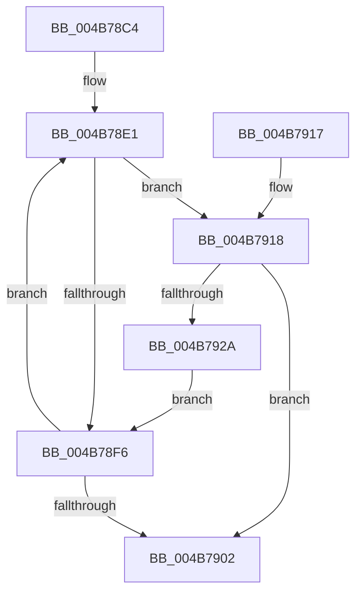

# MiWriteSegmentSignatureFlags

- RVA: `0x004B78C4`–`0x004B792C` (길이 `104` bytes)
- VA: `0x00000001404B78C4`
- 실행 섹션: `.text`
- PDB 이름 있음: `예`; PDB Function 태그: `아니요`
- unwind 정보 RVA: `0x000949B4`
- 디코드: `33`개 명령, `104/104` bytes 표시
- 미해석 바이트: `0` (있으면 어셈블리에 `.byte`로 보존)

> 이 문서는 커널 이미지의 기계어와 PDB 기호를 분석해 생성했습니다. 4번과 5번은 함수 원형과 자료형을 바이너리 사용 방식에서 추정한 C 해석이며 원본 소스 복구 결과는 아닙니다.

## 1. Dependencies

- 직접 호출 지점: **2**; 고유 호출 대상: **1**
- 직접 호출자로 확인된 함수: **1**
- RIP 상대 이미지 참조: **0**

### Outgoing calls
- `0x004B78ED` → [SeCompareSigningLevels](../../page/A1/SeCompareSigningLevels_function_00A13760.md) (function, `0x00A13760`)
- `0x004B7921` → [SeCompareSigningLevels](../../page/A1/SeCompareSigningLevels_function_00A13760.md) (function, `0x00A13760`)

### Direct callers
- [MiValidateSectionCreate](../../page/94/MiValidateSectionCreate_function_00940190.md) at `0x00940910`

### Static image references
- 디코드된 RIP-relative 메모리 참조가 없습니다.

## 2. Other-region calls and transfers

- 다른 실행 섹션으로 향하는 call: **2**
  - `0x004B78ED` → [SeCompareSigningLevels](../../page/A1/SeCompareSigningLevels_function_00A13760.md) (`.text` → `PAGE`)
  - `0x004B7921` → [SeCompareSigningLevels](../../page/A1/SeCompareSigningLevels_function_00A13760.md) (`.text` → `PAGE`)
- 별도 외부 분기/꼬리 이동을 확인하지 못했습니다.

## 3. Assembly (complete function range)

```asm
004B78C4  48 89 5C 24 08                  mov qword ptr [rsp + 8], rbx
004B78C9  48 89 6C 24 10                  mov qword ptr [rsp + 0x10], rbp
004B78CE  48 89 74 24 18                  mov qword ptr [rsp + 0x18], rsi
004B78D3  57                              push rdi
004B78D4  48 83 EC 20                     sub rsp, 0x20
004B78D8  8A 59 0F                        mov bl, byte ptr [rcx + 0xf]
004B78DB  40 8A FA                        mov dil, dl
004B78DE  48 8B E9                        mov rbp, rcx
004B78E1  40 8A F3                        mov sil, bl
004B78E4  B2 0C                           mov dl, 0xc
004B78E6  40 80 E6 0F                     and sil, 0xf
004B78EA  40 8A CE                        mov cl, sil
004B78ED  E8 6E BE 55 00                  call 0x140a13760
004B78F2  85 C0                           test eax, eax
004B78F4  75 22                           jne 0x1404b7918
004B78F6  8A C3                           mov al, bl
004B78F8  F0 40 0F B0 7D 0F               lock cmpxchg byte ptr [rbp + 0xf], dil
004B78FE  8A D8                           mov bl, al
004B7900  75 DF                           jne 0x1404b78e1
004B7902  48 8B 5C 24 30                  mov rbx, qword ptr [rsp + 0x30]
004B7907  48 8B 6C 24 38                  mov rbp, qword ptr [rsp + 0x38]
004B790C  48 8B 74 24 40                  mov rsi, qword ptr [rsp + 0x40]
004B7911  48 83 C4 20                     add rsp, 0x20
004B7915  5F                              pop rdi
004B7916  C3                              ret
004B7917  CC                              int3
004B7918  40 8A CF                        mov cl, dil
004B791B  40 8A D6                        mov dl, sil
004B791E  80 E1 0F                        and cl, 0xf
004B7921  E8 3A BE 55 00                  call 0x140a13760
004B7926  85 C0                           test eax, eax
004B7928  74 D8                           je 0x1404b7902
004B792A  EB CA                           jmp 0x1404b78f6
```

## 4. C-style interpretation (structured pseudocode)

```c
__int64 __fastcall MiWriteSegmentSignatureFlags(__int64 a1, unsigned __int8 a2)
{
    __int64 result;
    __int64 v_rsi;
    __int64 v_rsp;
    unsigned __int64 v_stack_p10;
    unsigned __int64 v_stack_p18;
    unsigned __int64 v_stack_p8;

    v_stack_p8 = v_rbx;
    v_stack_p10 = v_rbp;
    v_stack_p18 = v_rsi;
    v_rsp = (v_rsp) - (32);
loc_004B78E1:
    v_rsi = (unsigned __int8)(((unsigned __int8)(*(unsigned __int8 *)(a1 + 15))) & (15));
    result = SeCompareSigningLevels((unsigned __int8)(v_rsi), 12, a3, a4);
    if ((unsigned int)(result) != 0) goto loc_004B7918;
loc_004B78F6:
    if ((unsigned int)(result) != 0) goto loc_004B78E1;
loc_004B7902:
    v_rsp = (v_rsp) + (32);
    return (unsigned __int8)(*(unsigned __int8 *)(a1 + 15));
loc_004B7918:
    a1 = (unsigned __int8)((a2) & (15));
    result = SeCompareSigningLevels(a1, (unsigned __int8)(v_stack_p18), a3, a4);
    if ((unsigned int)(result) == 0) goto loc_004B7902;
    goto loc_004B78F6;
}
```

## 5. (Beta) C Style

```c
int64_t MiWriteSegmentSignatureFlags(void *Arg1, uint8_t Arg2)
{
    uint8_t *arg1 = (uint8_t *)Arg1;

    int64_t result;
    int64_t local_rsi;
    int64_t local_rsp;
    uint64_t v_stack_p10;
    uint64_t v_stack_p18;
    uint64_t v_stack_p8;

    v_stack_p8 = local_rbx;
    v_stack_p10 = local_rbp;
    v_stack_p18 = local_rsi;
    local_rsp = (local_rsp) - (32);
loc_004B78E1:
    local_rsi = (uint8_t)(((uint8_t)(*(uint8_t *)(arg1 + 0xF))) & (15));
    result = SeCompareSigningLevels((uint8_t)(local_rsi), 12, a3, a4);
    if ((uint32_t)(result) != 0) goto loc_004B7918;
loc_004B78F6:
    if ((uint32_t)(result) != 0) goto loc_004B78E1;
loc_004B7902:
    local_rsp = (local_rsp) + (32);
    return (uint8_t)(*(uint8_t *)(arg1 + 0xF));
loc_004B7918:
    Arg1 = (uint8_t)((Arg2) & (15));
    result = SeCompareSigningLevels(Arg1, (uint8_t)(v_stack_p18), a3, a4);
    if ((uint32_t)(result) == 0) goto loc_004B7902;
    goto loc_004B78F6;
}
```

### 관측된 메모리 오프셋

구조체 형식이 확인되지 않은 접근은 인자 기준의 오프셋으로만 기록했습니다.

| 기준 인자 | 오프셋 표현 | 폭 (bit) | 접근 |
|---|---:|---:|---|
| `Arg1` | `+ 0xF` | `8` | `R` |

## 6. Execution-region graph

[열기: 2D/3D 그래프와 함수 탐색 컨트롤 패널](../../../control-panel.html?section=text&rva=0x004B78C4&view=graph)

- 2D 그래프는 위에서 아래로 흐르고, 3D 그래프는 빈 공간을 드래그해 회전합니다. Shift+드래그는 이동, 휠은 확대·축소, 함수 노드 선택은 대상 보고서 이동입니다.

### Static fallback


