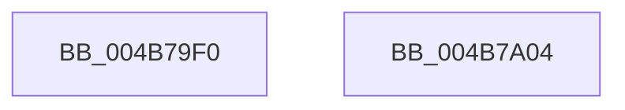

# MmIsNonPagedSystemAddressValid

- RVA: `0x004B79F0`–`0x004B7A05` (길이 `21` bytes)
- VA: `0x00000001404B79F0`
- 실행 섹션: `.text`
- PDB 이름 있음: `예`; PDB Function 태그: `아니요`
- unwind 정보 RVA: `0x0005C788`
- 디코드: `7`개 명령, `21/21` bytes 표시
- 미해석 바이트: `0` (있으면 어셈블리에 `.byte`로 보존)

> 이 문서는 커널 이미지의 기계어와 PDB 기호를 분석해 생성했습니다. 4번과 5번은 함수 원형과 자료형을 바이너리 사용 방식에서 추정한 C 해석이며 원본 소스 복구 결과는 아닙니다.

## 1. Dependencies

- 직접 호출 지점: **1**; 고유 호출 대상: **1**
- 직접 호출자로 확인된 함수: **4**
- RIP 상대 이미지 참조: **0**

### Outgoing calls
- `0x004B79F4` → [MiGetSystemRegionType](../28/MiGetSystemRegionType_function_0028EC80.md) (function, `0x0028EC80`)

### Direct callers
- [VfMiscIoInitializeWorkItem_Entry](../../pagevrfy/BA/VfMiscIoInitializeWorkItem_Entry_function_00BADB60.md) at `0x00BADB87`
- [ViMiscValidateSynchronizationObject](../../pagevrfy/BA/ViMiscValidateSynchronizationObject_function_00BAF698.md) at `0x00BAF6B0`
- [VfPnpVerifyNewRequest](../../pagevrfy/BB/VfPnpVerifyNewRequest_function_00BB5AE0.md) at `0x00BB5B3B`
- [ViPnpVerifyMinorWasProcessedProperly](../../pagevrfy/BB/ViPnpVerifyMinorWasProcessedProperly_function_00BB5BC0.md) at `0x00BB5CCC`

### Static image references
- 디코드된 RIP-relative 메모리 참조가 없습니다.

## 2. Other-region calls and transfers

- 다른 실행 섹션으로 향하는 call: **0**
- 별도 외부 분기/꼬리 이동을 확인하지 못했습니다.

## 3. Assembly (complete function range)

```asm
004B79F0  48 83 EC 28                     sub rsp, 0x28
004B79F4  E8 87 72 DD FF                  call 0x14028ec80
004B79F9  83 F8 05                        cmp eax, 5
004B79FC  0F 95 C0                        setne al
004B79FF  48 83 C4 28                     add rsp, 0x28
004B7A03  C3                              ret
004B7A04  CC                              int3
```

## 4. C-style interpretation (structured pseudocode)

```c
__int64 __fastcall MmIsNonPagedSystemAddressValid(void)
{
    __int64 result;
    __int64 v_rsp;

    v_rsp = (v_rsp) - (40);
    result = MiGetSystemRegionType(a1, a2, a3, a4);
    result = (((unsigned int)(result)) != 5) ? 1 : 0;
    v_rsp = (v_rsp) + (40);
    return result;
}
```

## 5. (Beta) C Style

```c
void MmIsNonPagedSystemAddressValid(void)
{
    int64_t result;
    int64_t local_rsp;

    local_rsp = (local_rsp) - (40);
    result = MiGetSystemRegionType(a1, a2, a3, a4);
    result = (((uint32_t)(result)) != 5) ? 1 : 0;
    local_rsp = (local_rsp) + (40);
    return result;
}
```

## 6. Execution-region graph

[열기: 2D/3D 그래프와 함수 탐색 컨트롤 패널](../../../control-panel.html?section=text&rva=0x004B79F0&view=graph)

- 2D 그래프는 위에서 아래로 흐르고, 3D 그래프는 빈 공간을 드래그해 회전합니다. Shift+드래그는 이동, 휠은 확대·축소, 함수 노드 선택은 대상 보고서 이동입니다.

### Static fallback


