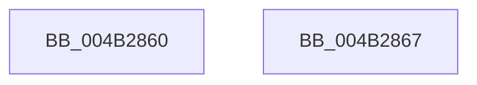

# MmIsThisAnNtAsSystem

- RVA: `0x004B2860`–`0x004B2868` (길이 `8` bytes)
- VA: `0x00000001404B2860`
- 실행 섹션: `.text`
- PDB 이름 있음: `예`; PDB Function 태그: `아니요`
- unwind 정보 RVA: `0x000DB714`
- 디코드: `3`개 명령, `8/8` bytes 표시
- 미해석 바이트: `0` (있으면 어셈블리에 `.byte`로 보존)

> 이 문서는 커널 이미지의 기계어와 PDB 기호를 분석해 생성했습니다. 4번과 5번은 함수 원형과 자료형을 바이너리 사용 방식에서 추정한 C 해석이며 원본 소스 복구 결과는 아닙니다.

## 1. Dependencies

- 직접 호출 지점: **0**; 고유 호출 대상: **0**
- 직접 호출자로 확인된 함수: **5**
- RIP 상대 이미지 참조: **1**

### Outgoing calls
- 직접 디코드된 call 명령이 없습니다.

### Direct callers
- [CcInitializeProcessor](../../page/71/CcInitializeProcessor_function_00710220.md) at `0x0071023C`
- [IopQueryProcessorInitValues](../../page/71/IopQueryProcessorInitValues_function_0071AB80.md) at `0x0071AB89`
- [ObInitializeProcessor](../../page/74/ObInitializeProcessor_function_0074DA98.md) at `0x0074DAB3`
- [IopMountVolume](../../page/A3/IopMountVolume_function_00A329D0.md) at `0x00A32A49`
- [IopMountVolume](../../page/A3/IopMountVolume_function_00A329D0.md) at `0x00A32E95`
- [IopMountVolume](../../page/A3/IopMountVolume_function_00A329D0.md) at `0x00A32F83`
- [PsChangeQuantumTable](../../page/A3/PsChangeQuantumTable_function_00A3BE70.md) at `0x00A3BF7C`
- [PsChangeQuantumTable](../../page/A3/PsChangeQuantumTable_function_00A3BE70.md) at `0x00A3BF97`

### Static image references
- `0x004B2860` → RVA `0x00FC521C` (`ALMOSTRO`; read)

## 2. Other-region calls and transfers

- 다른 실행 섹션으로 향하는 call: **0**
- 별도 외부 분기/꼬리 이동을 확인하지 못했습니다.

## 3. Assembly (complete function range)

```asm
004B2860  8A 05 B6 29 B1 00               mov al, byte ptr [rip + 0xb129b6]
004B2866  C3                              ret
004B2867  CC                              int3
```

## 4. C-style interpretation (structured pseudocode)

```c
__int64 __fastcall MmIsThisAnNtAsSystem(void)
{
    return *(unsigned __int8 *)(v_rip + 11610550);
}
```

## 5. (Beta) C Style

```c
void MmIsThisAnNtAsSystem(void)
{
    return *(uint8_t *)(v_rip + 0xB129B6);
}
```

## 6. Execution-region graph

[열기: 2D/3D 그래프와 함수 탐색 컨트롤 패널](../../../control-panel.html?section=text&rva=0x004B2860&view=graph)

- 2D 그래프는 위에서 아래로 흐르고, 3D 그래프는 빈 공간을 드래그해 회전합니다. Shift+드래그는 이동, 휠은 확대·축소, 함수 노드 선택은 대상 보고서 이동입니다.

### Static fallback


