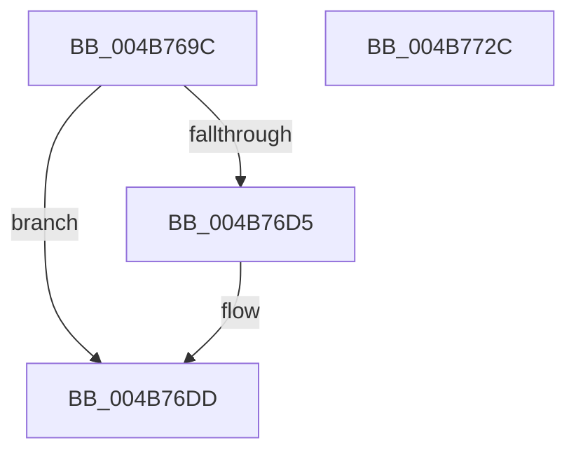

# MmStoreFlushOutstandingEvictions

- RVA: `0x004B769C`–`0x004B772D` (길이 `145` bytes)
- VA: `0x00000001404B769C`
- 실행 섹션: `.text`
- PDB 이름 있음: `예`; PDB Function 태그: `아니요`
- unwind 정보 RVA: `0x00066400`
- 디코드: `36`개 명령, `145/145` bytes 표시
- 미해석 바이트: `0` (있으면 어셈블리에 `.byte`로 보존)

> 이 문서는 커널 이미지의 기계어와 PDB 기호를 분석해 생성했습니다. 4번과 5번은 함수 원형과 자료형을 바이너리 사용 방식에서 추정한 C 해석이며 원본 소스 복구 결과는 아닙니다.

## 1. Dependencies

- 직접 호출 지점: **5**; 고유 호출 대상: **5**
- 직접 호출자로 확인된 함수: **2**
- RIP 상대 이미지 참조: **0**

### Outgoing calls
- `0x004B76BD` → [ExAcquireSpinLockExclusive](../24/ExAcquireSpinLockExclusive_function_00248690.md) (function, `0x00248690`)
- `0x004B76D8` → [KeResetEvent](../24/KeResetEvent_function_00248350.md) (function, `0x00248350`)
- `0x004B76E9` → [MiReleaseSpinLockExclusive](../24/MiReleaseSpinLockExclusive_function_002482C0.md) (function, `0x002482C0`)
- `0x004B76FA` → [KeSetEvent](../33/KeSetEvent_function_0033F310.md) (function, `0x0033F310`)
- `0x004B7712` → [KeWaitForSingleObject](../20/KeWaitForSingleObject_function_0020E6B0.md) (function, `0x0020E6B0`)

### Direct callers
- [MiStoreDeletePartition](../69/MiStoreDeletePartition_function_006926F4.md) at `0x006927A8`
- [SmStoreCompressionStart](../../page/A6/SmStoreCompressionStart_function_00A61AD0.md) at `0x00A61B25`

### Static image references
- 디코드된 RIP-relative 메모리 참조가 없습니다.

## 2. Other-region calls and transfers

- 다른 실행 섹션으로 향하는 call: **0**
- 별도 외부 분기/꼬리 이동을 확인하지 못했습니다.

## 3. Assembly (complete function range)

```asm
004B769C  48 89 5C 24 08                  mov qword ptr [rsp + 8], rbx
004B76A1  48 89 6C 24 10                  mov qword ptr [rsp + 0x10], rbp
004B76A6  48 89 74 24 18                  mov qword ptr [rsp + 0x18], rsi
004B76AB  57                              push rdi
004B76AC  48 83 EC 30                     sub rsp, 0x30
004B76B0  48 8B 19                        mov rbx, qword ptr [rcx]
004B76B3  48 8D B3 20 05 00 00            lea rsi, [rbx + 0x520]
004B76BA  48 8B CE                        mov rcx, rsi
004B76BD  E8 CE 0F D9 FF                  call 0x140248690
004B76C2  83 BB C0 04 00 00 00            cmp dword ptr [rbx + 0x4c0], 0
004B76C9  48 8D BB 70 05 00 00            lea rdi, [rbx + 0x570]
004B76D0  40 8A E8                        mov bpl, al
004B76D3  75 08                           jne 0x1404b76dd
004B76D5  48 8B CF                        mov rcx, rdi
004B76D8  E8 73 0C D9 FF                  call 0x140248350
004B76DD  FF 83 C0 04 00 00               inc dword ptr [rbx + 0x4c0]
004B76E3  40 8A D5                        mov dl, bpl
004B76E6  48 8B CE                        mov rcx, rsi
004B76E9  E8 D2 0B D9 FF                  call 0x1402482c0
004B76EE  48 8D 8B 30 05 00 00            lea rcx, [rbx + 0x530]
004B76F5  45 33 C0                        xor r8d, r8d
004B76F8  33 D2                           xor edx, edx
004B76FA  E8 11 7C E8 FF                  call 0x14033f310
004B76FF  48 83 64 24 20 00               and qword ptr [rsp + 0x20], 0
004B7705  45 33 C9                        xor r9d, r9d
004B7708  45 33 C0                        xor r8d, r8d
004B770B  48 8B CF                        mov rcx, rdi
004B770E  41 8D 51 1A                     lea edx, [r9 + 0x1a]
004B7712  E8 99 6F D5 FF                  call 0x14020e6b0
004B7717  48 8B 5C 24 40                  mov rbx, qword ptr [rsp + 0x40]
004B771C  48 8B 6C 24 48                  mov rbp, qword ptr [rsp + 0x48]
004B7721  48 8B 74 24 50                  mov rsi, qword ptr [rsp + 0x50]
004B7726  48 83 C4 30                     add rsp, 0x30
004B772A  5F                              pop rdi
004B772B  C3                              ret
004B772C  CC                              int3
```

## 4. C-style interpretation (structured pseudocode)

```c
__int64 __fastcall MmStoreFlushOutstandingEvictions(__int64 a1, __int64 a2, int a3, int a4)
{
    __int64 result;
    __int64 v_rsp;
    unsigned __int64 v_stack_m18;
    unsigned __int64 v_stack_p10;
    unsigned __int64 v_stack_p18;
    unsigned __int64 v_stack_p8;

    v_stack_p8 = v_rbx;
    v_stack_p10 = v_rbp;
    v_stack_p18 = v_rsi;
    v_rsp = (v_rsp) - (48);
    result = ExAcquireSpinLockExclusive(*(unsigned __int64 *)(a1) + 1312, a2, a3, a4);
    if ((*(unsigned int *)(*(unsigned __int64 *)(a1) + 1216)) == 0) {
        a1 = *(unsigned __int64 *)(a1) + 1392;
        result = KeResetEvent(a1, a2, a3, a4);
    }
    result = MiReleaseSpinLockExclusive(*(unsigned __int64 *)(a1) + 1312, (unsigned __int8)((unsigned __int8)(result)), a3, a4);
    a3 = 0;
    a2 = 0;
    result = KeSetEvent(*(unsigned __int64 *)(a1) + 1328, a2, a3, a4);
    a4 = 0;
    a3 = 0;
    result = KeWaitForSingleObject(*(unsigned __int64 *)(a1) + 1392, a4 + 26, a3, a4);
    v_rsp = (v_rsp) + (48);
    return result;
}
```

## 5. (Beta) C Style

```c
int64_t MmStoreFlushOutstandingEvictions(void *Arg1, int64_t Arg2, int32_t Arg3, int32_t Arg4)
{
    uint8_t *arg1 = (uint8_t *)Arg1;

    int64_t result;
    int64_t local_rsp;
    uint64_t v_stack_m18;
    uint64_t v_stack_p10;
    uint64_t v_stack_p18;
    uint64_t v_stack_p8;

    v_stack_p8 = local_rbx;
    v_stack_p10 = local_rbp;
    v_stack_p18 = local_rsi;
    local_rsp = (local_rsp) - (48);
    result = ExAcquireSpinLockExclusive(*(uint64_t *)(arg1) + 1312, Arg2, Arg3, Arg4);
    if ((*(uint32_t *)(*(uint64_t *)(arg1) + 0x4C0)) == 0) {
        Arg1 = *(uint64_t *)(arg1) + 1392;
        result = KeResetEvent(Arg1, Arg2, Arg3, Arg4);
    }
    result = MiReleaseSpinLockExclusive(*(uint64_t *)(arg1) + 1312, (uint8_t)((uint8_t)(result)), Arg3, Arg4);
    Arg3 = 0;
    Arg2 = 0;
    result = KeSetEvent(*(uint64_t *)(arg1) + 1328, Arg2, Arg3, Arg4);
    Arg4 = 0;
    Arg3 = 0;
    result = KeWaitForSingleObject(*(uint64_t *)(arg1) + 1392, Arg4 + 26, Arg3, Arg4);
    local_rsp = (local_rsp) + (48);
    return result;
}
```

### 관측된 메모리 오프셋

구조체 형식이 확인되지 않은 접근은 인자 기준의 오프셋으로만 기록했습니다.

| 기준 인자 | 오프셋 표현 | 폭 (bit) | 접근 |
|---|---:|---:|---|
| `Arg1` | `+ 0x0` | `64` | `R` |

## 6. Execution-region graph

[열기: 2D/3D 그래프와 함수 탐색 컨트롤 패널](../../../control-panel.html?section=text&rva=0x004B769C&view=graph)

- 2D 그래프는 위에서 아래로 흐르고, 3D 그래프는 빈 공간을 드래그해 회전합니다. Shift+드래그는 이동, 휠은 확대·축소, 함수 노드 선택은 대상 보고서 이동입니다.

### Static fallback


