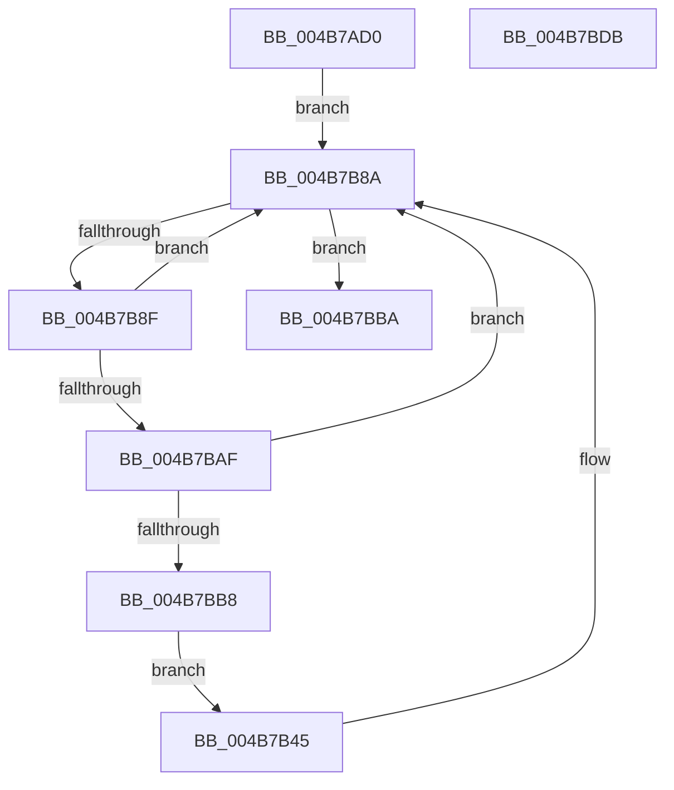

# PerfInfoLogIpiSend

- RVA: `0x004B7AD0`–`0x004B7BDC` (길이 `268` bytes)
- VA: `0x00000001404B7AD0`
- 실행 섹션: `.text`
- PDB 이름 있음: `예`; PDB Function 태그: `아니요`
- unwind 정보 RVA: `0x000BAAA4`
- 디코드: `63`개 명령, `268/268` bytes 표시
- 미해석 바이트: `0` (있으면 어셈블리에 `.byte`로 보존)

> 이 문서는 커널 이미지의 기계어와 PDB 기호를 분석해 생성했습니다. 4번과 5번은 함수 원형과 자료형을 바이너리 사용 방식에서 추정한 C 해석이며 원본 소스 복구 결과는 아닙니다.

## 1. Dependencies

- 직접 호출 지점: **2**; 고유 호출 대상: **2**
- 직접 호출자로 확인된 함수: **1**
- RIP 상대 이미지 참조: **2**

### Outgoing calls
- `0x004B7B85` → [EtwpLogKernelEvent](../25/EtwpLogKernelEvent_function_0025CC00.md) (function, `0x0025CC00`)
- `0x004B7BC1` → [_security_check_cookie](../6A/_security_check_cookie_function_006AC640.md) (function, `0x006AC640`)

### Direct callers
- [KiIpiSendRequest](../31/KiIpiSendRequest_function_003113C0.md) at `0x00311A0D`

### Static image references
- `0x004B7AE7` → RVA `0x00E0A740` (`.data`; read)
- `0x004B7B2B` → RVA `0x00FC6AA8` (`ALMOSTRO`; read)

## 2. Other-region calls and transfers

- 다른 실행 섹션으로 향하는 call: **0**
- 별도 외부 분기/꼬리 이동을 확인하지 못했습니다.

## 3. Assembly (complete function range)

```asm
004B7AD0  48 89 5C 24 08                  mov qword ptr [rsp + 8], rbx
004B7AD5  48 89 7C 24 10                  mov qword ptr [rsp + 0x10], rdi
004B7ADA  55                              push rbp
004B7ADB  48 8D 6C 24 B1                  lea rbp, [rsp - 0x4f]
004B7AE0  48 81 EC 90 00 00 00            sub rsp, 0x90
004B7AE7  48 8B 05 52 2C 95 00            mov rax, qword ptr [rip + 0x952c52]
004B7AEE  48 33 C4                        xor rax, rsp
004B7AF1  48 89 45 3F                     mov qword ptr [rbp + 0x3f], rax
004B7AF5  48 8B 45 7F                     mov rax, qword ptr [rbp + 0x7f]
004B7AF9  48 8B F9                        mov rdi, rcx
004B7AFC  83 65 2B 00                     and dword ptr [rbp + 0x2b], 0
004B7B00  48 8D 4D F7                     lea rcx, [rbp - 9]
004B7B04  89 55 FF                        mov dword ptr [rbp - 1], edx
004B7B07  4C 89 45 F7                     mov qword ptr [rbp - 9], r8
004B7B0B  0F B7 10                        movzx edx, word ptr [rax]
004B7B0E  48 83 C0 08                     add rax, 8
004B7B12  83 65 3B 00                     and dword ptr [rbp + 0x3b], 0
004B7B16  48 89 45 2F                     mov qword ptr [rbp + 0x2f], rax
004B7B1A  44 89 4D 03                     mov dword ptr [rbp + 3], r9d
004B7B1E  8D 04 D5 00 00 00 00            lea eax, [rdx*8]
004B7B25  89 55 07                        mov dword ptr [rbp + 7], edx
004B7B28  89 45 37                        mov dword ptr [rbp + 0x37], eax
004B7B2B  48 8B 05 76 EF B0 00            mov rax, qword ptr [rip + 0xb0ef76]
004B7B32  48 89 4D 1F                     mov qword ptr [rbp + 0x1f], rcx
004B7B36  C7 45 27 14 00 00 00            mov dword ptr [rbp + 0x27], 0x14
004B7B3D  8B 98 A8 11 00 00               mov ebx, dword ptr [rax + 0x11a8]
004B7B43  EB 45                           jmp 0x1404b7b8a
004B7B45  0F B6 84 4A 99 11 00 00         movzx eax, byte ptr [rdx + rcx*2 + 0x1199]
004B7B4D  41 B9 03 00 00 00               mov r9d, 3
004B7B53  83 65 1B 00                     and dword ptr [rbp + 0x1b], 0
004B7B57  48 FF C8                        dec rax
004B7B5A  C7 45 17 08 00 00 00            mov dword ptr [rbp + 0x17], 8
004B7B61  C7 44 24 28 02 1A 50 00         mov dword ptr [rsp + 0x28], 0x501a02
004B7B69  66 C7 44 24 20 70 0F            mov word ptr [rsp + 0x20], 0xf70
004B7B70  48 8D 0C C7                     lea rcx, [rdi + rax*8]
004B7B74  48 89 4D 0F                     mov qword ptr [rbp + 0xf], rcx
004B7B78  48 8D 4D 0F                     lea rcx, [rbp + 0xf]
004B7B7C  46 0F B6 84 42 98 11 00 00      movzx r8d, byte ptr [rdx + r8*2 + 0x1198]
004B7B85  E8 76 50 DA FF                  call 0x14025cc00
004B7B8A  0F BC CB                        bsf ecx, ebx
004B7B8D  74 2B                           je 0x1404b7bba
004B7B8F  48 8B 15 12 EF B0 00            mov rdx, qword ptr [rip + 0xb0ef12]
004B7B96  8D 43 FF                        lea eax, [rbx - 1]
004B7B99  23 D8                           and ebx, eax
004B7B9B  44 8B C1                        mov r8d, ecx
004B7B9E  8B C1                           mov eax, ecx
004B7BA0  48 C1 E0 05                     shl rax, 5
004B7BA4  48 05 CC 11 00 00               add rax, 0x11cc
004B7BAA  48 03 C2                        add rax, rdx
004B7BAD  74 DB                           je 0x1404b7b8a
004B7BAF  F7 40 08 00 00 40 00            test dword ptr [rax + 8], 0x400000
004B7BB6  74 D2                           je 0x1404b7b8a
004B7BB8  EB 8B                           jmp 0x1404b7b45
004B7BBA  48 8B 4D 3F                     mov rcx, qword ptr [rbp + 0x3f]
004B7BBE  48 33 CC                        xor rcx, rsp
004B7BC1  E8 7A 4A 1F 00                  call 0x1406ac640
004B7BC6  4C 8D 9C 24 90 00 00 00         lea r11, [rsp + 0x90]
004B7BCE  49 8B 5B 10                     mov rbx, qword ptr [r11 + 0x10]
004B7BD2  49 8B 7B 18                     mov rdi, qword ptr [r11 + 0x18]
004B7BD6  49 8B E3                        mov rsp, r11
004B7BD9  5D                              pop rbp
004B7BDA  C3                              ret
004B7BDB  CC                              int3
```

## 4. C-style interpretation (structured pseudocode)

```c
__int64 __fastcall PerfInfoLogIpiSend(__int64 a1, int a2, __int64 a3, int a4, __int64 a5)
{
    __int64 result;
    __int64 v_rbx;
    __int64 v_rsp;
    unsigned __int64 v_stack_m18;
    unsigned int v_stack_m1C;
    unsigned int v_stack_m20;
    unsigned __int64 v_stack_m28;
    unsigned int v_stack_m2C;
    unsigned int v_stack_m30;
    unsigned __int64 v_stack_m38;
    unsigned int v_stack_m3C;
    unsigned int v_stack_m40;
    unsigned __int64 v_stack_m48;
    unsigned int v_stack_m50;
    unsigned int v_stack_m54;
    unsigned __int64 v_stack_m57;
    unsigned int v_stack_m58;
    unsigned __int64 v_stack_m60;
    unsigned int v_stack_m70;
    unsigned __int16 v_stack_m78;
    unsigned __int64 v_stack_m8;
    unsigned __int64 v_stack_p10;
    unsigned __int64 v_stack_p8;

    v_stack_p8 = v_rbx;
    v_stack_p10 = v_rdi;
    v_rsp = (v_rsp) - (144);
    result = (*(unsigned __int64 *)(v_rip + 9776210)) ^ (v_rsp);
    v_stack_m18 = result;
    v_stack_m58 = a2;
    v_stack_m60 = a3;
    result = (a5) + (8);
    v_stack_m28 = result;
    v_stack_m54 = a4;
    v_stack_m50 = (unsigned int)(*(unsigned __int16 *)(a5));
    v_stack_m20 = (unsigned int)(*(unsigned __int16 *)(a5) * 8);
    v_stack_m38 = v_stack_m60;
    v_stack_m30 = 20;
    goto loc_004B7B8A;
loc_004B7B45:
    result = (*(unsigned __int8 *)(*(unsigned __int16 *)(a5) + v_stack_m60 * 2 + 4505)) - 1;
    v_stack_m40 = 8;
    v_stack_m70 = 0x501A02ULL;
    v_stack_m78 = 0xF70ULL;
    v_stack_m48 = a1 + result * 8;
    result = EtwpLogKernelEvent(v_stack_m48, *(unsigned __int16 *)(a5), *(unsigned __int8 *)(*(unsigned __int16 *)(a5) + a3 * 2 + 4504), 3);
loc_004B7B8A:
    if (condition_is_equal) goto loc_004B7BBA;
    v_rbx = (unsigned int)(((unsigned int)(*(unsigned int *)(*(unsigned __int64 *)(v_rip + 11595638) + 4520))) & ((unsigned int)((unsigned int)(*(unsigned int *)(*(unsigned __int64 *)(v_rip + 11595638) + 4520)) - 1)));
    result = ((unsigned int)((unsigned int)(v_stack_m48))) << (5);
    result = (result) + (0x11CCULL);
    result = (result) + (*(unsigned __int64 *)(v_rip + 11595538));
    if (condition_is_equal) goto loc_004B7B8A;
    if (((*(unsigned int *)(result + 8)) & (0x400000ULL)) == 0) goto loc_004B7B8A;
    goto loc_004B7B45;
loc_004B7BBA:
    a1 = (v_stack_m18) ^ (v_rsp);
    result = _security_check_cookie(a1, *(unsigned __int64 *)(v_rip + 11595538), (unsigned int)((unsigned int)(v_stack_m48)), 3);
    return result;
}
```

## 5. (Beta) C Style

```c
int64_t PerfInfoLogIpiSend(void *Arg1, int32_t Arg2, int64_t Arg3, int32_t Arg4, void *Arg5)
{
    uint8_t *arg1 = (uint8_t *)Arg1;
    uint8_t *arg5 = (uint8_t *)Arg5;

    int64_t result;
    int64_t local_rbx;
    int64_t local_rsp;
    uint64_t v_stack_m18;
    uint32_t v_stack_m1C;
    uint32_t v_stack_m20;
    uint64_t v_stack_m28;
    uint32_t v_stack_m2C;
    uint32_t v_stack_m30;
    uint64_t v_stack_m38;
    uint32_t v_stack_m3C;
    uint32_t v_stack_m40;
    uint64_t v_stack_m48;
    uint32_t v_stack_m50;
    uint32_t v_stack_m54;
    uint64_t v_stack_m57;
    uint32_t v_stack_m58;
    uint64_t v_stack_m60;
    uint32_t v_stack_m70;
    uint16_t v_stack_m78;
    uint64_t v_stack_m8;
    uint64_t v_stack_p10;
    uint64_t v_stack_p8;

    v_stack_p8 = local_rbx;
    v_stack_p10 = local_rdi;
    local_rsp = (local_rsp) - (144);
    result = (*(uint64_t *)(v_rip + 0x952C52)) ^ (local_rsp);
    v_stack_m18 = result;
    v_stack_m58 = Arg2;
    v_stack_m60 = Arg3;
    result = (Arg5) + (8);
    v_stack_m28 = result;
    v_stack_m54 = Arg4;
    v_stack_m50 = (uint32_t)(*(uint16_t *)(arg5));
    v_stack_m20 = (uint32_t)(*(uint16_t *)(arg5) * 8);
    v_stack_m38 = v_stack_m60;
    v_stack_m30 = 20;
    goto loc_004B7B8A;
loc_004B7B45:
    result = (*(uint8_t *)(*(uint16_t *)(arg5) + v_stack_m60 * 2 + 0x1199)) - 1;
    v_stack_m40 = 8;
    v_stack_m70 = 0x501A02ULL;
    v_stack_m78 = 0xF70ULL;
    v_stack_m48 = Arg1 + result * 8;
    result = EtwpLogKernelEvent(v_stack_m48, *(uint16_t *)(arg5), *(uint8_t *)(*(uint16_t *)(arg5) + Arg3 * 2 + 0x1198), 3);
loc_004B7B8A:
    if (condition_is_equal) goto loc_004B7BBA;
    local_rbx = (uint32_t)(((uint32_t)(*(uint32_t *)(*(uint64_t *)(v_rip + 0xB0EF76) + 0x11A8))) & ((uint32_t)((uint32_t)(*(uint32_t *)(*(uint64_t *)(v_rip + 0xB0EF76) + 0x11A8)) - 1)));
    result = ((uint32_t)((uint32_t)(v_stack_m48))) << (5);
    result = (result) + (0x11CCULL);
    result = (result) + (*(uint64_t *)(v_rip + 0xB0EF12));
    if (condition_is_equal) goto loc_004B7B8A;
    if (((*(uint32_t *)(result + 0x8)) & (0x400000ULL)) == 0) goto loc_004B7B8A;
    goto loc_004B7B45;
loc_004B7BBA:
    Arg1 = (v_stack_m18) ^ (local_rsp);
    result = _security_check_cookie(Arg1, *(uint64_t *)(v_rip + 0xB0EF12), (uint32_t)((uint32_t)(v_stack_m48)), 3);
    return result;
}
```

### 관측된 메모리 오프셋

구조체 형식이 확인되지 않은 접근은 인자 기준의 오프셋으로만 기록했습니다.

| 기준 인자 | 오프셋 표현 | 폭 (bit) | 접근 |
|---|---:|---:|---|
| `Arg1` | `+ 0x0 + rax*8` | `64` | `R` |
| `Arg5` | `+ 0x0` | `16` | `R` |

## 6. Execution-region graph

[열기: 2D/3D 그래프와 함수 탐색 컨트롤 패널](../../../control-panel.html?section=text&rva=0x004B7AD0&view=graph)

- 2D 그래프는 위에서 아래로 흐르고, 3D 그래프는 빈 공간을 드래그해 회전합니다. Shift+드래그는 이동, 휠은 확대·축소, 함수 노드 선택은 대상 보고서 이동입니다.

### Static fallback


