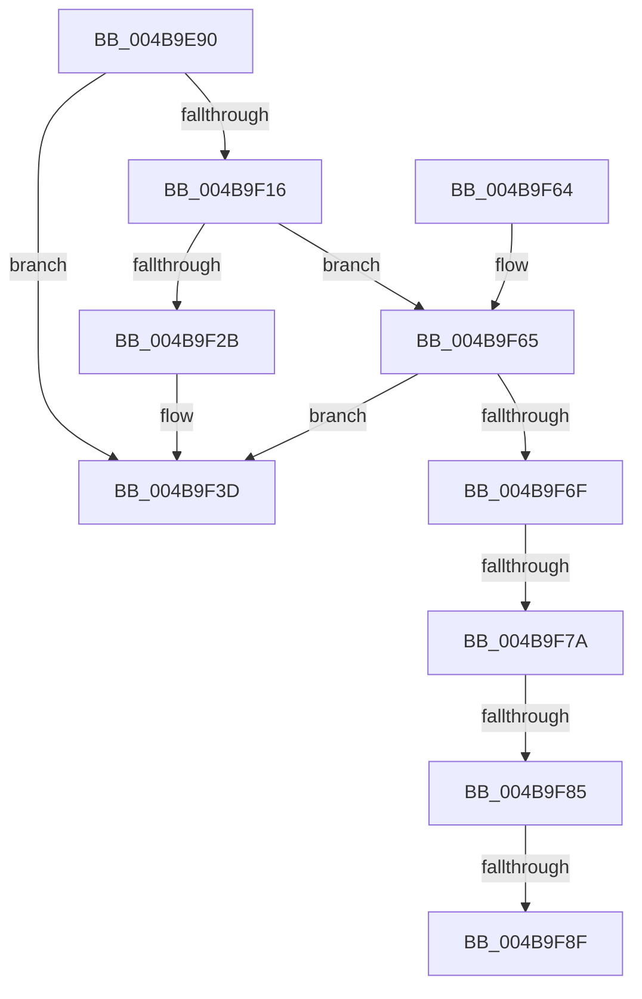

# PerfLogExecutiveResourceWait

- RVA: `0x004B9E90`–`0x004B9F97` (길이 `263` bytes)
- VA: `0x00000001404B9E90`
- 실행 섹션: `.text`
- PDB 이름 있음: `예`; PDB Function 태그: `예`
- unwind 정보 RVA: `0x000BB2C4`
- 디코드: `70`개 명령, `263/263` bytes 표시
- 미해석 바이트: `0` (있으면 어셈블리에 `.byte`로 보존)

> 이 문서는 커널 이미지의 기계어와 PDB 기호를 분석해 생성했습니다. 4번과 5번은 함수 원형과 자료형을 바이너리 사용 방식에서 추정한 C 해석이며 원본 소스 복구 결과는 아닙니다.

## 1. Dependencies

- 직접 호출 지점: **2**; 고유 호출 대상: **2**
- 직접 호출자로 확인된 함수: **4**
- RIP 상대 이미지 참조: **1**

### Outgoing calls
- `0x004B9F06` → [EtwpGetTrackingLockSlotForThread](../21/EtwpGetTrackingLockSlotForThread_function_00215B34.md) (function, `0x00215B34`)
- `0x004B9F44` → [_security_check_cookie](../6A/_security_check_cookie_function_006AC640.md) (function, `0x006AC640`)

### Direct callers
- [ExpWaitForResource](../21/ExpWaitForResource_function_002166F0.md) at `0x002167D2`
- [ExpAcquireSharedStarveExclusive](../34/ExpAcquireSharedStarveExclusive_function_003411C0.md) at `0x003417E9`
- [ExpWaitForFastResource](../3B/ExpWaitForFastResource_function_003BE760.md) at `0x003BE89D`
- [sub_006E96C4](../6E/Unknown_function_006E96C4.md) at `0x006E9738`

### Static image references
- `0x004B9EAA` → RVA `0x00E0A740` (`.data`; read)

## 2. Other-region calls and transfers

- 다른 실행 섹션으로 향하는 call: **0**
- call이 아닌 외부 분기/꼬리 이동: **4**
  - `0x004B9F74` → [sub_006FC414](../6F/Unknown_function_006FC414.md) (`tail-transfer`)
  - `0x004B9F7F` → [sub_006FC414](../6F/Unknown_function_006FC414.md) (`tail-transfer`)
  - `0x004B9F89` → [sub_006FC414](../6F/Unknown_function_006FC414.md) (`tail-transfer`)
  - `0x004B9F92` → [sub_006FC414 + 0x3](../6F/Unknown_function_006FC414.md) (`tail-transfer`)

## 3. Assembly (complete function range)

```asm
004B9E90  48 89 5C 24 18                  mov qword ptr [rsp + 0x18], rbx
004B9E95  55                              push rbp
004B9E96  56                              push rsi
004B9E97  57                              push rdi
004B9E98  41 54                           push r12
004B9E9A  41 55                           push r13
004B9E9C  41 56                           push r14
004B9E9E  41 57                           push r15
004B9EA0  48 8B EC                        mov rbp, rsp
004B9EA3  48 81 EC 80 00 00 00            sub rsp, 0x80
004B9EAA  48 8B 05 8F 08 95 00            mov rax, qword ptr [rip + 0x95088f]
004B9EB1  48 33 C4                        xor rax, rsp
004B9EB4  48 89 45 F8                     mov qword ptr [rbp - 8], rax
004B9EB8  83 65 B0 00                     and dword ptr [rbp - 0x50], 0
004B9EBC  45 8B F0                        mov r14d, r8d
004B9EBF  4C 8B EA                        mov r13, rdx
004B9EC2  8B F1                           mov esi, ecx
004B9EC4  0F 31                           rdtsc
004B9EC6  65 48 8B 3C 25 20 00 00 00      mov rdi, qword ptr gs:[0x20]
004B9ECF  48 C1 E2 20                     shl rdx, 0x20
004B9ED3  48 0B C2                        or rax, rdx
004B9ED6  C6 45 B3 00                     mov byte ptr [rbp - 0x4d], 0
004B9EDA  8B D1                           mov edx, ecx
004B9EDC  48 8B D8                        mov rbx, rax
004B9EDF  44 0F B6 BF D0 00 00 00         movzx r15d, byte ptr [rdi + 0xd0]
004B9EE7  81 E2 00 00 FF FF               and edx, 0xffff0000
004B9EED  44 8A A7 D1 00 00 00            mov r12b, byte ptr [rdi + 0xd1]
004B9EF4  49 8B CD                        mov rcx, r13
004B9EF7  FF 87 70 8F 00 00               inc dword ptr [rdi + 0x8f70]
004B9EFD  66 44 89 7D B0                  mov word ptr [rbp - 0x50], r15w
004B9F02  44 88 65 B2                     mov byte ptr [rbp - 0x4e], r12b
004B9F06  E8 29 BC D5 FF                  call 0x140215b34
004B9F0B  45 33 C9                        xor r9d, r9d
004B9F0E  4C 8B C0                        mov r8, rax
004B9F11  48 85 C0                        test rax, rax
004B9F14  74 27                           je 0x1404b9f3d
004B9F16  FF 87 74 8F 00 00               inc dword ptr [rdi + 0x8f74]
004B9F1C  8D 8E DC FF FE FF               lea ecx, [rsi - 0x10024]
004B9F22  B8 DF FF FF FF                  mov eax, 0xffffffdf
004B9F27  85 C8                           test eax, ecx
004B9F29  75 3A                           jne 0x1404b9f65
004B9F2B  8B 45 B0                        mov eax, dword ptr [rbp - 0x50]
004B9F2E  41 89 40 18                     mov dword ptr [r8 + 0x18], eax
004B9F32  41 C7 40 20 04 00 00 00         mov dword ptr [r8 + 0x20], 4
004B9F3A  49 89 18                        mov qword ptr [r8], rbx
004B9F3D  48 8B 4D F8                     mov rcx, qword ptr [rbp - 8]
004B9F41  48 33 CC                        xor rcx, rsp
004B9F44  E8 F7 26 1F 00                  call 0x1406ac640
004B9F49  48 8B 9C 24 D0 00 00 00         mov rbx, qword ptr [rsp + 0xd0]
004B9F51  48 81 C4 80 00 00 00            add rsp, 0x80
004B9F58  41 5F                           pop r15
004B9F5A  41 5E                           pop r14
004B9F5C  41 5D                           pop r13
004B9F5E  41 5C                           pop r12
004B9F60  5F                              pop rdi
004B9F61  5E                              pop rsi
004B9F62  5D                              pop rbp
004B9F63  C3                              ret
004B9F64  CC                              int3
004B9F65  8D 8E DC FD FE FF               lea ecx, [rsi - 0x10224]
004B9F6B  85 C8                           test eax, ecx
004B9F6D  75 CE                           jne 0x1404b9f3d
004B9F6F  41 83 78 20 04                  cmp dword ptr [r8 + 0x20], 4
004B9F74  0F 85 9A 24 24 00               jne 0x1406fc414
004B9F7A  66 45 39 78 18                  cmp word ptr [r8 + 0x18], r15w
004B9F7F  0F 85 8F 24 24 00               jne 0x1406fc414
004B9F85  45 38 60 1A                     cmp byte ptr [r8 + 0x1a], r12b
004B9F89  0F 85 85 24 24 00               jne 0x1406fc414
004B9F8F  49 2B 18                        sub rbx, qword ptr [r8]
004B9F92  E9 80 24 24 00                  jmp 0x1406fc417
```

## 4. C-style interpretation (structured pseudocode)

```c
__int64 __fastcall PerfLogExecutiveResourceWait(int a1, __int64 a2, int a3, int a4)
{
    __int64 result;
    __int64 v_rbx;
    __int64 v_rsp;
    unsigned __int64 v_stack_m40;
    unsigned __int8 v_stack_m85;
    unsigned __int8 v_stack_m86;
    unsigned int v_stack_m88;
    unsigned __int64 v_stack_p18;

    v_stack_p18 = v_rbx;
    v_rsp = (v_rsp) - (128);
    result = (*(unsigned __int64 *)(v_rip + 9767055)) ^ (v_rsp);
    v_stack_m40 = result;
    a2 = (a2) << (32);
    result = (result) | (a2);
    v_stack_m85 = 0;
    a2 = (unsigned int)(((unsigned int)(a1)) & (0xFFFF0000ULL));
    v_stack_m88 = (unsigned __int16)(*(unsigned __int8 *)(*(unsigned __int64 *)(gs_base + (0 + 32)) + 208));
    v_stack_m86 = (unsigned __int8)(*(unsigned __int8 *)(*(unsigned __int64 *)(gs_base + (0 + 32)) + 209));
    result = EtwpGetTrackingLockSlotForThread(a2, a2, a3, a4);
    a4 = 0;
    if (result == 0) goto loc_004B9F3D;
    if ((((unsigned int)((unsigned int)(0xFFFFFFDFULL))) & ((unsigned int)((unsigned int)(a1) - 65572))) != 0) goto loc_004B9F65;
    *(unsigned int *)(result + 24) = (unsigned int)((unsigned int)(v_stack_m88));
    *(unsigned int *)(result + 32) = 4;
    *(unsigned __int64 *)(result) = result;
loc_004B9F3D:
    a1 = (v_stack_m40) ^ (v_rsp);
    result = _security_check_cookie(a1, a2, result, a4);
    v_rsp = (v_rsp) + (128);
    return result;
loc_004B9F65:
    if ((((unsigned int)(result)) & ((unsigned int)((unsigned int)(a1) - 66084))) != 0) goto loc_004B9F3D;
    v_rbx = (v_stack_p18) - (*(unsigned __int64 *)(result));
}
```

## 5. (Beta) C Style

```c
int64_t PerfLogExecutiveResourceWait(void *Arg1, int64_t Arg2, int32_t Arg3, int32_t Arg4)
{
    uint8_t *arg1 = (uint8_t *)Arg1;

    int64_t result;
    int64_t local_rbx;
    int64_t local_rsp;
    uint64_t v_stack_m40;
    uint8_t v_stack_m85;
    uint8_t v_stack_m86;
    uint32_t v_stack_m88;
    uint64_t v_stack_p18;

    v_stack_p18 = local_rbx;
    local_rsp = (local_rsp) - (128);
    result = (*(uint64_t *)(v_rip + 0x95088F)) ^ (local_rsp);
    v_stack_m40 = result;
    Arg2 = (Arg2) << (32);
    result = (result) | (Arg2);
    v_stack_m85 = 0;
    Arg2 = (uint32_t)(((uint32_t)(Arg1)) & (0xFFFF0000ULL));
    v_stack_m88 = (uint16_t)(*(uint8_t *)(*(uint64_t *)(gs_base + (0 + 0x20)) + 0xD0));
    v_stack_m86 = (uint8_t)(*(uint8_t *)(*(uint64_t *)(gs_base + (0 + 0x20)) + 0xD1));
    result = EtwpGetTrackingLockSlotForThread(Arg2, Arg2, Arg3, Arg4);
    Arg4 = 0;
    if (result == 0) goto loc_004B9F3D;
    if ((((uint32_t)((uint32_t)(0xFFFFFFDFULL))) & ((uint32_t)((uint32_t)(Arg1) - 65572))) != 0) goto loc_004B9F65;
    *(uint32_t *)(result + 0x18) = (uint32_t)((uint32_t)(v_stack_m88));
    *(uint32_t *)(result + 0x20) = 4;
    *(uint64_t *)(result) = result;
loc_004B9F3D:
    Arg1 = (v_stack_m40) ^ (local_rsp);
    result = _security_check_cookie(Arg1, Arg2, result, Arg4);
    local_rsp = (local_rsp) + (128);
    return result;
loc_004B9F65:
    if ((((uint32_t)(result)) & ((uint32_t)((uint32_t)(Arg1) - 66084))) != 0) goto loc_004B9F3D;
    local_rbx = (v_stack_p18) - (*(uint64_t *)(result));
}
```

### 관측된 메모리 오프셋

구조체 형식이 확인되지 않은 접근은 인자 기준의 오프셋으로만 기록했습니다.

| 기준 인자 | 오프셋 표현 | 폭 (bit) | 접근 |
|---|---:|---:|---|
| `Arg1` | `- 0x10224` | `32` | `R` |
| `Arg1` | `- 0x10024` | `32` | `R` |

## 6. Execution-region graph

[열기: 2D/3D 그래프와 함수 탐색 컨트롤 패널](../../../control-panel.html?section=text&rva=0x004B9E90&view=graph)

- 2D 그래프는 위에서 아래로 흐르고, 3D 그래프는 빈 공간을 드래그해 회전합니다. Shift+드래그는 이동, 휠은 확대·축소, 함수 노드 선택은 대상 보고서 이동입니다.

### Static fallback


