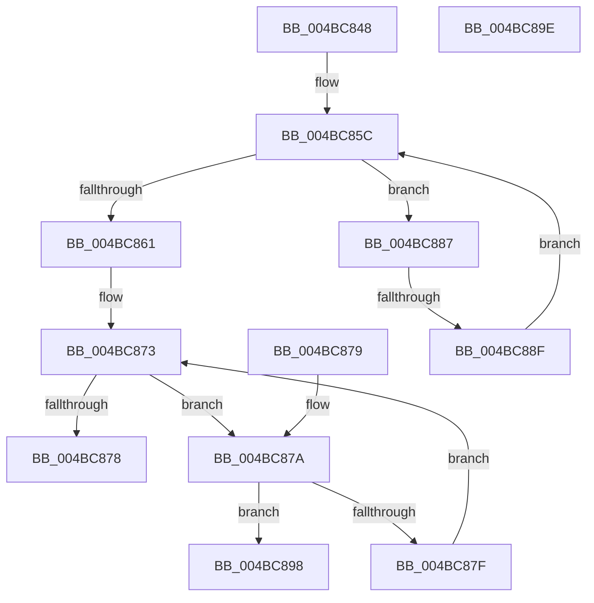

# PfpRpControlRequestVerify

- RVA: `0x004BC848`–`0x004BC89F` (길이 `87` bytes)
- VA: `0x00000001404BC848`
- 실행 섹션: `.text`
- PDB 이름 있음: `예`; PDB Function 태그: `예`
- unwind 정보 RVA: `0x000DB714`
- 디코드: `30`개 명령, `87/87` bytes 표시
- 미해석 바이트: `0` (있으면 어셈블리에 `.byte`로 보존)

> 이 문서는 커널 이미지의 기계어와 PDB 기호를 분석해 생성했습니다. 4번과 5번은 함수 원형과 자료형을 바이너리 사용 방식에서 추정한 C 해석이며 원본 소스 복구 결과는 아닙니다.

## 1. Dependencies

- 직접 호출 지점: **0**; 고유 호출 대상: **0**
- 직접 호출자로 확인된 함수: **1**
- RIP 상대 이미지 참조: **0**

### Outgoing calls
- 직접 디코드된 call 명령이 없습니다.

### Direct callers
- [PfpRpControlRequest](../../page/A7/PfpRpControlRequest_function_00A7CF24.md) at `0x00A7CF87`

### Static image references
- 디코드된 RIP-relative 메모리 참조가 없습니다.

## 2. Other-region calls and transfers

- 다른 실행 섹션으로 향하는 call: **0**
- call이 아닌 외부 분기/꼬리 이동: **1**
  - `0x004BC889` → `0x006FC7C2` (`tail-transfer`)

## 3. Assembly (complete function range)

```asm
004BC848  44 8B 49 08                     mov r9d, dword ptr [rcx + 8]
004BC84C  48 8B D1                        mov rdx, rcx
004BC84F  44 03 49 04                     add r9d, dword ptr [rcx + 4]
004BC853  48 83 C1 18                     add rcx, 0x18
004BC857  33 C0                           xor eax, eax
004BC859  44 8B C0                        mov r8d, eax
004BC85C  45 3B C1                        cmp r8d, r9d
004BC85F  72 26                           jb 0x1404bc887
004BC861  44 8B 42 10                     mov r8d, dword ptr [rdx + 0x10]
004BC865  48 83 C1 07                     add rcx, 7
004BC869  44 03 42 0C                     add r8d, dword ptr [rdx + 0xc]
004BC86D  8B D0                           mov edx, eax
004BC86F  48 83 E1 F8                     and rcx, 0xfffffffffffffff8
004BC873  41 3B D0                        cmp edx, r8d
004BC876  72 02                           jb 0x1404bc87a
004BC878  C3                              ret
004BC879  CC                              int3
004BC87A  48 39 01                        cmp qword ptr [rcx], rax
004BC87D  74 19                           je 0x1404bc898
004BC87F  48 83 C1 08                     add rcx, 8
004BC883  FF C2                           inc edx
004BC885  EB EC                           jmp 0x1404bc873
004BC887  39 01                           cmp dword ptr [rcx], eax
004BC889  0F 84 33 FF 23 00               je 0x1406fc7c2
004BC88F  48 83 C1 08                     add rcx, 8
004BC893  41 FF C0                        inc r8d
004BC896  EB C4                           jmp 0x1404bc85c
004BC898  B8 D0 07 00 00                  mov eax, 0x7d0
004BC89D  C3                              ret
004BC89E  CC                              int3
```

## 4. C-style interpretation (structured pseudocode)

```c
__int64 __fastcall PfpRpControlRequestVerify(__int64 a1)
{
    __int64 result;

    a4 = (unsigned int)(((unsigned int)(*(unsigned int *)(a1 + 8))) + (*(unsigned int *)(a1 + 4)));
    a1 = (a1) + (24);
    result = 0;
loc_004BC85C:
    if (0 < ((unsigned int)(a4))) goto loc_004BC887;
    a1 = (a1) + (7);
    a3 = (unsigned int)(((unsigned int)(*(unsigned int *)(a1 + 16))) + (*(unsigned int *)(a1 + 12)));
    a1 = (a1) & (-8);
loc_004BC873:
    if (0 < ((unsigned int)(a3))) goto loc_004BC87A;
    return result;
loc_004BC87A:
    if ((*(unsigned __int64 *)(a1)) == 0) goto loc_004BC898;
    a1 = (a1) + (8);
    a2 = (unsigned int)((0) + 1);
    goto loc_004BC873;
loc_004BC887:
    a1 = (a1) + (8);
    a3 = (unsigned int)((a3) + 1);
    goto loc_004BC85C;
loc_004BC898:
    return (unsigned int)(0x7D0ULL);
}
```

## 5. (Beta) C Style

```c
int64_t PfpRpControlRequestVerify(void *Arg1)
{
    uint8_t *arg1 = (uint8_t *)Arg1;

    int64_t result;

    a4 = (uint32_t)(((uint32_t)(*(uint32_t *)(arg1 + 0x8))) + (*(uint32_t *)(arg1 + 0x4)));
    Arg1 = (Arg1) + (24);
    result = 0;
loc_004BC85C:
    if (0 < ((uint32_t)(a4))) goto loc_004BC887;
    Arg1 = (Arg1) + (7);
    a3 = (uint32_t)(((uint32_t)(*(uint32_t *)(arg1 + 0x10))) + (*(uint32_t *)(arg1 + 0xC)));
    Arg1 = (Arg1) & (-8);
loc_004BC873:
    if (0 < ((uint32_t)(a3))) goto loc_004BC87A;
    return result;
loc_004BC87A:
    if ((*(uint64_t *)(arg1)) == 0) goto loc_004BC898;
    Arg1 = (Arg1) + (8);
    a2 = (uint32_t)((0) + 1);
    goto loc_004BC873;
loc_004BC887:
    Arg1 = (Arg1) + (8);
    a3 = (uint32_t)((a3) + 1);
    goto loc_004BC85C;
loc_004BC898:
    return (uint32_t)(0x7D0ULL);
}
```

### 관측된 메모리 오프셋

구조체 형식이 확인되지 않은 접근은 인자 기준의 오프셋으로만 기록했습니다.

| 기준 인자 | 오프셋 표현 | 폭 (bit) | 접근 |
|---|---:|---:|---|
| `Arg1` | `+ 0x0` | `32` | `R` |
| `Arg1` | `+ 0x0` | `64` | `R` |
| `Arg1` | `+ 0x4` | `32` | `R` |
| `Arg1` | `+ 0x8` | `32` | `R` |
| `Arg1` | `+ 0xC` | `32` | `R` |
| `Arg1` | `+ 0x10` | `32` | `R` |

## 6. Execution-region graph

[열기: 2D/3D 그래프와 함수 탐색 컨트롤 패널](../../../control-panel.html?section=text&rva=0x004BC848&view=graph)

- 2D 그래프는 위에서 아래로 흐르고, 3D 그래프는 빈 공간을 드래그해 회전합니다. Shift+드래그는 이동, 휠은 확대·축소, 함수 노드 선택은 대상 보고서 이동입니다.

### Static fallback


