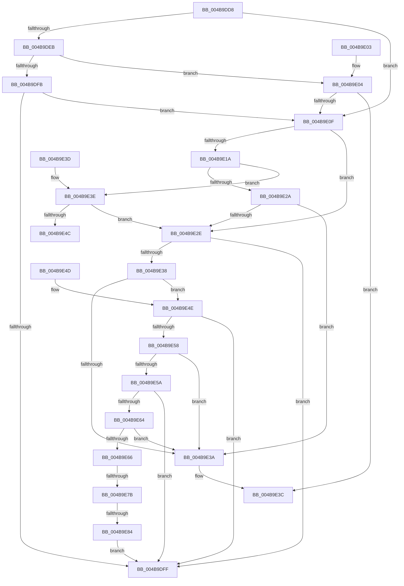

# PiDevCfgCompareDrivers

- RVA: `0x004B9DD8`–`0x004B9E89` (길이 `177` bytes)
- VA: `0x00000001404B9DD8`
- 실행 섹션: `.text`
- PDB 이름 있음: `예`; PDB Function 태그: `예`
- unwind 정보 RVA: `0x000DB714`
- 디코드: `60`개 명령, `177/177` bytes 표시
- 미해석 바이트: `0` (있으면 어셈블리에 `.byte`로 보존)

> 이 문서는 커널 이미지의 기계어와 PDB 기호를 분석해 생성했습니다. 4번과 5번은 함수 원형과 자료형을 바이너리 사용 방식에서 추정한 C 해석이며 원본 소스 복구 결과는 아닙니다.

## 1. Dependencies

- 직접 호출 지점: **0**; 고유 호출 대상: **0**
- 직접 호출자로 확인된 함수: **1**
- RIP 상대 이미지 참조: **0**

### Outgoing calls
- 직접 디코드된 call 명령이 없습니다.

### Direct callers
- [PiDevCfgFindDeviceDriver](../../page/97/PiDevCfgFindDeviceDriver_function_0097602C.md) at `0x009765E4`
- [PiDevCfgFindDeviceDriver](../../page/97/PiDevCfgFindDeviceDriver_function_0097602C.md) at `0x009768DC`
- [PiDevCfgFindDeviceDriver](../../page/97/PiDevCfgFindDeviceDriver_function_0097602C.md) at `0x00976B8F`

### Static image references
- 디코드된 RIP-relative 메모리 참조가 없습니다.

## 2. Other-region calls and transfers

- 다른 실행 섹션으로 향하는 call: **0**
- call이 아닌 외부 분기/꼬리 이동: **2**
  - `0x004B9E75` → `0x006FC406` (`tail-transfer`)
  - `0x004B9E7E` → `0x006FC40F` (`tail-transfer`)

## 3. Assembly (complete function range)

```asm
004B9DD8  4C 8D 89 B8 00 00 00            lea r9, [rcx + 0xb8]
004B9DDF  4C 8B D2                        mov r10, rdx
004B9DE2  4C 8B D9                        mov r11, rcx
004B9DE5  41 F6 C0 04                     test r8b, 4
004B9DE9  75 24                           jne 0x1404b9e0f
004B9DEB  8B 8A B8 00 00 00               mov ecx, dword ptr [rdx + 0xb8]
004B9DF1  41 8B 01                        mov eax, dword ptr [r9]
004B9DF4  83 E1 04                        and ecx, 4
004B9DF7  A8 04                           test al, 4
004B9DF9  75 09                           jne 0x1404b9e04
004B9DFB  85 C9                           test ecx, ecx
004B9DFD  74 10                           je 0x1404b9e0f
004B9DFF  83 C8 FF                        or eax, 0xffffffff
004B9E02  C3                              ret
004B9E03  CC                              int3
004B9E04  33 C0                           xor eax, eax
004B9E06  85 C9                           test ecx, ecx
004B9E08  0F 94 C0                        sete al
004B9E0B  85 C9                           test ecx, ecx
004B9E0D  74 2D                           je 0x1404b9e3c
004B9E0F  B9 01 00 00 00                  mov ecx, 1
004B9E14  41 F6 C0 02                     test r8b, 2
004B9E18  75 14                           jne 0x1404b9e2e
004B9E1A  8B 92 B8 00 00 00               mov edx, dword ptr [rdx + 0xb8]
004B9E20  41 8B 01                        mov eax, dword ptr [r9]
004B9E23  83 E2 02                        and edx, 2
004B9E26  A8 02                           test al, 2
004B9E28  75 14                           jne 0x1404b9e3e
004B9E2A  85 D2                           test edx, edx
004B9E2C  75 0C                           jne 0x1404b9e3a
004B9E2E  41 8B 43 6C                     mov eax, dword ptr [r11 + 0x6c]
004B9E32  41 3B 42 6C                     cmp eax, dword ptr [r10 + 0x6c]
004B9E36  72 C7                           jb 0x1404b9dff
004B9E38  74 14                           je 0x1404b9e4e
004B9E3A  8B C1                           mov eax, ecx
004B9E3C  C3                              ret
004B9E3D  CC                              int3
004B9E3E  8B C2                           mov eax, edx
004B9E40  F7 D8                           neg eax
004B9E42  1B C0                           sbb eax, eax
004B9E44  F7 D8                           neg eax
004B9E46  2B C1                           sub eax, ecx
004B9E48  85 D2                           test edx, edx
004B9E4A  75 E2                           jne 0x1404b9e2e
004B9E4C  C3                              ret
004B9E4D  CC                              int3
004B9E4E  49 8B 43 70                     mov rax, qword ptr [r11 + 0x70]
004B9E52  49 3B 42 70                     cmp rax, qword ptr [r10 + 0x70]
004B9E56  7F A7                           jg 0x1404b9dff
004B9E58  75 E0                           jne 0x1404b9e3a
004B9E5A  49 8B 43 78                     mov rax, qword ptr [r11 + 0x78]
004B9E5E  49 3B 42 78                     cmp rax, qword ptr [r10 + 0x78]
004B9E62  7F 9B                           jg 0x1404b9dff
004B9E64  75 D4                           jne 0x1404b9e3a
004B9E66  49 83 BB 88 00 00 00 00         cmp qword ptr [r11 + 0x88], 0
004B9E6E  49 8B 82 88 00 00 00            mov rax, qword ptr [r10 + 0x88]
004B9E75  0F 84 8B 25 24 00               je 0x1406fc406
004B9E7B  48 85 C0                        test rax, rax
004B9E7E  0F 85 8B 25 24 00               jne 0x1406fc40f
004B9E84  E9 76 FF FF FF                  jmp 0x1404b9dff
```

## 4. C-style interpretation (structured pseudocode)

```c
__int64 __fastcall PiDevCfgCompareDrivers(__int64 a1, __int64 a2, unsigned __int8 a3)
{
    __int64 result;

    if (((a3) & (4)) != 0) goto loc_004B9E0F;
    a1 = (unsigned int)(((unsigned int)(*(unsigned int *)(a2 + 184))) & (4));
    if ((((unsigned __int8)((unsigned int)(*(unsigned int *)(a1 + 184)))) & (4)) != 0) goto loc_004B9E04;
    if ((unsigned int)(a1) == 0) goto loc_004B9E0F;
loc_004B9DFF:
    result = (unsigned int)(((unsigned int)(*(unsigned int *)(a1 + 184))) | (0xFFFFFFFFULL));
    return result;
loc_004B9E04:
    result = 0;
    result = ((unsigned int)(a1) == 0) ? 1 : 0;
    if ((unsigned int)(a1) == 0) goto loc_004B9E3C;
loc_004B9E0F:
    if (((a3) & (2)) != 0) goto loc_004B9E2E;
    a2 = (unsigned int)(((unsigned int)(*(unsigned int *)(a2 + 184))) & (2));
    if ((((unsigned __int8)((unsigned int)(*(unsigned int *)(a1 + 184)))) & (2)) != 0) goto loc_004B9E3E;
    if ((unsigned int)(a2) != 0) goto loc_004B9E3A;
loc_004B9E2E:
    if (((unsigned int)((unsigned int)(*(unsigned int *)(a1 + 108)))) < (*(unsigned int *)(a2 + 108))) goto loc_004B9DFF;
    if (((unsigned int)((unsigned int)(*(unsigned int *)(a1 + 108)))) == (*(unsigned int *)(a2 + 108))) goto loc_004B9E4E;
loc_004B9E3A:
loc_004B9E3C:
    return 1;
loc_004B9E3E:
    result = (unsigned int)(-((unsigned int)((unsigned int)(a2))));
    result = (unsigned int)(-(result));
    result = (unsigned int)((result) - (1));
    if ((unsigned int)(a2) != 0) goto loc_004B9E2E;
    return result;
loc_004B9E4E:
    if ((*(unsigned __int64 *)(a1 + 112)) > (*(unsigned __int64 *)(a2 + 112))) goto loc_004B9DFF;
    if ((*(unsigned __int64 *)(a1 + 112)) != (*(unsigned __int64 *)(a2 + 112))) goto loc_004B9E3A;
    if ((*(unsigned __int64 *)(a1 + 120)) > (*(unsigned __int64 *)(a2 + 120))) goto loc_004B9DFF;
    if ((*(unsigned __int64 *)(a1 + 120)) != (*(unsigned __int64 *)(a2 + 120))) goto loc_004B9E3A;
    goto loc_004B9DFF;
}
```

## 5. (Beta) C Style

```c
int64_t PiDevCfgCompareDrivers(void *Arg1, void *Arg2, uint8_t Arg3)
{
    uint8_t *arg1 = (uint8_t *)Arg1;
    uint8_t *arg2 = (uint8_t *)Arg2;

    int64_t result;

    if (((Arg3) & (4)) != 0) goto loc_004B9E0F;
    Arg1 = (uint32_t)(((uint32_t)(*(uint32_t *)(arg2 + 0xB8))) & (4));
    if ((((uint8_t)((uint32_t)(*(uint32_t *)(arg1 + 0xB8)))) & (4)) != 0) goto loc_004B9E04;
    if ((uint32_t)(Arg1) == 0) goto loc_004B9E0F;
loc_004B9DFF:
    result = (uint32_t)(((uint32_t)(*(uint32_t *)(arg1 + 0xB8))) | (0xFFFFFFFFULL));
    return result;
loc_004B9E04:
    result = 0;
    result = ((uint32_t)(Arg1) == 0) ? 1 : 0;
    if ((uint32_t)(Arg1) == 0) goto loc_004B9E3C;
loc_004B9E0F:
    if (((Arg3) & (2)) != 0) goto loc_004B9E2E;
    Arg2 = (uint32_t)(((uint32_t)(*(uint32_t *)(arg2 + 0xB8))) & (2));
    if ((((uint8_t)((uint32_t)(*(uint32_t *)(arg1 + 0xB8)))) & (2)) != 0) goto loc_004B9E3E;
    if ((uint32_t)(Arg2) != 0) goto loc_004B9E3A;
loc_004B9E2E:
    if (((uint32_t)((uint32_t)(*(uint32_t *)(arg1 + 0x6C)))) < (*(uint32_t *)(arg2 + 0x6C))) goto loc_004B9DFF;
    if (((uint32_t)((uint32_t)(*(uint32_t *)(arg1 + 0x6C)))) == (*(uint32_t *)(arg2 + 0x6C))) goto loc_004B9E4E;
loc_004B9E3A:
loc_004B9E3C:
    return 1;
loc_004B9E3E:
    result = (uint32_t)(-((uint32_t)((uint32_t)(Arg2))));
    result = (uint32_t)(-(result));
    result = (uint32_t)((result) - (1));
    if ((uint32_t)(Arg2) != 0) goto loc_004B9E2E;
    return result;
loc_004B9E4E:
    if ((*(uint64_t *)(arg1 + 0x70)) > (*(uint64_t *)(arg2 + 0x70))) goto loc_004B9DFF;
    if ((*(uint64_t *)(arg1 + 0x70)) != (*(uint64_t *)(arg2 + 0x70))) goto loc_004B9E3A;
    if ((*(uint64_t *)(arg1 + 0x78)) > (*(uint64_t *)(arg2 + 0x78))) goto loc_004B9DFF;
    if ((*(uint64_t *)(arg1 + 0x78)) != (*(uint64_t *)(arg2 + 0x78))) goto loc_004B9E3A;
    goto loc_004B9DFF;
}
```

### 관측된 메모리 오프셋

구조체 형식이 확인되지 않은 접근은 인자 기준의 오프셋으로만 기록했습니다.

| 기준 인자 | 오프셋 표현 | 폭 (bit) | 접근 |
|---|---:|---:|---|
| `Arg1` | `+ 0x0` | `32` | `R` |
| `Arg1` | `+ 0x6C` | `32` | `R` |
| `Arg1` | `+ 0x70` | `64` | `R` |
| `Arg1` | `+ 0x78` | `64` | `R` |
| `Arg1` | `+ 0x88` | `64` | `R` |
| `Arg1` | `+ 0xB8` | `64` | `R` |
| `Arg2` | `+ 0x6C` | `32` | `R` |
| `Arg2` | `+ 0x70` | `64` | `R` |
| `Arg2` | `+ 0x78` | `64` | `R` |
| `Arg2` | `+ 0x88` | `64` | `R` |
| `Arg2` | `+ 0xB8` | `32` | `R` |

## 6. Execution-region graph

[열기: 2D/3D 그래프와 함수 탐색 컨트롤 패널](../../../control-panel.html?section=text&rva=0x004B9DD8&view=graph)

- 2D 그래프는 위에서 아래로 흐르고, 3D 그래프는 빈 공간을 드래그해 회전합니다. Shift+드래그는 이동, 휠은 확대·축소, 함수 노드 선택은 대상 보고서 이동입니다.

### Static fallback


