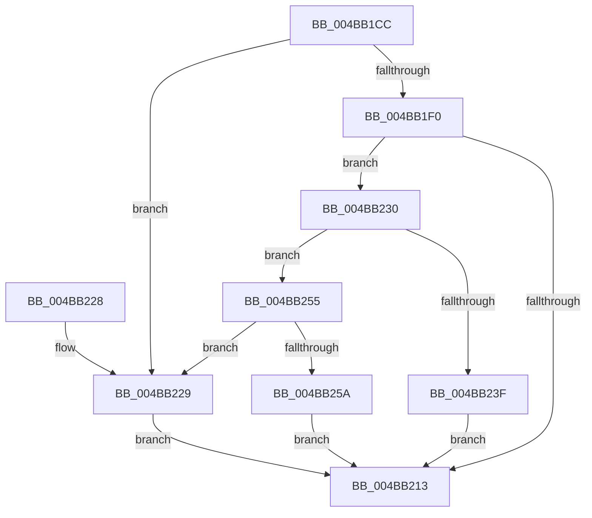

# PiDevCfgParseInterfaceKeyName

- RVA: `0x004BB1CC`–`0x004BB25F` (길이 `147` bytes)
- VA: `0x00000001404BB1CC`
- 실행 섹션: `.text`
- PDB 이름 있음: `예`; PDB Function 태그: `아니요`
- unwind 정보 RVA: `0x000BB6A0`
- 디코드: `46`개 명령, `147/147` bytes 표시
- 미해석 바이트: `0` (있으면 어셈블리에 `.byte`로 보존)

> 이 문서는 커널 이미지의 기계어와 PDB 기호를 분석해 생성했습니다. 4번과 5번은 함수 원형과 자료형을 바이너리 사용 방식에서 추정한 C 해석이며 원본 소스 복구 결과는 아닙니다.

## 1. Dependencies

- 직접 호출 지점: **1**; 고유 호출 대상: **1**
- 직접 호출자로 확인된 함수: **1**
- RIP 상대 이미지 참조: **0**

### Outgoing calls
- `0x004BB20A` → [RtlGUIDFromString](../../page/8F/RtlGUIDFromString_function_008F1EF0.md) (function, `0x008F1EF0`)

### Direct callers
- [sub_00B467A6](../../page/B4/Unknown_function_00B467A6.md) at `0x00B468C2`

### Static image references
- 디코드된 RIP-relative 메모리 참조가 없습니다.

## 2. Other-region calls and transfers

- 다른 실행 섹션으로 향하는 call: **1**
  - `0x004BB20A` → [RtlGUIDFromString](../../page/8F/RtlGUIDFromString_function_008F1EF0.md) (`.text` → `PAGE`)
- 별도 외부 분기/꼬리 이동을 확인하지 못했습니다.

## 3. Assembly (complete function range)

```asm
004BB1CC  4C 8B DC                        mov r11, rsp
004BB1CF  49 89 5B 08                     mov qword ptr [r11 + 8], rbx
004BB1D3  49 89 73 10                     mov qword ptr [r11 + 0x10], rsi
004BB1D7  57                              push rdi
004BB1D8  48 83 EC 30                     sub rsp, 0x30
004BB1DC  33 F6                           xor esi, esi
004BB1DE  48 8B D9                        mov rbx, rcx
004BB1E1  49 8B F8                        mov rdi, r8
004BB1E4  89 74 24 24                     mov dword ptr [rsp + 0x24], esi
004BB1E8  8D 4E 4C                        lea ecx, [rsi + 0x4c]
004BB1EB  66 39 0B                        cmp word ptr [rbx], cx
004BB1EE  72 39                           jb 0x1404bb229
004BB1F0  48 8B 43 08                     mov rax, qword ptr [rbx + 8]
004BB1F4  49 89 43 F0                     mov qword ptr [r11 - 0x10], rax
004BB1F8  0F B7 43 02                     movzx eax, word ptr [rbx + 2]
004BB1FC  66 89 4C 24 20                  mov word ptr [rsp + 0x20], cx
004BB201  49 8D 4B E8                     lea rcx, [r11 - 0x18]
004BB205  66 89 44 24 22                  mov word ptr [rsp + 0x22], ax
004BB20A  E8 E1 6C 43 00                  call 0x1408f1ef0
004BB20F  85 C0                           test eax, eax
004BB211  79 1D                           jns 0x1404bb230
004BB213  48 8B 5C 24 40                  mov rbx, qword ptr [rsp + 0x40]
004BB218  48 8B 74 24 48                  mov rsi, qword ptr [rsp + 0x48]
004BB21D  C1 E8 1F                        shr eax, 0x1f
004BB220  34 01                           xor al, 1
004BB222  48 83 C4 30                     add rsp, 0x30
004BB226  5F                              pop rdi
004BB227  C3                              ret
004BB228  CC                              int3
004BB229  B8 01 00 00 C0                  mov eax, 0xc0000001
004BB22E  EB E3                           jmp 0x1404bb213
004BB230  4C 8B 43 08                     mov r8, qword ptr [rbx + 8]
004BB234  41 0F B7 48 4C                  movzx ecx, word ptr [r8 + 0x4c]
004BB239  66 83 F9 23                     cmp cx, 0x23
004BB23D  75 16                           jne 0x1404bb255
004BB23F  49 83 C0 4E                     add r8, 0x4e
004BB243  41 0F B7 08                     movzx ecx, word ptr [r8]
004BB247  66 F7 D9                        neg cx
004BB24A  48 1B D2                        sbb rdx, rdx
004BB24D  49 23 D0                        and rdx, r8
004BB250  48 89 17                        mov qword ptr [rdi], rdx
004BB253  EB BE                           jmp 0x1404bb213
004BB255  66 85 C9                        test cx, cx
004BB258  75 CF                           jne 0x1404bb229
004BB25A  48 89 37                        mov qword ptr [rdi], rsi
004BB25D  EB B4                           jmp 0x1404bb213
```

## 4. C-style interpretation (structured pseudocode)

```c
__int64 __fastcall PiDevCfgParseInterfaceKeyName(__int64 a1, __int64 a2, __int64 a3)
{
    __int64 result;
    __int64 v_rsi;
    __int64 v_rsp;
    unsigned int v_stack_m14;
    unsigned __int16 v_stack_m16;
    unsigned __int16 v_stack_m18;
    unsigned __int64 v_stack_p10;
    unsigned __int64 v_stack_p8;

    *(unsigned __int64 *)(v_rsp + 8) = v_rbx;
    *(unsigned __int64 *)(v_rsp + 16) = v_rsi;
    v_rsp = (v_rsp) - (48);
    v_rsi = 0;
    v_stack_m14 = 0;
    if ((*(unsigned __int16 *)(a1)) < ((unsigned __int16)(v_rsi + 76))) goto loc_004BB229;
    *(unsigned __int64 *)(v_rsp - 16) = *(unsigned __int64 *)(a1 + 8);
    v_stack_m18 = (unsigned __int16)(v_rsi + 76);
    v_stack_m16 = (unsigned __int16)(*(unsigned __int16 *)(a1 + 2));
    result = RtlGUIDFromString(v_rsp - 24, a2, a3, a4);
    if (!sign_flag) goto loc_004BB230;
loc_004BB213:
    result = (unsigned int)((result) >> (31));
    result = (unsigned __int8)((result) ^ (1));
    v_rsp = (v_rsp) + (48);
    return result;
loc_004BB229:
    goto loc_004BB213;
loc_004BB230:
    if (((unsigned __int16)(*(unsigned __int16 *)(*(unsigned __int64 *)(v_stack_p8 + 8) + 76))) != 35) goto loc_004BB255;
    a3 = (*(unsigned __int64 *)(v_stack_p8 + 8)) + (78);
    a1 = (unsigned __int16)(-(*(unsigned __int16 *)(a3)));
    a2 = (a2) & (a3);
    *(unsigned __int64 *)(a3) = a2;
    goto loc_004BB213;
loc_004BB255:
    if ((unsigned __int16)(a1) != 0) goto loc_004BB229;
    *(unsigned __int64 *)(a3) = v_stack_p10;
    goto loc_004BB213;
}
```

## 5. (Beta) C Style

```c
int64_t PiDevCfgParseInterfaceKeyName(void *Arg1, int64_t Arg2, void *Arg3)
{
    uint8_t *arg1 = (uint8_t *)Arg1;
    uint8_t *arg3 = (uint8_t *)Arg3;

    int64_t result;
    int64_t local_rsi;
    int64_t local_rsp;
    uint32_t v_stack_m14;
    uint16_t v_stack_m16;
    uint16_t v_stack_m18;
    uint64_t v_stack_p10;
    uint64_t v_stack_p8;

    *(uint64_t *)(local_rsp + 0x8) = local_rbx;
    *(uint64_t *)(local_rsp + 0x10) = local_rsi;
    local_rsp = (local_rsp) - (48);
    local_rsi = 0;
    v_stack_m14 = 0;
    if ((*(uint16_t *)(arg1)) < ((uint16_t)(local_rsi + 76))) goto loc_004BB229;
    *(uint64_t *)(local_rsp - 0x10) = *(uint64_t *)(arg1 + 0x8);
    v_stack_m18 = (uint16_t)(local_rsi + 76);
    v_stack_m16 = (uint16_t)(*(uint16_t *)(arg1 + 0x2));
    result = RtlGUIDFromString(local_rsp - 24, Arg2, Arg3, a4);
    if (!sign_flag) goto loc_004BB230;
loc_004BB213:
    result = (uint32_t)((result) >> (31));
    result = (uint8_t)((result) ^ (1));
    local_rsp = (local_rsp) + (48);
    return result;
loc_004BB229:
    goto loc_004BB213;
loc_004BB230:
    if (((uint16_t)(*(uint16_t *)(*(uint64_t *)(v_stack_p8 + 0x8) + 0x4C))) != 35) goto loc_004BB255;
    Arg3 = (*(uint64_t *)(v_stack_p8 + 0x8)) + (78);
    Arg1 = (uint16_t)(-(*(uint16_t *)(arg3)));
    Arg2 = (Arg2) & (Arg3);
    *(uint64_t *)(arg3) = Arg2;
    goto loc_004BB213;
loc_004BB255:
    if ((uint16_t)(Arg1) != 0) goto loc_004BB229;
    *(uint64_t *)(arg3) = v_stack_p10;
    goto loc_004BB213;
}
```

### 관측된 메모리 오프셋

구조체 형식이 확인되지 않은 접근은 인자 기준의 오프셋으로만 기록했습니다.

| 기준 인자 | 오프셋 표현 | 폭 (bit) | 접근 |
|---|---:|---:|---|
| `Arg1` | `+ 0x0` | `16` | `R` |
| `Arg1` | `+ 0x2` | `16` | `R` |
| `Arg1` | `+ 0x8` | `64` | `R` |
| `Arg3` | `+ 0x0` | `64` | `W` |

## 6. Execution-region graph

[열기: 2D/3D 그래프와 함수 탐색 컨트롤 패널](../../../control-panel.html?section=text&rva=0x004BB1CC&view=graph)

- 2D 그래프는 위에서 아래로 흐르고, 3D 그래프는 빈 공간을 드래그해 회전합니다. Shift+드래그는 이동, 휠은 확대·축소, 함수 노드 선택은 대상 보고서 이동입니다.

### Static fallback


