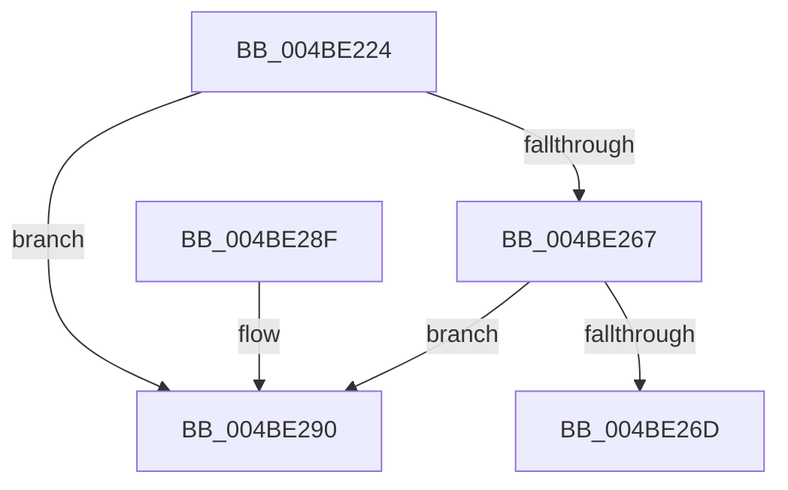

# PnpDeviceCompletionQueueGetCompletedRequest

- RVA: `0x004BE224`–`0x004BE297` (길이 `115` bytes)
- VA: `0x00000001404BE224`
- 실행 섹션: `.text`
- PDB 이름 있음: `예`; PDB Function 태그: `아니요`
- unwind 정보 RVA: `0x0008474C`
- 디코드: `29`개 명령, `115/115` bytes 표시
- 미해석 바이트: `0` (있으면 어셈블리에 `.byte`로 보존)

> 이 문서는 커널 이미지의 기계어와 PDB 기호를 분석해 생성했습니다. 4번과 5번은 함수 원형과 자료형을 바이너리 사용 방식에서 추정한 C 해석이며 원본 소스 복구 결과는 아닙니다.

## 1. Dependencies

- 직접 호출 지점: **3**; 고유 호출 대상: **3**
- 직접 호출자로 확인된 함수: **2**
- RIP 상대 이미지 참조: **4**

### Outgoing calls
- `0x004BE23F` → [KeWaitForSingleObject](../20/KeWaitForSingleObject_function_0020E6B0.md) (function, `0x0020E6B0`)
- `0x004BE24B` → [KeAcquireSpinLockRaiseToDpc](../20/KeAcquireSpinLockRaiseToDpc_function_00208470.md) (function, `0x00208470`)
- `0x004BE281` → [KeReleaseSpinLock](../39/KeReleaseSpinLock_function_00392BA0.md) (function, `0x00392BA0`)

### Direct callers
- [PipProcessDevNodeTree](../../page/8F/PipProcessDevNodeTree_function_008F9068.md) at `0x008F95CC`
- [PipProcessDevNodeTree](../../page/8F/PipProcessDevNodeTree_function_008F9068.md) at `0x008F9754`
- [PipProcessDevNodeTree](../../page/8F/PipProcessDevNodeTree_function_008F9068.md) at `0x008F9790`
- [PnpDeviceCompletionProcessCompletedRequests](../../page/8F/PnpDeviceCompletionProcessCompletedRequests_function_008FC0D0.md) at `0x008FC12C`

### Static image references
- `0x004BE230` → RVA `0x00F8C328` (`.data`; read)
- `0x004BE244` → RVA `0x00F8C348` (`.data`; read)
- `0x004BE250` → RVA `0x00F8C318` (`.data`; read)
- `0x004BE26D` → RVA `0x00F8C318` (`.data`; write)

## 2. Other-region calls and transfers

- 다른 실행 섹션으로 향하는 call: **0**
- 별도 외부 분기/꼬리 이동을 확인하지 못했습니다.

## 3. Assembly (complete function range)

```asm
004BE224  40 53                           push rbx
004BE226  48 83 EC 30                     sub rsp, 0x30
004BE22A  48 83 64 24 20 00               and qword ptr [rsp + 0x20], 0
004BE230  48 8D 0D F1 E0 AC 00            lea rcx, [rip + 0xace0f1]
004BE237  45 33 C9                        xor r9d, r9d
004BE23A  45 33 C0                        xor r8d, r8d
004BE23D  33 D2                           xor edx, edx
004BE23F  E8 6C 04 D5 FF                  call 0x14020e6b0
004BE244  48 8D 0D FD E0 AC 00            lea rcx, [rip + 0xace0fd]
004BE24B  E8 20 A2 D4 FF                  call 0x140208470
004BE250  48 8B 1D C1 E0 AC 00            mov rbx, qword ptr [rip + 0xace0c1]
004BE257  48 8D 0D BA E0 AC 00            lea rcx, [rip + 0xace0ba]
004BE25E  48 8B 13                        mov rdx, qword ptr [rbx]
004BE261  48 39 4B 08                     cmp qword ptr [rbx + 8], rcx
004BE265  75 29                           jne 0x1404be290
004BE267  48 39 5A 08                     cmp qword ptr [rdx + 8], rbx
004BE26B  75 23                           jne 0x1404be290
004BE26D  48 89 15 A4 E0 AC 00            mov qword ptr [rip + 0xace0a4], rdx
004BE274  48 89 4A 08                     mov qword ptr [rdx + 8], rcx
004BE278  8A D0                           mov dl, al
004BE27A  48 8D 0D C7 E0 AC 00            lea rcx, [rip + 0xace0c7]
004BE281  E8 1A 49 ED FF                  call 0x140392ba0
004BE286  48 8B C3                        mov rax, rbx
004BE289  48 83 C4 30                     add rsp, 0x30
004BE28D  5B                              pop rbx
004BE28E  C3                              ret
004BE28F  CC                              int3
004BE290  B9 03 00 00 00                  mov ecx, 3
004BE295  CD 29                           int 0x29
```

## 4. C-style interpretation (structured pseudocode)

```c
__int64 __fastcall PnpDeviceCompletionQueueGetCompletedRequest(__int64 a1, int a2, int a3, int a4)
{
    __int64 result;
    __int64 v_rsp;
    unsigned __int64 v_stack_m18;

    v_rsp = (v_rsp) - (48);
    a4 = 0;
    a3 = 0;
    a2 = 0;
    result = KeWaitForSingleObject(v_rip + 11329777, a2, a3, a4);
    result = KeAcquireSpinLockRaiseToDpc(v_rip + 11329789, a2, a3, a4);
    if ((*(unsigned __int64 *)(*(unsigned __int64 *)(v_rip + 11329729) + 8)) != (v_rip + 11329722)) goto loc_004BE290;
    if ((*(unsigned __int64 *)(*(unsigned __int64 *)(*(unsigned __int64 *)(v_rip + 11329729)) + 8)) != (*(unsigned __int64 *)(v_rip + 11329729))) goto loc_004BE290;
    *(unsigned __int64 *)(v_rip + 11329700) = *(unsigned __int64 *)(*(unsigned __int64 *)(v_rip + 11329729));
    *(unsigned __int64 *)(*(unsigned __int64 *)(*(unsigned __int64 *)(v_rip + 11329729)) + 8) = v_rip + 11329722;
    result = KeReleaseSpinLock(v_rip + 11329735, (unsigned __int8)(result), a3, a4);
    v_rsp = (v_rsp) + (48);
    return *(unsigned __int64 *)(v_rip + 11329729);
loc_004BE290:
    return *(unsigned __int64 *)(v_rip + 11329729);
}
```

## 5. (Beta) C Style

```c
int64_t PnpDeviceCompletionQueueGetCompletedRequest(int64_t Arg1, int32_t Arg2, int32_t Arg3, int32_t Arg4)
{
    int64_t result;
    int64_t local_rsp;
    uint64_t v_stack_m18;

    local_rsp = (local_rsp) - (48);
    Arg4 = 0;
    Arg3 = 0;
    Arg2 = 0;
    result = KeWaitForSingleObject(v_rip + 11329777, Arg2, Arg3, Arg4);
    result = KeAcquireSpinLockRaiseToDpc(v_rip + 11329789, Arg2, Arg3, Arg4);
    if ((*(uint64_t *)(*(uint64_t *)(v_rip + 0xACE0C1) + 0x8)) != (v_rip + 11329722)) goto loc_004BE290;
    if ((*(uint64_t *)(*(uint64_t *)(*(uint64_t *)(v_rip + 0xACE0C1)) + 0x8)) != (*(uint64_t *)(v_rip + 0xACE0C1))) goto loc_004BE290;
    *(uint64_t *)(v_rip + 0xACE0A4) = *(uint64_t *)(*(uint64_t *)(v_rip + 0xACE0C1));
    *(uint64_t *)(*(uint64_t *)(*(uint64_t *)(v_rip + 0xACE0C1)) + 0x8) = v_rip + 11329722;
    result = KeReleaseSpinLock(v_rip + 11329735, (uint8_t)(result), Arg3, Arg4);
    local_rsp = (local_rsp) + (48);
    return *(uint64_t *)(v_rip + 0xACE0C1);
loc_004BE290:
    return *(uint64_t *)(v_rip + 0xACE0C1);
}
```

## 6. Execution-region graph

[열기: 2D/3D 그래프와 함수 탐색 컨트롤 패널](../../../control-panel.html?section=text&rva=0x004BE224&view=graph)

- 2D 그래프는 위에서 아래로 흐르고, 3D 그래프는 빈 공간을 드래그해 회전합니다. Shift+드래그는 이동, 휠은 확대·축소, 함수 노드 선택은 대상 보고서 이동입니다.

### Static fallback


