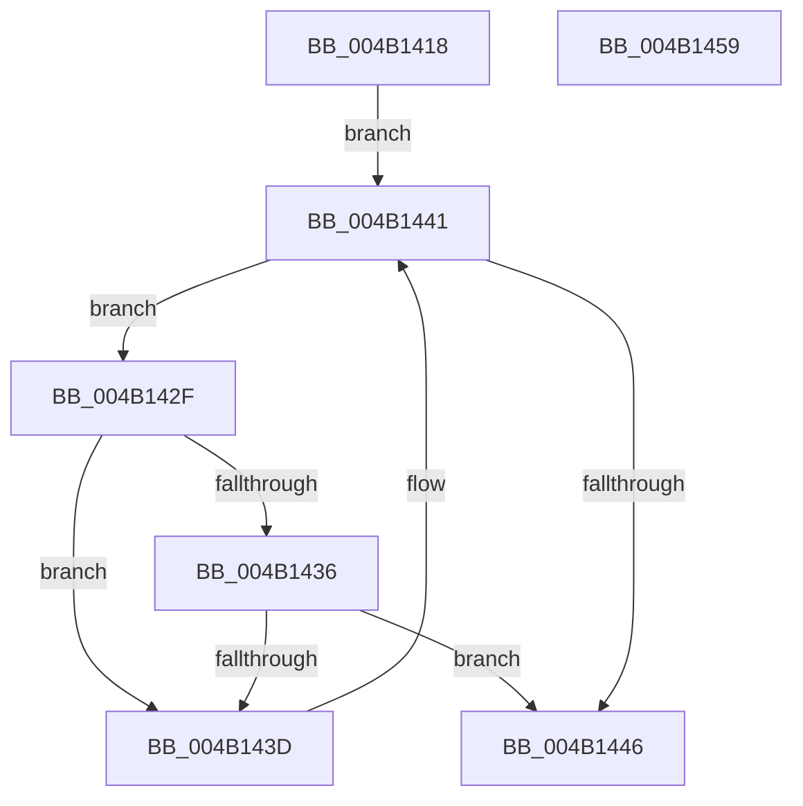

# PnpFindMountableDevice

- RVA: `0x004B1418`–`0x004B145A` (길이 `66` bytes)
- VA: `0x00000001404B1418`
- 실행 섹션: `.text`
- PDB 이름 있음: `예`; PDB Function 태그: `아니요`
- unwind 정보 RVA: `0x0005CF00`
- 디코드: `22`개 명령, `66/66` bytes 표시
- 미해석 바이트: `0` (있으면 어셈블리에 `.byte`로 보존)

> 이 문서는 커널 이미지의 기계어와 PDB 기호를 분석해 생성했습니다. 4번과 5번은 함수 원형과 자료형을 바이너리 사용 방식에서 추정한 C 해석이며 원본 소스 복구 결과는 아닙니다.

## 1. Dependencies

- 직접 호출 지점: **2**; 고유 호출 대상: **2**
- 직접 호출자로 확인된 함수: **3**
- RIP 상대 이미지 참조: **0**

### Outgoing calls
- `0x004B1426` → [KeAcquireQueuedSpinLock](../27/KeAcquireQueuedSpinLock_function_00273D80.md) (function, `0x00273D80`)
- `0x004B144B` → [KeReleaseQueuedSpinLock](../27/KeReleaseQueuedSpinLock_function_00272540.md) (function, `0x00272540`)

### Direct callers
- [PiIrpQueryRemoveDevice](../../page/73/PiIrpQueryRemoveDevice_function_0073E088.md) at `0x0073E0E0`
- [PnpQueryStopDeviceNode](../../page/73/PnpQueryStopDeviceNode_function_0073F47C.md) at `0x0073F4AC`
- [IopRemoveDevice](../../page/8F/IopRemoveDevice_function_008FC7FC.md) at `0x008FC87B`

### Static image references
- 디코드된 RIP-relative 메모리 참조가 없습니다.

## 2. Other-region calls and transfers

- 다른 실행 섹션으로 향하는 call: **0**
- 별도 외부 분기/꼬리 이동을 확인하지 못했습니다.

## 3. Assembly (complete function range)

```asm
004B1418  40 53                           push rbx
004B141A  48 83 EC 20                     sub rsp, 0x20
004B141E  48 8B D9                        mov rbx, rcx
004B1421  B9 0A 00 00 00                  mov ecx, 0xa
004B1426  E8 55 29 DC FF                  call 0x140273d80
004B142B  8A D0                           mov dl, al
004B142D  EB 12                           jmp 0x1404b1441
004B142F  8B 43 30                        mov eax, dword ptr [rbx + 0x30]
004B1432  A8 40                           test al, 0x40
004B1434  74 07                           je 0x1404b143d
004B1436  48 83 7B 38 00                  cmp qword ptr [rbx + 0x38], 0
004B143B  75 09                           jne 0x1404b1446
004B143D  48 8B 5B 18                     mov rbx, qword ptr [rbx + 0x18]
004B1441  48 85 DB                        test rbx, rbx
004B1444  75 E9                           jne 0x1404b142f
004B1446  B9 0A 00 00 00                  mov ecx, 0xa
004B144B  E8 F0 10 DC FF                  call 0x140272540
004B1450  48 8B C3                        mov rax, rbx
004B1453  48 83 C4 20                     add rsp, 0x20
004B1457  5B                              pop rbx
004B1458  C3                              ret
004B1459  CC                              int3
```

## 4. C-style interpretation (structured pseudocode)

```c
__int64 __fastcall PnpFindMountableDevice(__int64 a1)
{
    __int64 result;
    __int64 v_rsp;

    v_rsp = (v_rsp) - (32);
    result = KeAcquireQueuedSpinLock(10, a2, a3, a4);
    goto loc_004B1441;
loc_004B142F:
    if ((((unsigned __int8)((unsigned int)(*(unsigned int *)(a1 + 48)))) & (64)) == 0) goto loc_004B143D;
    if ((*(unsigned __int64 *)(a1 + 56)) != 0) goto loc_004B1446;
loc_004B143D:
loc_004B1441:
    if (*(unsigned __int64 *)(a1 + 24) != 0) goto loc_004B142F;
loc_004B1446:
    result = KeReleaseQueuedSpinLock(10, (unsigned __int8)(result), a3, a4);
    v_rsp = (v_rsp) + (32);
    return *(unsigned __int64 *)(a1 + 24);
}
```

## 5. (Beta) C Style

```c
int64_t PnpFindMountableDevice(int64_t Arg1)
{
    int64_t result;
    int64_t local_rsp;

    local_rsp = (local_rsp) - (32);
    result = KeAcquireQueuedSpinLock(10, a2, a3, a4);
    goto loc_004B1441;
loc_004B142F:
    if ((((uint8_t)((uint32_t)(*(uint32_t *)(Arg1 + 0x30)))) & (64)) == 0) goto loc_004B143D;
    if ((*(uint64_t *)(Arg1 + 0x38)) != 0) goto loc_004B1446;
loc_004B143D:
loc_004B1441:
    if (*(uint64_t *)(Arg1 + 0x18) != 0) goto loc_004B142F;
loc_004B1446:
    result = KeReleaseQueuedSpinLock(10, (uint8_t)(result), a3, a4);
    local_rsp = (local_rsp) + (32);
    return *(uint64_t *)(Arg1 + 0x18);
}
```

## 6. Execution-region graph

[열기: 2D/3D 그래프와 함수 탐색 컨트롤 패널](../../../control-panel.html?section=text&rva=0x004B1418&view=graph)

- 2D 그래프는 위에서 아래로 흐르고, 3D 그래프는 빈 공간을 드래그해 회전합니다. Shift+드래그는 이동, 휠은 확대·축소, 함수 노드 선택은 대상 보고서 이동입니다.

### Static fallback


