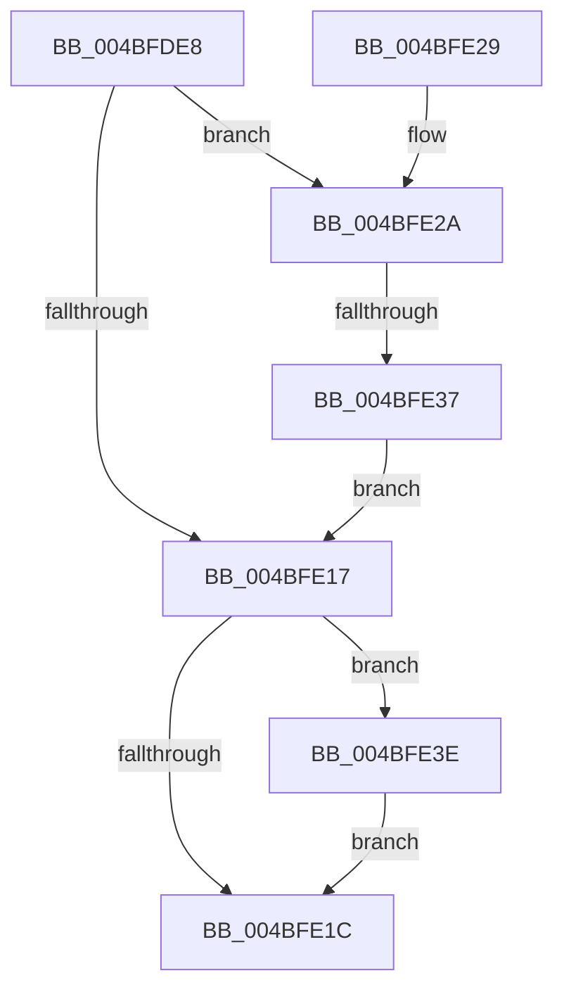

# PnpGetRegistryDword

- RVA: `0x004BFDE8`–`0x004BFE47` (길이 `95` bytes)
- VA: `0x00000001404BFDE8`
- 실행 섹션: `.text`
- PDB 이름 있음: `예`; PDB Function 태그: `예`
- unwind 정보 RVA: `0x00068A5C`
- 디코드: `29`개 명령, `95/95` bytes 표시
- 미해석 바이트: `0` (있으면 어셈블리에 `.byte`로 보존)

> 이 문서는 커널 이미지의 기계어와 PDB 기호를 분석해 생성했습니다. 4번과 5번은 함수 원형과 자료형을 바이너리 사용 방식에서 추정한 C 해석이며 원본 소스 복구 결과는 아닙니다.

## 1. Dependencies

- 직접 호출 지점: **3**; 고유 호출 대상: **3**
- 직접 호출자로 확인된 함수: **5**
- RIP 상대 이미지 참조: **0**

### Outgoing calls
- `0x004BFE07` → [IopGetRegistryValue](../../page/99/IopGetRegistryValue_function_009990EC.md) (function, `0x009990EC`)
- `0x004BFE2A` → [PnpValidateRegistryDword](../4D/PnpValidateRegistryDword_function_004D109C.md) (function, `0x004D109C`)
- `0x004BFE40` → [ExFreePoolWithTag](../../poolcode/B8/ExFreePoolWithTag_function_00B82870.md) (function, `0x00B82870`)

### Direct callers
- [PipDmgGetDeviceDmarRegistryValue](../../page/73/PipDmgGetDeviceDmarRegistryValue_function_007307F0.md) at `0x0073087A`
- [PipDmgGetDeviceDmarRegistryValue](../../page/73/PipDmgGetDeviceDmarRegistryValue_function_007307F0.md) at `0x0073088E`
- [PipDmgGetDriverDmarCompatLevel](../../page/AA/PipDmgGetDriverDmarCompatLevel_function_00AA0A40.md) at `0x00AA0AF1`
- [IopInitializePlugPlayServices](../../init/C2/IopInitializePlugPlayServices_function_00C2F298.md) at `0x00C2F71C`
- [IopInitializePlugPlayServices](../../init/C2/IopInitializePlugPlayServices_function_00C2F298.md) at `0x00C2F752`
- [PnpInitializePnpWatchdogs](../../init/C3/PnpInitializePnpWatchdogs_function_00C3357C.md) at `0x00C335AE`
- [PnpInitializePnpWatchdogs](../../init/C3/PnpInitializePnpWatchdogs_function_00C3357C.md) at `0x00C335E6`
- [PnpInitializePnpWatchdogs](../../init/C3/PnpInitializePnpWatchdogs_function_00C3357C.md) at `0x00C3361C`
- [PiUEventProcessRegistry](../../init/C3/PiUEventProcessRegistry_function_00C33EC0.md) at `0x00C33EE6`
- [PiUEventProcessRegistry](../../init/C3/PiUEventProcessRegistry_function_00C33EC0.md) at `0x00C33F32`
- [PiUEventProcessRegistry](../../init/C3/PiUEventProcessRegistry_function_00C33EC0.md) at `0x00C33F79`
- [PiUEventProcessRegistry](../../init/C3/PiUEventProcessRegistry_function_00C33EC0.md) at `0x00C33FC4`

### Static image references
- 디코드된 RIP-relative 메모리 참조가 없습니다.

## 2. Other-region calls and transfers

- 다른 실행 섹션으로 향하는 call: **2**
  - `0x004BFE07` → [IopGetRegistryValue](../../page/99/IopGetRegistryValue_function_009990EC.md) (`.text` → `PAGE`)
  - `0x004BFE40` → [ExFreePoolWithTag](../../poolcode/B8/ExFreePoolWithTag_function_00B82870.md) (`.text` → `POOLCODE`)
- call이 아닌 외부 분기/꼬리 이동: **1**
  - `0x004BFE31` → [sub_006FCBE8](../6F/Unknown_function_006FCBE8.md) (`tail-transfer`)

## 3. Assembly (complete function range)

```asm
004BFDE8  48 89 5C 24 08                  mov qword ptr [rsp + 8], rbx
004BFDED  57                              push rdi
004BFDEE  48 83 EC 20                     sub rsp, 0x20
004BFDF2  41 83 20 00                     and dword ptr [r8], 0
004BFDF6  4C 8D 4C 24 40                  lea r9, [rsp + 0x40]
004BFDFB  48 83 64 24 40 00               and qword ptr [rsp + 0x40], 0
004BFE01  49 8B F8                        mov rdi, r8
004BFE04  45 33 C0                        xor r8d, r8d
004BFE07  E8 E0 92 4D 00                  call 0x1409990ec
004BFE0C  48 8B 4C 24 40                  mov rcx, qword ptr [rsp + 0x40]
004BFE11  8B D8                           mov ebx, eax
004BFE13  85 C0                           test eax, eax
004BFE15  79 13                           jns 0x1404bfe2a
004BFE17  48 85 C9                        test rcx, rcx
004BFE1A  75 22                           jne 0x1404bfe3e
004BFE1C  8B C3                           mov eax, ebx
004BFE1E  48 8B 5C 24 30                  mov rbx, qword ptr [rsp + 0x30]
004BFE23  48 83 C4 20                     add rsp, 0x20
004BFE27  5F                              pop rdi
004BFE28  C3                              ret
004BFE29  CC                              int3
004BFE2A  E8 6D 12 01 00                  call 0x1404d109c
004BFE2F  84 C0                           test al, al
004BFE31  0F 85 B1 CD 23 00               jne 0x1406fcbe8
004BFE37  BB 29 02 00 C0                  mov ebx, 0xc0000229
004BFE3C  EB D9                           jmp 0x1404bfe17
004BFE3E  33 D2                           xor edx, edx
004BFE40  E8 2B 2A 6C 00                  call 0x140b82870
004BFE45  EB D5                           jmp 0x1404bfe1c
```

## 4. C-style interpretation (structured pseudocode)

```c
__int64 __fastcall PnpGetRegistryDword(__int64 a1, int a2, __int64 a3)
{
    __int64 result;
    __int64 v_rsp;
    unsigned __int64 v_stack_p18;
    unsigned __int64 v_stack_p8;

    v_stack_p8 = v_rbx;
    v_rsp = (v_rsp) - (32);
    a3 = 0;
    result = IopGetRegistryValue(a1, a2, a3, v_stack_p18);
    if (!sign_flag) goto loc_004BFE2A;
loc_004BFE17:
    if (v_stack_p18 != 0) goto loc_004BFE3E;
loc_004BFE1C:
    v_rsp = (v_rsp) + (32);
    return (unsigned int)((unsigned int)((unsigned int)((unsigned int)(result))));
loc_004BFE2A:
    result = PnpValidateRegistryDword(v_stack_p18, a2, a3, v_stack_p18);
    goto loc_004BFE17;
loc_004BFE3E:
    a2 = 0;
    result = ExFreePoolWithTag(v_stack_p18, a2, a3, v_stack_p18);
    goto loc_004BFE1C;
}
```

## 5. (Beta) C Style

```c
int64_t PnpGetRegistryDword(int64_t Arg1, int32_t Arg2, void *Arg3)
{
    uint8_t *arg3 = (uint8_t *)Arg3;

    int64_t result;
    int64_t local_rsp;
    uint64_t v_stack_p18;
    uint64_t v_stack_p8;

    v_stack_p8 = local_rbx;
    local_rsp = (local_rsp) - (32);
    Arg3 = 0;
    result = IopGetRegistryValue(Arg1, Arg2, Arg3, v_stack_p18);
    if (!sign_flag) goto loc_004BFE2A;
loc_004BFE17:
    if (v_stack_p18 != 0) goto loc_004BFE3E;
loc_004BFE1C:
    local_rsp = (local_rsp) + (32);
    return (uint32_t)((uint32_t)((uint32_t)((uint32_t)(result))));
loc_004BFE2A:
    result = PnpValidateRegistryDword(v_stack_p18, Arg2, Arg3, v_stack_p18);
    goto loc_004BFE17;
loc_004BFE3E:
    Arg2 = 0;
    result = ExFreePoolWithTag(v_stack_p18, Arg2, Arg3, v_stack_p18);
    goto loc_004BFE1C;
}
```

### 관측된 메모리 오프셋

구조체 형식이 확인되지 않은 접근은 인자 기준의 오프셋으로만 기록했습니다.

| 기준 인자 | 오프셋 표현 | 폭 (bit) | 접근 |
|---|---:|---:|---|
| `Arg3` | `+ 0x0` | `32` | `R/W` |

## 6. Execution-region graph

[열기: 2D/3D 그래프와 함수 탐색 컨트롤 패널](../../../control-panel.html?section=text&rva=0x004BFDE8&view=graph)

- 2D 그래프는 위에서 아래로 흐르고, 3D 그래프는 빈 공간을 드래그해 회전합니다. Shift+드래그는 이동, 휠은 확대·축소, 함수 노드 선택은 대상 보고서 이동입니다.

### Static fallback


