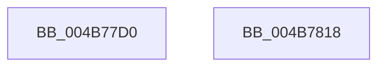

# PnpIrpDeviceEnumerated

- RVA: `0x004B77D0`–`0x004B7819` (길이 `73` bytes)
- VA: `0x00000001404B77D0`
- 실행 섹션: `.text`
- PDB 이름 있음: `예`; PDB Function 태그: `아니요`
- unwind 정보 RVA: `0x000BA960`
- 디코드: `18`개 명령, `73/73` bytes 표시
- 미해석 바이트: `0` (있으면 어셈블리에 `.byte`로 보존)

> 이 문서는 커널 이미지의 기계어와 PDB 기호를 분석해 생성했습니다. 4번과 5번은 함수 원형과 자료형을 바이너리 사용 방식에서 추정한 C 해석이며 원본 소스 복구 결과는 아닙니다.

## 1. Dependencies

- 직접 호출 지점: **2**; 고유 호출 대상: **2**
- 직접 호출자로 확인된 함수: **1**
- RIP 상대 이미지 참조: **0**

### Outgoing calls
- `0x004B77E7` → [memset](../6C/memset_function_006C6C40.md) (function, `0x006C6C40`)
- `0x004B780A` → [IopSynchronousCall](../../page/8F/IopSynchronousCall_function_008FB018.md) (function, `0x008FB018`)

### Direct callers
- [PiProcessNewDeviceNode](../../page/A2/PiProcessNewDeviceNode_function_00A28F20.md) at `0x00A2A332`

### Static image references
- 디코드된 RIP-relative 메모리 참조가 없습니다.

## 2. Other-region calls and transfers

- 다른 실행 섹션으로 향하는 call: **1**
  - `0x004B780A` → [IopSynchronousCall](../../page/8F/IopSynchronousCall_function_008FB018.md) (`.text` → `PAGE`)
- 별도 외부 분기/꼬리 이동을 확인하지 못했습니다.

## 3. Assembly (complete function range)

```asm
004B77D0  40 53                           push rbx
004B77D2  48 81 EC 80 00 00 00            sub rsp, 0x80
004B77D9  33 D2                           xor edx, edx
004B77DB  48 8B D9                        mov rbx, rcx
004B77DE  48 8D 4C 24 30                  lea rcx, [rsp + 0x30]
004B77E3  44 8D 42 48                     lea r8d, [rdx + 0x48]
004B77E7  E8 54 F4 20 00                  call 0x1406c6c40
004B77EC  48 83 64 24 20 00               and qword ptr [rsp + 0x20], 0
004B77F2  48 8D 54 24 30                  lea rdx, [rsp + 0x30]
004B77F7  45 33 C9                        xor r9d, r9d
004B77FA  66 C7 44 24 30 1B 19            mov word ptr [rsp + 0x30], 0x191b
004B7801  41 B8 BB 00 00 C0               mov r8d, 0xc00000bb
004B7807  48 8B CB                        mov rcx, rbx
004B780A  E8 09 38 44 00                  call 0x1408fb018
004B780F  48 81 C4 80 00 00 00            add rsp, 0x80
004B7816  5B                              pop rbx
004B7817  C3                              ret
004B7818  CC                              int3
```

## 4. C-style interpretation (structured pseudocode)

```c
__int64 __fastcall PnpIrpDeviceEnumerated(__int64 a1, int a2, __int64 a3, int a4)
{
    __int64 result;
    __int64 v_rsp;
    unsigned __int64 v_stack_m58;
    unsigned __int64 v_stack_m68;

    v_rsp = (v_rsp) - (128);
    a2 = 0;
    result = memset(v_stack_m58, a2, a2 + 72, a4);
    a4 = 0;
    v_stack_m58 = 0x191BULL;
    result = IopSynchronousCall(a1, v_stack_m58, (unsigned int)(0xC00000BBULL), a4);
    v_rsp = (v_rsp) + (128);
    return result;
}
```

## 5. (Beta) C Style

```c
int64_t PnpIrpDeviceEnumerated(int64_t Arg1, int32_t Arg2, int64_t Arg3, int32_t Arg4)
{
    int64_t result;
    int64_t local_rsp;
    uint64_t v_stack_m58;
    uint64_t v_stack_m68;

    local_rsp = (local_rsp) - (128);
    Arg2 = 0;
    result = memset(v_stack_m58, Arg2, Arg2 + 72, Arg4);
    Arg4 = 0;
    v_stack_m58 = 0x191BULL;
    result = IopSynchronousCall(Arg1, v_stack_m58, (uint32_t)(0xC00000BBULL), Arg4);
    local_rsp = (local_rsp) + (128);
    return result;
}
```

## 6. Execution-region graph

[열기: 2D/3D 그래프와 함수 탐색 컨트롤 패널](../../../control-panel.html?section=text&rva=0x004B77D0&view=graph)

- 2D 그래프는 위에서 아래로 흐르고, 3D 그래프는 빈 공간을 드래그해 회전합니다. Shift+드래그는 이동, 휠은 확대·축소, 함수 노드 선택은 대상 보고서 이동입니다.

### Static fallback


