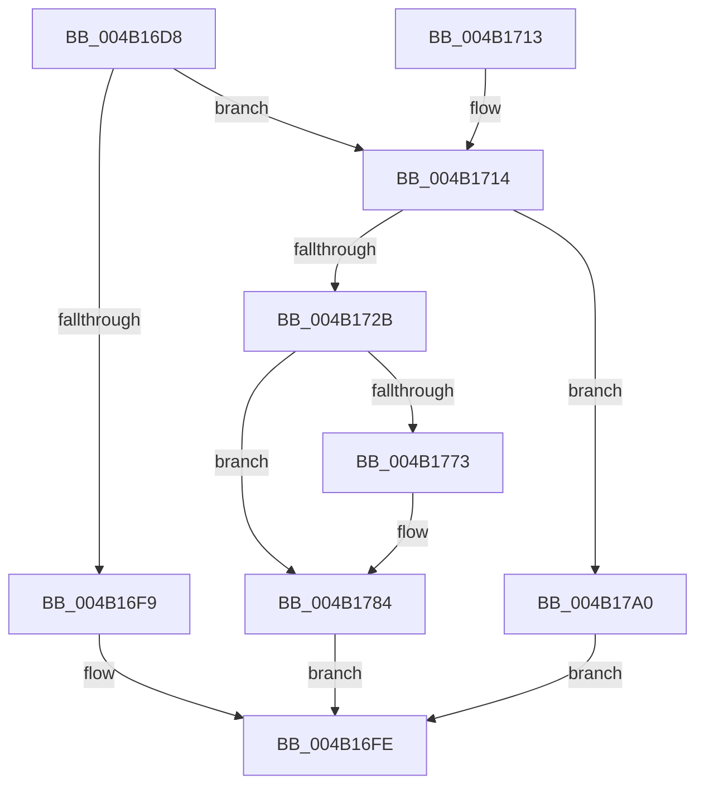

# PnpSetDeviceInstanceRemovalEvent

- RVA: `0x004B16D8`–`0x004B17AA` (길이 `210` bytes)
- VA: `0x00000001404B16D8`
- 실행 섹션: `.text`
- PDB 이름 있음: `예`; PDB Function 태그: `아니요`
- unwind 정보 RVA: `0x0008323C`
- 디코드: `49`개 명령, `210/210` bytes 표시
- 미해석 바이트: `0` (있으면 어셈블리에 `.byte`로 보존)

> 이 문서는 커널 이미지의 기계어와 PDB 기호를 분석해 생성했습니다. 4번과 5번은 함수 원형과 자료형을 바이너리 사용 방식에서 추정한 C 해석이며 원본 소스 복구 결과는 아닙니다.

## 1. Dependencies

- 직접 호출 지점: **3**; 고유 호출 대상: **3**
- 직접 호출자로 확인된 함수: **1**
- RIP 상대 이미지 참조: **2**

### Outgoing calls
- `0x004B171E` → [PnpCreateDeviceEventEntry](../../page/95/PnpCreateDeviceEventEntry_function_00951B48.md) (function, `0x00951B48`)
- `0x004B177F` → [memcpy](../6C/memcpy_function_006C6840.md) (function, `0x006C6840`)
- `0x004B1796` → [PnpInsertEventInQueue](../../page/95/PnpInsertEventInQueue_function_00951B78.md) (function, `0x00951B78`)

### Direct callers
- [PnpUnlinkDeviceRemovalRelations](../../page/A0/PnpUnlinkDeviceRemovalRelations_function_00A063D8.md) at `0x00A065B4`

### Static image references
- `0x004B16F1` → RVA `0x00F8C5E4` (`.data`; read)
- `0x004B172B` → RVA `0x0001C148` (`.rdata`; read)

## 2. Other-region calls and transfers

- 다른 실행 섹션으로 향하는 call: **2**
  - `0x004B171E` → [PnpCreateDeviceEventEntry](../../page/95/PnpCreateDeviceEventEntry_function_00951B48.md) (`.text` → `PAGE`)
  - `0x004B1796` → [PnpInsertEventInQueue](../../page/95/PnpInsertEventInQueue_function_00951B78.md) (`.text` → `PAGE`)
- 별도 외부 분기/꼬리 이동을 확인하지 못했습니다.

## 3. Assembly (complete function range)

```asm
004B16D8  48 89 5C 24 08                  mov qword ptr [rsp + 8], rbx
004B16DD  48 89 6C 24 10                  mov qword ptr [rsp + 0x10], rbp
004B16E2  48 89 74 24 18                  mov qword ptr [rsp + 0x18], rsi
004B16E7  57                              push rdi
004B16E8  48 83 EC 20                     sub rsp, 0x20
004B16EC  33 ED                           xor ebp, ebp
004B16EE  48 8B F9                        mov rdi, rcx
004B16F1  39 2D ED AE AD 00               cmp dword ptr [rip + 0xadaeed], ebp
004B16F7  74 1B                           je 0x1404b1714
004B16F9  B8 89 01 00 C0                  mov eax, 0xc0000189
004B16FE  48 8B 5C 24 30                  mov rbx, qword ptr [rsp + 0x30]
004B1703  48 8B 6C 24 38                  mov rbp, qword ptr [rsp + 0x38]
004B1708  48 8B 74 24 40                  mov rsi, qword ptr [rsp + 0x40]
004B170D  48 83 C4 20                     add rsp, 0x20
004B1711  5F                              pop rdi
004B1712  C3                              ret
004B1713  CC                              int3
004B1714  0F B7 71 28                     movzx esi, word ptr [rcx + 0x28]
004B1718  83 C6 52                        add esi, 0x52
004B171B  8D 4E 78                        lea ecx, [rsi + 0x78]
004B171E  E8 25 04 4A 00                  call 0x140951b48
004B1723  48 8B D8                        mov rbx, rax
004B1726  48 85 C0                        test rax, rax
004B1729  74 75                           je 0x1404b17a0
004B172B  0F 10 05 16 AA B6 FF            movups xmm0, xmmword ptr [rip - 0x4955ea]
004B1732  48 89 68 18                     mov qword ptr [rax + 0x18], rbp
004B1736  89 68 10                        mov dword ptr [rax + 0x10], ebp
004B1739  F3 0F 7F 40 78                  movdqu xmmword ptr [rax + 0x78], xmm0
004B173E  48 89 68 30                     mov qword ptr [rax + 0x30], rbp
004B1742  48 89 68 38                     mov qword ptr [rax + 0x38], rbp
004B1746  C7 80 88 00 00 00 0A 00 00 00   mov dword ptr [rax + 0x88], 0xa
004B1750  48 89 A8 90 00 00 00            mov qword ptr [rax + 0x90], rbp
004B1757  89 A8 98 00 00 00               mov dword ptr [rax + 0x98], ebp
004B175D  89 B0 9C 00 00 00               mov dword ptr [rax + 0x9c], esi
004B1763  48 89 A8 A0 00 00 00            mov qword ptr [rax + 0xa0], rbp
004B176A  48 8B 57 30                     mov rdx, qword ptr [rdi + 0x30]
004B176E  48 85 D2                        test rdx, rdx
004B1771  74 11                           je 0x1404b1784
004B1773  44 0F B7 47 28                  movzx r8d, word ptr [rdi + 0x28]
004B1778  48 8D 88 A8 00 00 00            lea rcx, [rax + 0xa8]
004B177F  E8 BC 50 21 00                  call 0x1406c6840
004B1784  0F B7 47 28                     movzx eax, word ptr [rdi + 0x28]
004B1788  48 8B CB                        mov rcx, rbx
004B178B  48 D1 E8                        shr rax, 1
004B178E  66 89 AC 43 A8 00 00 00         mov word ptr [rbx + rax*2 + 0xa8], bp
004B1796  E8 DD 03 4A 00                  call 0x140951b78
004B179B  E9 5E FF FF FF                  jmp 0x1404b16fe
004B17A0  B8 9A 00 00 C0                  mov eax, 0xc000009a
004B17A5  E9 54 FF FF FF                  jmp 0x1404b16fe
```

## 4. C-style interpretation (structured pseudocode)

```c
__int64 __fastcall PnpSetDeviceInstanceRemovalEvent(__int64 a1)
{
    __int64 result;
    __int64 v_rbp;
    __int64 v_rsi;
    __int64 v_rsp;
    unsigned __int64 v_stack_p10;
    unsigned __int64 v_stack_p18;
    unsigned __int64 v_stack_p8;

    v_stack_p8 = v_rbx;
    v_stack_p10 = v_rbp;
    v_stack_p18 = v_rsi;
    v_rsp = (v_rsp) - (32);
    v_rbp = 0;
    if ((*(unsigned int *)(v_rip + 11382509)) == 0) goto loc_004B1714;
loc_004B16FE:
    v_rsp = (v_rsp) + (32);
    return (unsigned int)(0xC0000189ULL);
loc_004B1714:
    v_rsi = (unsigned int)((*(unsigned __int16 *)(a1 + 40)) + (82));
    result = PnpCreateDeviceEventEntry(v_rsi + 120, a2, a3, a4);
    if (result == 0) goto loc_004B17A0;
    *(unsigned __int64 *)(result + 24) = v_stack_p10;
    *(unsigned int *)(result + 16) = (unsigned int)(v_stack_p10);
    *(unsigned __int64 *)(result + 120) = v_xmm0;
    *(unsigned __int64 *)(result + 48) = v_stack_p10;
    *(unsigned __int64 *)(result + 56) = v_stack_p10;
    *(unsigned int *)(result + 136) = 10;
    *(unsigned __int64 *)(result + 144) = v_stack_p10;
    *(unsigned int *)(result + 152) = (unsigned int)(v_stack_p10);
    *(unsigned int *)(result + 156) = (unsigned int)(v_rsi);
    *(unsigned __int64 *)(result + 160) = v_stack_p10;
    if (*(unsigned __int64 *)(a1 + 48) != 0) {
        a3 = *(unsigned __int16 *)(a1 + 40);
        a1 = result + 168;
        result = memcpy(a1, *(unsigned __int64 *)(a1 + 48), a3, a4);
    }
    result = (*(unsigned __int16 *)(a1 + 40)) >> (1);
    *(unsigned __int16 *)(result + result * 2 + 168) = (unsigned __int16)(v_stack_p10);
    result = PnpInsertEventInQueue(result, *(unsigned __int64 *)(a1 + 48), a3, a4);
    goto loc_004B16FE;
loc_004B17A0:
    goto loc_004B16FE;
}
```

## 5. (Beta) C Style

```c
int64_t PnpSetDeviceInstanceRemovalEvent(void *Arg1)
{
    uint8_t *arg1 = (uint8_t *)Arg1;

    int64_t result;
    int64_t local_rbp;
    int64_t local_rsi;
    int64_t local_rsp;
    uint64_t v_stack_p10;
    uint64_t v_stack_p18;
    uint64_t v_stack_p8;

    v_stack_p8 = local_rbx;
    v_stack_p10 = local_rbp;
    v_stack_p18 = local_rsi;
    local_rsp = (local_rsp) - (32);
    local_rbp = 0;
    if ((*(uint32_t *)(v_rip + 0xADAEED)) == 0) goto loc_004B1714;
loc_004B16FE:
    local_rsp = (local_rsp) + (32);
    return (uint32_t)(0xC0000189ULL);
loc_004B1714:
    local_rsi = (uint32_t)((*(uint16_t *)(arg1 + 0x28)) + (82));
    result = PnpCreateDeviceEventEntry(local_rsi + 120, a2, a3, a4);
    if (result == 0) goto loc_004B17A0;
    *(uint64_t *)(result + 0x18) = v_stack_p10;
    *(uint32_t *)(result + 0x10) = (uint32_t)(v_stack_p10);
    *(uint64_t *)(result + 0x78) = v_xmm0;
    *(uint64_t *)(result + 0x30) = v_stack_p10;
    *(uint64_t *)(result + 0x38) = v_stack_p10;
    *(uint32_t *)(result + 0x88) = 10;
    *(uint64_t *)(result + 0x90) = v_stack_p10;
    *(uint32_t *)(result + 0x98) = (uint32_t)(v_stack_p10);
    *(uint32_t *)(result + 0x9C) = (uint32_t)(local_rsi);
    *(uint64_t *)(result + 0xA0) = v_stack_p10;
    if (*(uint64_t *)(arg1 + 0x30) != 0) {
        a3 = *(uint16_t *)(arg1 + 0x28);
        Arg1 = result + 168;
        result = memcpy(Arg1, *(uint64_t *)(arg1 + 0x30), a3, a4);
    }
    result = (*(uint16_t *)(arg1 + 0x28)) >> (1);
    *(uint16_t *)(result + result * 2 + 0xA8) = (uint16_t)(v_stack_p10);
    result = PnpInsertEventInQueue(result, *(uint64_t *)(arg1 + 0x30), a3, a4);
    goto loc_004B16FE;
loc_004B17A0:
    goto loc_004B16FE;
}
```

### 관측된 메모리 오프셋

구조체 형식이 확인되지 않은 접근은 인자 기준의 오프셋으로만 기록했습니다.

| 기준 인자 | 오프셋 표현 | 폭 (bit) | 접근 |
|---|---:|---:|---|
| `Arg1` | `+ 0x28` | `16` | `R` |
| `Arg1` | `+ 0x30` | `64` | `R` |

## 6. Execution-region graph

[열기: 2D/3D 그래프와 함수 탐색 컨트롤 패널](../../../control-panel.html?section=text&rva=0x004B16D8&view=graph)

- 2D 그래프는 위에서 아래로 흐르고, 3D 그래프는 빈 공간을 드래그해 회전합니다. Shift+드래그는 이동, 휠은 확대·축소, 함수 노드 선택은 대상 보고서 이동입니다.

### Static fallback


